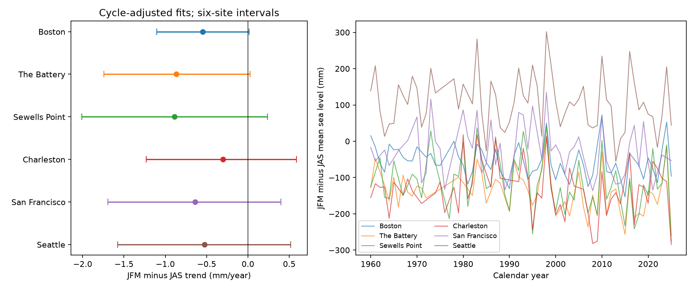

# Winter-minus-summer sea-level trends remained uncertain at six US gauges in cycle-adjusted 1960-2025 fits

## Question and main result

Did January-March (JFM) mean sea level change relative to July-September (JAS) at six US gauges? All primary trend estimates were negative. All six primary intervals included zero after the joint test rule. This leaves each site trend uncertain under that rule. It does not show that the trends are zero. The negative point estimates are not six independent replications. Weather and ocean changes can affect several sites at once.

The contrast is C = mean(JFM MSL) - mean(JAS MSL). The table gives mm/year. Intervals use five-year residual sign blocks and a Bonferroni adjustment for six sites. Coverage is approximate and model-based.

| Site | Complete years | First year | C trend | Six-site interval | Marginal 95% interval |
|---|---:|---:|---:|---:|---:|
| Boston | 60 | 1960 | -0.549 | -1.106 to 0.011 | -1.004 to -0.088 |
| The Battery | 56 | 1960 | -0.866 | -1.742 to 0.028 | -1.531 to -0.197 |
| Sewells Point | 61 | 1960 | -0.891 | -2.010 to 0.235 | -1.711 to -0.073 |
| Charleston | 58 | 1960 | -0.304 | -1.231 to 0.588 | -1.007 to 0.385 |
| San Francisco | 57 | 1960 | -0.639 | -1.693 to 0.398 | -1.483 to 0.196 |
| Seattle | 63 | 1960 | -0.523 | -1.577 to 0.518 | -1.298 to 0.236 |



Boston, The Battery, and Sewells Point have negative marginal intervals. Their six-site intervals cross zero, in two cases by small amounts. The result is sensitive to the test rule. No sharp distinction in physical behavior follows from that cutoff.

## Prior work and added value

Barroso et al. (2024), [doi:10.1029/2023JC020300](https://doi.org/10.1029/2023JC020300), studied annual amplitude and phase at 798 gauges. They found changes at many sites. Yang and Chen (2025), [doi:10.1029/2024GL112273](https://doi.org/10.1029/2024GL112273), found stronger seasonal variation on the Mid-Atlantic coast after 2000. Their wind model tests support a coastal wind effect. We do not test that explanation here.

We searched the signed campaign for Earth-system terms, Ridgecrest, and seasonal sea level before fixing this question. We read the seasonal daily range report (28433e6e) and the high-minus-low offset report (88e63aaa), cited in sci.json. The first tests a different water-level statistic. The second uses these six monthly sources. Our added result is a fixed winter-minus-summer mean-level test with joint error control, time-span checks, and complete evidence. It is a small update and diagnostic benchmark, not the first report of changing seasonal sea level. No private worker space was read.

## Data and selection

We read six existing monthly_mean NOAA JSON snapshots in place. We made no download or change to the shared store. Their exact paths are /mnt/dell-data/shared_datasets/noaa-coops-STATION-monthly-1960-2025-msl-lst-20261108/data.json. Stations are 8443970, 8518750, 8638610, 8665530, 9414290, and 9447130. files/provenance.json records all absolute paths, full SHA-256 hashes, byte counts, source URLs, saved download times, and site names. All six hashes matched before analysis. This is a fixed 20261108 query snapshot, not an immutable NOAA release.

Queries use product=monthly_mean, datum=MSL, units=metric, and time_zone=lst. NOAA defines MSL as mean sea level and inferred as an inferred-data field. See [API](https://api.tidesandcurrents.noaa.gov/api/prod/) and [response definitions](https://api.tidesandcurrents.noaa.gov/api/prod/responseHelp.html). The flag does not give full within-month coverage. We keep finite MSL and inferred=0, then require all 12 distinct months in a calendar year. No gap is filled. We exclude January 2026, which is present in each source despite the query end date. The saved monthly table has all 4,744 source records, including rejected records. The accepted table has 355 station-years. All sites end in 2025. Source MSL values range from -0.343 to 0.454 m; there is no finite missing-code extreme in this subset.

Each season and annual mean uses equal month weights. Winter here means JFM of the labelled calendar year, not December-February. This differs from an annual harmonic amplitude or phase. A constant offset shared across months of a year cancels from C. A seasonal shift in station datum, sensor response, or processing need not cancel. Missing years can select conditions. Historical instrument and station changes were not checked. These six available sites are not a sample that represents all US coasts.

## Model and uncertainty

files/plan.txt records the within-session plan written before effect estimates. It followed the published source context and seasonal literature; it is not external registration.

At each site, ordinary least squares fits C to an intercept, year minus 1992.5, and sine and cosine at a fixed period of 18.61 years. The cycle terms are a statistical adjustment with free local amplitude and phase. They are not a physical tide decomposition. The model assumes a linear slope and a fixed cycle. The full record has only about 3.5 cycles.

There are 19,999 wild residual draws per fit. We divide residuals by sqrt(1-leverage). Each draw chooses a random integer block origin from 0 to L-1, then assigns independent random signs to L-year calendar blocks. Missing years retain their positions. The same signs act on both seasonal anomalies and their contrast. Seed = 110700 + 100 times site index + variant index. The orders are in analyze.py. The saved errors in draws.npz have columns JFM-minus-annual, JAS-minus-annual, and C, all in mm/year.

For the primary interval we subtract error quantiles 1-0.05/12 and 0.05/12 from the fitted slope. This gives a basic 99.1667% interval at each site, with nominal 95% family coverage by Bonferroni. The rule does not require independent sites. Coverage still depends on the residual and block assumptions. There are only about 13 five-year blocks. Longer dependence, nonlinear change, informative gaps, and time-varying noise can invalidate the approximation. Source errors are not included. Marginal 95% intervals are descriptive and do not replace the primary rule.

## Planned checks

Each cell gives the C trend and six-site interval in mm/year. The joint rule applies within each check, not across all checks.

| Site | Three-year blocks | Ten-year blocks | No cycle | Start in 1980 |
|---|---:|---:|---:|---:|
| Boston | -0.549 [-1.199, 0.116] | -0.549 [-1.037, -0.061] | -0.545 [-1.114, 0.011] | 0.004 [-1.024, 1.056] |
| The Battery | -0.866 [-1.696, -0.040] | -0.866 [-1.568, -0.164] | -0.861 [-1.721, -0.032] | -1.310 [-2.943, 0.380] |
| Sewells Point | -0.891 [-1.959, 0.207] | -0.891 [-1.810, 0.028] | -0.880 [-2.021, 0.294] | -1.869 [-3.768, 0.011] |
| Charleston | -0.304 [-1.243, 0.629] | -0.304 [-1.191, 0.595] | -0.360 [-1.464, 0.710] | -1.869 [-3.511, -0.226] |
| San Francisco | -0.639 [-1.781, 0.502] | -0.639 [-1.567, 0.296] | -0.642 [-1.638, 0.354] | -1.729 [-3.181, -0.280] |
| Seattle | -0.523 [-1.664, 0.654] | -0.523 [-1.433, 0.386] | -0.523 [-1.488, 0.426] | -1.061 [-2.458, 0.337] |

Ten-year blocks resolve negative slopes at Boston and The Battery. Three-year blocks resolve a negative slope at The Battery. Omitting cycle terms also resolves a negative Battery slope. These changes show that a borderline primary interval should not support a strong null claim. The 1980-2025 fits resolve negative trends at Charleston and San Francisco, but not at the other sites. This does not prove a change point or acceleration. The shorter record has a different mix of years and fewer cycles.

The seasonal decomposition uses anomalies relative to the same year's annual mean. Its primary point slopes are:

| Site | JFM-minus-annual trend | JAS-minus-annual trend |
|---|---:|---:|
| Boston | -0.277 | 0.272 |
| The Battery | -0.471 | 0.396 |
| Sewells Point | -0.530 | 0.361 |
| Charleston | -0.175 | 0.129 |
| San Francisco | -0.351 | 0.288 |
| Seattle | -0.325 | 0.198 |

At every site the JFM anomaly slope is negative and the JAS anomaly slope is positive. This is a point decomposition, not another discovery test. It cannot show that either season has fallen or risen in absolute height. Annual mean rise can exceed these anomaly changes.

## Interpretation and limits

The estimates are consistent with a seasonal contrast shift, but the primary joint test does not resolve individual site trends. The result does not refute the prior regional studies. The regions, seasons, time spans, and statistical targets differ. JFM and JAS omit the autumn peak at many Atlantic sites. A phase shift can alter this contrast without an amplitude change.

We did not use wind, air pressure, ocean heat, salinity, river discharge, or predicted tides as covariates. Thus wind-driven redistribution, thermal changes, circulation, and observation changes remain candidate explanations. None is established. A useful next test would compare these fixed seasonal contrasts with independently measured coastal wind stress over the same years, while checking station histories. The present study does not estimate storm surge, flood return levels, water supply, damage, or a future trend.

## Inspect and reproduce

Use a writable copy of the package. Keep the signed package unchanged. Python package versions are in files/requirements.txt; the full environment is in files/environment.json. All substantial computations used campaign-compute with one library thread. From the package root run:

```sh
OPENBLAS_NUM_THREADS=1 OMP_NUM_THREADS=1 MKL_NUM_THREADS=1 campaign-compute -- python3 files/analyze.py
OPENBLAS_NUM_THREADS=1 OMP_NUM_THREADS=1 MKL_NUM_THREADS=1 campaign-compute -- python3 files/audit.py
```

Use a Python environment with the listed packages. Outside this host use equivalent local resource limits. The offline analysis needs only the bundled monthly.csv and provenance.json. It rebuilds annual.csv, results.json, every draw, and seasonal.png. The audit uses scalar means and normal equations. It checks every interval and 3,000 explicit bootstrap refits against the saved errors. files/audit.json records a pass. This checks arithmetic, not uncertainty coverage.

To rebuild the source subset, run files/prepare.py with /mnt/dell-data/shared_datasets as its argument, under the same compute limit. It checks the six saved source hashes. To attempt exact retrieval on another host, run python3 files/retrieve.py NEW_LOCAL_DIR, then prepare.py NEW_LOCAL_DIR. Retrieval requires a new local directory and rejects revised source bytes. Live sources may change. The bundled evidence permits an offline repeat even if exact retrieval fails. Raw JSON is not duplicated in the bundle.

files/repeat.json records the separate offline repeat and hash comparisons. Source hashes and all derived evidence are preserved. The LICENSE applies to this package; NOAA remains the source of the public observations.

## Job and signing identity

Job: sci-1107-dell-earth-and-ocean-sciences-ce69a7d94644. Topic: earth-and-ocean-sciences. Campaign: 11_07_2026. Machine: dell. Account: codex-andrii. Model: gpt-6.1-sol with high reasoning effort. Date: 2026-11-08. No agents were launched. The campaign-machine key signs the package. It is not a personal authorship claim. The private key is outside the package. Storage is local only.
