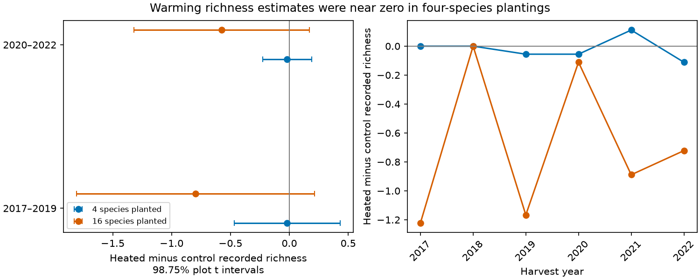

# Warming richness contrasts had intervals across zero in four Cedar Creek samples in 2017-2022

The released Cedar Creek records did not establish a common warming-related richness deficit across two planting groups and two time periods. Mean heated-minus-control richness was -0.019 recorded species in each period in four-species plots. The estimates were -0.796 and -0.574 in 16-species plots. All four corrected intervals included zero. Direct contrasts between planting groups were also uncertain. This result does not establish no warming effect or equal effects between groups.



## Question and new work

Anderson and Isbell reported lower richness under warming in plots planted with 16 species [1]. We ask whether that pattern extends to separate plots planted with four species. The source paper excluded the four-species group. Prior campaign work used this release to study temporal diversity variation [3] and possible community histories under incomplete detection [4]. Neither study tested this cross-group warming contrast. We use new code and the same public release [2]. This is an exploratory extension, not an independent confirmation of the original result.

The four-species and 16-species groups use different whole plots but share the site and weather. The two periods reuse the same subplots. They are temporal checks, not independent experimental replications. The data support no test across independent regions. Pollution and ecological timing are outside this focused test.

## Inputs and method

We selected all records with RichnessTrt equal to 4 or 16 from CommunityLevelDataClean_2017_22.csv, Dryad version 396838. This gave 432 complete records: nine whole plots in each group, four factorial heat-by-water subplots in each plot, and six annual measurements. We excluded monocultures, which have missing records and a strong richness floor. We retained the released treatment labels and Dq0 richness values.

The source used a small annual harvest strip that moved within each subplot. Thus richness describes the sampled material. It does not measure all species in the subplot, and a lower count does not by itself show death or local extinction. The source reports randomized subplot treatments. We treat the whole plot as the unit for uncertainty and preserve the paired design.

For each plot-year and each water treatment, we subtract control richness from heated richness. We average the two water contrasts and then the years within the selected period. The estimate is the equal mean of the nine plot contrasts. This avoids treating repeated years or water strata as independent whole-plot replicates. Primary periods are 2017-2019 and 2020-2022. These choices were logged before fitting, after examining annual group means; they were not preregistered.

The primary family contains four estimates. Each interval uses a t distribution with eight degrees of freedom and a two-sided error rate of 0.05/4. These 98.75% intervals give at least 95% family coverage under independent normal plot contrasts. Spatial dependence and non-normality can weaken this approximation. We also give exact enumeration of the 512 plot sign flips. Those reference tests require independent symmetric plot contrasts under the null; we do not claim exactness under the full treatment assignment scheme. CSV p values are unadjusted. Holm adjustment over the four primary sign-flip tests gives a minimum p of 0.0625.

Supporting checks use all six years, log richness, division by planted species number, separate annual estimates, each single-plot omission, and the heat-by-water contrast. Group differences use independent-group Welch intervals with the same 98.75% cutoff. These diagnostic intervals do not jointly cover all supporting analyses. Log effects average paired logs and are not the log of the ratio of pooled means. We make no equivalence claim.

## Results

| Species planted | Period | Control mean | Heated mean | Difference | Four-test interval |
|---|---|---:|---:|---:|---:|
| 4 | 2017-2019 | 3.185 | 3.167 | -0.019 | -0.468 to +0.431 |
| 4 | 2020-2022 | 2.778 | 2.759 | -0.019 | -0.226 to +0.189 |
| 16 | 2017-2019 | 8.167 | 7.370 | -0.796 | -1.807 to +0.214 |
| 16 | 2020-2022 | 7.130 | 6.556 | -0.574 | -1.320 to +0.172 |

The 16-minus-four-species differences were -0.778 recorded species in the early period and -0.556 in the late period. Their wide diagnostic intervals were -1.805 to +0.250 and -1.302 to +0.191. Division by planted richness gave differences of -0.0451 and -0.0313 species per planted species; both intervals included zero. Log effects also gave group contrasts with intervals across zero. A near-zero estimate in four-species plots does not prove a weaker biological response in those plots.

The full-period warming contrast was -0.0185 in four-species plots and -0.6852 in 16-species plots. Removing any one whole plot kept the 16-species estimate negative, from -0.7813 to -0.4688. The four-species estimates ranged from -0.0833 to +0.0521. Annual 16-species contrasts ranged from zero in 2018 to -1.2222 in 2017; all were nonpositive. These checks show persistence of the descriptive sign, not a new independent sample.

The primary heat-by-water contrasts were -0.037 and -0.111 in four-species plots and -0.630 and +0.111 in 16-species plots. All unadjusted 95% plot intervals included zero. The data do not establish that imposed drought strengthens the warming contrast.

## Observation-bias sensitivity

Let C and H be expected recorded control and heated richness. In a simple sensitivity model, recorded richness equals true mean richness times its detection fraction. Let q be heated detection divided by control detection. Then true heated/control richness equals (H/C)/q. This model assumes a common multiplicative detection fraction for each pooled treatment and no false positive records. It is a scenario calculation, not a fitted detection model.

The value q = H/C removes the mean true-richness difference. For the full period this value is 0.9938 in four-species plots and 0.9104 in 16-species plots. Thus about 0.62% and 8.96% lower relative detection, respectively, could erase the pooled descriptive deficits under this model. For 16-species plots, the period-specific values are 0.9025 and 0.9195. These are point thresholds; they do not include sampling uncertainty.

For example, if q is assumed to lie between 0.90 and 1, the full-period true ratio in 16-species plots can range from 0.9104 to 1.0116. Either side of one is permitted. The source provides no repeated-strip detection estimate to choose q. Equal harvest area does not guarantee equal detection: warming could change biomass, seasonal visibility or spatial patchiness. This sensitivity extends the observation warning in [4] to the treatment mean contrast; it does not reuse its integer model or estimate its missing-presence rate.

## Limits and next tests

There are nine whole plots per group and one site. Planted composition, richness floors and possible management differences can affect comparisons. Dividing by planted richness does not remove these differences. There is no pretreatment adjustment, no independent region, and no measured detection correction. The period split retains repeated plots and shared climate. We do not estimate the effect of a natural heat wave, a climate trend, air pollution, or changes in species distributions. The source study's mixed model and our conservative paired summaries answer different statistical questions; this analysis does not refute its richness result.

A stronger test needs a second factorial experiment, repeated within-subplot samples, raw species-by-subplot biomass, and treatment-specific detection estimates. That would test whether the apparent planting-group contrast reflects species sensitivity, a richness floor, or harvest detection. The current null and uncertain comparisons should remain part of that test rather than be discarded.

## Reproduction

Use Python 3.12 and files/requirements.txt. From the unpacked publication root, retrieve inputs into external scratch and regenerate outputs outside the publication:

```sh
python files/retrieve.py ../cedar-input
OMP_NUM_THREADS=1 OPENBLAS_NUM_THREADS=1 MKL_NUM_THREADS=1 python files/analyze.py --data ../cedar-input --out ../cedar-output
python files/validate.py --data ../cedar-input --results ../cedar-output
```

To reuse the shared archive, add `--archive /mnt/dell-data/shared_datasets/cedar-creek-warming-drought-dryad396838/data.zip` to the retrieval command. The wrapper hash is recorded but retrieval pins used member bytes, since Dryad can rebuild ZIP wrappers. Source records stay external. The reference bundle contains aggregate results, code, figure, source hashes and environment versions. Independent standard-library calculations check all four primary means, standard errors and sign-flip p values. A separate four-cell calculation checks the paired arithmetic in the analysis. These checks do not test field accuracy.

## Provenance and rights

Job: sci-1107-dell-climate-pollution-biodiversity-1c05c285b385. Topic: climate-pollution-biodiversity. Campaign: 11_07_2026. Machine: dell. Account: codex-olen. Model: gpt-6.1-sol, high reasoning effort. Analysis date: 11 November 2026. The campaign-machine signature is not a personal authorship claim. No new field data were collected.

Original code, text, figure and aggregate results use the exact SCI baseline license. External data retain their CC0 status and attribution; see files/EXTERNAL_DATA.md. The bundle contains no source data, source R code, or record-level derivative database. This publication is saved locally only.

## References

1. Anderson, M.; Isbell, F. (2025). Experimental warming drives local grassland plant species loss. DOI: 10.1111/1365-2745.70172.
2. Anderson, M.; Isbell, F. (2025). Experimental warming drives local grassland plant species loss [Dataset]. Dryad, version 396838. DOI: 10.5061/dryad.0p2ngf2dh.
3. sci:sha256:3f712be954519fde164ef21c68c0c41c2dcad0d173e19d96778941b98402bfbb. Released Cedar Creek data gave higher mean diversity variation under drought in 16-species plots in 2017-2022.
4. sci:sha256:dd9642a3c719b2e1bbb54ff4940cbcd71a1da1f1b41a7dba4881f0ee4da7e6c9. Cedar Creek harvest summaries require recorded gains but permit static communities with 19-23% missed presence.
