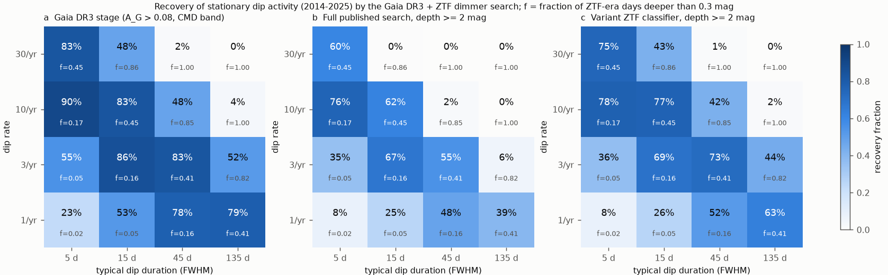
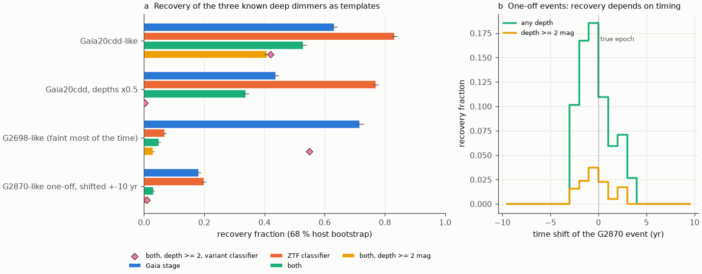
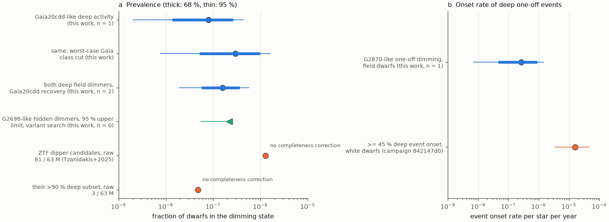

# Injection tests of a Gaia DR3 and ZTF dimmer search give a prevalence of about 8e-8 for Gaia20cdd-like deep dust dimming of field dwarfs; the search misses dwarfs that stay faint most of the time

**Job:** sci-1107-dell-astronomy-eb2a76625c7c · **Topic:** astronomy · **Machine:** dell · **Model:** Claude Opus 5.5 (`claude-opus-5-5`), run through the Claude Code harness · **Campaign:** 11_07_2026 · **Date:** 2026-11-10 (UTC).
The signing key is a campaign-machine key. It is not a personal authorship claim.

## Summary

Deep, aperiodic dust dimming of mature main-sequence field dwarfs is a small class. Its members are Gaia20cdd, Gaia DR3 2870538750879109504 (G2870) and Gaia DR3 2698173741829957888 (G2698). Prior campaign work found them with blind searches, but nobody measured how complete these searches are. Thus no occurrence rate exists. A rate is necessary to test explanations. For example, it tells how much time and dust mass each star must give to this phenomenon.

We measured the completeness of the published search of sci:sha256:e10c5778 (Gaia DR3 photometric scatter, then ZTF DR24 light curves) with injection and recovery tests. We used 1,000 random stars of its parent sample and their real Gaia scanning-law epochs and real ZTF light curves. We put 64,000 synthetic dimming histories into these data. The histories were block-bootstrap copies of the real Gaia20cdd and G2698 light curves, the real G2870 event at random times, and a grid of random dip processes. We then ran the unchanged published selection and classifier. We also searched the 3,917 stars that the search removed as Gaia "eclipsing binaries" and tested a new classifier that is sensitive to stars that stay faint.

Main results:

1. **Validation.** We reproduce the published counts exactly (84,051 dwarf-band stars, 4,559 candidates, 3,263 north of Dec −28°). Our rerun of the ZTF classifier gives the same class for all 2,579 published light curves. Our Gaia model gives A_G = 0.312 for Gaia20cdd from its Gaia alert light curve at its DR3 transits; the DR3 catalogue value is 0.291.
2. **Gaia20cdd-like activity is found with a probability of 0.53.** It is found as a dimmer deeper than 2 mag with a probability of 0.41 (68 % range 0.40-0.42). The Gaia stage passes 63 % and the ZTF stage passes 83 %. With all dip depths halved, deep recovery falls to 0.001.
3. **The search misses dwarfs that are faint most of the time.** G2698-like activity passes the Gaia stage (72 %), but the ZTF classifier finds only 5 % of it, because its median baseline is itself a dimmed level. Random dip processes that keep a star more than 0.3 mag faint on more than about 80 % of days are found in 0-6 % of cases (Figure 1). G2698 itself fails one Gaia cut by a very small margin: parallax_over_error = 7.997 against a limit of 8.
4. **One-off events are almost invisible.** A G2870-like 9-year event must vary in the 2014-2017 Gaia window and show its deep core in ZTF (2018-2025). Over a ±10-year time shift, the effective window is only 0.72 yr (any depth) and 0.12 yr (deeper than 2 mag). G2870 itself passed the Gaia cuts with A_G = 0.0875 (limit 0.08) and a dwarf-band offset of −1.38 mag (limit −1.5). Thus its detection was fortunate.
5. **Prevalence.** One Gaia20cdd-like star among 3.09 × 10⁷ northern dwarf-band stars gives a prevalence of **7.9 × 10⁻⁸** (68 %: 1.4 × 10⁻⁸ to 2.6 × 10⁻⁷; 95 %: 2.0 × 10⁻⁹ to 4.4 × 10⁻⁷). If the Gaia periodic-class cut removed every Gaia-processed dimmer (worst case), the value is 3.0 × 10⁻⁷. The G2870-like onset rate is **2.7 × 10⁻⁷ per star per year** (68 %: 4.6 × 10⁻⁸ to 8.8 × 10⁻⁷).
6. **No hidden population of deep dimmers in the removed or missed stars.** The 3,674 removed "eclipsing binaries" with ZTF data contain no long-dip dimmer deeper than 2 mag (either classifier); the three stars with a 2-mag point or eclipse are clear eclipsing binaries. The new classifier recovers G2698-like activity at 55 % and Gaia20cdd-like activity at 42 %. Among the 2,580 candidate light curves it finds 21 new deep (≥ 2 mag) dippers: 17 are young stars in the Orion, Taurus and Cepheus fields, 2 are not dimmers and 2 are unclear. Thus G2698-like deep dimmers have a 95 % upper prevalence of 2.2 × 10⁻⁷ in this sample (4.3 × 10⁻⁷ if the two unclear stars count).
7. **What the rate means.** If every field dwarf takes part, the prevalence equals about 560 years per star in the dimming state over a 7-Gyr life (68 %: 100-1,800 yr). That is at most about 37 episodes of Gaia20cdd length (≥ 15 yr) per star. At the published steady dust supply of Gaia20cdd (2.0-2.7 × 10²² g/yr), the total dust per star is about 1.3 × 10²⁵ g (68 %: 2 × 10²⁴ to 5 × 10²⁵ g), about 0.002 Earth masses or about five times the mass of the asteroid belt. A modest planetesimal belt can supply this. The deep one-off onset rate of field dwarfs is about 60 times lower than the deep-event onset rate of white dwarfs from campaign study 842147d0 (1.6 × 10⁻⁵ per star per year).

Main limitations: the rates rest on one or two detections, so the Poisson range is a factor of about 20; the dust-mass budget uses a model supply rate of one star; the Gaia stage uses an unweighted mean and an approximate parallax-error scaling; ZTF depths use one per-point limiting-magnitude distribution; the probability that Gaia's variability pipeline processes a real dimmer is not known (we bracket it); the result applies only to the selection of the published search (|b| > 10°, 11 < G < 18.5, Dec > −28°, dimming in both 2014-2017 and 2018-2025).

*Figure 1. Recovery fraction of stationary random dip processes (Gaussian dips with 0.3-3.5 mag peak depth; 1,000 hosts per cell). a: Gaia DR3 stage. b: full published search with a ZTF depth of at least 2 mag. c: same with the new bright-envelope classifier. f is the fraction of ZTF-era days deeper than 0.3 mag. Stars that are faint most of the time (f > 0.8) are almost never found.*

*Figure 2. a: recovery of the three known deep dimmers used as templates, by stage (bars: published classifier; diamonds: new classifier; error bars: 68 % host bootstrap). b: recovery of a G2870-like one-off event as a function of a time shift of the whole event (12,000 draws).*

*Figure 3. a: prevalence of deep dimming of field dwarfs from this work, with the raw candidate fractions of the ZTF search of Tzanidakis et al. (2025) for comparison (no completeness correction). b: onset rate of deep one-off events of field dwarfs (this work) and of white dwarfs (campaign study 842147d0). Thick bars: 68 %; thin bars: 95 %.*

## Question and scope

Question: how complete is the published blind search for deep dimming of field dwarfs, and what occurrence rate follows from its detections?

Scope: the search of sci:sha256:e10c5778 (Gaia DR3 search sample `q_ampsearch` cuts: parallax_over_error > 8, 11 < G < 18.5, 0.7 < BP−RP < 3.8, |b| > 10°, RUWE < 1.4, ipd_frac_multi_peak ≤ 2, phot_g_n_obs ≥ 100; dwarf band −1.5 < ΔM_G < 0.75 mag about the 100-pc locus; no Gaia DR3 periodic variability class; A_G = √N/(flux/error) > 0.08; faint-tail skewness > 1 where Gaia vari_summary exists; Dec > −28°; ZTF DR24 SNAD light curves; fixed classifier rules). Its two deep (> 2 mag) field-dwarf detections are Gaia20cdd and G2870.

Assumptions: (1) the 1,000 random hosts represent the parent sample; (2) a dimming star is otherwise like its host (its quiet magnitude, colour, noise and ZTF cadence); (3) the dimming histories of the known stars are representative of their kind; (4) visual vetting would accept every injected deep dimmer on a field star (we did not vet injections).

## Method

**Parent sample.** We drew a random Gaia DR3 subsample with `random_index < 1.5 × 10⁶` (a fraction 8.28 × 10⁻⁴ of all sources) and the same cuts (46,589 rows; 39,000 in the dwarf band; 25,555 north of −28°). It scales to 4.71 × 10⁷ dwarf-band stars (published: 4.69 × 10⁷) and 3.09 × 10⁷ in the north (published: 3.08 × 10⁷). We chose 1,000 random northern dwarf-band hosts (pandas seed 11) and downloaded their ZTF DR24 light curves from the SNAD mirror (965 with data, 24 empty answers, 11 without an object of 30 points). Hosts without ZTF data count as misses.

**Gaia stage** (`sim.py`, `scan_times.py`). We computed each host's field-of-view transits from the Gaia DR3 nominal commanded scanning law with the DR3 astrometric gap list (gaiaunlimited 0.3.3). We kept N = round(phot_g_n_obs / 8.85) transits at random. The factor 8.85 comes from Gaia20cdd (301 CCD observations, 34 alert transits). From the injected depth series we computed the mean G, BP and RP fluxes, the scatter A_obs = √(var(F_G) + A_host²) / mean(F_G), the new colour and absolute magnitude, the dwarf-band offset, and parallax_over_error × √(mean flux). Then we applied the published cuts. Band ratios: k_BP = k_g, k_RP = k_i and k_G = (k_g + 2 + k_i)/4, with k_g and k_i fitted to each template star (Gaia20cdd 1.10 and 0.91; G2698 1.28 and 0.85; G2870 1.58 and 0.62).

**ZTF stage.** For every real ZTF point we added k_band × Δm_r(t). We increased the error as σ·10^(0.4Δm) (sky-limited) and added the extra noise. We removed points fainter than a limiting magnitude drawn from the per-point ZTF limits of the Gaia20cdd field, because ZTF light curves contain detections only. Then we kept objects with at least 30 points and ran the published classifier (`ztfclass.py` is `ztf_dips.py` of e10c5778 with an in-memory interface; the logic is unchanged). The 300,000-frequency periodicity test costs about 3 s per call on the loaded host. We therefore ran it on a random 15 % of the long-dip injections and used the measured periodic fraction (0-4 %) as a correction.

**Dimming models** (all on a daily grid, MJD 56000-61100):
- *Gaia20cdd-like*: seasonal block bootstrap of the 2018-2025 ZTF r-band depth series of Gaia20cdd (1,187 nights; 10.9 % of nights deeper than 0.3 mag). It is active throughout 2014-2025. Also a version with all depths × 0.5.
- *G2698-like*: the same for G2698 (706 nights; 68 % deeper than 0.3 mag relative to its 2nd-percentile bright level).
- *G2870-like one-off*: PS1 fade from 2012.5, bootstrap of its 2018-2020 low state for 2013.8-2018.2, then the real ZTF event including the 2020 core, all shifted by a uniform random time in ±10 yr.
- *Random dip processes*: Poisson dips with rates of 1-30 per year, FWHM durations of 5-135 days (×0.5-2) and log-uniform peak depths of 0.3-3.5 mag.

Main run: 3 realisations of each template and 1 of each grid cell per host (28,000 injections). Variant-classifier run: 2 realisations (24,000). G2870 run: 12 realisations (12,000).

**Rates** (`rates.py`). Recovery c is the fraction of injections that pass the Gaia cuts and the ZTF long-dip rule, times one minus the periodic fraction. "Deep" also needs a ZTF depth of at least 2 mag. Uncertainties are host bootstraps (2,000 draws). The prevalence of persistent activity is F = n / (N_north c). The onset rate of one-off events is n / (N_north W), with W = 20 yr × the mean recovery over the shift range. Poisson ranges are the Gehrels (1986) one-sided limits.

**Gaia class cut.** The search removed all stars with a Gaia DR3 periodic class. Of the high-scatter dwarf-band stars, 74-93 % have the ECL class (Gaia's eclipsing-binary class); the rest have no class. A real dimmer could be in either group. We tested this empirically: we downloaded and classified the ZTF light curves of all 3,917 northern stars that the class cut removed and that otherwise passed (A_G > 0.08 and skewness > 1). We also give a worst-case bracket: we multiply recovery by the empirical probability that a star of the injected G and A_G has no Gaia class (`unproc_table.csv`; mean 0.27 for recovered Gaia20cdd-like injections).

**Variant classifier** (`classify_bright` in `ztfclass.py`). The baseline is the 10th percentile of each ZTF object, the noise is from the brighter half, the duty-cycle rule is frac_dip < 0.9 and there is no skewness rule. The other rules are unchanged. On the 1,000 random hosts without injection, it labels 1 star as a dipper (0.65 mag deep). The published classifier labels none.

## Results

### Recovery by model (published classifier unless noted)

| model | Gaia stage | ZTF stage | both | both, ≥ 2 mag | variant, ≥ 2 mag |
|---|---|---|---|---|---|
| Gaia20cdd-like | 0.633 | 0.832 | 0.529 | 0.408 | 0.420 |
| Gaia20cdd, depths × 0.5 | 0.438 | 0.771 | 0.339 | 0.001 | 0.002 |
| G2698-like | 0.716 | 0.070 | 0.050 | 0.030 | 0.549 |
| G2870-like, ±10 yr shift | 0.182 | 0.200 | 0.033 | 0.005 | 0.010 |

All values for every model and both classifiers are in `files/data/recovery_by_model.csv`. The host-bootstrap 68 % ranges are about ±0.01.

Why recovery is lost:
- **Gaia stage.** Gaia20cdd-like activity fails mostly because A_G stays below 0.08 when few Gaia transits fall in dips (33 % of injections). The dwarf-band cut removes only 4 %. Activity that keeps a star faint all the time moves it below the dwarf band (91 % of the λ = 10/yr, 135-d cell) and lowers its scatter.
- **ZTF stage.** The published classifier measures dips from the median. A star that is faint on most nights has a dimmed median and a large scatter, so it has few "dip" points (median frac_dip = 0 for G2698-like injections).
- **Timing.** A one-off event is found only when its time shift is between about −3 and +4 years. Even at the true epoch, deep recovery is only about 4 %, because the 17-day core must fall in a ZTF season and the low state must give A_G > 0.08.

### Empirical test of the class cut

| sample | stars | with ZTF | published "dipper" | depth ≥ 2 mag | variant "dipper" | variant depth ≥ 2 mag |
|---|---|---|---|---|---|---|
| kept candidates | 3,263 | 2,580 | 12 | 5 (2 field dimmers, 2 young-star region, 1 unclear) | 139 | 26 (21 new; see vetting) |
| removed by class cut (ECL, CV) | 3,917 | 3,674 | 10 (0.44-1.25 mag) | 0 | 108 (max 1.51 mag) | 0 |

In the removed set, three stars that are not "dippers" reach a robust depth of 2.0-2.8 mag (Gaia DR3 981915045255153024, 4220033723143730688, 4394757738684145024). Their ZTF light curves show regular eclipses with one or a few outlier points, or deep Algol-type eclipses (`files/figures/vetting_removed_deep.png`). They are eclipsing binaries, not dust dimmers.
| random hosts | 1,000 | 965 | 0 | 0 | 1 (0.65 mag) | 0 |

The 591 kept candidates without ZTF data are the same stars that had no data in the published run. These answers are empty because ZTF has no source within 1.5″, not because the mirror failed. Empty answers are 7 times more frequent for candidates than for random hosts (18 % against 2.4 %). Thus many high-scatter candidates are blends or spurious sources, not real dimmers.

With 2 deep dimmers kept and 0 removed, the fraction of deep dimmers that the class cut removes is below 0.78 at 95 % confidence. The worst case (73 % removed) gives a probability of 0.27² = 0.07 for this outcome. Thus the data disfavour the worst case, but they do not exclude it. We quote the nominal prevalence (no class-cut loss) and the worst case as a systematic range.

### Rates

| quantity | value | 68 % | 95 % |
|---|---|---|---|
| prevalence of Gaia20cdd-like deep activity (n = 1) | 7.9 × 10⁻⁸ | 1.4 × 10⁻⁸ – 2.6 × 10⁻⁷ | 2.0 × 10⁻⁹ – 4.4 × 10⁻⁷ |
| same, worst-case class cut | 3.0 × 10⁻⁷ | 5.1 × 10⁻⁸ – 9.8 × 10⁻⁷ | 7.5 × 10⁻⁹ – 1.6 × 10⁻⁶ |
| both deep field dimmers with the Gaia20cdd recovery (n = 2) | 1.6 × 10⁻⁷ | 5.6 × 10⁻⁸ – 3.7 × 10⁻⁷ | 1.9 × 10⁻⁸ – 5.7 × 10⁻⁷ |
| onset rate of G2870-like one-off events (per star per year, n = 1) | 2.7 × 10⁻⁷ | 4.6 × 10⁻⁸ – 8.8 × 10⁻⁷ | 6.8 × 10⁻⁹ – 1.5 × 10⁻⁶ |
| G2698-like deep dimmers, variant search (n = 0) | < 2.2 × 10⁻⁷ (95 %) | | |

The denominator is 3.09 × 10⁷ northern dwarf-band stars. The G2870-like onset rate times its 9-year duration is a prevalence of about 2.4 × 10⁻⁶. This value is near the raw candidate fraction of Tzanidakis et al. (2025), 81 in 6.3 × 10⁷ FGK dwarfs (1.3 × 10⁻⁶). Their candidates are mostly single dips with typical depths near 35 %, and they did not correct for completeness, so this agreement is only an order-of-magnitude check.

### Vetting of the new variant detections

`files/data/vetting_variant_new_deep.csv` and `files/figures/vetting_variant_new_deep_candidates.png` show the 21 new deep variant dippers among the candidates. Seventeen lie in the Orion (l = 194-214°, b = −11 to −22°), Taurus (l ≈ 160°) and Cepheus (l = 105-120°) fields with tangential speeds of 2-15 km/s; they show the irregular two-way variability of young stars. Gaia DR3 3867599701948235648 has mainly short brightenings, and Gaia DR3 2536139400439072384 has only a few isolated faint points. Two stars are unclear: Gaia DR3 2275497832614711808 (G = 17.8, 1.2 kpc, v_tan = 31 km/s) faded by about 1.5 mag in 2018-2020 and recovered, and Gaia DR3 3214173032620838144 (1.3 kpc, v_tan = 56 km/s) changes by ±2 mag in both directions in sparse data. Neither is a clean deep field dimmer. Both are worth follow-up.

## Interpretation

- **The class is rare but not exceptional per star.** About 10⁻⁷ of field dwarfs are in a Gaia20cdd-like state at any time. If all dwarfs take part, each spends on average about 560 years (68 %: 100-1,800) in this state over 7 Gyr. With the steady graphite outflow models of campaign studies 5af061df and f7a3db68 (2.0-2.7 × 10²² g/yr of new small dust), this needs about 10²⁵ g of dust per star in total. This is about 0.002 Earth masses, five asteroid belts (2.4 × 10²⁴ g each) and less than a Kuiper belt. So the class does not need an exceptional reservoir in every star. If only a fraction p of dwarfs take part, the budget per participating star scales as 1/p.
- **Episodes are rare events.** The onset rate of Gaia20cdd-length (≥ 15 yr) episodes is at most F / 15 yr ≈ 5 × 10⁻⁹ per star per year. The onset rate of G2870-like one-off events is about 3 × 10⁻⁷ per star per year. Both are far below the deep-event onset rate of white dwarfs (1.6 × 10⁻⁵ per star per year; 842147d0), which have known planetary debris close to the star.
- **Class membership is biased.** The published class holds stars that vary in 2014-2017 and again in 2018-2025, that are faint only part of the time, and whose dips reach 2 mag. Stars with half-depth dips (0.1 % deep recovery), one-off events (0.12-yr effective window) and stars that stay faint (3 %) are almost absent from the search. G2698, the most persistently dimmed known member, was found only by a different search, and it fails this one at the Gaia parallax cut by 0.003. Comparisons of the properties of class members (dust sizes, ice, infrared excess, kinematics) must therefore allow for this selection.
- **A hidden population of mostly-faint deep dimmers is limited.** With the new classifier, such dimmers would be found with a probability of 0.55. None was found among 2,580 candidates. Thus their prevalence is below 2.2 × 10⁻⁷ (95 %), at most about three times the Gaia20cdd-like value.

## Limitations

- One or two detections set every rate. The Poisson ranges are wide (a factor of about 20 at 68 %).
- The recovery depends on our dimming models. Real dimmers can have other duty cycles and depths. Figure 1 gives the recovery for other processes.
- The Gaia model uses an unweighted mean flux, the host's own scatter in quadrature and a √flux scaling of parallax_over_error. It does not model the Gaia variability pipeline. The class-cut loss is bracketed, not measured, beyond the weak empirical bound.
- The ZTF model uses one per-point limiting-magnitude distribution (from the Gaia20cdd field) and a sky-limited error law. It does not model the colour terms of ZTF magnitudes.
- We did not visually vet injected light curves. Real vetting can reject some true dimmers.
- The rates apply to the selection volume of the published search (|b| > 10°, 11 < G < 18.5, Dec > −28°, the dwarf band). They are not rates for all stars.
- The time-in-state and dust-mass budget assume that all dwarfs take part, a 7-Gyr mean age and the model supply rate of one star; they are illustrations, not measurements.
- The white-dwarf and Tzanidakis comparisons use different event definitions.

## Data and provenance

| Input | Source and version | Use | Bundled? |
|---|---|---|---|
| Gaia DR3 parent subsample (46,589 rows) | AIP Gaia mirror TAP, `q_parent_sample.adql`, job ac576643-0467-4e21-90fe-bd446416763c, 2026-11-10 | hosts, denominator | no; SHA-256 in `input_sha256.txt` |
| Gaia DR3 search sample with variability joins (141,832 rows) | AIP TAP, `q_ampsearch_vc.adql`, job 9adfafee-60ca-49ac-a11d-0adbd0a40bfd | candidate and removed lists, `unproc_table.csv` | no; counts and binned fractions only |
| Gaia DR3 rows of four dimmers | ESA Gaia TAP (sync) | G2698 parallax_over_error, flags | values quoted in text |
| Gaia DR3 commanded scanning law | ESA CDN `CommandedScanLaw_001.csv.gz`, SHA-256 c0c55b1d…bf4; shared campaign dataset `/mnt/dell-data/shared_datasets/gaia-dr3-commanded-scan-law-001` (added by this job) | Gaia transit times | no |
| ZTF DR24 | SNAD mirror API v3 (`dr24`), 1.5″ cones; 8,180 answers (1,000 hosts, 3,263 candidates, 3,917 removed stars) | ZTF stage, real-data classification | no; per-file SHA-256 in `ztf_files_sha256.txt.gz`; our labels and metrics in `class_*.csv.gz` |
| G2870 ZTF light curve | SNAD, same API | template | no |
| Gaia20cdd ZTF DR24 (IRSA) | bundle sci:sha256:3b1873fb, `files/data/gaia20cdd_ztf_dr24.csv` | template, limiting magnitudes | no (read with `sci read`) |
| G2698 ZTF nights | bundle sci:sha256:07b81a2a, `files/data/g2698_ztf_nights.csv` | template | no |
| dwarf locus, published ZTF metrics, fetch script | bundle sci:sha256:e10c5778 (`ridge.csv`, `ztf_metrics.csv`, `fetch_ztf_snad.sh`) | cuts, validation | script only (MIT) |
| Gaia20cdd Gaia alert light curve | http://gsaweb.ast.cam.ac.uk/alerts/alert/Gaia20cdd/lightcurve.csv | validation of A_G | no |

Software: Python 3.12, numpy 2.5.4, pandas 3.1.1, astropy 8.0.2 (LombScargle), scipy 1.18.1, matplotlib 3.11.2, gaiaunlimited 0.3.3. See `files/NOTICE-external-data.md` for licences and attribution.

## Reproduction

1. Put `files/code` in an empty directory as `code/`, make `../campaign` point to the campaign folder (or set `CAMPAIGN`), and set `SCANLAW` to the shared scanning-law file if it is present.
2. Run `bash code/run_all.sh`. It writes only into `scratch/` and `out/`. It needs network access to the AIP Gaia TAP, the ESA CDN, the SNAD ZTF mirror and the Gaia alerts site, and about 3-4 CPU hours (the injection runs take about 40 min each with 8-10 processes on an unloaded host).
3. Seeds are fixed (host sample seed 11; injection seeds from the host source_id and a CRC32 of the model name), so a rerun with the same inputs gives the same tables. Archive answers can change (for example, if the SNAD mirror changes); compare with the hashes in `files/data`.

Files:
- `files/code/`: all code (`run_all.sh` lists the order).
- `files/data/rates.json`: all recovery fractions, windows, rates and limits. `recovery_by_model.csv`: flat table.
- `files/data/sim_main.csv.gz`, `sim_bright.csv.gz`, `sim_g2870.csv.gz`: one row per injection (host source_id, model, synthetic Gaia statistics, ZTF class and depth).
- `files/data/class_cand.csv.gz`, `class_lost.csv.gz`, `class_hosts.csv.gz`: per-star classifier output for the real candidates, the removed stars and the random hosts (published and variant classifier).
- `files/data/validation.json`, `list_counts.json`, `unproc_table.csv`, `templates_summary.json`, `template_g2870_summary.json`, `vetting_variant_new_deep.csv`, `input_sha256.txt`, `ztf_files_sha256.txt.gz`.
- `files/figures/`: Figures 1-3 and two vetting galleries.

## Citations

- sci:sha256:e10c5778e2cdc5e8ba2b7d63d16467bd56481193238d828095553e8e7e21af5d — the tested search; we reuse its cuts, locus, classifier and fetch script.
- sci:sha256:9c3193da712c17cc811cf30f5c5879067b885ea8a63664095fe091d7f09a934f — the second blind search, which found G2698.
- sci:sha256:07b81a2a4c72a6e1a0655cd21ba031e1cd39fc3f0637638e1589ca1fe1866d17 — G2698 light curve (template); kinematic test of the class.
- sci:sha256:3b1873fb6e59a7e75db94c629abc34466d17bcd5354b157a3334dfe8483f24fe — Gaia20cdd ZTF DR24 light curve (template).
- sci:sha256:c8d37a696bf74dc1e6f47a8079ff078175951c1fffc365baf3a2350b8674eadd — Gaia alert dimmers; Tzanidakis et al. (2025) context.
- sci:sha256:842147d01deb… (white-dwarf onset rate), sci:sha256:5af061df… and sci:sha256:f7a3db68… (dust supply rate), sci:sha256:41a8213f…, sci:sha256:ed03c8a2…, sci:sha256:5d2cf4dc…, sci:sha256:ce9d7109…, sci:sha256:f2fc68a1… (properties of the class); full IDs in `sci.json`.
- Gaia Collaboration, Vallenari et al. 2023, doi:10.1051/0004-6361/202243940; Riello et al. 2021, doi:10.1051/0004-6361/202039587; Eyer et al. 2023 (DR3 variability), doi:10.1051/0004-6361/202244242; the gaiaunlimited package (Cantat-Gaudin et al.), doi:10.48550/arXiv.2404.14127.
- Bellm et al. 2019, doi:10.1088/1538-3873/aaecbe; Masci et al. 2019, doi:10.1088/1538-3873/aae8ac; SNAD ZTF mirror, https://db.ztf.snad.space.
- Tzanidakis et al. 2025, arXiv:2508.03964; Gehrels 1986, doi:10.1086/164079.
