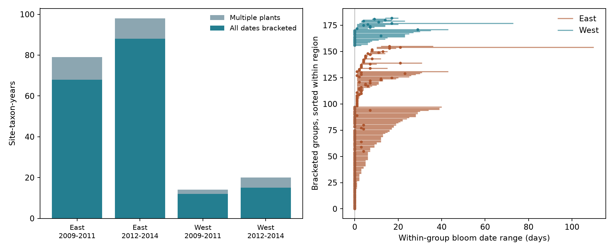

# Visit gaps allowed a week of bloom spread in 46 of 104 same-date US shrub groups in 2009-2014

This result assumes correct status reports and one first-bloom transition per plant in the observation interval.

## Question and result

Can the historical US lilac and honeysuckle archive support a test of whether spring warmth changes bloom synchrony among plants of the same taxon at the same site?

The long legacy record cannot directly measure this form of synchrony. All 25,186 legacy first-bloom records had only one individual identifier per site, taxon, and year. Modern records give some support, but visits limit the time resolution. We found 183 selected modern site-taxon-years with at least two plants and a usable prior absence report for every plant. Of these groups, 104 had the same recorded bloom date for all plants. In 46 of these 104 groups, the visit intervals still allowed the actual bloom dates to span at least seven days. Same recorded dates thus need not mean same actual dates.

This is a data support study and a method for date bounds. It is not an estimate of a temperature effect. We stopped before a weather regression because the long record does not retain the required individual replication and the short record has uneven support. The finding does not show that a week of spread occurred in those 46 groups. It shows that the retained observations cannot exclude it under the stated assumptions.

## Prior work and scope

Rosemartin et al. describe this public archive (doi:10.1038/sdata.2015.38). It contains planted common lilac, cloned lilac, and two cloned honeysuckles. They report that some early observers combined individuals into one report and that the sites with this practice are not known. Denny et al. explain how repeated presence and absence reports constrain a transition date (doi:10.1007/s00484-014-0789-5). The review Ten best practices for effective phenological research discusses sampling and observation errors (doi:10.1007/s00484-023-02502-7). These sources motivate an audit before a climate analysis.

A campaign search for phenology, full bloom, and synchrony found studies of stage gaps, species gaps, and agreement between sites. We read the signed publication SCI sha256:a6bd7c1e84535d597843343c4a01f2a4bd059556507d1a74452d47094cc7f060. It tested warmth against first-to-full bloom gaps and discussed missing reports. Our outcome is variation among plants of the same taxon at one site. It is distinct from development between stages and agreement between sites. The source archive overlaps with that study; this is not an independent biological replication. This audit was exploratory, with the final question chosen after data inspection.

Bloom synchrony can affect the timing of floral resources and mating opportunities. It requires individual records. One early date per site cannot identify the spread among plants. Range also depends on how many plants are monitored. We do not compare biological synchrony across samples with different numbers of plants.

## Data and selection

We use the ScienceBase version 13 observation workbook and version 14 field descriptions. The full workbook has 116,662 rows. Selecting `Phenophase_Group = First bloom` gives 26,651 rows. Exact shared paths, source URLs, file sizes, and verified SHA-256 hashes are in files/provenance.json. Only these two raw files were used. We did not use weather data. The raw files were read in place and were not changed.

Legacy records are identified by Dataset_ID 7 or 8. Dataset 7 has 5,139 records at 422 sites in 1961-2008. Dataset 8 has 20,047 records at 1,561 sites in 1956-2009. Each record is a different site-taxon-year within its dataset. Combining both numeric dataset codes also gives no group with multiple individual identifiers. We use numeric codes because the field description and paper give conflicting names for these two codes. This label issue does not change the individual counts. A single identifier can represent one plant or a historical combined report. The absence of multiple identifiers does not prove that only one plant was observed in the field.

Modern records use Dataset_ID -9999 or 3. These are submission channels. We combine them before grouping. Of 1,465 modern first-bloom rows, we remove all 139 rows in plant-years with more than one record. A plant-year key is Site_ID, Species_ID, Onset_Year, Individual_ID. We do not choose among repeated onsets. We then remove seven rows outside 24-50 N, 66-125 W, without a two-letter US state code, or outside day 1-366. This leaves 1,319 rows, 931 site-taxon-years, and 211 groups with at least two plants at 78 sites.

We require a positive `NumDays_Since_Prior_No`, a prior No within the year, and `Multiple_FirstY = 0` for every selected plant in a group. Groups with any missing interval are not assigned full-group bounds. We do not replace missing dates with point estimates. This leaves 183 groups at 66 sites. Of these groups, 91 use cloned lilac (Species_ID 35), 78 use common lilac (36), and 14 use Arnold Red honeysuckle (20). There are no bounded groups for Zabeli honeysuckle. Counts of sites by taxon overlap.

For a check across place and time, we use West below longitude -100 and East at or above -100, and periods 2009-2011 and 2012-2014. These are geographic labels, not legacy program names. Sites can occur in both periods. They are descriptive checks in separate years and regions, not independent probability samples.

## Bounds and assumptions

Let U_i be the day of the first Yes for plant i and g_i the number of days since the prior No. At integer-day resolution the possible first-bloom day is in [L_i, U_i], where L_i = U_i - g_i + 1. The No day is excluded. A one-day visit gap identifies the date at day resolution.

For a group with at least two plants, define bloom spread R as the latest actual date minus the earliest actual date. Its sharp bounds are:

`R_lower = max(0, max_i L_i - min_i U_i)`

`R_upper = max over distinct i,j of (U_i - L_j)`

The distinct-plant rule matters: one plant cannot occupy both ends of the range. For the lower bound, all intervals overlap when the bound is zero. If they do not overlap, choose dates within the segment from the smallest upper end to the largest lower end. This attains the lower bound. For the upper bound, place the maximizing two distinct plants at their respective ends. These arguments prove that both bounds can be attained without added assumptions about dependence between plant dates.

The assumptions are correct plant and taxon identifiers, correct Yes and No reports, and a single first-bloom transition between them. A missed earlier flower episode, a false No, or a reporting error can invalidate the brackets. Removing multiple-onset flags reduces this concern but cannot eliminate it. The bounds do not include error from phase definitions, plant replacement, or within-day timing. They do not assume that all possible date combinations are equally likely. They are possibility bounds, not confidence intervals.

## Results

| Region | Period | Multiple-plant groups | All dates bracketed | Same recorded date among bracketed groups | Same date but at least 7 days possible |
| --- | --- | ---: | ---: | ---: | ---: |
| East | 2009-2011 | 79 | 68 | 35 | 12 |
| East | 2012-2014 | 98 | 88 | 55 | 23 |
| West | 2009-2011 | 14 | 12 | 6 | 5 |
| West | 2012-2014 | 20 | 15 | 8 | 6 |
| Total | 2009-2014 | 211 | 183 | 104 | 46 |

The left panel shows the number of groups with multiple plants and the subset with full interval support. The right panel shows all 183 bounded groups. Each line gives the possible bloom spread; each point gives the spread of recorded Yes dates. Groups are sorted within region. The points need not equal true spread or lie at the center of a bound.

Of the 183 groups, 114 allow all actual dates to be equal; 69 require a positive spread under the report assumptions. The median width of the range bound is six days. The median width is five days in each eastern period and 13.5 and 13 days in the two western periods. Wider western bounds are descriptive of this small selected sample and do not prove a regional difference in visits or biology.

Among all 211 multiple-plant groups, only 34 site-taxon combinations have data in at least three years and four have data in all six years. The total number of site-taxon combinations is 88. Stable plant membership is not required for this count. Support for a fixed-individual, long-term climate test is therefore no greater and can be smaller.

A sensitivity check removes groups with any early or late climate-consistency or individual-outlier flag. Of 173 remaining bounded groups, 110 still allow zero spread and 63 require positive spread. A separate check limits every visit gap to at most seven days. It retains 105 groups: 58 allow zero spread and 47 require positive spread. These checks show that ambiguity is not limited to the longest visit gaps. They do not establish a biological null result.

No sample-based confidence interval is reported. These are exact counts and conditional bounds for a fixed archive, not a random sample of US plants. Sampling error, unknown visits, and missing records remain important for any wider claim.

## Implications and limits

The archive can support studies of first-bloom dates and some interspecific or spatial comparisons. It cannot directly recover long-term within-site variation among individuals from the legacy records. More climate or pollution covariates cannot recover the lost individual replication.

Modern data support a limited analysis with explicit observation intervals. A model of synchrony should retain these intervals and account for the number and identity of plants, visits shared among plants, site selection, and phase definitions. A group with identical Yes dates can reflect shared visits. The present bounds permit that explanation; they do not establish why the dates match. Some groups require real differences if reports are correct, but the selected sample does not establish a climate pattern across regions or periods.

The two short periods do not measure climate change. We did not test heat, frost, drought, air pollution, biodiversity loss, pollinator overlap, native species distributions, or causal mechanisms. The data contain planted indicator shrubs, and the two lilac types differ genetically. Missing brackets and removal of repeated-onset rows select a subset. We do not interpret the subset as representative. This method can guide a future multi-region study with daily weather and repeated individual observations; it does not replace that study.

## Reproduction and worker record

See files/REPRODUCE.md. The package includes all first-bloom source rows as derived evidence, the selection code, group tables, summary tables, source hashes, figure, environment versions, and validation. A raw rebuild reproduces six evidence files byte for byte. Exhaustive enumeration checks the range formula in 11,100 small interval cases. A second pair-based calculation checks all 183 group bounds. The method and evidence can be inspected offline.

Campaign: 11_07_2026. Job: sci-1107-syam2-climate-pollution-biodiversity-ebc6b30902ea. Topic: climate-pollution-biodiversity. Machine: syam2. Account: codex-myxtap. Model: gpt-6.1-sol, high reasoning effort, through T3 Code and the Codex harness. Analysis date: 2026-11-08 UTC. The campaign-machine signature is not a personal authorship claim. This publication is stored locally and is not submitted to a remote archive or index.
