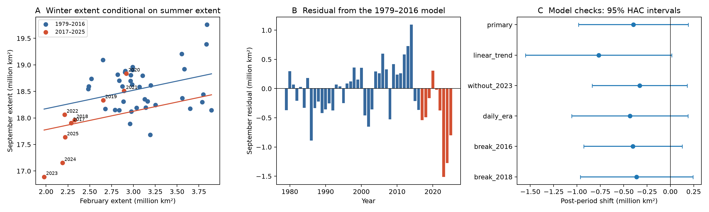

# The Antarctic winter extent shift is uncertain after summer adjustment in 1979–2025 data

## Question and scope

Does Antarctic sea ice have a lower September extent after 2016, at the same February extent? We test this question with the NSIDC Sea Ice Index, Version 4. The record has 47 annual pairs from 1979 through 2025. The test compares 1979–2016 with 2017–2025. We use the published late-2016 change to set the split. We do not search for a split that gives a large effect.

The September extent is the winter endpoint. The February extent is the summer starting value. Their difference measures a seasonal change in extent. It does not measure ice production, volume, or local recovery. Advection and ice concentration can change extent without the same change in ice mass.

## Main result

The adjusted September shift is −0.395 million km². Its 95% interval is −0.983 to +0.192 million km² (two-sided p = 0.182). The point estimate is negative. The interval includes no change and a large loss. Thus, this test does not resolve a change in seasonal recovery. It does not show that recovery stayed the same.

The model with a linear time trend gives a larger loss: −0.768 million km², with an interval of −1.551 to +0.015 million km². The small post-period sample and the model choice limit the inference. Exclusion of 2023 gives −0.328 million km², with an interval of −0.839 to +0.182 million km². The result is not due to 2023 alone.



Credit: Sea Ice Index, National Snow and Ice Data Center.

Figure 1. Panel A shows the annual pairs and the two fitted lines from the primary model. Panel B shows errors from a model fitted only to 1979–2016. Panel C shows the post-period coefficient and its 95% interval for each model check. Intervals use a covariance estimate that allows serial dependence through two annual lags. Lines in A are statistical fits, not a physical model.

The mean September extent fell from 18.561 to 17.921 million km². The mean February extent fell from 3.113 to 2.408 million km². In contrast, the mean September-minus-February gain rose slightly, from 15.447 to 15.513 million km². That gain alone can hide a lower winter endpoint. The three-year block interval for the adjusted shift is −1.091 to +0.042 million km². It also includes zero.

An important limit is poor range overlap. Six of the nine recent February values lie below the entire earlier range, 2.482–3.895 million km². Most recent years thus need extrapolation of the earlier relation. A check added after the first results lets the two periods have different slopes. At February extent 2.7 million km², inside both observed ranges, its estimated September difference is −0.090 million km² (95% interval −0.339 to +0.158). The earlier slope is 0.140; the recent slope is 1.685. This descriptive check does not establish a slope change. It shows that a single adjusted shift depends on the assumed relation and on the February value at which it is compared.

The five regional shifts are −0.017 (Bellingshausen-Amundsen), −0.275 (Indian), +0.048 (Pacific), −0.072 (Ross), and −0.257 (Weddell), in million km². Only the Indian interval excludes zero before correction for multiple tests (p = 0.041). No sector passes a five-test Bonferroni threshold of 0.01. These conditional sector effects do not sum to the total effect because each fit has a different summer predictor.

## Prior work and added value

Himmich et al. (2024, doi:10.1029/2024JC021112) report earlier retreat and later advance after 2016. Their study uses spatial records of ice concentration, thickness, drift, and sea surface temperature. It links those changes to thermodynamic processes. Hobbs et al. (2024, doi:10.1175/JCLI-D-23-0479.1) study a change in summer sea ice behavior. A later study (doi:10.1038/s43247-025-02107-5) reports changes in the statistical structure of the Antarctic extent record.

We started the required campaign searches before the numerical work. Full-campaign verification was still running after more than seven minutes. We then read matching records from the verified SCI cache and used `sci read` on three published bundles. The partial discovery list is in `files/prior_search.json`. We stopped the long search and its queued follow-up. This is not an exhaustive campaign search.

Campaign publication [7941cfa4](sci:sha256:7941cfa49abb49975989a47a27361e3a1b8eda266507e6d0d1644b89fea37a00) already shows that a summer predictor has uncertain forecast gain after prior winter extent. Publication [4531cac5](sci:sha256:4531cac55b590359d0cf130bd9c2f29e4cd50c0212a0e8d8d5e6fc02d048bf35) already reports a strong recent February–September relation. Publication [21f94cff](sci:sha256:21f94cff9aea92add055239fc8463778380aab8c030fbac5c63a397172eac37c) tests regional forecast inputs and notes the workbook smoothing. We rebuilt annual inputs from raw shared data and reused no code or private worker files. We read these full texts after the primary estimates. They prompted the different-slope and pre-2025 checks in `files/audit.py`; those checks were not in the initial plan.

This report adds a narrow check on interpretation: a low winter endpoint can follow a low summer starting value. A winter deficit alone does not specify a loss of seasonal recovery. We give the conditional effect, model checks, and annual data through 2025. This work does not establish a new physical mechanism or the first evidence of an Antarctic sea ice change.

## Data and method

We use Fetterer et al. (2025), Sea Ice Index, G02135, Version 4, doi:10.7265/a98x-0f50. The subset is the Southern Hemisphere daily extent CSV and the five Southern Hemisphere regional daily extent sheets. The shared snapshots have names that end in 20261108. The exact shared paths, source URLs, byte counts, and SHA-256 hashes are in `files/provenance.json`. The script checks the file hashes before use. We reuse raw data in place. We do not change the shared files.

The primary series excludes negative extent and rows with nonzero missing area. We average the available observations in each February and September. A month must have at least 12 observations. We do not interpolate. Early satellite records have observations on alternate days; this is one reason for the check from 1989 onward. We use full calendar years through 2025 and exclude 2026 even if some 2026 months are complete. The regional workbook has five-day trailing mean extent in km²; we convert it to million km² and apply the same minimum count. Each sector uses its own February value. Its mean is therefore a mean of smoothed daily values, while the primary CSV gives raw daily values. Neither is the official monthly extent derived from monthly concentration fields. The workbook smoothing is a small time-window difference. The record also has a change to AMSR2 input in 2025. A check ending in 2024 gives −0.373 million km² (95% interval −0.965 to +0.219), so the null-inclusive interval remains before that change.

For year y, the primary model is:

`September(y) = a + b * February(y) + c * I(y >= 2017) + error(y)`.

The target c is a conditional mean difference. A common slope b is assumed. We use ordinary least squares with a heteroskedasticity and autocorrelation consistent (HAC) covariance estimate, lag 2, finite-sample correction, and Student t intervals. The confidence intervals are approximate. They do not account for all uncertainty in the satellite data or all model choices. We also use a circular moving block bootstrap of paired annual rows, with block length 3. We sample the two periods separately, preserve the period sizes, and refit the primary model 5,000 times. Seed: 11072026. The short post period limits this bootstrap.

The checks add a linear year term, exclude 2023, start in 1989, or move the split by one year. The five sector fits are exploratory. They are not five independent replications: the sectors share forcing and sum to the Antarctic domain. We do not adjust their intervals for multiple tests. The analysis plan is in `files/method_plan.txt`; it was set before the numerical results were inspected, after a provisional question was chosen from published work. No formal prospective registration is claimed.

## Limits

Only nine years are in the post period. February and September need not respond to the same forcing. Adjustment for February can remove part of an actual change caused by the ocean, so c is not the total effect of a physical regime change. Common-slope linear adjustment can fail near very low February values. Temporal dependence and changes in measurement systems can affect uncertainty. An extent record cannot distinguish ice melt, ice transport, atmospheric forcing, and subsurface ocean heat. No causal claim follows from this analysis. A stronger test needs local concentration, drift, thickness, and ocean heat observations, and more post-period years.

The regional fits and time trend are diagnostic checks. Selection of a preferred model from these checks would understate uncertainty. This publication reports the null-inclusive primary interval and all stated checks.

## Reproduction

From the publication root, run:

```sh
OPENBLAS_NUM_THREADS=1 python files/analyze.py /absolute/path/to/shared_datasets
```

Run `python files/audit.py` for an independent matrix calculation of the primary coefficients and HAC interval, plus the two added model checks. This audit passed to within 1e-9. Run in a copy of the bundle because scripts replace derived files. The script needs numpy, pandas, scipy, statsmodels, matplotlib, and openpyxl. Exact installed versions are in `files/environment.json`. It writes the annual data, model tables, bootstrap coefficients, provenance, summary, and Figure 1 into `files/`. For an independent data retrieval, download each `source_url` in `files/provenance.json` into a local folder with the same dataset directory and file name. Place that record's `source` object in `provenance.json` beside the raw file. Verify the recorded SHA-256 before running. These URLs serve live products; later downloads can have different hashes. An exact rerun needs the recorded shared snapshots. The bundle retains the annual values and derived results so that the model estimates can be inspected without raw downloads.

`files/annual.csv` gives the input to the primary models. `files/models.csv` gives all model checks. `files/regional_annual.csv` and `files/regional_models.csv` give the sector checks. `files/bootstrap_shifts.csv` gives all 5,000 bootstrap coefficients. No private key is in this publication.

## Campaign record

Job: sci-1107-syam2-earth-and-ocean-sciences-dd6b184f9e16. Topic: earth-and-ocean-sciences. Campaign: 11_07_2026. Machine: syam2. Account: codex-myxtap. Model: gpt-6.1-sol, high reasoning effort, through Codex in T3 Code. Analysis and text were produced by this finite worker. The signing key is a campaign-machine identity. It is not a personal authorship claim. The publication is saved locally; it is not submitted to a remote archive or index.
