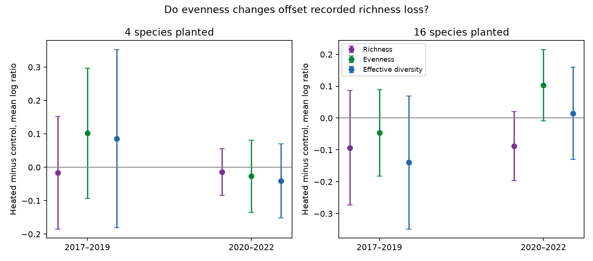

# Warming evenness intervals crossed zero in four Cedar Creek planting-group and period tests in 2017-2022

Warming did not have a clear common link to biomass evenness in four paired tests. All four adjusted t intervals included zero. In 16-species plantings in 2020-2022, the mean log evenness contrast was +0.1030. It offset a recorded log richness contrast of -0.0883, leaving a log effective diversity contrast of +0.0147. That offset is a descriptive identity. It does not show biological compensation. A sign-flip reference test gave stronger evidence for the later evenness contrast than the t interval did.



## Question and prior work

Do evenness changes offset warming-related richness losses, and does that pattern persist in different plantings and periods? This matters because a diversity index can hide a loss of recorded species when biomass becomes more even. It can also appear to show compensation when a harvest misses rare species.

Anderson and Isbell (2025; DOI 10.1111/1365-2745.70172) studied warming and drought in a grassland experiment. Their results motivate this follow-up. Campaign publication sci:sha256:db79a722d361f73ab78b7b20ee0b8cad2c04803a65891a0fa008d500b9d19482 tested richness in four- and 16-species plantings. Campaign publication sci:sha256:3f712be954519fde164ef21c68c0c41c2dcad0d173e19d96778941b98402bfbb tested temporal diversity variation. We read both. We use the same release with new code. We add a paired log decomposition of diversity and a specific observation-bias example. This is not independent validation of those records or a new general diversity identity.

We searched the campaign for phenology, pollution, spring temperature, ozone, solardomes, Cedar Creek and evenness. North Wales follow-ups were extensive, so we selected the Cedar Creek question. The primary analysis was specified in the progress log before calculation. This is an exploratory secondary analysis, not a registered test.

## Data and design

We reused Anderson and Isbell's Dryad version 396838 (DOI 10.5061/dryad.0p2ngf2dh). The analysis uses CommunityLevelDataClean_2017_22.csv: 432 complete harvest records, nine whole plots at each of two planted richness levels (4 and 16), four heat-by-water subplots per plot, and six years. Monocultures are excluded because of their richness floor and incomplete records. We used the source README to inspect units and sampling. No new data download was needed.

Warming and water treatments are constant within subplot. The paired analysis retains the four treatment combinations in each plot. The response describes biomass from a small annual harvest strip that moved within each subplot. Recorded richness therefore need not equal whole-subplot richness. The experiment has one site at Cedar Creek, Minnesota. Two periods reuse the same plots and shared weather. Neither the planting groups nor periods supply independent regional replication.

## Exact decomposition and inference

Let S be recorded richness (Dq0), N be the exponential Shannon diversity of biomass proportions (Dq1), and E=N/S. E is a Hill evenness ratio. It is not Pielou's entropy ratio. For each harvest:

log(N) = log(S) + log(E).

For each plot, year and water treatment, we subtract the control value from the heated value on each log scale. We average equally over the two water treatments and over years in a period, then average the nine whole-plot contrasts. Linearity keeps the identity exact for these contrasts. These are averages of paired log ratios, not logs of pooled mean ratios. Separate intervals for the components cannot be added as if their errors were independent.

The four primary estimates are warming contrasts in log(E), for two planting groups and periods 2017-2019 and 2020-2022. Their intervals use t with eight degrees of freedom and a two-sided error rate of 0.05/4, or 98.75% marginal coverage. Bonferroni gives at least 95% family coverage under independent normal plot contrasts. Only nine plot units support each estimate. Spatial dependence and non-normality can weaken this model.

We also enumerate 512 plot sign flips. These reference tests require independent symmetric plot contrasts under the null. They are not exact randomization tests of the full field assignment. Holm adjustment applies to the four primary p values. This second reference does not replace the specified t intervals. Full-period summaries, water strata, omission of each plot and the inverse Simpson ratio Dq2/Dq0 are supporting checks. Diagnostic component intervals use the same t cutoff but are not jointly corrected over all supporting analyses.

## Results

| Species planted | Period | Log evenness contrast | Adjusted t interval | Holm sign-flip p |
| --- | --- | ---: | --- | ---: |
| 4 | 2017-2019 | +0.1019 | -0.0930 to +0.2969 | 0.3984 |
| 4 | 2020-2022 | -0.0268 | -0.1348 to +0.0812 | 0.5938 |
| 16 | 2017-2019 | -0.0463 | -0.1821 to +0.0894 | 0.5938 |
| 16 | 2020-2022 | +0.1030 | -0.0092 to +0.2152 | 0.0313 |

Evenness contrast signs changed between periods in both planting groups. This does not prove a true period change: a direct period-change hypothesis was not tested. All four t intervals cross zero. The later 16-species sign-flip p value is small, which shows that conclusions depend on the reference assumptions with only nine plots. We do not select the favorable reference and declare a repeated response.

The exact component means are:

| Species planted | Period | Log richness | Log evenness | Log effective diversity |
| --- | --- | ---: | ---: | ---: |
| 4 | 2017-2019 | -0.0162 | +0.1019 | +0.0857 |
| 4 | 2020-2022 | -0.0141 | -0.0268 | -0.0409 |
| 16 | 2017-2019 | -0.0933 | -0.0463 | -0.1396 |
| 16 | 2020-2022 | -0.0883 | +0.1030 | +0.0147 |

Thus the later 16-species point estimate can hide a recorded richness loss in an almost unchanged effective diversity summary. Earlier 16-species evenness instead reinforces the recorded loss. In the later 16-species sample, each single-plot omission keeps the evenness contrast positive (+0.0796 to +0.1160). Separate ambient-water and drought estimates are +0.1834 and +0.0227. These differences are descriptive; we did not test their difference. Replacing Dq1 with Dq2 preserves all four primary contrast signs, but all four corresponding wide intervals still cross zero. Full-period evenness estimates are +0.0376 and +0.0283, both uncertain.

## Observation bias can mimic an offset

Uniform scaling of all species biomass in a harvest cancels from biomass proportions and does not change S, N or E. Missing low-biomass species is different. It reduces recorded S directly while it may change N little. That alone can raise E.

We construct a synthetic example with eight true species. Seven have equal biomass and the eighth has fraction e of total biomass. The true entropy is h(e)+(1-e)log(7), where h(e)=-e log(e)-(1-e)log(1-e). Suppose a control harvest records all eight species and a heated harvest misses only the rare species, with no true community difference. The observed log evenness contrast is:

log(8/7) + e log(7) - h(e).

At e=0.00781580, the contrast is +0.103036, equal to the later 16-species mean evenness contrast. The artificial richness contrast is -0.133531 and effective diversity contrast is -0.030496. This example matches only the evenness contrast. It does not reconstruct the observed richness, individual plots or full dataset. It shows that missing a species with about 0.78% of biomass can produce an evenness increase of that size under one possible community. This is not an estimated missed fraction, error threshold for the actual data, or measured treatment bias.

The release has no repeated harvest detection data or raw species-by-subplot biomass with which to choose between biological change and sampling selection. The exact decomposition cannot resolve that problem. The observation process must be measured before an evenness offset can be called biological compensation.

## Limits and next test

Nine plots per group, a moving harvest strip, planted composition, shared weather and one site restrict inference. The source mixed models and these paired summaries have different targets. This study neither refutes the source analysis nor proves no warming effect. It tests no air pollution effect, natural heat wave, climate trend, event timing or species range change. It cannot meet the wider objective of tests across independent regions from this single dataset.

A useful continuation would apply the same paired decomposition to a second independent warming-by-drought experiment. It should include repeated harvest samples and raw species biomass at the subplot level. Those records could test whether evenness changes remain after accounting for rare-species detection. Direct period and water-interaction tests were not done here and should be planned before a larger confirmatory study.

## Reproduce

Use Python 3.12 and the versions in files/requirements.txt. From an extracted publication directory:

```sh
python files/retrieve.py /absolute/path/to/new_external_input
OMP_NUM_THREADS=1 OPENBLAS_NUM_THREADS=1 MKL_NUM_THREADS=1 python files/analyze.py --archive /absolute/path/to/new_external_input/data.zip --out /absolute/path/to/new_output
python files/validate.py --archive /absolute/path/to/new_external_input/data.zip --results /absolute/path/to/new_output
```

Alternatively reuse /mnt/dell-data/shared_datasets/cedar-creek-warming-drought-dryad396838/data.zip directly. Exact resolved path, version, URL, archive hash and hashes of used members are in files/provenance.json. The analysis CSV hash is 2119ce953db0c8c60aabf7d12c6d4f4df7a81fed57b89b1f603120662e539da9. Retrieval pins this member because ZIP wrapper metadata can change. Source records and all regenerated outputs remain outside the signed package.

Compare generated CSV and JSON numbers with the bundled aggregate results. Figure bytes can vary by software version. The analysis checks complete paired cells, fixed treatment labels, ordered Hill numbers and the decomposition identity. An independent standard-library validator checks the four primary means, standard errors, sign-flip p values and omission ranges. All checks passed. The synthetic detection example is checked algebraically. No background process remains.

## Provenance and rights

Source credit: Anderson, Maggie; Isbell, Forest (2025). Experimental warming drives local grassland plant species loss [Dataset]. Dryad. DOI 10.5061/dryad.0p2ngf2dh. Original source data use CC0. This package contains our code, text, figure and aggregate results; it contains no source CSV, source README, source R code or record-level derivative database. See files/EXTERNAL_DATA.md. The exact SCI baseline license applies to bundled original work.

Campaign 11_07_2026. Job sci-1107-dell-climate-pollution-biodiversity-081faf17991d. Topic climate-pollution-biodiversity. Machine dell. Account codex-olen. Model gpt-6.1-sol, high reasoning effort. Analysis date 11 November 2026. The campaign-machine signature is not a personal authorship claim. This publication is saved locally only.
