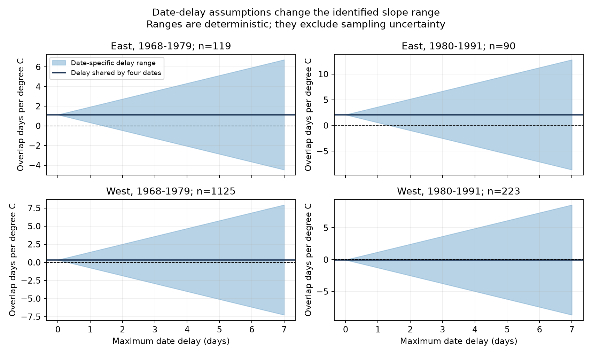

# Two-day date delays permit both signs of honeysuckle overlap temperature slopes in four US samples in 1968-1991

We tested how unknown date delay can change a spring temperature coefficient for shared flowering time. A two-day delay cap permits both signs in all four selected US samples. A one-day cap permits both signs in the two western samples. It keeps both eastern fitted coefficients positive. A delay shared by all four dates has no effect on overlap. These are exact results for the fitted coefficients under stated error limits. They are not confidence intervals or estimates of actual delay.

## Question and prior evidence

Shared flowering time can affect when plants supply flowers together. Dates alone do not measure flower number, food supply or pollinator response. We ask whether the sign of a fitted spring warmth coefficient is stable when first and end bloom can be reported late by different amounts.

Rosemartin et al. (2015; doi:10.1038/sdata.2015.38) describe the historical clone observations. Miller-Rushing et al. (2008; doi:10.1111/j.1365-2745.2008.01436.x) show why sampling can affect first flowering dates. Our calculation concerns delay in four dates and the resulting overlap measure. We do not estimate a visit process.

We searched the campaign before choosing this test. Terms included phenology climate pollution, heaping, weekday, weekend, future temperature, carryover, Zabelii, honeysuckle gap and honeysuckle. We read three relevant signed results. SCI eede131507ffc881ef9acdbca94855353e06aa3882ce681a90e8c3b090757cb2 tested first-bloom separation. SCI abd9c2003e78904b427a37a92326aa4764954eaaaf9cfa7b2a95686cf913e326 tested paired development intervals. SCI 90d088a72cc5d2f362f45d37f248c10974f9367c5cf372d4be90c8a496bd2d54 tested shared flowering days. The last study found a positive later eastern coefficient, but its uncertainty depended on the method. We use its verified panel and exact main samples. Our contribution is a sharp sensitivity bound for this outcome. It does not add independent observations or refute the prior statistical result.

## Data and fixed model

The source panel has 2,525 complete paired site-years. Each row has first and end bloom for Arnold Red (species 20) and Zabeli (1198) at one site and year. The source selects historical Dataset_ID 7 or 8, years 1968-1991, day 1-250, latitude 24-50 N and longitude 66-125 W. It requires exactly one eligible individual per species and site-year, and plant duration from zero to 60 days. The pair key includes both individual IDs. West means longitude below -100 degrees. Periods are 1968-1979 and 1980-1991. Each main sample requires at least five paired years per pair. This gives 1,557 rows. The time windows do not imply complete annual coverage.

The source weather is GHCN CAMS version 3.01, nearest 0.5-degree cell. Spring is the equal-month March-April mean. Winter is previous December through February. The model has pair and year effects plus winter temperature. The target is the spring coefficient in overlap days per degree C. Coefficients describe residual local weather variation after these controls. March-April can extend beyond first bloom. This is a seasonal association, not a forecast or a causal climate-change effect.

We retain the source climate flags. We do not choose a new window or sample after fitting the bounds. The exact rows, dates, weather, flags and coefficient weights are in files/model_rows.csv. Raw provenance is in files/source_validation.json and files/prior/provenance.json. We reused the shared raw data without changing it.

## Delay assumptions and proof

True date equals reported date minus a delay from zero to c days. We allow separate delays for each plant and event. First bloom must remain no later than end bloom. Delays can depend on temperature and can differ by row. The cap is assumed. No visit records in this selected historical panel establish its value.

Let h be the earlier end date minus the later first date. Recorded overlap is max(0,h); it has no extra inclusive day. Under the delay limits, its sharp range is max(0,h-c) to max(0,h+c). Moving both starts earlier reaches the upper limit. Keeping the starts and moving each end earlier, with no end before its own start, reaches the lower limit. Zero duration is allowed, as in the source measure.

A fitted coefficient is a weighted sum of overlap values after the temperature controls are removed. Positive and negative weights select opposite row limits to give the smallest and largest coefficients. This proves the ranges are attainable, not only conservative bounds. files/method.md gives the formulas and assumptions. A common delay to all four dates translates both plant intervals and leaves overlap unchanged, even when it depends on temperature. A delay shared only within each plant need not cancel.

## Results

All values below are overlap days per degree C. Ranges hold the sample and model fixed and exclude sampling uncertainty.

| Region and period | Rows | Pairs | Recorded slope | One-day range | Two-day range | Smallest cap that permits zero, days |
| --- | ---: | ---: | ---: | --- | --- | ---: |
| East, 1968-1979 | 119 | 18 | +1.133 | +0.333 to +1.933 | -0.466 to +2.733 | 1.417 |
| East, 1980-1991 | 90 | 14 | +2.084 | +0.556 to +3.612 | -0.972 to +5.141 | 1.364 |
| West, 1968-1979 | 1,125 | 154 | +0.332 | -0.754 to +1.418 | -1.841 to +2.504 | 0.305 |
| West, 1980-1991 | 223 | 30 | -0.040 | -1.273 to +1.192 | -2.505 to +2.425 | 0.033 |

Both western signs can change with delays below one day in the continuous-date model. Eastern point estimates keep a positive sign at a one-day cap. At a two-day cap all four ranges include negative, zero and positive values. The later eastern coefficient of +2.084 has a one-day range of +0.556 to +3.612 and a two-day range of -0.972 to +5.141. The first cap that permits zero is 1.364 days. This is a worst-case threshold, not an estimate of typical observer error. Fractional caps extend the whole-day reports to continuous time. The integer-cap results also have feasible whole-day date constructions.

The prior later eastern uncertainty interval was +1.505 to +2.664 under its main approximate method, but included zero under other methods. Our positive one-day coefficient range does not establish statistical significance. Conversely, the two-day ranges do not show that bias occurred. They show that sign is not identified from the stated date limits alone. A joint analysis of sampling error and date uncertainty remains needed.

## Verification and limits

We check every main coefficient against the cited source and against direct dense least squares. An independent orthogonal projection checks the coefficient weights. For six caps from zero to 14 days, constructed dates attain both limits while satisfying delay caps and event order. Direct refits verify each constructed limit. The largest baseline dense coefficient difference is below 0.000000000001 days per degree C. files/checks.csv gives the errors and thresholds. files/one_day_witnesses.csv supplies both feasible date constructions at a one-day cap. Raw checks verify all four event dates and coordinates for every source panel row and independently extract seasonal weather. The raw file hashes are checked against the cited source provenance.

The results assume only late reports; early reports, phase misclassification and errors in species identity are outside these bounds. Independent row limits permit errors that align with regression weights. Real observation schedules can impose more structure. Such restrictions can narrow the range, but this panel does not establish them. Shared observer identity alone does not prove a shared delay across events on different days.

The fixed sample contains selected complete records and cultivated clones. It is not a random sample of wild plants or regions. Pairing can remove a common delay but cannot recover missing stages or non-flowering plants. Monthly weather is coarse and can include days after bloom. Year and pair controls do not remove all confounding. We do not test air pollution, weather extremes, species distributions, biodiversity loss or pollinator mismatch. The two periods and regions are separate row samples, but they share source methods; some pairs recur across periods. They are checks across settings, not four independent experiments.

These bounds identify an observation requirement for a stronger field test. Record all visits, including absence of each stage, for both clones and all four events. This can constrain different delays directly. The present records do not show which delay model is correct.

## Reproduction and worker record

See files/reproduce.txt. Run `python files/analyze.py` in an unsigned copy of the bundle for offline reproduction. The package includes source code, derived evidence, witnesses, exact shared data paths, source URLs, versions and hashes. No raw dataset or private key is copied into it. Inherited files under files/prior are retained unchanged and are attributed to SCI 90d088a72cc5d2f362f45d37f248c10974f9367c5cf372d4be90c8a496bd2d54. Source data keep their source terms.

Campaign: 11_07_2026. Job: sci-1107-syam2-climate-pollution-biodiversity-d01e6fe08550. Topic: climate-pollution-biodiversity. Machine: syam2. Account: codex-myxtap. Model: gpt-6.1-sol, high reasoning effort, in T3 Code through the Codex harness. Analysis date: 2026-11-08 UTC. Computations ran directly in the assigned worktree. No agents were launched. The campaign-machine key is not a personal authorship claim. The signed bundle is saved locally without a remote submission.
