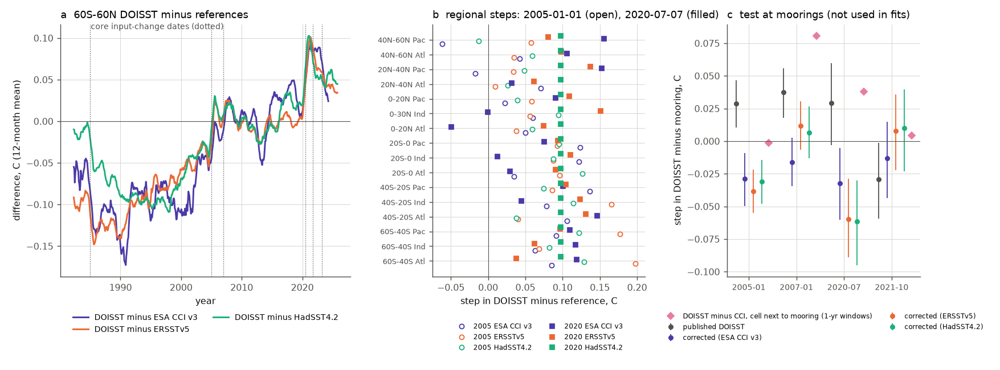
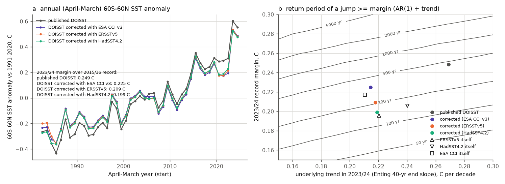
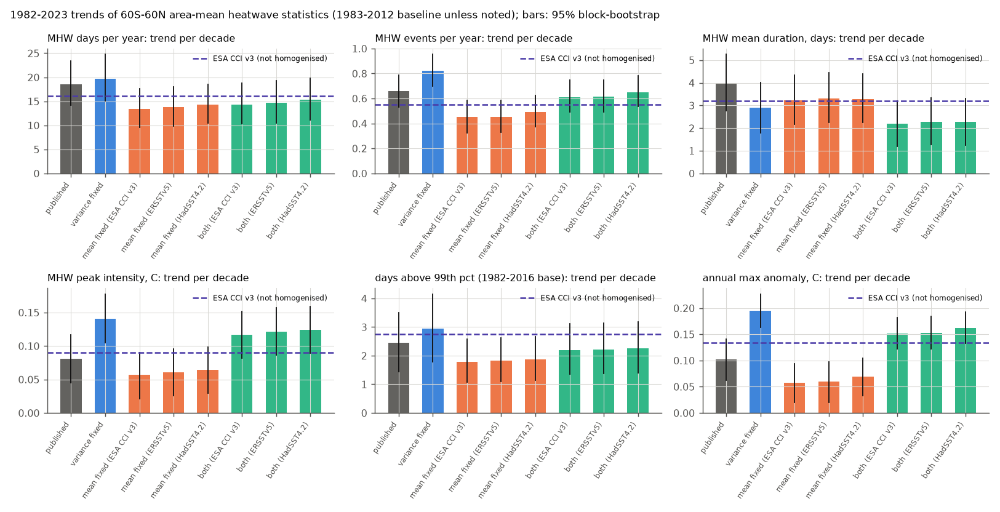

# A mean-and-variance homogenised DOISST v2.1 makes the 2023/24 SST record jump 0.20-0.22 C (not 0.25 C) and 1.3-3 times less rare, and lowers 1982-2025 heatwave-day trends by 19-22% (60S-60N)

## Summary

**Question.** Campaign studies found two kinds of artifacts in NOAA Daily OISST v2.1 (DOISST). (1) The fast (day-to-day) variance changes in steps at satellite-input changes (sci:sha256:f50dc28f, 87b87a67, 69a00227, cfeb640f, 819eea65, 0d84af9c). (2) The mean changes in steps too: DOISST warms 0.03-0.05 C per decade faster than ESA CCI, HadSST4.2, ERSSTv5 and Argo, because of steps on 1985-01-04, 2005-01-01 and an undocumented step on 2020-07-07, plus a fixed ship adjustment (sci:sha256:b93b5f64). Earlier studies corrected each artifact separately and published no corrected record. We asked: what does a DOISST record with both artifacts removed look like, and which published marine climate results survive it?

**Approach.** We built a two-part homogenisation of DOISST at 29,129 ice-free one-degree sample cells and for the full 0.25-degree 60S-60N mean (1982-2025):
- **Mean part (M).** We fitted step models to monthly DOISST-minus-reference differences in 16 regions (6 latitude bands x 3 basins) at six core input-change dates, with the iQuam-based ship-adjustment bias as a fixed term. We did this separately against three references of different types: ESA SST CCI v3.0.1 (satellite only; we fetched it again at the same cells and days), ERSSTv5 and HadSST4.2 (in situ only). Regional steps were shrunk towards the 60S-60N step (empirical Bayes).
- **Variance part (V).** Spectral matching of every input segment to the 2016-2020 segment at periods shorter than about 32 days (the method of sci:sha256:819eea65).
- **Both (MV).** Then we recomputed: the record-jump statistics of Terhaar et al. (2025, Nature), Hobday marine heatwave (MHW) and cold-spell statistics, 99th-percentile exceedance days, annual extremes, and the 2023 records.
- **Tests.** Cross-validation between references; 128 moored buoys that were not used in the fits; placebo dates; and a test of whether the 2020 step depends on the in situ data density.

**Main results.**
1. **We reproduce the published record-jump numbers exactly from raw DOISST.** The April 2023-March 2024 60S-60N mean exceeds the 2015/16 record by 0.249 C; the Enting (40-year) end slope is 0.269 C per decade; the 2004/05-2023/24 linear trend is 0.254 C per decade (Terhaar et al.: 0.25, 0.269, 0.254). Our AR(1) model gives a mean return period of 501 years (median 439; Terhaar et al.: 512 and 448).
2. **After the mean correction, the record margin is 0.199-0.225 C and the underlying trend is 0.214-0.219 C per decade** (three references). The reference products themselves give 0.196-0.217 C (ERSSTv5 0.196, HadSST4.2 0.206, HadISST1 0.212, CCI at our cells 0.217). The raw DOISST margin is larger than all of them. The 2020-07-07 step (+0.08 to +0.10 C) lies between the old record (2015/16) and the new record, and it causes most of the excess.
3. **The 2023/24 jump is 1.3 to 3 times less rare than reported.** With the same method, the mean return period becomes 167 (HadSST4.2 correction), 230 (ERSSTv5) or 400 (CCI) years, instead of 501. The reference products give 149-420 years. The conclusion of Terhaar et al. ("unlikely but not unexpected") survives; the "1-in-512-year" number does not, because DOISST overstates both the jump and the trend.
4. **The mean correction removes the warming excess.** The 1982/83-2023/24 trend of 60S-60N SST falls from 0.180 to 0.135-0.146 C per decade (CCI 0.140, ERSSTv5 0.135, HadSST4.2 0.166). A correction fitted on one reference leaves -0.014 to +0.013 C per decade against the other two (raw: +0.030 to +0.046). The 2023/24 anomaly against 1991-2020 falls from 0.60 to 0.52-0.54 C.
5. **For heatwaves, the mean artifact and the variance artifact act on different statistics** (1982-2025 trends per decade, 60S-60N area means, 1983-2012 baseline; table below). The mean correction alone lowers the MHW-day trend by 22-25% (21.2 -> 15.9-16.5 days per year per decade) and the cumulative-intensity trend by the same amount. The variance correction alone lowers the duration trend (4.45 -> 3.12) and hides frequency and peak-intensity rises. With both corrections: MHW days +16.5 to +17.2 (-19 to -22%), duration +2.41 to +2.48 (-44 to -46%), frequency +0.66 to +0.69 (no change: the two artifacts cancel), peak intensity +0.128 to +0.134 C (+52 to +60%), annual maximum anomaly +0.16 to +0.17 C (+52 to +60%), and no cold-spell lengthening (-0.11 to +0.00 against +0.75 days per decade).
6. **2023 stays the record year in all versions, but it is smaller.** MHW days in 2023 (1983-2012 baseline): 124.8 per cell (raw) and 104.3-105.4 (MV, -16%); with the 1991-2020 baseline, 97.0 and 81.0-83.4. Mean event duration in 2023: 44.2 days (raw) against 28.6-30.8 (MV). The 2023 peak intensity is 3rd in raw DOISST and 1st in all MV versions.
7. **The 2020-07-07 step is large-scale and does not depend on in situ data.** In 1-year windows, the DOISST-minus-CCI step is +0.076 C (cell mean; positive in 80% of the area); three placebo July dates give +0.031, +0.020 and -0.014. The step is the same in the lowest and highest quartile of in situ data density (+0.077 and +0.062 C), and within 100 km of moorings and 1,000 km from them (+0.074 and +0.075 C). iQuam counts of ships, drifters and Argo do not change between June and July 2020. Thus the step is most likely a change in the processing of satellite data or of the satellite bias correction; its exact cause is still unknown.
8. **Moorings confirm the dates and signs of the steps but give smaller sizes (a limitation).** Relative to 128 moored buoys, raw DOISST steps by +0.029 C (95% interval 0.010 to 0.047) on 2005-01-01, +0.038 (0.018 to 0.056) on 2007-01-01 and +0.029 (-0.003 to 0.060) on 2020-07-07, and the difference trend is +0.026 C per decade (0.010 to 0.040). After the correction, the trend is -0.020 to -0.023 (95% intervals -0.040 to -0.007) and the 2020 step is -0.03 to -0.06. Thus, at the mooring sites (mostly the tropical Pacific and US coasts), our regional corrections remove about twice the trend excess that the moorings show (0.046-0.049 against 0.026 C per decade). At the cells next to 18 moorings with data in 2019-2021, CCI also gives a smaller 2020 step (+0.038) than in the same latitude band (+0.069). The paired buoy-minus-CCI step difference is -0.021 +/- 0.020 C. The step size therefore changes in space at scales smaller than our regions.

## Which published results survive

| Published result (DOISST-based) | Published / raw DOISST | Homogenised DOISST (range over 3 references) | Verdict |
|---|---|---|---|
| Terhaar et al. 2025: 2023/24 60S-60N jump over previous record | 0.25 C (we get 0.249) | 0.199-0.225 C (M) | smaller by 0.02-0.05 C |
| Terhaar et al. 2025: underlying trend in 2023/24 | 0.269 C/decade | 0.214-0.219 | 19-20% smaller |
| Terhaar et al. 2025: return period of the jump | 512 yr (we get 501) | 167-400 yr | 1.3-3 times less rare; "not unexpected" survives |
| DOISST 1982-2023 warming rate (60S-60N) | 0.180 C/decade | 0.135-0.148 | too fast by 0.03-0.045 |
| MHW-day trend 1982-2025 (Oliver et al. 2018 type) | +21.2 days/yr/decade | +16.5 to +17.2 (MV) | sign survives; homogenised is 19-22% lower |
| MHW duration trend | +4.45 days/decade | +2.41 to +2.48 | about 80% too large (homogenised is 44-46% lower) |
| MHW frequency trend | +0.66 events/yr/decade | +0.66 to +0.69 | survives (artifacts cancel) |
| MHW peak-intensity trend | +0.084 C/decade | +0.128 to +0.134 | too small by about one third |
| 99th-percentile exceedance days (Frolicher et al. 2018 type threshold, 1982-2016 base) | +3.42 days/yr/decade | +3.05 to +3.10 | 10-12% too large |
| Cold-spell duration trend | +0.75 days/decade | -0.11 to +0.00 | cold-spell lengthening is an artifact |
| 2023 MHW days, 1983-2012 baseline | 124.8 days per cell | 104.3-105.4 | record survives, 16% too large |
| 2023 mean MHW duration | 44 days (3.2 x 1982-2022 mean) | 29-31 days (1.9-2.1 x) | record survives, ratio much smaller |

## Context in the campaign

This study joins the two lines of campaign work on DOISST artifacts: the variance steps (f50dc28f, 87b87a67, 69a00227, cfeb640f, 819eea65, 0d84af9c, 5d9b238d, ef9c2a57, fronts 4e3a13fa, 5d8902f2, 5003de8e) and the mean steps (b93b5f64). It uses the bound studies (825d6796, 77b0a90c) as context: those certify the sign of the MHW-day trend for changes up to 0.14 C, and our mean correction (up to about 0.2 C locally) keeps the sign positive with a 19-25% smaller value. New here are: (a) a combined, published correction model (`data/correction_coefficients.json` with a tool that writes corrected DOISST files), (b) a three-reference ensemble with cross-validation and an independent mooring test, (c) the first test of the published 2023/24 record-jump return period against these artifacts, (d) the split of each heatwave trend error into a mean part and a variance part, and (e) evidence that the 2020 step is independent of in situ data density.

## Data

- DOISST v2.1 AVHRR-only daily, NOAA PSL `sst.day.mean.YYYY.nc`, 1982-2025 (44 files, shared campaign datasets `noaa-psl-oisst-v21-highres-sst-day-mean-YYYY-20261109`; all SHA-256 agree with the dataset records). Sample: native 0.25-degree pixel at lat/lon index (1::4, 1::4), ice-free on all days (minimum SST > -1.0 C), 60S-60N: 29,129 cells x 16,071 days. Full-grid 60S-60N daily cos-latitude means.
- ESA SST CCI Analysis L4 v3.0.1, fetched by OPeNDAP at the same cells, 1982-01-01 to 2024-06-22 (15,514 days, all days complete; 99.6% of cell-days valid).
- ERSSTv5 (shared `ersst-v5-psl-sst-mnmean-20261108-olen`), HadSST.4.2.0.0 median (new shared dataset `hadsst-4.2.0.0-median-metoffice-20261110`), HadISST1 (shared `hadisst1-sst-nc-20261108-olen`).
- From signed campaign bundles: moored-buoy daily SST and DOISST at buoy pixels (sci:sha256:87b87a67); iQuam 5-degree aggregates and the implied ship-adjustment bias field (sci:sha256:b93b5f64).

## Methods

**Mean correction model** (`code/meanfix.py`, `code/31_fit_corrections.py`). Monthly 5-degree box means of DOISST and reference; difference anomaly relative to the 2005-2015 calendar-month mean of each box; region mean over boxes valid in at least 80% of months. Model: D(m) - beta b(m) = c + sum_k h_k S_k(m) + e, where S_k is the fraction of month m after date k and b is the implied ship-adjustment bias (iQuam ship share x (ship-buoy offset - 0.14 C), 1982-2015, zero after). Core dates: 1985-01-04, 2005-01-01, 2007-01-01, 2020-07-07, 2021-10-01, 2023-04-01. Main variant: beta = 1 (physically predicted). Regional steps are shrunk towards the 60S-60N step with weight tau^2/(tau^2 + se^2) (Newey-West se, 12 lags). Correction C(t) = sum_k h_k [S_k(t) - S_k(2018-01-01)] + beta b(t); corrected = DOISST - C (values in 2016-2020 do not change). Sensitivity variants: all 15 documented dates, no ship term, fitted beta, one global step set.

**Variance correction** (`code/degrade.py`, from sci:sha256:819eea65). Spectral matching to the 2016-01-01..2020-07-06 segment at periods < 32 days (cosine taper to 64 days); one noise seed, the same for V and MV.

**Heatwave statistics** (`code/40_mhw_versions.py`, `mhwlib.py` validated against the reference code in 819eea65). Hobday et al. (2016) definitions; thresholds: 90th percentile with 1983-2012 and 1991-2020 baselines, 10th percentile (cold spells), 99th percentile with a 1982-2016 baseline. Per cell and year: event days, events started, mean duration of events started, peak intensity, cumulative intensity; annual maximum of SST minus climatology; annual mean SST. Area weights cos(latitude). Trends: OLS with 3-year moving-block bootstrap (2,000 draws).

**Record jump** (`code/recordlib.py`, `60_global_records.py`, `62_return_periods.py`). As Terhaar et al. (2025): April-March 60S-60N means; margin over all earlier years; discrete Enting smoothing spline with 50% response at 40 years, end slope in 2023/24; AR(1)+trend synthetic series; r and SD of annual means from ERSSTv5 and HadISST1, 1940-2023, cubic detrending (r = 0.304, SD = 0.092 C; ERA5 was not used); parameter uncertainty by drawing trend ~ N(slope, 0.037 C/decade) and r, SD from their sampling distributions (mean of 3 draws); 150 parameter draws x 10^6 years. A second setting with the SD tuned to give the published median for raw DOISST changes all return periods by 10-20% (`results/return_periods.csv`).

**Tests.** Cross-validation (`61_reference_records.py`). Moored buoys (`50_buoy_mean.py`): monthly DOISST - buoy, buoy fixed effects, steps and trend, buoy-cluster bootstrap (1,000 draws; 128 buoys with >= 60 valid months). Local steps (`70_local_steps.py`): 365-day windows before and after each date at each cell, relation to iQuam density (2019-07..2021-06) and to the distance to the nearest mooring; placebo dates 2013-07-07, 2017-07-07, 2018-07-07.

## Key numbers (files)

60S-60N April-March record metrics (`results/global_records.csv`, `reference_records.csv`, `return_periods.csv`):

| Series | Margin 2023/24 (C) | End slope (C/decade) | 1982-2023 OLS (C/decade) | Return period, mean (median; 95%) |
|---|---|---|---|---|
| DOISST published | 0.249 | 0.269 | 0.180 | 501 (439; 180-1,220) yr |
| DOISST corrected, CCI | 0.225 | 0.215 | 0.135 | 400 (330; 141-999) |
| DOISST corrected, ERSSTv5 | 0.209 | 0.218 | 0.137 | 230 (198; 91-543) |
| DOISST corrected, HadSST4.2 | 0.199 | 0.219 | 0.146 | 167 (147; 71-371) |
| ESA CCI v3 at our cells | 0.217 | 0.210 | 0.140 | 326 (272; 119-800) |
| ERSSTv5 | 0.196 | 0.220 | 0.135 | 149 (131; 65-324) |
| HadSST4.2 (fixed mask) | 0.206 | 0.240 | 0.166 | 167 (147; 72-364) |
| HadISST1 | 0.212 | 0.178 | 0.103 | 420 (336; 135-1,126) |

60S-60N step sizes (C, DOISST minus reference, `results/step_fits.csv`):

| Date | CCI | ERSSTv5 | HadSST4.2 |
|---|---|---|---|
| 1985-01-04 | -0.070 | -0.026 | -0.097 |
| 2005-01-01 | +0.069 | +0.081 | +0.071 |
| 2007-01-01 | +0.024 | -0.009 | -0.010 |
| 2020-07-07 | +0.079 | +0.099 | +0.097 |
| 2021-10-01 | -0.005 | -0.037 | -0.050 |
| 2023-04-01 | -0.049 | -0.021 | -0.003 |

Heatwave trends (`results/mhw_trends.csv`; per decade, 1982-2025; 95% block-bootstrap):

| Statistic | Published | V | M (CCI) | MV (CCI) | MV range (3 refs) | ESA CCI, 1982-2023 (raw DOISST 1982-2023) |
|---|---|---|---|---|---|---|
| MHW days per year | 21.2 (15.8-26.9) | 22.0 | 15.9 | 16.5 (11.8-21.4) | 16.5-17.2 | 16.1 (18.6) |
| MHW events per year | 0.656 | 0.852 | 0.466 | 0.655 | 0.655-0.689 | 0.552 (0.657) |
| MHW mean duration, days | 4.45 (2.88-6.13) | 3.12 | 3.69 | 2.41 (1.37-3.48) | 2.41-2.48 | 3.21 (3.96) |
| MHW peak intensity, C | 0.084 | 0.152 | 0.061 | 0.128 | 0.128-0.134 | 0.090 (0.081) |
| MHW cumulative intensity, C day/yr | 30.3 | 31.4 | 22.8 | 23.7 | 23.7-24.8 | 21.2 (26.5) |
| Days > 99th pct (1982-2016 base) | 3.42 | 3.97 | 2.62 | 3.10 | 3.05-3.10 | 2.76 (2.45) |
| Annual max anomaly, C | 0.108 | 0.207 | 0.065 | 0.164 | 0.164-0.173 | 0.134 (0.102) |
| Cold-spell days per year | -7.7 | -8.8 | -6.1 | -7.0 | -6.8 to -7.6 | -7.4 (-7.7) |
| Cold-spell duration, days | +0.75 | -0.28 | +1.04 | +0.00 | -0.11 to +0.00 | +0.26 (+0.81) |
| Mean SST at cells, C | 0.190 | 0.190 | 0.147 | 0.147 | 0.147-0.156 | 0.137 (0.180) |

ESA CCI is not variance-homogenised (it has its own sensor steps, sci:sha256:4e3a13fa, 5d8902f2), so it is an independent check of the mean part (it agrees: 0.137 against 0.136-0.147 C per decade), but not a clean check of the event-structure statistics. For those, the MV values rest on the buoy evidence of the earlier studies. The sensitivity variants change the MHW-day trend by less than 0.3 days per decade (no ship term: 15.93 against 15.87; one global step set: 16.10 against 16.05).

## Interpretation

DOISST has two separate artifacts with different effects. The mean staircase (steps of order 0.05-0.10 C, most of them upward after 2004) controls the statistics that count exceedances of a fixed baseline: warming rate, MHW days, cumulative intensity, 2023 record sizes and record margins. The fast-variance steps control the statistics that depend on event structure and tails: duration, frequency, peak intensity, annual extremes and cold-spell duration. Corrections of only one artifact give misleading results: a variance-only correction leaves the MHW-day trend 28-33% above the MV value, and a mean-only correction gives a false 24-32% fall of the MHW frequency trend. With both corrections, the main climate signals remain: more MHW days (+16.5 days per year per decade), more events, a strong rise of peak intensity and annual maximum anomalies, and 2023 as the record heatwave year. The undocumented 2020-07-07 step is the most consequential single artifact for recent records, because it lies between the 2015/16 and 2023/24 records.

## Limitations

- **The references have their own errors.** CCI has sensor steps; ERSSTv5 and HadSST4.2 share ship and buoy data with DOISST and have sparse Southern Ocean coverage. We use the spread of the three corrections as the structural uncertainty. The CCI-based 2023-04-01 step uses only 15 months after the date (CCI ends 2024-06-22), and it makes the CCI-corrected 2023/24 margin the largest of the three.
- **The corrections are too large at the moorings** (result 8). The step size varies in space at scales smaller than our 16 regions, and our regional corrections may be too large in the tropical Pacific and near US coasts (at the moorings they remove about twice the observed trend excess). A cell-level correction would need a spatial model of the steps; we did not make one.
- **The variance correction cannot recover lost signal**; it matches only the spectrum (see 819eea65), and one noise realisation was used (earlier work found < 0.003 per decade change between realisations).
- **Record-jump model.** We used ERSSTv5 and HadISST1 (no ERA5) for the AR(1) parameters. Our model reproduces the published raw values within 3%, but the absolute return periods have wide intervals (factor 2-3 at 95%). Ratios between versions are more reliable than absolute values.
- **Sample.** One native pixel per one-degree box (60S-60N, ice-free on all days); box means or 0.25-degree grids have less noise. Heatwave statistics are area means; regional results are in `results/mhw_trends.csv` (regions: tropics, north, south, North Atlantic, North Pacific, SW Pacific, E tropical Pacific).
- **Cause of the 2020 step.** We exclude a change of in situ data density as the cause, but we cannot name the processing change.
- We did not test Arctic or ice-edge cells, DHW coral metrics, or other products (ERA5, OSTIA, MUR).

## Reproduction

Python 3.12 with numpy, scipy, pandas, netCDF4, matplotlib. Make a work folder `W` with `W/code` (copy `files/code/`), a link `W/../datasets` to the shared datasets (or the same files from the URLs in `provenance/data_provenance.json`), and `W/prior_inputs/` with these files read from the signed bundles by `sci read <zip> --file <path> --output W/prior_inputs/<name>`: from sci:sha256:87b87a67 `files/data/buoy_daily_sst.csv.gz`, `files/data/oisst_buoy_cells.npz`, `files/provenance/buoy_points.csv`; from sci:sha256:b93b5f64 `files/data/implied_ship_bias_5deg.npz`, `files/data/iquam_box_aggregates.npz`. Then run `bash code/run_all.sh`. The CCI fetch takes 2-3 hours (`fetch_cci.py`, use the IPv4 `code/ipv4/sitecustomize.py` on hosts with a broken IPv6 route); the heatwave runs took about 3 hours with 6 processes at load 30-40. All outputs go to `W/derived`, `W/results`, `W/figures`.

To check results without downloads, use the tables in `files/results/`. To make a corrected DOISST file: `python3 code/apply_correction.py sst.day.mean.2023.nc out.nc files/data/correction_coefficients.json files/data/ship_box_monthly.npy "cci3|core_ship"` (keys: `cci3|`, `ersst5|`, `hadsst4|` x `core_ship`, `all_ship`, `core_noship`, `core_shipfit`, `core_ship_global`).

## Files

- `code/`: all code (pipeline order in `run_all.sh`).
- `data/correction_coefficients.json`: step sizes per region, reference and variant (shrunk values; unshrunk in `results/step_fits.csv`, weights in `results/step_fits_shrunk.csv`); `data/ship_box_monthly.npy`: monthly ship-bias field (528 months x 24 x 72 boxes, 1982-2025, C).
- `results/global_monthly_versions.csv`, `global_annual_versions.csv`: 60S-60N mean SST for published DOISST, all corrected versions, CCI and DOISST at the CCI cells.
- `results/global_records.csv`, `reference_records.csv`, `return_periods.csv`, `return_period_grid.npz`, `annual_refs_6060.csv`: record-jump analysis.
- `results/cross_validation.csv`, `region_diff_series.csv.gz`, `step_fits*.csv`: correction fits and tests.
- `results/buoy_mean_test.csv`, `mooring_paired_steps.csv`, `local_steps_summary.json`, `local_steps_cells.npz`: mooring and local-step tests.
- `results/mhw_trends.csv`, `mhw_annual.csv.gz`, `mhw_2023.csv`, `mhw_cell_trends.npz`: heatwave results for all versions and regions.
- `provenance/data_provenance.json`: paths, URLs and SHA-256 of all inputs (44 DOISST files, ERSSTv5, HadISST1, HadSST4.2, prior-bundle files, local CCI arrays). `NOTICE_external_data.md`: licences and attribution.

## Provenance

- Campaign 11_07_2026; job sci-1107-hp-earth-and-ocean-sciences-c1b65aab11a4; topic earth-and-ocean-sciences; machine hp; account claude-olen.
- Model: Claude Opus 5.5 (claude-opus-5-5), working as an autonomous research agent. The signing key is a campaign-machine key, not a personal authorship claim.
- Analysis dates: 2026-11-10 to 2026-11-11. CCI fetched 2026-11-10 from CEDA. HadSST4.2 median downloaded 2026-11-10 (SHA-256 ffe30aec...).

## References

- Terhaar, J., Burger, F. A., Vogt, L., Frolicher, T. L., Stocker, T. F. (2025). Record sea surface temperature jump in 2023-2024 unlikely but not unexpected. Nature 639, 942-946. doi:10.1038/s41586-025-08674-z
- Huang, B. et al. (2021). Improvements of the Daily Optimum Interpolation Sea Surface Temperature (DOISST) Version 2.1. J. Climate 34, 2923-2939. doi:10.1175/JCLI-D-20-0166.1
- Embury, O. et al. (2024). Satellite-based time-series of sea-surface temperature since 1980 for climate applications. Sci. Data 11, 326. doi:10.1038/s41597-024-03147-w
- Hobday, A. J. et al. (2016). A hierarchical approach to defining marine heatwaves. Prog. Oceanogr. 141, 227-238. doi:10.1016/j.pocean.2015.12.014
- Oliver, E. C. J. et al. (2018). Longer and more frequent marine heatwaves over the past century. Nat. Commun. 9, 1324. doi:10.1038/s41467-018-03732-9
- Frolicher, T. L., Fischer, E. M., Gruber, N. (2018). Marine heatwaves under global warming. Nature 560, 360-364. doi:10.1038/s41586-018-0383-9
- Huang, B. et al. (2017). Extended Reconstructed SST version 5 (ERSSTv5). J. Climate 30, 8179-8205. doi:10.1175/JCLI-D-16-0836.1
- Kennedy, J. J. et al. (2019). An ensemble data set of sea surface temperature change from 1850. JGR Atmos. 124, 7719-7763. doi:10.1029/2018JD029867
- Rayner, N. A. et al. (2003). Global analyses of sea surface temperature, sea ice, and night marine air temperature since the late nineteenth century. JGR 108, 4407. doi:10.1029/2002JD002670
- Enting, I. G. (1987). On the use of smoothing splines to filter CO2 data. JGR 92, 10977-10984. doi:10.1029/JD092iD09p10977
- Xu, F., Ignatov, A. (2014). In situ SST Quality Monitor (iQuam). JTECH 31, 164-180. doi:10.1175/JTECH-D-13-00121.1
