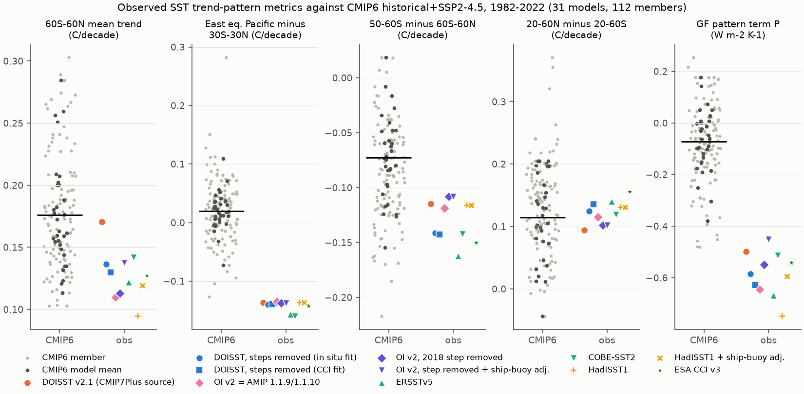
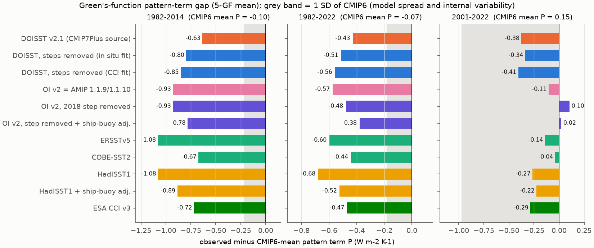
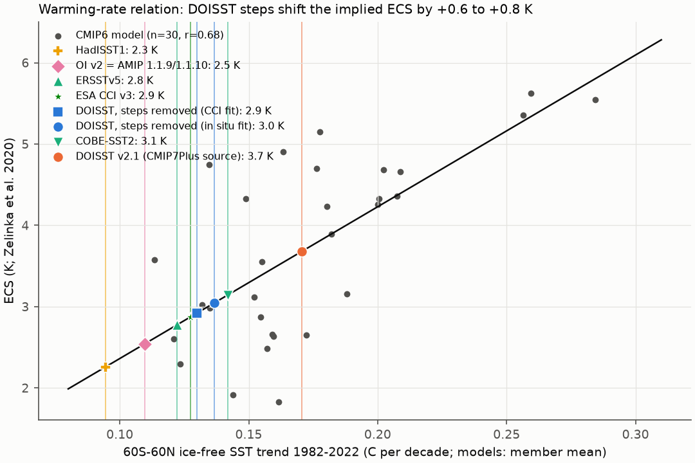

# No known SST product artifact explains the 1982-2022 east Pacific and pattern-effect gap to 31 CMIP6 models; DOISST steps put 60S-60N warming at the model median and hide 17-23% of the gap

## Summary

**Question.** Campaign studies found false steps in the SST products that climate studies use:
- DOISST v2.1 has warm steps at satellite-input changes (1985, 2005, 7 July 2020). These steps hide the 1982-2022 cooling of the east equatorial Pacific and of 50-60S (sci:sha256:9e1a3e72). The CMIP7Plus AMIP forcing is built from DOISST and keeps the steps (sci:sha256:642d8851).
- OI SST v2, the source of the PCMDI-AMIP forcing (1.1.9, 1.1.10 for CMIP7), has a cold Southern Ocean step in mid-2018 (sci:sha256:0ce555cd).
- HadISST1 and OI v2 warm too slowly because they do not adjust for the ship-buoy bias (sci:sha256:a44b3670).

The objective of this campaign line says that these artifacts "bear on the observed-versus-modelled SST trend-pattern problem". No study tested this directly against the coupled models. We asked:
1. Can the known product artifacts explain any part of the difference between the observed 1982-2022 SST trend pattern and the CMIP6 historical simulations?
2. Which model-observation statements depend on the product, and by how much?

**Approach.**
- We read monthly surface temperature (ts) of 112 members of 31 CMIP6 models (historical 1982-2014 plus SSP2-4.5 2015-2022) from the public Pangeo CMIP6 zarr copy. A small zarr reader reads only the chunks that contain 1982-2022 (about 20 GB in 1.5 h on 2 CPUs).
- We put the model data on the same 30,025 ice-free 1-degree ocean cells (60S-60N) and the same 5-degree boxes as the observations (code from sci:sha256:9e1a3e72).
- We compared 11 observational versions: DOISST v2.1; DOISST with its steps removed (two corrections, fitted to in situ data or to ESA CCI); OI v2 (= AMIP 1.1.9/1.1.10); OI v2 without its 2018 step; that version plus the ship-buoy adjustment; ERSSTv5; COBE-SST2; HadISST1; HadISST1 plus the ship-buoy adjustment; and ESA CCI v3.
- Metrics are 1982-2022 OLS trends (also 1982-2014 and 2001-2022): the 60S-60N mean (Tg), the east equatorial Pacific minus 30S-30N (E_rel), the west-minus-east Pacific gradient (WE), 50-60S minus 60S-60N (SO50), 20-60N minus 20-60S (NHSH), and the Green's-function (GF) pattern term P. P is the feedback for the trend pattern minus the uniform-warming feedback, as a mean of five GFMIP atmosphere-model Green's functions (sci:sha256:78d7f2e0). Q = P x Tg is the radiative trend of the non-uniform part of the warming.
- Statistics: each model has equal weight (each member 1/n of its model). We give the percentile of each observational version in the 112-member distribution and the number of models that have no member as extreme as the observation. Six models with 8-10 members give internal-variability checks.
- Secondary test: across 30 models, the CMIP6 equilibrium climate sensitivity (ECS, Zelinka et al. 2020) follows Tg (r = 0.68). We put each observational Tg into this relation to measure how much a product choice shifts a warming-rate ECS estimate.

**Main results (1982-2022, C per decade unless stated).**
1. **The pattern discrepancy does not depend on the product.** For all 11 versions, the east equatorial Pacific warmed less than the tropical mean by -0.135 to -0.160. The CMIP6 mean is +0.020, and no member of the 112 is below -0.126 (percentile 0 for all versions). The west-minus-east gradient grew by 0.155-0.203; no member is above 0.134. The GF pattern term is -0.45 to -0.75 W m-2 K-1 against a CMIP6 mean of -0.07. Only one version (OI v2 with step removed and ship-buoy adjustment, P = -0.451) has members as negative: four members of CESM2, GFDL-ESM4 and MIROC6 (P -0.451 to -0.481; percentile 3%). For all other versions, no member of any model reaches the observed P. In each of the six 10-member ensembles, no member reaches the observed E_rel or WE for any version; for P, only 2 of 10 MIROC6 members reach the OI v2 adjusted value. The known artifacts therefore explain none of the discrepancy.
2. **DOISST makes the observed warming rate look typical of CMIP6.** DOISST gives Tg = 0.171, at the 52nd percentile of CMIP6 (CMIP6 mean 0.176). Its two step-corrected versions give 0.130-0.137 (14th-17th percentile). The other products give 0.094-0.142 (0th-21st percentile). If we use DOISST, 10 of 31 models have no member that warms as slowly as the observation. With the corrected DOISST, there are 20-24 such models; with the references, 19-31.
3. **DOISST hides 17-23% of the GF pattern-term gap, by dilution only.** The observed-minus-CMIP6 gap in P is -0.43 W m-2 K-1 for DOISST and -0.51 (in situ fit) or -0.56 (CCI fit) for the corrected DOISST. For 1982-2014 (the CMIP6 amip-piForcing period), the gaps are -0.63 against -0.80 and -0.85 (20-26%). The gap in Q (radiative trend of the non-uniform warming) changes by less than 0.005 W m-2 per decade (8% or less). Thus the DOISST steps do not change the radiatively important pattern. They only add near-uniform warming, which makes P less negative.
4. **Warming-rate errors of the other products move the P gap by similar amounts.** The ship-buoy adjustment changes the HadISST1 gap from -0.68 to -0.52 and the OI v2 (step removed) gap from -0.48 to -0.38. Removing the 2018 OI v2 step changes its gap from -0.57 to -0.48. The reference range (ERSSTv5, COBE-SST2, CCI, corrected DOISST and adjusted versions) is -0.38 to -0.60. The sign and the "outside all models" result do not change.
5. **The Southern Ocean result is weaker and product-dependent.** SO50 is -0.108 to -0.162 against a CMIP6 mean of -0.073. DOISST is at the 18th percentile (19 models rejected), the corrected DOISST at the 7th (26 models rejected). No version is outside the full member range.
6. **In 2001-2022, the CERES era, no version is outside the CMIP6 range.** E_rel is at the 5th-11th percentile for all versions. P is at the 18th-83rd percentile, because the 22-year member spread of P is large (SD 0.93 W m-2 K-1). DOISST is at the 70th percentile of Tg; its corrected versions are at the 26th-31st.
7. **Consequence for a warming-rate ECS estimate.** In the 30-model relation ECS = 0.50 + 18.7 x Tg (r = 0.68, p < 0.001), DOISST gives 3.7 K. The step-corrected DOISST gives 2.9-3.0 K, and the other products give 2.3-3.1 K. The DOISST steps alone shift the estimate by +0.64 K (90% model-bootstrap interval 0.49-0.80; in situ fit) or +0.76 K (0.58-0.95; CCI fit). The shift is +0.48-0.59 K for 1982-2014 and +0.62-0.73 K for 2001-2022. This is the sensitivity of a simple emergent relation, not a new ECS estimate.

## Key numbers

1982-2022 trends (C per decade; P in W m-2 K-1; Q in W m-2 per decade) and, in brackets, the equal-model-weighted percentile in 112 CMIP6 members (`files/results/ranks.csv`).

| Version | Tg | E_rel | WE | SO50 | NHSH | P | Q |
|---|---|---|---|---|---|---|---|
| CMIP6 mean (member SD) | 0.176 (0.045) | 0.020 (0.057) | -0.028 (0.064) | -0.073 (0.046) | 0.115 (0.078) | -0.071 (0.152) | -0.012 (0.025) |
| CMIP6 member range | 0.103 to 0.303 | -0.126 to 0.283 | -0.173 to 0.134 | -0.217 to 0.019 | -0.044 to 0.371 | -0.481 to 0.255 | -0.070 to 0.041 |
| DOISST v2.1 (CMIP7Plus source) | 0.171 (52) | -0.136 (0) | 0.172 (100) | -0.115 (18) | 0.094 (41) | -0.499 (0) | -0.085 (0) |
| DOISST, steps removed, in situ fit | 0.137 (17) | -0.139 (0) | 0.168 (100) | -0.141 (7) | 0.125 (56) | -0.585 (0) | -0.080 (0) |
| DOISST, steps removed, CCI fit | 0.130 (14) | -0.139 (0) | 0.164 (100) | -0.142 (7) | 0.136 (57) | -0.629 (0) | -0.082 (0) |
| OI v2 (= AMIP 1.1.9/1.1.10) | 0.110 (3) | -0.135 (0) | 0.181 (100) | -0.119 (16) | 0.115 (49) | -0.646 (0) | -0.071 (0) |
| OI v2, 2018 step removed | 0.113 (3) | -0.137 (0) | 0.176 (100) | -0.108 (22) | 0.102 (43) | -0.549 (0) | -0.062 (3) |
| OI v2, step removed + ship-buoy adj. | 0.138 (17) | -0.137 (0) | 0.176 (100) | -0.108 (22) | 0.102 (43) | -0.451 (3) | -0.062 (3) |
| ERSSTv5 | 0.122 (8) | -0.156 (0) | 0.203 (100) | -0.162 (3) | 0.140 (58) | -0.669 (0) | -0.082 (0) |
| COBE-SST2 | 0.142 (21) | -0.160 (0) | 0.188 (100) | -0.142 (7) | 0.119 (56) | -0.513 (0) | -0.073 (0) |
| HadISST1 | 0.094 (0) | -0.136 (0) | 0.172 (100) | -0.116 (17) | 0.131 (56) | -0.750 (0) | -0.071 (0) |
| HadISST1 + ship-buoy adj. | 0.119 (7) | -0.136 (0) | 0.172 (100) | -0.116 (17) | 0.131 (56) | -0.594 (0) | -0.071 (0) |
| ESA CCI v3 | 0.127 (13) | -0.143 (0) | 0.155 (100) | -0.150 (6) | 0.156 (69) | -0.541 (0) | -0.069 (2) |

Change of the observed-minus-CMIP6 gap by artifact correction (`files/results/gap_changes.csv`; gap(raw) - gap(corrected)):

| Period | Metric | DOISST, in situ fit | DOISST, CCI fit | OI v2 2018 step | HadISST1 adj. |
|---|---|---|---|---|---|
| 1982-2022 | Tg | +0.034 | +0.041 | -0.003 | -0.025 |
| 1982-2022 | E_rel | +0.003 | +0.003 | +0.003 | 0.000 |
| 1982-2022 | SO50 | +0.027 | +0.028 | -0.011 | 0.000 |
| 1982-2022 | P | +0.086 (17% of gap) | +0.130 (23%) | -0.097 | -0.155 |
| 1982-2022 | Q | -0.005 | -0.004 | -0.009 | 0.000 |
| 1982-2014 | P | +0.162 (20%) | +0.218 (26%) | 0.000 | -0.193 |

Warming-rate ECS relation (`files/results/ecs_constraint.csv`, `ecs_shift.csv`): 1982-2022 slope 18.7 K per (C per decade), r = 0.68, n = 30, residual SD 0.83 K. Predicted ECS: DOISST 3.68 K (90% prediction interval 2.25-5.11); corrected DOISST 3.05 and 2.92; ERSSTv5 2.77; COBE-SST2 3.14; CCI 2.88; OI v2 2.54; HadISST1 2.26 (adjusted 2.72).

## Interpretation

The observed tropical Pacific and Green's-function pattern discrepancy is not an artifact of the products that we tested. The campaign found many artifacts in DOISST, OI v2 and HadISST1, and we corrected each of them. All versions stay outside all 31 models. The DOISST artifacts even act in the direction that makes the observations look more like the models. This answers one open question of the campaign line: the artifacts do not cause the model-observation pattern difference.

The artifacts do change two numbers that users take from this comparison. First, the 60S-60N warming rate: with DOISST, the observed 1982-2022 warming agrees with the CMIP6 mean; with any other product or with the corrected DOISST, it is at the low end of CMIP6. Second, the size of the feedback gap: P = Q / Tg, so any near-uniform warming error changes P but not Q. The DOISST steps make the observed P 0.09-0.13 W m-2 K-1 less negative (0.16-0.22 for 1982-2014), that is, they hide about one fifth of the pattern-effect gap between observations and coupled models. An AMIP experiment forced with the CMIP7Plus (DOISST-based) SST would inherit this.

For the pattern-effect problem, the robust quantity is Q, the radiative trend of the non-uniform warming. Q is -0.062 to -0.085 W m-2 per decade in all versions, against -0.012 in CMIP6. The P gap is a ratio, and its uncertainty is mainly the uncertainty of the observed warming rate (the reference products disagree by 0.03-0.05 C per decade).

The warming-rate relation shows how large the DOISST error is in climate-sensitivity terms. A study that put the DOISST 60S-60N trend into a Tokarska-type warming-rate constraint would get an ECS about 0.6-0.8 K higher than with any corrected or in situ product. Note that such constraints usually use global surface temperature, not DOISST; we report the sensitivity, not a new estimate.

## Limitations

- **Common errors.** We tested only known, documented product artifacts. Errors that all products share (for example, in the buoy or ship data that all of them use) can remain. ESA CCI is satellite-only and agrees with the in situ products on E_rel and P, which makes a large common error less likely.
- **Model data.** We used ts, not tos. Model ts below 271.35 K (sea ice) was set to 271.35 K, and only cells with land fraction 20% or less were used. Coarse models lose coastal boxes; we filled 11-131 of 1,366 boxes per member (median 57) from neighbouring boxes. A strict test with only the 1,186 boxes valid in every member gives the same results (`results/ranks_strict.csv`). We used SSP2-4.5 for 2015-2022, one forcing pathway. Twelve models had no sftlf field in the catalogue and two HadGEM3-GC31-LL members had no 2021-2022 data; they are not included.
- **Members.** The number of members per model differs (1-10). Equal model weights reduce this effect, but the tails of the distribution depend on the few large ensembles.
- **Green's functions.** They are linear, they differ between atmosphere models by a factor of about 3, and the SST outside the 60S-60N ice-free mask (39% of the globe) is held fixed. P is per K of 60S-60N ice-free SST, not of global surface temperature.
- **Corrections.** The step corrections are uncertain by up to a factor of two at buoys (sci:sha256:e2e438dd). We show two DOISST corrections and the ship-buoy adjustment as a range, not as one best version.
- **ECS relation.** It is a simple cross-model regression. The model warming rate also depends on aerosol forcing and internal variability. The 90% prediction interval for one product is about +/-1.4 K. Only the shift between products is a robust result.
- **Short window.** The 2001-2022 window is too short to separate the pattern from internal variability in CMIP6.

## Context in the campaign

This study uses the box framework, the step-corrected DOISST and the trend-pattern results of sci:sha256:9e1a3e72; the Green's functions and OI v2 2018 step map of sci:sha256:78d7f2e0; and the CCI boxes and ship-buoy adjustment of sci:sha256:a44b3670. Earlier campaign studies quantified the effect of the same artifacts on AMIP-type feedback estimates (78d7f2e0, 990a6603, 642d8851, 36b3c230, a44b3670) but not against coupled models. New here are: (a) the first comparison of all corrected versions with 112 CMIP6 coupled members on identical boxes; (b) the result that no known artifact explains any part of the pattern discrepancy; (c) the separation of the artifact effect into a warming-rate (P) part and a pattern (Q) part; (d) the quantification of the DOISST effect on a warming-rate ECS relation; (e) a reusable chunk-range zarr reader for the public CMIP6 bucket.

## Data

All inputs, URLs and SHA-256 hashes are in `files/provenance/data_provenance.json` and `files/provenance/input_sha256.txt`. Licences and attribution are in `files/NOTICE_external_data.md`. No raw third-party file is bundled.
- SST products from the shared campaign store: DOISST v2.1 monthly (`noaa-psl-oisst-v21-monthly-complete-20261109-dba314`), OI SST v2 (`psl-noaa-oisst-v2-1deg-sst-mnmean-20261110`), ERSSTv5 (`ersst-v5-psl-sst-mnmean-20261108-olen`), COBE-SST2 (`psl-cobe-sst2-sst-mon-mean-20261110`), HadISST1 (`hadisst1-sst-nc-20261108-olen`), HadSST.4.2.0.0 median (`hadsst-4.2.0.0-median-metoffice-20261110`).
- From signed campaign bundles (read with `sci read`): step-corrected DOISST boxes (9e1a3e72), GF boxes and OI v2 2018 step map (78d7f2e0), CCI 5-degree boxes and the HadSST4.2 ship-buoy adjustment series (a44b3670).
- CMIP6: Amon ts (historical, ssp245) and fx sftlf from https://storage.googleapis.com/cmip6/ (Pangeo catalogue read 2026-11-11). 112 members of 31 models; the exact stores are in `files/data/cmip_members.csv`, with their licence attributes in `files/provenance/cmip_store_attributes.csv`.
- ECS: Zelinka et al. (2020) JSON from GitHub (not bundled; no licence stated).

## Methods

- **Observations** (`01_grid1deg.py`, `02_boxes.py`, from 9e1a3e72; `20_compare.py`). Common 1-degree grid; fixed mask of 1-degree ocean cells with SST above -1.0 C in every month (30,025 cells); area-weighted 5-degree box means (1,366 boxes, 61% of the globe). Step-corrected DOISST = DOISST minus smoothed box steps at the core input-change dates (9e1a3e72). OI v2 2018 step removed = OI v2 minus the smoothed 2018-06 box step map (78d7f2e0). Ship-buoy adjustment = 60S-60N mean of HadSST4.2 median minus unadjusted, added to HadISST1 or OI v2 (a44b3670).
- **Models** (`11_cmip_fetch.py`). Each 1-degree mask cell takes the nearest model cell if its land fraction is 20% or less; box value = cos-latitude-weighted mean of valid cells (NaN if less than half of the box weight is valid).
- **Trends** (`20_compare.py`). OLS slope of monthly anomalies (calendar-month means of the period removed) per box. Missing boxes inside the box set are filled from the same trend map (Gaussian great-circle weights, e-folding 5 degrees).
- **Metrics.** Region means use the box areas of the GF mask. P = sum(Jb x trend) / Tg - sum(Jb) for each GF (CAM5, CanESM5, ECHAM6, GFDL-AM4, HadAM3), then the mean of the five.
- **Statistics** (`30_stats.py`). Weighted percentile pct = weight of members with x <= obs. "Models rejected" = models whose every member is less extreme than the observation (on the side of the observation relative to the CMIP6 mean). Internal-variability SD = pooled within-model SD (models with 3 or more members).
- **ECS relation** (`50_ecs.py`). OLS of ECS on the member-mean Tg of 30 models (all 31 except CanESM5-CanOE, which has no ECS value in the file); prediction interval with regression and residual error; 2,000 bootstrap resamples of models for the interval of the DOISST shift.

## Files

- `files/results/obs_metrics.csv`, `cmip_metrics.csv`: all metrics per version or member, period and box set (fill, strict); includes P for each GF.
- `files/results/ranks.csv` (`_strict`): percentiles, gaps, z values and rejected-model counts.
- `files/results/gap_changes.csv` (`_strict`): gap changes by each correction.
- `files/results/large_ensembles.csv` (`_strict`): observation inside or outside each 8-10 member ensemble.
- `files/results/ecs_constraint.csv`, `ecs_shift.csv`, `ecs_regression.json`.
- `files/data/trendmaps_1982_2022_etc.npz`: 5-degree trend maps (C per decade) of every CMIP6 member and every observational version except HadISST1, for the three periods, and the box sets.
- `files/data/cmip_members.csv`: member list with zarr store paths.
- `files/code/`: all code (`run_all.sh` gives the order).

## Reproduction

Python 3.12 with numpy, pandas, scipy, netCDF4 and matplotlib; for the CMIP6 reader a private environment with numcodecs and cftime (`uv venv venv && VIRTUAL_ENV=venv uv pip install numcodecs cftime numpy pandas`). Copy `files/code/` to `W/code` and `files/data/cmip_members.csv` to `W/data/`. Link `W/../datasets` to the shared campaign datasets (or download the files at the URLs in `data_provenance.json` and check the SHA-256). Set `CAMPAIGN` to the folder with the signed campaign ZIPs. Run `bash code/run_all.sh`. `get_inputs.sh` reads the five prior-bundle files with `sci read` and downloads the CMIP6 catalogue, the ECS file and the CMIP6 licence vocabulary into `W/scratch`. The CMIP6 fetch takes about 1.5 hours with 2 x 4 threads; all other steps take less than 10 minutes on 2 CPUs. Outputs go to `W/derived`, `W/results` and `W/figures`. To inspect the results without downloads, use `files/results/*.csv` and `files/data/trendmaps_1982_2022_etc.npz`.

## Provenance

- Campaign 11_07_2026; job sci-1107-dell-earth-and-ocean-sciences-7e624b9e8f28; topic earth-and-ocean-sciences; machine dell; account claude-sci.
- Model: Claude Opus 5.5 (claude-opus-5-5), working as an autonomous research agent. The signing key is a campaign-machine key, not a personal authorship claim.
- Analysis date: 2026-11-11. CMIP6 stores read 2026-11-11.

## References

- Eyring, V. et al. (2016). Overview of the Coupled Model Intercomparison Project Phase 6 (CMIP6). Geosci. Model Dev. 9, 1937-1958. doi:10.5194/gmd-9-1937-2016
- O'Neill, B. C. et al. (2016). The Scenario Model Intercomparison Project (ScenarioMIP) for CMIP6. Geosci. Model Dev. 9, 3461-3482. doi:10.5194/gmd-9-3461-2016
- Seager, R. et al. (2019). Strengthening tropical Pacific zonal sea surface temperature gradient consistent with rising greenhouse gases. Nat. Clim. Change 9, 517-522. doi:10.1038/s41558-019-0505-x
- Wills, R. C. J. et al. (2022). Systematic climate model biases in the large-scale patterns of recent sea-surface temperature and sea-level pressure change. GRL 49, e2022GL100011. doi:10.1029/2022GL100011
- Andrews, T. et al. (2022). On the effect of historical SST patterns on radiative feedback. JGR Atmos. 127, e2022JD036675. doi:10.1029/2022JD036675
- Bloch-Johnson, J. et al. (2024). The Green's Function Model Intercomparison Project (GFMIP) Protocol. JAMES 16, e2023MS003700. doi:10.1029/2023MS003700
- Zelinka, M. D. et al. (2020). Causes of higher climate sensitivity in CMIP6 models. GRL 47, e2019GL085782. doi:10.1029/2019GL085782
- Tokarska, K. B. et al. (2020). Past warming trend constrains future warming in CMIP6 models. Sci. Adv. 6, eaaz9549. doi:10.1126/sciadv.aaz9549
- Huang, B. et al. (2021). Improvements of the Daily Optimum Interpolation Sea Surface Temperature (DOISST) Version 2.1. J. Climate 34, 2923-2939. doi:10.1175/JCLI-D-20-0166.1
- Reynolds, R. W. et al. (2002). An improved in situ and satellite SST analysis for climate. J. Climate 15, 1609-1625.
- Huang, B. et al. (2017). ERSSTv5. J. Climate 30, 8179-8205. doi:10.1175/JCLI-D-16-0836.1
- Hirahara, S., Ishii, M., Fukuda, Y. (2014). Centennial-scale sea surface temperature analysis and its uncertainty. J. Climate 27, 57-75. doi:10.1175/JCLI-D-12-00837.1
- Rayner, N. A. et al. (2003). HadISST1. JGR 108, 4407. doi:10.1029/2002JD002670
- Kennedy, J. J. et al. (2019). HadSST4. JGR Atmos. 124, 7719-7763. doi:10.1029/2018JD029867
- Embury, O. et al. (2024). Satellite-based time-series of sea-surface temperature since 1980 for climate applications. Sci. Data 11, 326. doi:10.1038/s41597-024-03147-w
