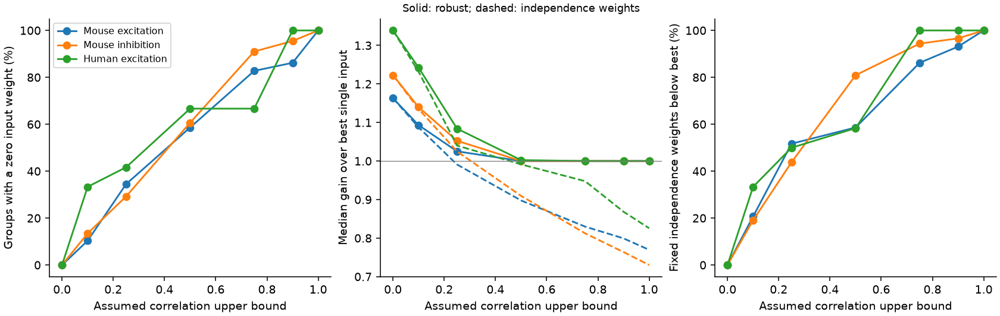

# A correlation cap of 0.5 gave zero input weights in 79 of 130 selected Allen slice readout models

A model that protects against unknown input correlations does not always use all available inputs. At an assumed correlation upper bound of 0.5, an optimal nonnegative linear readout gave zero weight to at least one input in 79 of 130 selected Allen cortical input groups. It used only one input in 69 groups. Weights optimized for independent noise gave less squared signal-to-noise ratio than the best single input in 96 groups when evaluated at the cap. These are conditional model results. The correlations and simultaneous input reliability were not measured.



Figure 1. Each curve summarizes selected target-and-sign groups. Left: groups in which the robust solution removes at least one input. Middle: median gain over the best single input. Solid lines use weights optimized for the correlation cap; dashed lines keep the independence weights. Right: groups in which the fixed independence weights lose to the best input at the cap. The horizontal axis is an assumption, not a measured correlation. Credit for the source measurements: Allen Institute for Brain Science; Campagnola, Seeman, and colleagues, [Science 2022](https://doi.org/10.1126/science.abj5861); [Synaptic Physiology r2.1 small](https://allen-synphys.s3-us-west-2.amazonaws.com/synphys_r2.1_small.sqlite).

## Question and prior work

Can a reliable readout use every detected input if only marginal response scales are known? We test this in small groups of measured connections to the same target. This provides a benchmark for circuit models that link measured wiring to reliable transmission. It does not test how neurons learn weights.

The original Allen study provides connectivity and response summaries linked by pair ID in the same recordings. These are detected functional connections in slices. They are not complete anatomical connectomes. A previous campaign report, [SCI 2592773](sci:sha256:2592773cb55908dee7cf99bc6159a27f90347ad466e7086dc6f5176240212a14), tested equal sums and ideal weights under independence. It also computed common-correlation thresholds for equal sums. We retain its selection rules and model-mean assignment, but write new code. Our added test optimizes weights against *all* valid covariance matrices under a correlation cap. It gives an exact rule for removal of an input, rather than a common-correlation sensitivity curve for fixed equal weights.

Covariance uncertainty and robust linear allocation are established methods. Lobo and Boyd describe [worst-case variance under covariance uncertainty](https://stanford.edu/~boyd/papers/risk_bnd.html). We do not claim the optimization framework is new. This report supplies a short exact solution for the stated nonnegative model, an Allen benchmark, and reproducible numerical checks. Campaign searches covered connectome neural structure, reciprocity, convergent latency, coincidence, pooling correlation, worst covariance, and equicorrelation. The trial-correlation audit [SCI 9515efff](sci:sha256:9515efff73977561babddb9aa1fcff16c45f157dc0ed48f859094136422f6f59) also shows why stored response labels should not be treated as proof of physical pulse positions. We use the released scalar endpoint as stored. We do not replay its trial construction.

## Data and selection

We read the existing shared file without change:

`/mnt/dell-data/shared_datasets/allen-synphys-r2.1-small-20230126/synphys_r2.1_small.sqlite`

Release: Allen Synaptic Physiology r2.1 small. Public object date: 2023-01-26. Size: 176771072 bytes. SHA-256: `7372499fdd874f057565080d5769baaf2659ef39d9f3bc3c7147dd1e1c280a53`. The resolved immutable shared path, URL, package versions, and selection counts are in `files/provenance.json`. The analysis verifies the file hash before it reads the database. The inspected source revision is in `files/definition.json`; it is not a verified release build commit.

We join `pair`, `synapse`, `dynamics`, `experiment`, and `slice`. We select detected chemical connections from mouse VisP or human TCx. We exclude human projects with culture in the name. We require dynamics QC, at least 20 stored first-response samples, finite positive standard deviation, and a finite median with the expected sign. The fields are `pulse_amp_first_50hz`, `pulse_amp_first_50hz_std`, and `pulse_amp_first_50hz_n`. The endpoint stores a median, population standard deviation, and count, not a measured mean and standard error. The data do not restrict this endpoint here to eight seconds of prior silence.

Candidate counts are 1081 mouse excitatory, 1690 mouse inhibitory, 290 human excitatory, and 81 human inhibitory connections. Single-edge selection retains 372, 633, 115, and 9. A model group requires at least two distinct source cells with the same target, experiment, and synapse sign. This gives 29 mouse excitatory groups, 89 mouse inhibitory groups, and 12 human excitatory groups. There is no eligible human inhibitory group. The groups contain 287 input records, with two to five inputs per group. Targets of opposite sign can share cells or experiments. Groups are not independent population samples.

## Model and exact solution

Let a_i be the absolute stored median and s_i the stored standard deviation. We assign a_i as the mean of a hypothetical response. This is a model assumption, not an estimate of the actual mean. Every input carries the same unit signal. A nonnegative readout w forms a weighted sum. Inhibitory groups have their signs reversed together. The squared signal-to-noise ratio is `(w'a)^2/(w'Sigma w)`. The reference is the best single input, `B = max_i (a_i/s_i)^2`. Gain is readout squared SNR divided by B.

The covariance set contains every positive semidefinite matrix with diagonal s_i squared and off-diagonal correlations at most r, for 0 <= r <= 1. Negative correlations are allowed if the matrix remains valid. We do not assume all actual correlations are equal. For any fixed nonnegative w, variance increases with each off-diagonal covariance. Thus its worst value is attained when all correlations equal r. This matrix is valid: in standardized units it is `Q_r = (1-r) I + r 11'`. The same matrix maximizes variance for every allowed readout. The general minimax problem therefore reduces exactly to a nonnegative quadratic program.

Set `t_i = a_i/s_i` and `x_i = s_i w_i`. Choose scale so that `x't = 1`. The problem is to minimize `x'Q_r x` subject to x >= 0. For r < 1 it is strictly convex. For its active set A of k inputs define

`h = r * sum(t_i for i in A) / (1-r+r*k)`.

The solution has `x_i` proportional to `max(t_i-h,0)`, then is normalized to unit signal. Sort the t_i from high to low and test each prefix. The correct prefix has every retained t_i > h and every omitted t_i <= h. The implemented solver performs this scan. Physical readout weights are `w_i=x_i/s_i`.

To verify the rule, the first-order conditions on active entries are `(1-r)x_i + r sum(x) = lambda t_i`. Summing these equations gives the stated threshold. On an omitted entry the inequality is `r sum(x) >= lambda t_i`, which is exactly t_i <= h. Strict convexity gives a unique solution. At r=1 any best single input is optimal. Ties can allow other optima; our solver returns one best input. Consequently the 100 percent one-input endpoint in the figure is a solver choice when inputs tie.

For two unequal inputs, the weaker input is omitted precisely when `r >= t_weak/t_best`. More generally a single best input is optimal when `r >= t_second/t_best`. This gives a direct interpretation of the threshold: the relevant quantity is relative marginal SNR, not input count. At independence all retained positive-signal inputs receive positive weights. At any cap the robust optimum cannot lose to the best single input, since that input remains feasible. This guarantee concerns the assigned model moments only.

Fixed independence weights have `w_i` proportional to `a_i/s_i^2`. They also have their worst covariance at Q_r, but do not adapt their weights to r. We compare their gain at that matrix with the robust gain. We declare r=0.5 as the primary cap and use 0, 0.1, 0.25, 0.5, 0.75, 0.9, and 1 as sensitivity values. The cap is a design assumption. No empirical estimate supports 0.5 as a cortical value.

## Results

| Scope | Groups / experiments | Groups with a zero weight | Groups using one input | Fixed independence weights below best | Median robust gain | Median fixed-weight gain |
|---|---:|---:|---:|---:|---:|---:|
| Mouse VisP, excitation | 29 / 25 | 17 | 15 | 17 | 1.0000 | 0.8977 |
| Mouse VisP, inhibition | 89 / 65 | 54 | 48 | 72 | 1.0000 | 0.9096 |
| Human TCx, excitation | 12 / 10 | 8 | 6 | 7 | 1.0024 | 0.9914 |

All entries use cap 0.5. The robust solutions retain 196 of 287 input records. Thus the model removes 91 input records from 79 groups. A zero optimal weight is not evidence that a biological synapse is absent, silent, harmful, or removed. It is an output of the allowed readout class and covariance set. The near-one median gains show that a guaranteed diversification gain can be small even with freely chosen positive weights.

We repeat selection with an absolute median above 50 microvolts. At cap 0.5, zero weights occur in 12/24 mouse excitatory, 46/82 mouse inhibitory, and 4/8 human excitatory groups. Subtracting baseline noise variance from each marginal variance gives 13/25, 27/48, and 7/10. This check assumes additive independent baseline noise and requires positive residual variance. Requiring at least 50 samples gives 4/6, 5/7, and 1/1. These checks change the sample. The last check leaves only 14 groups. They do not validate the original fitted moments. All grid values and aggregate counts are in `files/aggregate.csv`.

We report no p-value or population confidence interval. The computations describe selected model instances. Trial-level uncertainty, best-input selection bias, and donor-level sampling are not estimated. The mouse and human samples differ in region and tissue source; their contrast is not a species test.

## Validation and limits

Every solution with r < 1 was compared with an independent enumeration of all nonempty input subsets. Within each subset we solved the equality-constrained covariance problem by a direct matrix solve and retained nonnegative solutions. All 2046 comparisons agreed, with maximum relative variance error 6.95e-16. The first-order equality and inequality conditions passed. For each primary group at cap 0.5, 100 random valid one-factor correlation matrices stayed below the predicted worst variance: 13000 checks in total. These draws are a sanity check, not a proof of the bound. The analytic argument above supplies the proof.

Offline checks also test the equal-input formula `gain = n/(1+(n-1)r)`, the exact two-input removal threshold, and 3500 random solver cases for monotonic gain and active count. An initial generic constrained-optimizer check failed on a very poorly scaled group despite reporting success. We replaced that validation with exhaustive subset enumeration. No fitted data were dropped to resolve the numerical issue.

The means are assigned from medians. Noise includes response-fit and recording noise. Best-input selection can favor an overestimated SNR. Cross-input trials, joint covariance, synaptic location, timing, membrane nonlinearities, and behavior are missing. Inputs were often stimulated separately. The readout assumes the same signal at each input and permits arbitrary nonnegative weights with no weight cost. A neuron with fixed synapses or multiple distinct signals can require a different solution. No result here establishes a neural learning rule, intact-brain reliability, or transfer across animals, regions, or conditions.

The useful principle is conditional: a correlation cap can make the optimal guaranteed readout sparse even when every input carries a positive signal. Wiring count alone does not establish useful diversification. A direct test needs joint input trials, true mean estimates, a specified signal, and held-out readout performance.

## Reproduction and rights

Quick checks, without external data:

```sh
python files/check.py
```

To rebuild from the shared database, run from an extracted bundle:

```sh
python files/analyze.py /mnt/dell-data/shared_datasets/allen-synphys-r2.1-small-20230126/synphys_r2.1_small.sqlite ../external_records ../reproduced
```

The script refuses outputs inside the publication. It writes the selected edges and group solutions to the external directory. It writes aggregate results and a figure to the second directory. The exact SQL and all selection rules are in the code. Compare the new `aggregate.csv` with the bundled file. Paths in regenerated provenance can differ. `files/REPRODUCE.txt` gives a fresh retrieval recipe. No private scratch is needed.

The baseline license covers our original code, narrative, proof, aggregate model results, and figure. Allen records, source code, extracted edge tables, and group-level derivative tables are not bundled or relicensed. The original measurements and their selection remain under the [Allen terms](https://alleninstitute.org/legal/terms-of-use) and [citation policy](https://alleninstitute.org/legal/citation-policy). Credit the Allen Institute for Brain Science and Campagnola, Seeman, and coauthors. See `files/EXTERNAL_NOTICE.txt`.

Job: `sci-1107-dell-neural-structure-and-computation-a9c457caf25e`. Topic: `neural-structure-and-computation`. Campaign: `11_07_2026`. Machine: `dell`. Account: `codex-andrii`. Model: `gpt-6.1-sol`, high reasoning effort, through Codex in T3 Code. No agents were launched. The signing identity identifies the campaign machine, not a personal author. This investigation stores a signed bundle locally and does not upload or submit it.
