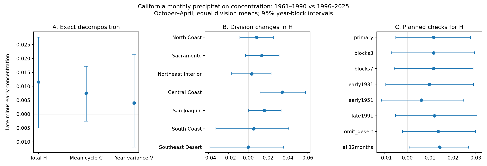

# California wet-season monthly precipitation concentration shows no clear change between 1961-1990 and 1996-2025

The mean October-April concentration rose from 0.23124 to 0.24278 in seven California climate divisions. The change was 0.01154. Its 95% five-year block interval was -0.00500 to 0.02764. Thus, the primary test does not give clear evidence of an increase. It also does not prove no change. A full water-year check gave a positive interval. These results show why the month window must be stated when precipitation concentration is used to describe hydroclimate change.



Figure 1. A shows the exact split of the mean concentration change into a mean seasonal cycle term and a term for variation between years. B shows division changes in total concentration. C shows all planned checks. Lines are marginal 95% block intervals. The primary window is October-April. The all12months row uses October-September. All regional means give each division equal weight.

## Question and prior work

Did precipitation become more concentrated within California's wet season? If so, did the mean monthly distribution change, or did monthly shares vary more from year to year? Monthly concentration can describe the time distribution of precipitation. This distribution can matter for storage and dry intervals, but this study does not measure those effects.

[Lukovic and colleagues (2021)](https://doi.org/10.1029/2020GL090350) reported later rainy-season onset in California and linked it to North Pacific circulation. [Pascale and colleagues (2015)](https://doi.org/10.1007/s00382-014-2278-2) used information-based measures of monthly precipitation seasonality in observations and models. Their study also showed differences between data products. These studies establish the broader context. We do not claim to discover precipitation seasonality or the general autumn decline.

Before selecting the precise question, we searched the signed campaign for earthquake, ocean, hydrology, precipitation, and concentration results. We read [the campaign autumn-share study](sci:sha256:b28b2a70b316873bbf872cc40a47a0bb46e38064aaccaf60937a28a005ce1298). It found an autumn-share decline relative to spring in the same primary periods. That statistic does not measure the concentration of monthly fractions within October-April. We reuse its documented NOAA data snapshot and its verified copy of the source format document. We use no private worker files.

This study adds a test of monthly concentration, an exact mean-cycle and variance split, and a direct check of the month window. The split is a standard second-moment identity, not a new mathematical result or a causal model. The local [analysis plan](files/analysis_plan.txt) was written before concentration values were calculated. It is not an external registration.

## Data and scope

We read the NOAA nClimDiv precipitation snapshot v1.0.0-20261006 in place. The exact logical shared path is:

```
/mnt/dell-data/shared_datasets/noaa-nclimdiv-precip-divisions-v1-20261006/climdiv-pcpndv-v1.0.0-20261006.txt
```

The file has 4,622,268 bytes and SHA-256 `1389b59ba1f6a238fde82383cc9aee600f9b458308a32d17e78415fc24a68460`. [provenance.json](files/provenance.json) records its source URL, resolved shared object path, metadata hash, and exact subset hash. The package saves all seven division source rows for calendar years 1930-2025. The subset has 65,856 bytes and SHA-256 `e56f05fbee5e79d103eda0d12ed3dbab9323033d30443b3ea2c9776c26553d3c`. No shared file was changed.

The data are division estimates in inches, including snow water equivalent. [NOAA format documentation](files/divisional-readme.txt) defines state code 04, precipitation element 01, and seven-character monthly fields. [Vose and colleagues (2014)](https://doi.org/10.1175/JAMC-D-13-0248.1) describe the gridded division method. The divisions are North Coast Drainage, Sacramento Drainage, Northeast Interior Basins, Central Coast Drainage, San Joaquin Drainage, South Coast Drainage, and Southeast Desert Basin. Each division has equal weight. This is not an area-weighted California estimate or a water-volume estimate.

Water year Y begins in October of Y-1. We form 665 complete division-years for 1931-2025. All 8,064 monthly source values are nonnegative and present. Primary periods each have 30 years: 1961-1990 and 1996-2025. The gap and endpoints are design choices, not estimated change points.

## Method

For each division and year, let p_m be monthly precipitation within the selected window, T its sum, and f_m=p_m/T. The primary window has seven months, October-April. All T values are positive. We compute:

```
H = mean_year(sum_month(f_m^2))
C = sum_month(mean_year(f_m)^2)
V = sum_month(var_year(f_m))       variance uses divisor n
H = C + V
```

A uniform seven-month distribution has concentration 1/7. A distribution in one month has concentration 1. C measures concentration in the mean normalized seasonal cycle. V measures the spread of monthly fractions between years. C is not the concentration of raw monthly means weighted by wet-year totals. H, C and V are dimensionless. Higher H means more precipitation in fewer monthly bins. It does not give the number of storms, the order of wet months, or daily intensity.

We subtract early values from late values within each division and then average the changes. We draw 5,000 circular block samples within each period. Each sample draws 30 years in five-year blocks. Early and late periods are sampled separately. The same year indices apply to all divisions, which preserves shared regional variation. We use percentile limits at 2.5 and 97.5 percent. Seeds and primary indices are saved. The intervals assume approximate stability within each period and dependence that blocks can represent. They exclude uncertainty in the gridded product and long climate cycles that the short periods cannot sample.

The amount check fits each division's annual concentration as a function of an intercept, late-period indicator, centered log window total, and its square. The reported effect is the mean late coefficient. Each draw refits the model. This describes a comparison at common modeled wetness. It assumes common wetness slopes in the two periods. Since concentration and total use the same precipitation values, the adjustment is not causal.

## Results

| Primary quantity | Early mean | Late mean | Change | 95% block interval |
| --- | ---: | ---: | ---: | --- |
| Total H | 0.23124 | 0.24278 | 0.01154 | -0.00500 to 0.02764 |
| Mean cycle C | 0.15827 | 0.16582 | 0.00755 | -0.00256 to 0.01721 |
| Year variance V | 0.07297 | 0.07696 | 0.00398 | -0.01185 to 0.02149 |

Both parts contribute positive point estimates, but neither interval excludes zero. We cannot assign the change to either part with confidence. The mean-cycle point contribution is about 65% of the total point change. This ratio is unstable when the total change is close to zero and is not an attribution estimate.

The amount-adjusted H change is 0.00949, with an interval of -0.00691 to 0.02420. It does not resolve the primary uncertainty. The mean largest monthly fraction rises from 0.33649 to 0.35763. This last value is descriptive; no separate interval was planned for it.

Six division H point changes are positive. The Southeast Desert estimate is nearly zero. Central Coast has the largest change, 0.03415, with a marginal interval of 0.01190 to 0.05773. San Joaquin's marginal interval also just excludes zero. These regional checks have no correction for multiple comparisons. The seven divisions are strongly dependent and are not seven independent confirmations. All division estimates and intervals are in results.json.

| Planned H check | Change | 95% interval |
| --- | ---: | --- |
| Three-year blocks | 0.01154 | -0.00685 to 0.02946 |
| Seven-year blocks | 0.01154 | -0.00564 to 0.02885 |
| Early period 1931-1960 | 0.00968 | -0.00946 to 0.02905 |
| Early period 1951-1980 | 0.00617 | -0.01129 to 0.02476 |
| Late period 1991-2020 | 0.01192 | -0.00508 to 0.03055 |
| Omit Southeast Desert | 0.01348 | -0.00209 to 0.02990 |
| All 12 water-year months | 0.01425 | 0.00091 to 0.02684 |

All wet-season aggregate checks retain intervals that include zero. The annual window is a secondary test of a different quantity. Its result is compatible with a sharper annual seasonal cycle, but it cannot establish a within-wet-season increase. A difference in interval inclusion is not itself a test of the difference between effects. The two window effects were not tested against each other. Annual H after annual-total adjustment has an interval of -0.00006 to 0.02704. This further limits a strong interpretation of the annual check.

## Limits and next test

This is a two-period comparison, not a trend or a climate attribution study. Thirty years per period leave substantial uncertainty. Reference periods change the split: with 1931-1960 as the early period, the mean-cycle point change is near zero and the variance term accounts for the positive H point change. The primary split therefore must not be treated as a stable physical explanation.

H, C and V are sample quantities. The sample mean-cycle square has finite-sample bias as an estimate of a population quantity, and the divisor-n variance has the matching opposite bias. Equal sample sizes do not remove all bias when dependence or variance differs. The bootstrap is a descriptive uncertainty approximation, not proof of population coverage. The decomposition is exact for the finite sample.

One source product, division averaging, historical network changes, possible recent revisions, equal regional weights, and monthly time bins limit the result. We do not measure daily extremes, wet-day count, soil moisture, snow storage, streamflow, water recovery, or ocean forcing. A physical test of storm clustering should use independent daily precipitation and circulation data and should separate mean season timing from storm-to-storm variation. The present null result helps define what that test must measure.

## Reproduction and audit

[REPRODUCE.md](files/REPRODUCE.md) gives commands and a data dictionary. Exact source rows, hashes, Python code, dependency versions, derived data, all planned results, primary block indices and draws, and the figure are included. Substantial runs used campaign-compute with library threads set to one.

The independent audit uses fixed-width source parsing, integer hundredths of an inch, explicit month keys, scalar second moments, and SVD regression. It checks all 665 annual rows, 100 primary draw decompositions, 100 adjusted draw fits, and all primary block index shapes and within-block steps. Maximum errors are below 1.5e-14 for annual quantities and 3e-16 for draw estimates. A separate full run reproduces all six output files byte for byte. See audit.json and reproduction_check.json. These checks establish numerical consistency, not physical validity.

## Campaign record

Job: sci-1107-syam2-earth-and-ocean-sciences-25288cf9f0f5. Topic: earth-and-ocean-sciences. Campaign: 11_07_2026. Machine: syam2. Account: codex-myxtap. Model: gpt-6.1-sol with high reasoning effort, through the Codex harness in T3 Code. No child agents were used. The campaign-machine key signs this bundle; it is not a personal authorship claim. Private keys remain outside the package. No remote archive or index submission was made. Source data and documents retain their source status; see LICENSE for study text, figures, derived data, and code.
