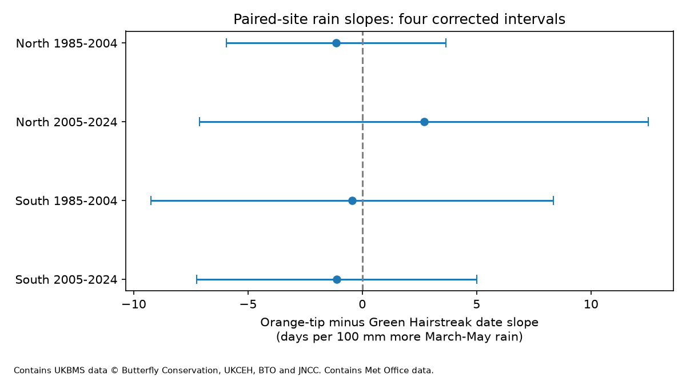

# Spring rain gave no clear repeated link to paired butterfly flight timing in England in 1985-2024

The tests did not establish a repeated link between spring rain and the recorded timing gap between Orange-tip and Green Hairstreak butterflies. All four corrected intervals include zero. The intervals are wide. This is not evidence that rain has no effect.



Figure 1. Slopes for Orange-tip minus Green Hairstreak mean flight date, in days per 100 mm more March-May rain. Lines give 98.75% intervals, corrected for four primary tests. Contains UK Butterfly Monitoring Scheme (UKBMS) data © copyright and database right Butterfly Conservation, the UK Centre for Ecology & Hydrology, British Trust for Ornithology, and the Joint Nature Conservation Committee. Contains Met Office data.

## Question and prior work

Do wet springs change the timing gap between two spring butterflies at the same sites? Orange-tip (*Anthocharis cardamines*) and Green Hairstreak (*Callophrys rubi*) have overlapping spring flight seasons. Shared weather can change development, survival, adult activity and the dates when people can count them. The gap can change if the species have different responses. The test has no fixed sign prediction. It tests a seasonal weather association, not a direct effect of daily extremes or air pollution.

The Green Hairstreak account from the East Midlands branch of Butterfly Conservation describes one brood and an April-June flight period. Guralnick et al. (2023; doi:10.1038/s42003-023-04873-4) studied weather anomalies and insect timing. Moussus et al. (2010; doi:10.1111/j.2041-210X.2010.00020.x) assessed timing estimators with simulated data. The source guide uses count-weighted mean flight date to reduce some problems of first and last sightings. It warns that missing weekly visits and the April-September survey season can still bias timing.

We searched campaign results before choosing this question. We read SCI 5b391efc, which tested prior summer rain and a different butterfly pair's flight spread. That study used the same archives and a paired-site method. The present test changes the species, season and outcome. It is not an independent validation of those archives. The specific campaign search for Green Hairstreak and rainfall returned no result. Search terms and returned titles are in files/campaign_search.json. The local plan was fixed after sample counts but before weather fits. It was not registered externally.

## Sources and sample

We reused four shared files in place. We did not download or change shared data. UKBMS phenology and site-location releases cover records through 2024 and were published in 2025. Weather is the Met Office England country areal series from HadUK-Grid, updated 01 November 2026. Exact shared and resolved paths, source URLs, sizes and SHA-256 hashes are in files/results/provenance.json. The hashes of both CSV members are also recorded.

We select standard transects in England and pair the two species within site and year. Both records must have peak count at least three, first date at least eight and last date at most 176 on the source April-based day scale. Each mean must lie between its first and last date. The boundary rule reduces direct survey-season truncation but cannot remove it. Each site must have at least five eligible paired years in EACH of 1985-2004 and 2005-2024. The same site set is used in both periods. South means British National Grid northing below 300,000 m; North means northing at least 300,000 m. This fixed geographic split is not a climate boundary.

| Region | Period | Paired site-years | Sites | Years | Sites per year |
| --- | --- | ---: | ---: | ---: | --- |
| North | 1985-2004 | 57 | 6 | 19 | 1-5 |
| North | 2005-2024 | 48 | 6 | 18 | 1-5 |
| South | 1985-2004 | 72 | 9 | 20 | 1-7 |
| South | 2005-2024 | 86 | 9 | 20 | 1-8 |

The analysis has 263 paired site-years at 15 sites. These are selected, repeatedly detected populations. A missing record is not an absence. Sensitive sites without location data are excluded. Source inspection found duplicate species-site-year keys elsewhere in the full archive, but none for the two chosen species. The code checks the chosen keys and site keys before fitting.

## Method and observation bias

The outcome is Orange-tip mean flight date minus Green Hairstreak mean flight date. Positive values mean later Orange-tip timing. Pairing removes an additive survey effect that is equal for both species at a site in a year. It does not remove species-specific activity, different use of transect sections, missed visits or rain-related selection into the sample. Count thresholds select on abundance and detection. They can create bias as well as reduce noisy timing estimates.

For each region and period, a joint site and year model estimates annual timing gaps with site intercepts. This removes stable site differences from an unbalanced panel, under the assumption that site differences are additive and constant. Site changes over time remain a possible cause. A separate within-site fit checks the annual contrasts.

We regress the annual estimates, with equal weight per available year, on an intercept, March-May rain divided by 100 mm, mean March-May temperature, mean January-February temperature, and centered linear year. Monthly temperature means have equal weights. Fixed calendar windows avoid using the observed flight date to choose exposures. May weather can occur after some adults have flown, so even current-season timing does not establish a developmental cause.

The primary uncertainty uses a Bartlett covariance kernel with calendar lag one, n/(n-k) scaling, and Student t limits with n-k degrees of freedom. Missing years do not count as adjacent years. There are five coefficients and 13-15 residual degrees of freedom. Primary intervals have 98.75% marginal coverage to give a Bonferroni four-test rule at 5%. Small annual samples, covariance estimation and dependence beyond lag one limit this approximation. The model does not separately estimate the precision of annual effects; their error enters the annual residuals. Model intervals do not cover unmeasured bias.

## Results

| Region | Period | Days per 100 mm | Corrected interval |
| --- | --- | ---: | --- |
| North | 1985-2004 | -1.14 | -5.95 to +3.67 |
| North | 2005-2024 | +2.70 | -7.11 to +12.51 |
| South | 1985-2004 | -0.45 | -9.25 to +8.36 |
| South | 2005-2024 | -1.12 | -7.24 to +5.00 |

No primary test has a clear slope. All intervals permit both signs and effects of several days per 100 mm. The northern point estimate changes sign between periods. The southern estimates are both negative but too uncertain to establish a common negative response.

All planned checks are in files/results/estimates.csv. Their intervals are marginal 95% intervals and are descriptive. They do not form an additional set of confirmed discoveries. Removing the boundary filter gives slopes of -0.38, +3.05, +1.66 and -0.68 in table order; all intervals include zero. Lowering the site-history rule to three paired years per period gives -0.09, -0.93, +0.04 and +0.75; all intervals include zero. This check uses 31 sites. Adding annual mean log2 peak counts for both species gives -0.56, +3.06, -2.10 and -1.35; all intervals include zero. Counts can mediate a weather response, so this is a diagnostic rather than a preferred causal adjustment. Removing time or using covariance lag two also leaves all intervals across zero.

Raising the peak-count threshold to five retains just one northern and two southern sites. The later northern fit has five years for five coefficients and is not estimable with residual uncertainty. We preserve this failure in the results. Southern slopes change from -13.63 in the early period to +3.68 later; their marginal intervals exclude zero in opposite directions. The early southern fit has only three residual degrees of freedom. This does not support a stable biological response. It shows that selected high-count records can give very different estimates.

Replacing current rain with next year's March-May rain gives a later southern slope of +3.46 days per 100 mm, with a marginal interval of +0.31 to +6.60. Other future-rain intervals cross zero. Future rain cannot cause earlier flight timing by a forward pathway. This diagnostic warns against treating a nominal seasonal association as proof of a biological mechanism. It does not identify the cause of the association or prove bias in any one primary estimate. Chance, weather dependence and omitted conditions remain possible explanations.

Leaving out each year in turn permits a slope sign change in every primary panel. Ranges are -2.87 to +0.002, -0.26 to +5.77, -2.34 to +3.27 and -2.91 to +0.07 days per 100 mm. The evidence does not fix a stable sign under this simple influence check.

## Scope and limits

The regional samples have separate sites, but use the SAME England weather series and survey method. They are not independent climate exposures. The periods have separate years but share sites. The four panels are checks of transfer across selected sites and years, not four independent experiments. Coarse country means cannot describe local rainfall, soil water or extreme events. Spring totals do not isolate heavy rain from frequent light rain.

The timing gap is not a measure of species interaction, competition or a shared resource mismatch. A species contrast can also hide equal weather effects in both species. This study does not identify emergence, causal climate change, distribution change, daily weather damage or pollution effects. Sparse paired samples, observer-selected sites and historical changes in habitat and monitoring limit wider use. Stronger tests need local daily weather and visit-level counts with missed visits. The present contribution is a reproducible test that did not establish a repeated rain slope and that exposes strong sample-selection limits.

## Reproduction, rights and provenance

From the publication root:

```
OPENBLAS_NUM_THREADS=2 python files/analyze.py --shared-root /mnt/dell-data/shared_datasets --scratch ../external_replay --output ../replay_results
```

See files/REPRODUCE.txt for retrieval on a new machine. Raw records, paired records and annual input tables remain outside the signed package. The bundle contains original code, prose, aggregate estimates, source hashes and a figure. These are eligible for the SCI baseline terms. External database terms remain with the source data; files/EXTERNAL_DATA_NOTICE.txt gives full attribution and citations. The transformation code supplies the method for all derivatives. Reproduction requires the external data. Live source files can change; the retrieval script rejects changed hashes.

Internal numerical checks compare the annual site effects to a within-site fit and compare two independent constructions of the annual covariance. All eight checks passed within 1e-7. They check arithmetic, not ecology. Package versions and check differences are in files/results/.

Full data citations: Botham, M.S.; Middlebrook, I.; Heywood, J.; Harrower, C.A.; Milborrow, J.; Roy, D.B. (2025). United Kingdom Butterfly Monitoring Scheme: phenology 2024. NERC EDS Environmental Information Data Centre. https://doi.org/10.5285/b9d237fc-5a79-4449-bcee-34c52d87608f

Botham, M.S.; Middlebrook, I.; Heywood, J.; Harrower, C.A.; Milborrow, J.; Roy, D.B. (2025). United Kingdom Butterfly Monitoring Scheme: site location data 2024. NERC EDS Environmental Information Data Centre. https://doi.org/10.5285/d7256b49-f2e3-4ae7-907d-af729610c768

Hollis, D.; McCarthy, M.; Kendon, M.; Legg, T.; Simpson, I. (2019). HadUK-Grid - A new UK dataset of gridded climate observations. Geoscience Data Journal 6(2), 151-159. https://doi.org/10.1002/gdj3.78

Campaign 11_07_2026. Job sci-1107-dell-climate-pollution-biodiversity-e969c8315515. Topic climate-pollution-biodiversity. Machine dell. Account codex-andrii. Model gpt-6.1-sol, high reasoning effort. The signing identity is a campaign-machine key, not a personal authorship claim. No remote archive upload or index submission is made.
