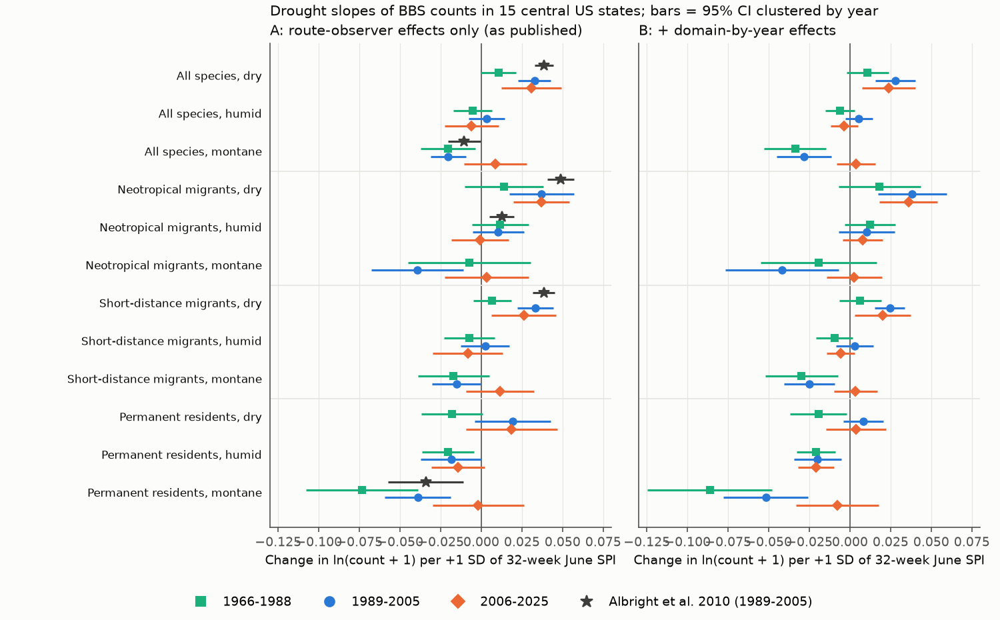
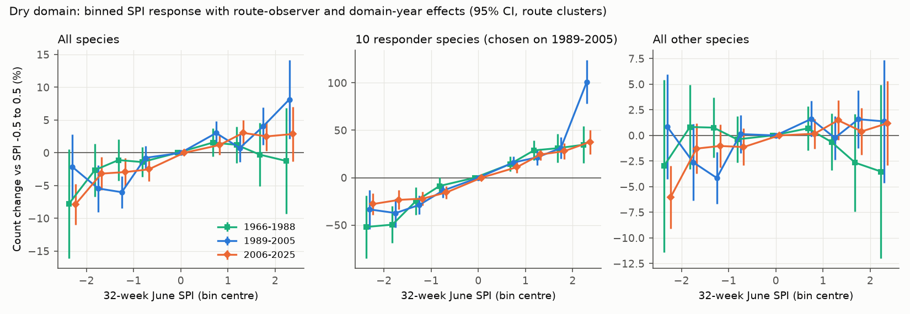
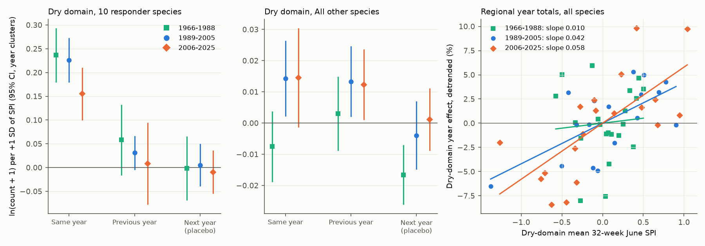

# Drought lowered breeding-bird counts in the dry central US plains again in 2006-2025, but rain-tracking grassland and wetland species gave most of the decrease, and the published montane response did not repeat

Job `sci-1107-dell-climate-pollution-biodiversity-0ca93713dec7` · topic climate-pollution-biodiversity · machine dell · account claude-andrii · model Claude Opus 5.5 (`claude-opus-5-5`) · 2026-11-09.
The signing key is a campaign-machine key. It is not a personal authorship claim.

## 1. Question

Albright et al. (2010, *Global Change Biology* 16:2158-2170, doi:10.1111/j.1365-2486.2009.02120.x) used North American Breeding Bird Survey (BBS) data from 15 central US states for 1989-2005. They reported these results:

* In the dry (semiarid Great Plains) domain, bird abundance was lowest after a dry period. The best metric was the 32-week standardized precipitation index (SPI) that ends in June. The slope for ln(abundance + 1) was +0.0387 per SD of SPI (95% CI ±0.0057). The predicted change for an extreme drought (SPI = -3) was -10.7%.
* Neotropical migrants in the dry domain had a slope of +0.0488 per SD, and a predicted change of -13.2% in an extreme drought.
* In the montane domain, the response was opposite: permanent residents had a slope of -0.0342 per SD (abundance increased in drought), and the slope for all species was negative but not significant.
* Previous-year drought metrics gave weaker or inverted relations.

We did three tests:

1. **Replication.** Does the same design with new data give the same result for 1989-2005?
2. **Out-of-sample test.** Do the published slopes hold for 2006-2025, after the paper? We also tested an earlier independent period, 1967-1988.
3. **Mechanism and observation bias.** Is the decrease a local loss of birds, a move of birds to nearby wetter routes, or a short-term absence of a few nomadic species? Do survey conditions, year-wide shocks or regional confounders explain it?

## 2. Data

All inputs are public. We read them in place from the shared campaign datasets. `files/provenance.json` gives the exact paths, source URLs, byte counts and SHA-256 hashes.

| Input | Use | Source / licence |
|---|---|---|
| BBS 2026 release (1966-2025): `States.zip` (10-stop counts), `Weather.csv`, `Routes.csv`, `SpeciesList.csv` | Bird counts, observers, run quality, survey conditions, route locations | USGS/ECCC, doi:10.5066/P144YU3S. US federal data, no use restrictions (see the USGS metadata). We only use US routes in the bundled tables. |
| NOAA nClimGrid monthly precipitation and mean temperature (5 km, 1895-2026-09) | SPI and March-June temperature anomaly at each route | NOAA NCEI, public domain. Shared datasets `noaa-nclimgrid-monthly-prcp-20261006` (added by this job) and `noaa-nclimgrid-monthly-tavg-20261006`. |
| USFS ECOMAP Bailey provinces | Humid, dry and montane domains as in Albright et al. Fig. 1b | USDA Forest Service, public domain. Shared dataset `usfs-ecomap-provinces-bailey-20261109` (added by this job). |
| AVONET migration class and GBIF winter-presence index per BBS species | Migratory guilds | From campaign publication sci:sha256:15270e894fa3... (CC BY 4.0; AVONET by Tobias et al. 2022, CC BY 4.0; GBIF occurrence facet counts). |

**Study area and rules (same as Albright et al. where they gave the rule).** The 15 states are MT, WY, CO, NM, ND, SD, NE, KS, OK, TX, MN, IA, MO, AR and LA. We used BBS runs with RunType = 1 and removed the first year of each observer. We removed species with fewer than 30 route-years in the conterminous US, and we removed unidentified taxa and hybrids. We merged subspecies forms into their species. Each route start went into one domain: humid (Humid Temperate domain, Ozark and Ouachita included), montane (Dry-domain mountain provinces M3xx) or dry (other Dry-domain provinces). The sample has 32,748 route-years on 1,393 routes (665 dry, 565 humid, 163 montane) from 1967 to 2025. BBS has no 2020 survey. For 1989-2005 we used 10,661 route-years; Albright et al. used 11,654.

**Guilds.** Permanent residents are AVONET migration class 1. Neotropical migrants are migratory species with an effort-adjusted Dec-Feb / June GBIF record ratio below 0.05 in the US states that are not on the southern border. Short-distance migrants are all other migratory species. This gives 130 resident, 107 short-distance and 105 Neotropical species. A further 154 non-passerine and water species have no class; they count only in "all species". This classification approximates Rappole (1995), which Albright et al. used. It is not identical to it.

**SPI.** For each route we used the mean nClimGrid precipitation of all cells within 20 km of the route start. The 32-week window ending on 30 June is 0.4 × November + December to June. We fit a gamma distribution for each route on 1931-2020 and converted it to a standard normal quantile. As sensitivity windows we used December-May (it ends before most surveys) and July-June (12 months).

## 3. Models

The response is ln(count + 1) or raw richness. Each domain has its own SPI slope.

* **A (as published):** route-observer fixed effects only. Albright et al. used route and observer random effects with an AR(1) term, and no year term.
* **B (year-controlled):** A + domain-by-year fixed effects. The slope then comes only from SPI differences between routes of the same domain in the same year.
* **C:** B + March-June temperature anomaly.
* **L:** B with same-year SPI, previous-year SPI and next-year SPI. Next-year SPI is a placebo and must give zero.
* **Checks on B:** survey start temperature, wind, sky and day of year; province-by-year, state-by-year or BCR-by-year fixed effects in place of domain-by-year; a "ring" term, which is the mean SPI of the other routes 100-400 km away.

We give two 95% intervals: one clustered by route and one clustered by year (t with G - 1 df). The year-clustered interval is the conservative one, because drought is regional. Unless we say otherwise, the intervals below are year-clustered.

## 4. Results



### 4.1 Dry domain: the published slope replicated and held out of sample (Fig. 1)

| Dry domain, ln(all species + 1) | Slope per SD | 95% CI (year clusters) | Change at SPI = -3 |
|---|---|---|---|
| Albright et al. 2010, 1989-2005 | +0.0387 | ±0.0057 (as published) | -10.7% |
| Our replication, model A, 1989-2005 | +0.0327 | +0.023 to +0.043 | -9.4% |
| Out of sample, model A, 2006-2025 | +0.0308 | +0.012 to +0.049 | -8.8% |
| Out of sample, model B, 2006-2025 | +0.0238 | +0.008 to +0.040 | -6.9% |
| Earlier period, model A, 1967-1988 | +0.0106 | -0.000 to +0.022 | -3.1% |

* Neotropical migrants in the dry domain: +0.037 (1989-2005) and +0.037 (2006-2025, CI +0.020 to +0.054), against the published +0.049. With model B the 2006-2025 slope is +0.036 (+0.018 to +0.054).
* Richness in the dry domain: +0.39 species per SD in 2006-2025 (model B, +0.20 to +0.58). This is about 1.2 species at SPI = -3.
* The out-of-sample slopes are 20-40% smaller than the published values (models A and B). The 2006-2025 point estimates are inside or near our own 1989-2005 replication intervals.
* The result does not depend on the window or the survey conditions. With December-May SPI, which ends before most surveys, the 2006-2025 model B slope is +0.025. With survey temperature, wind, sky and date as controls it is +0.022. With province-by-year, state-by-year or BCR-by-year effects it is +0.022, +0.027 and +0.026.
* Hot springs come with dry springs. With the March-June temperature anomaly as a control, the 2006-2025 slope falls to +0.017 (+0.004 to +0.030). The temperature term is -0.015 per °C, and its CI includes zero with year clusters.
* In 1967-1988 the slope was only about one third as large. This earlier period had no clear effect for species other than the responders (Section 4.3).

### 4.2 Humid and montane domains: the published contrasts did not repeat

* **Montane.** In 1989-2005 we replicated the negative montane slopes: all species -0.020 (-0.031 to -0.010), permanent residents -0.039 (-0.059 to -0.019). In 2006-2025 the montane slopes were +0.009 (-0.011 to +0.028) for all species and -0.002 (-0.030 to +0.026) for residents. The "residents increase in montane drought" result was present in 1967-1988 and 1989-2005, but not after 2005.
* **Humid.** The published Neotropical slope (+0.0126) gave +0.010 in our 1989-2005 replication and -0.001 (-0.019 to +0.017) in 2006-2025. The humid-domain slopes for all species were near zero in all periods (2006-2025: -0.006, -0.023 to +0.011).
* **Short-distance migrants, dry domain.** The published slope is +0.0384. Our replication gave +0.033 (1989-2005) and +0.026 (2006-2025, +0.006 to +0.046).

### 4.3 Ten rain-tracking species gave most of the dry-domain decrease (Figs. 2, 3)

We fit a Poisson model with route-observer and year effects for each species in the dry domain. We then selected "responders" with **1989-2005 data only**, by the rule slope > 0.10 per SD and z > 3. Ten species passed: Lark Bunting, Dickcissel, Cassin's Sparrow, Brewer's Sparrow, Yellow-headed Blackbird, Sora, American Bittern, Wilson's Snipe, Green Heron and Wilson's Warbler. Most are known to settle where rain makes grass or wetlands good in a given year. Wilson's Warbler is a late passage migrant in the plains.

* In 2006-2025, 8 of the 10 responders again had positive slopes (Dickcissel +0.27, Lark Bunting +0.27, Cassin's Sparrow +0.18, Sora +0.49, American Bittern +0.20, Yellow-headed Blackbird +0.15, Wilson's Snipe +0.13, Brewer's Sparrow +0.06). Green Heron and Wilson's Warbler did not.
* Over all 269 species, the species slopes of the two periods had a Spearman correlation of only 0.25.
* The responders make up only 8-10% of the birds counted in the dry domain. Their combined count changed by +0.155 per SD in 2006-2025 (year-clustered SE 0.030), which is about -37% at SPI = -3. In 1967-1988 the slope was +0.23 and in 1989-2005 it was +0.22.
* The other species changed by +0.012 per SD in 1989-2005 and +0.012 in 2006-2025 (route-clustered CI +0.007 to +0.018; year-clustered SE 0.008). In 1967-1988 the slope was -0.005. Thus in 2006-2025 the responders gave about half of the community slope (0.024).
* The dose-response is monotonic over SPI for the responders (Fig. 2). For the other species, only the driest bin (SPI < -2) showed a clear decrease in 2006-2025 (-6%, route-clustered CI about -9% to -3%).



### 4.4 Responders came back the next year; the other species did not (Fig. 4)

Model L adds previous-year SPI and next-year SPI (placebo):

| Dry domain, 2006-2025 | Same-year SPI | Previous-year SPI | Next-year SPI (placebo) |
|---|---|---|---|
| Responders | +0.155 (SE 0.026) | +0.008 (SE 0.041) | -0.009 (SE 0.022) |
| Other species | +0.015 (SE 0.008) | +0.012 (SE 0.005) | +0.001 (SE 0.005) |
| All species | +0.026 (SE 0.007) | +0.013 (SE 0.007) | +0.002 (SE 0.005) |

The SEs are year-clustered. In 1989-2005 the pattern was the same (other species: +0.014 same year, +0.013 previous year). The responders came back to their usual numbers after the drought year. A short-term absence agrees with this result: the birds settled elsewhere, did not breed, or were not detected. For the other species, the drought deficit continued into the next year. A lasting effect on reproduction or survival agrees with this result. This disagrees with the statement of Albright et al. that previous-year relations were weaker or inverted.

The placebo (next-year SPI) was near zero in 1989-2005 and 2006-2025. In 1967-1988 it was negative (-0.015, SE 0.005). Thus we use the 1967-1988 estimates with care.



### 4.5 No sign of local redistribution; regional totals fell in dry years

* **Ring test.** If birds left dry routes for wetter routes nearby, then a route in a dry neighbourhood would gain birds. The ring-SPI term was +0.001 (SE 0.014) in 2006-2025 and +0.004 (SE 0.009) in 1967-2025, so there was no such gain. The own-route slope did not change with the ring term (+0.023).
* **Regional totals.** We estimated the dry-domain year effects with route-observer effects and regressed them on the dry-domain mean SPI, with a quadratic trend. The slopes were +0.042 (SE 0.014) in 1989-2005 and +0.058 (SE 0.016) in 2006-2025. In 1967-1988 the slope was +0.010 (SE 0.030). The whole dry domain had fewer counted birds in dry years. Thus the effect is not only a redistribution of birds inside the domain.
* **Where did the responders go?** The year effects of the responders on Canadian Prairie routes (AB, SK, MB) and on US humid-domain routes did not increase clearly when the US dry domain was dry. The slopes for Lark Bunting and the wetland species in Canada were -0.05 to +0.04, with SEs of 0.03-0.15. Dickcissel in the humid domain was -0.035 (SE 0.024), which agrees weakly with an eastward move. These data cannot show where the missing birds went. They possibly settled outside BBS coverage, or did not sing or breed during survey time.

### 4.6 Forecast value

We predicted 2006-2025 consecutive-year changes on the same route with the same observer, after we removed the domain-year mean change. The predictor was the 1989-2005 coefficient multiplied by the SPI change. In the dry domain, the forecast lowered the squared error by 1.4% for all species (year-bootstrap 95% CI +0.1% to +3.0%) and by 1.7% for Neotropical migrants (+0.9% to +2.8%). The published coefficients gave +0.6% (-1.2% to +2.7%) and +1.7% (+0.6% to +2.9%). The refit humid and montane coefficients made the forecasts worse (humid -0.5%, montane -2.5%). The skill is small because one-year changes of BBS route counts are mostly observation noise. The sign and size of the dry-domain slope transfer, but the domain contrasts do not.

## 5. Conclusions

1. In the dry central US plains, the published positive relation between 32-week June SPI and BBS counts held again in 2006-2025. It was about 20-40% smaller than published: -7% to -9% at SPI = -3 for all species, against the published -10.7%. Survey conditions, regional year shocks and finer spatial controls did not remove it. Hot springs explain part of it.
2. About half of the dry-domain decrease comes from ten species. These species follow rain and wetland conditions from year to year, and they come back after the drought. The other species have a smaller decrease (about 1.2% per SD), and this decrease continues into the next year. It was not present before 1989.
3. The published montane contrast (abundance of all species and of permanent residents increases in montane drought) and the weak humid-domain Neotropical slope did not repeat after 2005. We do not recommend them for forecasts.

## 6. Limitations

* BBS counts are indices of birds detected, not of birds present. A drought can change singing rate or territory settlement. The same-year responder effect can thus be partly a detection effect. The lagged effect for the other species cannot be a detection effect of the survey day, but its cause (breeding output, survival or site choice) is not identified.
* Our guilds and SPI are close to, but not the same as, those of Albright et al. They used station-interpolated SPI from the High Plains Regional Climate Center, the Rappole guild lists, and mixed models with an AR(1) term. Our fixed-effect estimates for 1989-2005 were about 15% smaller than their published slope for all species, and about 25% smaller for Neotropical migrants.
* We selected the responders on 1989-2005 data. The 2006-2025 responder and non-responder estimates are thus out of sample for the selection, but the 1989-2005 split is not.
* Year-clustered intervals use only 17-22 clusters for each period. Drought years have spatial correlation that year clusters treat only roughly.
* The 1967-1988 period has fewer routes and a non-zero placebo. Thus its smaller slope can come from data quality or from a real change (for example the Conservation Reserve Program after 1985). We did not test this.
* We did not model irrigation, land-use change or wetland area directly. The ring and regional tests are coarse.
* Some Neotropical/short-distance classifications are imperfect. For example, Painted Bunting is classed as short-distance and Lark Bunting is short-distance. The responder analysis does not use the guilds.

## 7. Reproduce

```
# ROOT has datasets/ (shared campaign datasets) and campaign/ (to extract the 15270e89 inputs)
bash files/code/run_all.sh ROOT
```

The scripts run in this order: 01 build the BBS route-year guild totals, 02 compute the route SPI and temperature, 03 assign the domains, 04 fit the main models, 05 run the checks, 06 run the regional and forecast tests, 07 fit the species models, 08 analyze the responders and spillover, 09 fit the dose-response, 10 make the figures. On the dell host the full run takes about 25 minutes. `files/code/requirements.txt` gives the package versions.

To get the shared inputs elsewhere:
* BBS 2026 release: ScienceBase item 6a0b0b0ab66b0188da36aedd (files States.zip, Weather.csv, Routes.csv, SpeciesList.csv). The URLs are in `files/provenance.json`.
* `https://www.ncei.noaa.gov/data/nclimgrid-monthly/access/nclimgrid_prcp.nc` and `.../nclimgrid_tavg.nc`. These files are updated every month; the hashes in the provenance file are for the 2026-10-06 versions.
* `https://data.fs.usda.gov/geodata/edw/edw_resources/shp/S_USA.EcoMapProvinces.zip`

## 8. Bundled files

* `files/data/analysis_panel.parquet`: one row per accepted route-year in the 15 states. It has guild totals and richness (aggregated from US BBS counts), observer, survey conditions, domain, SPI windows (same, previous and next year) and the temperature anomaly.
* `files/data/route_spi.parquet`: SPI windows and temperature anomaly for each route and year, 1896-2026.
* `files/data/routes15_eco.parquet`: route location, Bailey province and domain. `files/data/species_guilds.csv`: the guild of each species.
* `files/results/`: all coefficient tables (`route_models.csv`, `mechanism_models.csv`, `responders_models.csv`, `between_year*.csv`, `forecast.csv`, `species_slopes*.csv`, `responders.csv`, `spillover.csv`, `spill_*.csv`, `dose_response.csv`).
* `files/figures/`: Figures 1-4 (Figure 3: species slopes in the two periods). `files/logs/`: run logs.

## 9. Licence and attribution

`LICENSE` is the SCI baseline licence (CC BY 4.0 for text, figures and data; MIT for code). It applies to the material that this job made. See `files/NOTICE.md` for the third-party sources and their terms.

## 10. Related campaign work

These campaign studies looked at other BBS weather extremes: winter cold (15270e89, 6eef26c7, 979b781f), the 2021 heat dome (e3bb114f), wildfire smoke (64f2d048) and acid deposition (9e80c094). As far as we know, no campaign study before this one tested drought.
