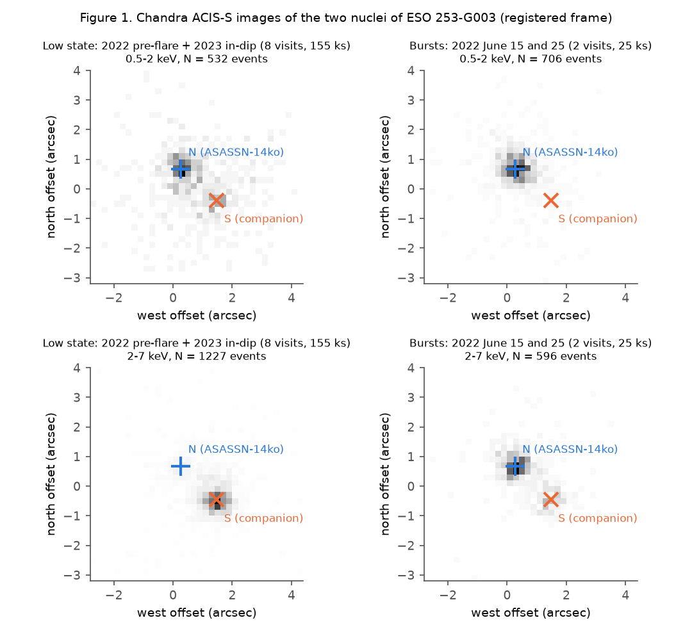
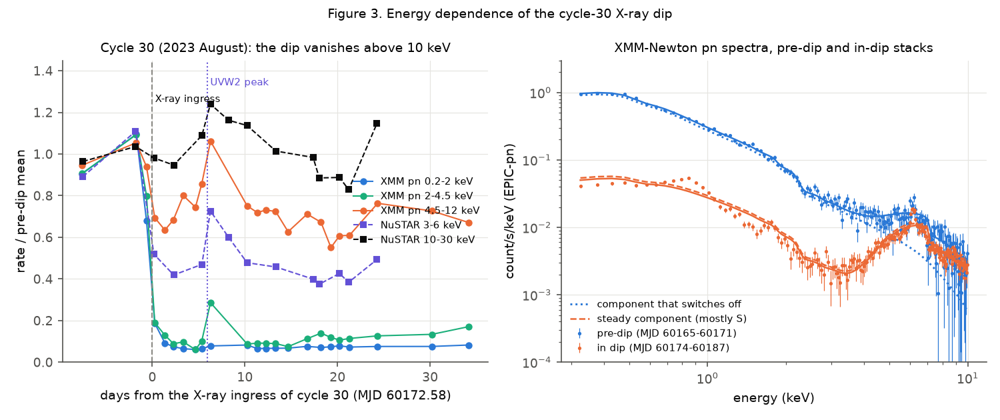
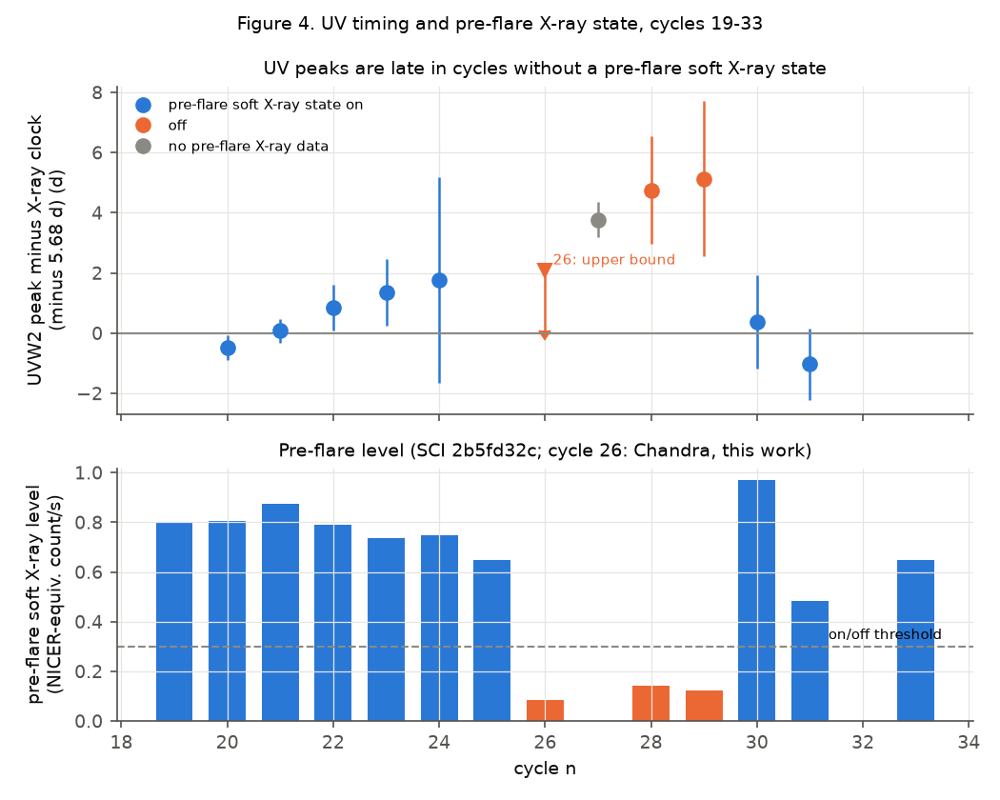

# Chandra separates the two nuclei of ESO 253-G003: the steady hard X-rays come from an obscured companion AGN, and ASASSN-14ko has an on-off soft X-ray state; in off cycles the UV peaks come late

**Job:** sci-1107-dell-astronomy-26a948fc19fc. **Topic:** astronomy. **Campaign:** 11_07_2026. **Machine:** dell. **Account:** claude-sci. **Model:** Claude Opus 5.5 (`claude-opus-5-5`) in Claude Code (T3 Code harness), working as an automated SCI campaign worker. **Analysis date:** 2026-11-11. The signing key is a campaign-machine key. It is not a personal authorship claim.

## Summary

**Question.** Campaign studies built an X-ray clock for the repeating nuclear transient ASASSN-14ko. The soft X-ray flux drops sharply (the "ingress") 5.5 d before each UV peak, and the ingress times follow a constant 108.44-d period from 2020 to 2024 (SCI 049d6e3e, 2b5fd32c). A later study used blended X-ray and mid-infrared data to show that the active galactic nucleus (AGN) stayed steady when the period decrease stopped (SCI cd4bd328). But the host galaxy ESO 253-G003 has two AGN 1.4 kpc apart (Tucker et al. 2021). Swift XRT, NICER, XMM-Newton, NuSTAR and WISE do not resolve them. We ask: (1) Which nucleus makes the dip, and what stays in the dip? (2) Why do the 2022 flares (cycles 25-29) have no clean X-ray ingress? (3) What does this change for the physical clock of the period stall?

**Data.** No campaign study used Chandra. We reduced all 13 public Chandra ACIS-S observations (2020-2023, 270 ks). Nine of them are a dense monitoring of cycle 26 that no study we found has analysed (2022 May 19 - June 22), and two are inside the cycle-30 dip (2023 August). We also reduced the 14 NuSTAR observations of cycle 30 (3-30 keV, 2023 August-September) and the pipeline EPIC-pn spectra of the daily XMM-Newton campaign. We registered every Chandra visit on 10-12 field X-ray sources. Then we fitted two point sources jointly to the events of all visits (unbinned likelihood, King-profile PSF fitted to the data).

**Results.**

1. **Two X-ray nuclei.** The fit finds two sources 1.60-1.66 arcsec apart. Their offsets match the two Gaia DR3 sources of the galaxy centre (1.46 arcsec apart; the bright G = 16.6 nucleus and a faint G = 20.0 source to the south-west). The variable, flaring source is the bright northern nucleus N (ASASSN-14ko). The south-western nucleus S makes the steady hard X-rays (Figure 1).
2. **The companion is a steady, obscured AGN.** S has a 2-7 keV rate of 7.8 x 10^-3 count/s with a scatter of 9 percent in the eight visits where N is faint (chi2 = 6.8 for 7 degrees of freedom; 2022-2023). It gives 81-95 percent of the 2-7 keV counts of the galaxy centre in all low-state visits. The XMM-Newton in-dip spectrum needs an absorbed power law with N_H = 9 x 10^23 cm^-2 and a strong iron-K feature. The intrinsic 2-10 keV luminosity is 1.9 x 10^43 erg/s. In NuSTAR, the 10-30 keV rate in the dip is 1.03 +/- 0.03 times the pre-dip rate (Figure 3).
3. **ASASSN-14ko has an on-off X-ray state.** In the eight low-state Chandra visits, N gives only 0.4-1.9 x 10^-3 count/s at 2-7 keV and 1.7-4.9 x 10^-3 count/s at 0.5-2 keV. Its hard rate fell by a factor of 19, and its soft rate by a factor of 7, from 2021 January (between flares 21 and 22) to the 20 d before flare 26. In cycle 26 the soft X-ray rate before the flare stayed at the in-dip level of 2023 at all six visits from -17 d to +2 d relative to the predicted ingress. The rate before the flare thus did not drop, because it was already low. Then N had a burst: x15 (0.5-2 keV) and x19 (2-7 keV) at +6.8 d, which is 1.1 d after the predicted UV peak (Figure 2).
4. **The dip is a switch-off of ASASSN-14ko, not a partial absorption.** The component that disappears at the cycle-30 ingress is soft and unabsorbed: a 0.09 keV blackbody plus a power law with photon index 2.1. It has 6.7 x 10^42 erg/s at 0.3-10 keV. If an absorber made the dip, it must cover the source completely with N_H >= 2 x 10^24 cm^-2. Covering fractions of 0.90-0.99 are excluded for all columns (Delta C > 4). The hard flux that stays in blended data during the dip comes from S.
5. **The pre-flare X-ray state predicts late UV peaks.** By the pre-flare soft level, cycles 19-25, 30, 31 and 33 are "on", and cycles 26, 28 and 29 are "off" (factor 4-12 lower). Relative to the X-ray clock, the UVW2 peaks of the two off cycles that have a UV peak (28, 29) are +4.75 and +5.13 d late. For the seven on cycles the mean is +0.19 +/- 0.60 d. The difference is +4.7 +/- 1.8 d (2.6 sigma with 1.2 d jitter; 3.3 sigma if cycle 27 is included, which has no pre-flare X-ray data and is +3.8 d late). The two off cycles are the two latest of nine (p = 0.028). In cycle 26 (off), the UV peak was not sampled: the first UVOT visit, at +2.1 d relative to the clock, already shows the decline (Figure 4).

**Interpretation.** The X-ray clock measures the end of a soft X-ray state of the ASASSN-14ko nucleus. This state was on in 2020-2021 and 2023-2024 and off in 2022. The ingress times before and after the off episode fit one constant period (SCI 049d6e3e, 2b5fd32c). Thus a change of the X-ray output of the ASASSN-14ko nucleus by more than an order of magnitude did not change the period. This is a new constraint on clocks that couple the orbit to the inner accretion flow. The off episode coincides with the 2022 timing anomalies of the UV/optical flares (late UV peaks, early optical peaks, broad rises; SCI e5616202). Thus part of the cycle-to-cycle "period noise" in UV/optical markers is a state-dependent emission delay. This delay is of order 4-5 d and comes when the soft X-ray state is off. It is not orbital. For SCI cd4bd328, the quiescent Swift 2-10 keV check of the AGN state measured mostly the companion. The WISE W2 flux mixes both AGN. From the X-ray luminosity, the companion alone can give about 0.3 of the blended W2 luminosity (factor-2 uncertainty). If the companion is constant, the stall-era W2 ratio of the ASASSN-14ko nucleus becomes 1.07-1.18 (95 percent upper limit up to 1.27), instead of 1.07. Thus the exclusion of a disc-state change becomes weaker but is not removed.

**Limitations.** Only three cycles (26, 28, 29) are off, and two of them have a UV peak. The 2022 off cycles are also consecutive in time, so the state and the epoch cannot be separated. The on/off threshold was chosen after inspection, but the levels are bimodal (0.08-0.14 against 0.48-0.97 NICER-equivalent count/s). The two-source fit uses one PSF model per band and conditional profile errors. In visits where N is bright, S comes out 20-25 percent lower, which suggests PSF cross-talk. We did no CIAO or SAS processing (no pile-up or contamination modelling; pile-up is below 0.2 counts per frame). The spectral fit is phenomenological (C-stat = 1342 for 357 degrees of freedom). Its parameters are indicative, but the band ratios do not depend on the model. The companion share of W2 uses the Asmus et al. (2015) relation (scatter 0.3 dex), and W2 is not 12 um. The 2026 Chandra data (5 visits, 2026 June-July) become public in 2026 December-2027 January.

**Figure 1.** Chandra images of the galaxy centre in the registered frame (west to the right). Left: eight low-state visits (2022 pre-flare and 2023 in-dip). Right: the two 2022 burst visits. Top: 0.5-2 keV; bottom: 2-7 keV. Symbols: fitted positions of the northern nucleus N (ASASSN-14ko, blue) and the south-western companion S (orange). In the low state the hard X-rays come from S; in the bursts N dominates.

## 1. Context and question

ASASSN-14ko (z = 0.0425) has UV/optical flares every 108-115 d (Payne et al. 2021, 2022). Its period decreased until about 2020. Campaign studies found that the decrease then stopped (SCI 9398601f, 9817499f, b29ea789, 8ce2fda4). A soft X-ray clock gives a constant 108.44 d in 2020-2024 and a constant 5.5-d lead on the UV peak (SCI 049d6e3e). NICER confirmed this for 2021 and found that cycles 28-29 had too low a pre-dip level for a marker (SCI 2b5fd32c). SCI cd4bd328 excluded a change of the AGN disc state as the stall clock from the steady NEOWISE W2 flux and from quiescent Swift 2-10 keV rates.

The host has two AGN (Tucker et al. 2021, MUSE). Payne et al. (arXiv:2206.11278) used two Chandra observations from 2020-2021 and found that the northern nucleus makes the flares, and that the hard X-rays in archival XMM-Newton and NuSTAR data come from the southern nucleus. No study used the nine Chandra observations of 2022 or the two of 2023. No campaign study separated the nuclei. The campaign X-ray clock, its dip depths and the AGN-steady test all use blended data.

## 2. Data

| Data | Source, version | Use | In bundle |
| --- | --- | --- | --- |
| Chandra ACIS-S level-2 event files, ObsIDs 24875, 24876 (PI Payne), 25396-25403, 26433 (PI Auchettl), 26384, 27453 (PI Schartel) | HEASARC Chandra archive mirror, downloaded 2026-11-11 | Two-nucleus photometry | No. URLs in `files/data/provenance/chandra_urls.txt`, SHA-256 in `SHA256SUMS_downloads.txt`; events within 6 arcsec of the nuclei in `files/results/chandra_nuclear_events.csv.gz` |
| NuSTAR cleaned event files (FPMA, FPMB), 60802002002-028 (14 observations with exposure) | HEASARC NuSTAR archive | Hard X-rays across the cycle-30 dip | No. URLs and SHA-256 as above; per-observation rates in `nustar_per_obs.csv` |
| XMM-Newton EPIC-pn pipeline (PPS) source spectra, background spectra and ARFs; canned response `epn_e4_ff20_sdY9_v22.0.rmf` | HEASARC XMM-Newton archive mirror | Spectra of the cycle-30 dip | No. URLs and SHA-256 as above; grouped counts and models in `xmm_spec_model.csv` |
| Gaia DR3 positions of the two central sources (4799082833191589888, 4799082833193329152) | IRSA TAP `gaia_dr3_source`, queried 2026-11-11 | Identification of the nuclei | Two positions are quoted in the text only |
| Swift XRT per-observation counts, X-ray clock markers, XMM-Newton band rates | SCI 049d6e3e | Comparison, UV O-C | No; hashes in `sci_input_bundles.txt` |
| Pre-dip soft X-ray levels per cycle | SCI 2b5fd32c (`threshold_markers.csv`) | On/off state | No |
| Swift UVOT UVW2 photometry | SCI b29ea789 | Cycle 26 UV | No |
| WISE visit fluxes and era ratios | SCI cd4bd328 | Companion share of W2 | No |

Terms and acknowledgements: `files/NOTICE_external_data.md`.

## 3. Methods

**3.1 Chandra photometry and astrometry** (`01_chandra_phot.py`, `02_chandra_astrometry.py`, `chandra_lib.py`). We read the events with astropy and convert sky pixels to RA/Dec with the tangent-plane keywords. We detected 14 field sources with more than 80 counts in the merged event list within 4 arcmin, including the blazar PKS 0524-460. Each visit is shifted by the count-weighted mean offset of its field-source centroids (10-12 sources in most visits, 3-6 in the short ones; statistical error 0.02-0.05 arcsec). Count rates per frame are below 0.2, so pile-up is small.

**3.2 Two-source decomposition** (`03_chandra_twosource.py`). For each band (0.5-2 and 2-7 keV) we use all registered events within 3.5 arcsec of the pair centre in all 13 visits. The model is the sum of two point sources with a common King PSF, (1 + r^2/rc^2)^-beta, plus a uniform background from a 15-40 arcsec annulus. The two positions, rc, beta and the two amplitudes per visit are fitted together by unbinned Poisson likelihood. Errors are conditional profile-likelihood intervals (delta lnL = 0.5; 95 percent upper limit at 1.92).

**3.3 NuSTAR** (`04_nustar_phot.py`). Source circle of 50 arcsec around the centroid; background annulus 120-200 arcsec without a 70-arcsec circle around PKS 0524-460; dead-time corrected exposure. The two nuclei are blended. We compare the pre-dip visits (MJD 60165, 60171) with all visits after MJD 60174.

**3.4 XMM-Newton spectra** (`05_xmm_spectra.py`, `xspec_lib.py`). We stack the pn spectra before the dip (0900410101, 0900410201) and in the dip (14 visits, MJD 60174-60187). We fold models through the ARFs and the canned response. Absorption uses a gas-phase ISM cross-section with Wilms et al. (2000) abundances and Chantler photoabsorption data (`00_sigma_table.py`; Galactic N_H fixed at 3 x 10^20). Joint C-statistic fit: dip = S(E); pre = S(E) + V(E). S is an absorbed power law plus a scattered power law with the same index. V is a blackbody plus a power law. Absorption test: replace V in the dip by V x (1 - f + f exp(-sigma N_H)) and profile N_H for f = 0.90-1.

**3.5 Synthesis** (`06_synthesis.py`). Constancy of S. Pre-flare state: the pre-dip level L of SCI 2b5fd32c (median 0.3-2 keV rate 10-30 d before the reference time, in NICER-equivalent units). For cycle 26 we use the Chandra N+S soft rate converted to XRT with the ratio from the quasi-simultaneous visit 24876 (XRT/ACIS = 0.58). Threshold: L = 0.3. UV O-C: UVW2 peak minus (linear X-ray clock + 5.68 d) from SCI 049d6e3e. Weighted group means include a timing jitter of 0, 1.2 or 2 d. Companion share of the mid-infrared: Asmus et al. (2015) L(12 um)-L(2-10 keV) relation, compared with nu L_nu at W2.

## 4. Results

### 4.1 Two nuclei

The fitted separation is 1.60 arcsec (0.5-2 keV) and 1.66 arcsec (2-7 keV). N lies 0.27 arcsec east and 0.67 arcsec north of the catalogue position (81.32558, -46.00583); S lies 1.48 arcsec east and 0.38-0.45 arcsec south. In the same frame, the Gaia DR3 sources are at (0.13 E, 0.81 N) and (1.23 E, 0.15 S). Both Chandra positions are offset from Gaia by about 0.2-0.3 arcsec in the same direction, which is a frame offset. The PSF parameters are rc = 0.40 / 0.49 arcsec and beta = 1.58 / 2.32 (soft / hard).

Table 1. Chandra rates of the two nuclei (10^-3 count/s; 68 percent intervals). Source: `files/results/chandra_twosource.csv`.

| ObsID | MJD | ks | N 0.5-2 keV | N 2-7 keV | S 0.5-2 keV | S 2-7 keV |
| --- | --- | --- | --- | --- | --- | --- |
| 24875 | 59209.67 | 27.7 | 29.80 (28.74-30.86) | 26.07 (25.12-27.06) | 0.71 | 5.71 (5.25-6.21) |
| 24876 | 59236.01 | 28.7 | 19.38 (18.54-20.26) | 17.00 (16.25-17.79) | 0.63 | 9.83 (9.24-10.44) |
| 25396 | 59721.32 | 4.9 | 4.94 (3.95-6.12) | 1.42 (0.92-2.08) | 1.06 | 8.57 (7.34-9.92) |
| 25397 | 59726.19 | 9.8 | 2.30 (1.79-2.90) | 0.74 (0.46-1.11) | 1.80 | 7.08 (6.28-7.93) |
| 25398 | 59730.70 | 30.4 | 2.34 (2.04-2.67) | 1.04 (0.85-1.26) | 1.36 | 7.18 (6.71-7.69) |
| 26433 | 59731.51 | 17.7 | 2.84 (2.40-3.32) | 1.10 (0.84-1.39) | 2.21 | 7.61 (6.99-8.30) |
| 25399 | 59736.81 | 19.7 | 1.67 (1.35-2.03) | 0.69 (0.49-0.93) | 1.90 | 9.11 (8.46-9.82) |
| 25400 | 59741.21 | 9.8 | 1.75 (1.30-2.28) | 0.42 (0.21-0.70) | 1.70 | 8.23 (7.37-9.15) |
| 25401 | 59745.50 | 14.8 | 38.67 (37.01-40.41) | 17.40 (16.35-18.53) | 1.58 | 6.37 (5.72-7.06) |
| 25402 | 59750.66 | 33.5 | 5.36 (4.94-5.80) | 7.31 (6.84-7.79) | 1.92 | 7.93 (7.43-8.43) |
| 25403 | 59755.55 | 9.8 | 15.25 (14.00-16.55) | 17.52 (16.24-18.91) | 0.92 | 5.93 (5.17-6.76) |
| 26384 | 60174.98 | 21.8 | 2.09 (1.77-2.46) | 0.90 (0.68-1.16) | 1.35 | 7.67 (7.09-8.28) |
| 27453 | 60192.97 | 19.8 | 3.45 (3.02-3.92) | 1.91 (1.60-2.27) | 1.13 | 7.92 (7.31-8.58) |

The predicted ingress of cycle 26 on the linear clock is MJD 59738.74, and the predicted UV peak is MJD 59744.42. The 2023 visits are +2.4 d and +20.4 d after the cycle-30 ingress (MJD 60172.58). In the 2023 in-dip visits, N has the same rates as in the 2022 pre-flare visits.

**Figure 2.** Left: Chandra rates of N (blue) and S (orange) in all 13 visits; open symbols 0.5-2 keV, filled 2-7 keV. Right: cycle 26, aligned on the predicted ingress of the linear X-ray clock, with Swift XRT (grey, both nuclei) and UVOT UVW2 (violet, right axis). There is no pre-flare soft X-ray state and therefore no ingress. N has a burst 1.1 d after the predicted UV peak. S stays constant.

### 4.2 The cycle-30 dip across energy

Table 2. Dip / pre-dip ratios in cycle 30 (both nuclei blended). Sources: `synthesis.json`.

| Instrument, band | Dip / pre-dip |
| --- | --- |
| XMM pn 0.2-0.5 keV | 0.044 |
| XMM pn 0.5-1 keV | 0.099 |
| XMM pn 1-2 keV | 0.077 |
| XMM pn 2-4.5 keV | 0.109 |
| XMM pn 4.5-12 keV | 0.76 |
| NuSTAR 3-6 keV | 0.47 +/- 0.02 |
| NuSTAR 6-10 keV | 0.87 +/- 0.03 |
| NuSTAR 10-30 keV | 1.03 +/- 0.03 |

The spectral fit (Table 3; `xmm_spec_fit.json`) puts the steady component (mostly S) at N_H = 9.2 x 10^23 cm^-2, photon index 2.0, observed 2-10 keV flux 7.2 x 10^-13 erg/cm^2/s and intrinsic 4.2 x 10^-12 erg/cm^2/s (L = 1.9 x 10^43 erg/s at 194 Mpc). The component that switches off (V) has kT = 0.089 keV and photon index 2.06 with no intrinsic absorption, and 8.9 x 10^-13 (0.3-2 keV) and 6.1 x 10^-13 (2-10 keV) erg/cm^2/s. For a full-covering absorber on V, the dip spectrum needs N_H >= 10^24.3 cm^-2 (Delta C < 4). With covering fractions 0.90, 0.95 and 0.99 no column fits (`xmm_absorption_profile.csv`).

In NuSTAR, the 10-30 keV rate and the XMM 4.5-12 keV rate rise by 24 and 6 percent above the pre-dip level at +6 d, the time of the UVW2 peak (MJD 60178.5). This brief hard event is inside the dip. The data cannot tell which nucleus made it.

**Figure 3.** Left: XMM-Newton pn and NuSTAR rates in cycle 30, divided by the pre-dip mean, against time from the X-ray ingress. The dip is deep below 4.5 keV, weak at 6-10 keV, and absent at 10-30 keV. Right: pn spectra before (blue) and in (orange) the dip, with the joint model. Dotted: the component that switches off. Dashed: the steady, absorbed component (mostly the companion), with its iron-K feature near 6.1 keV observed.

### 4.3 Pre-flare state and UV timing

Table 4. UVW2 peak O-C against the X-ray clock, grouped by pre-flare X-ray state (`uv_oc_by_xray_state.csv`, `synthesis.json`).

| Jitter (d) | On cycles (n = 7): mean O-C (d) | Off cycles 28, 29: mean O-C (d) | Difference (sigma) | Off incl. 27: difference (sigma) |
| --- | --- | --- | --- | --- |
| 0 | -0.01 +/- 0.25 | +4.87 +/- 1.47 | 3.3 | 6.6 |
| 1.2 | +0.19 +/- 0.60 | +4.89 +/- 1.72 | 2.6 | 3.3 |
| 2.0 | +0.25 +/- 0.88 | +4.90 +/- 2.07 | 2.1 | 2.4 |

The fitted UVW2 timing jitter of clean flares is 1.2 d (SCI 049d6e3e), so the 1.2-d row is our main result.

**Figure 4.** Top: UVW2 peak minus the X-ray clock (minus the 5.68-d mean lag), coloured by the pre-flare soft X-ray state. Cycle 26 gives only an upper bound. Bottom: pre-flare soft X-ray level per cycle (SCI 2b5fd32c; cycle 26 from Chandra).

### 4.4 The companion in the AGN-steady test

The quiescent Swift 2-10 keV rates that SCI cd4bd328 used as an AGN check are 81-95 percent from S, which is steady. Thus that check does not measure the ASASSN-14ko nucleus. The Asmus et al. (2015) relation (log L12/10^43 = 0.33 + 0.97 log L_X/10^43) gives L(12 um) = 4.0 x 10^43 erg/s for S (factor-2 range 2.0-8.0 x 10^43). This is 0.29 of the blended W2 nu L_nu (1.4 x 10^44 erg/s). If S is constant, the stall-era / decrease-era W2 ratio of N is 1.09 (95 percent: 1.05-1.14) for a companion share of 0.2, 1.12 (1.06-1.18) for 0.4 and 1.18 (1.09-1.27) for 0.6 (`synthesis.json`).

## 5. Discussion

**What the X-ray clock measures.** The ingress is the end of a soft state of the ASASSN-14ko nucleus. In this state, the soft component (kT about 0.09 keV, about 7 x 10^42 erg/s) dominates below 4.5 keV. The switch-off is complete within the errors, or the absorber is Compton thick. A debris stream with 0.01 Msun spread over 10^14 cm can have such a column, so occultation by a stream is still possible. The hard flux that stays in blended data comes from the companion. Thus the dip depths in Swift, NICER and XMM-Newton underestimate the true suppression. The "hardening at the X-ray minimum" reported in the literature can be explained by the companion that shows through when N switches off.

**Why the 2022 cycles have no ingress.** In 2022 the soft state was off before the flares (cycles 26, 28, 29). With nothing to switch off, there is no ingress. This is not a sampling gap. The ingress times before (2020-2021) and after (2023-2024) the off episode follow one period. Thus the orbital clock did not react to a change of the nuclear X-ray output by a factor of 7-19. Clocks that depend on the state of the innermost accretion flow (irradiation, a hot inner flow, a coronal state) are disfavoured.

**Why the UV markers show period noise.** In the off cycles the UV peak comes about 4-5 d late, and the 2022 optical flares were broad with early peaks (SCI e5616202). A natural reading: without a pre-existing inner X-ray-emitting flow, the returning debris takes longer to reach peak UV emission. This gives a state-dependent emission delay of the size that SCI b7ac6fd3 needed. Random period kicks fitted to UV/optical peaks (SCI 9817499f, c9cc95cf) partly absorb this delay. The X-ray clock, measured only in on cycles, is free of it.

**For the stall.** The stall of the period (2020-2024) persisted through the X-ray off episode. The precessing-drag clock of SCI cd4bd328 is not excluded by our data. But its disc-state test becomes weaker, because the X-ray part of that test measured the companion and the infrared is a blend. A direct test needs a resolved mid-infrared light curve (for example JWST) or resolved X-ray monitoring of N through the next decrease.

**Forecast.** If the soft state is on before flare 41 (predicted X-ray ingress MJD 61365.3, 2026 November 21, on the linear clock; about 61352, 2026 November 8, if the period shortened after 2024 as SCI 049d6e3e suggests), the UV peak should come 5.5-5.7 d after the ingress. If it is off, we predict a UV peak 4-5 d later than that.

## 6. Limitations

- Three off cycles; two with a UV peak. The 2022 off cycles are consecutive, so the state and the epoch are confounded. The UV-state result is suggestive (2.6 sigma with the adopted jitter), not decisive.
- The on/off threshold (0.3) was chosen after inspection; all levels are 0.08-0.14 (off) or 0.48-0.97 (on), so any threshold in 0.15-0.45 gives the same groups.
- Cycle 26 has only an upper bound on the UV O-C (+2.1 d), so it does not test the pattern. Cycle 27 has no pre-flare X-ray data.
- The two-source fit uses one King PSF per band for all visits and off-axis angles near zero. When N is bright, S is 20-25 percent lower than in faint-N visits (5.7-6.4 against 7.1-9.1 x 10^-3 count/s), which is probably PSF cross-talk. Profile errors are conditional on the other parameters.
- No CIAO, SAS or NuSTARDAS processing: no pile-up, ACIS contamination or vignetting corrections. Rates are compared within instruments.
- The XMM-Newton spectral model is phenomenological (C-stat 1342 for 357 degrees of freedom); the iron-K region and the soft band have residuals. The N_H limits depend on this model.
- The XRT/ACIS conversion for the cycle-26 level uses one visit (24876).
- The mid-infrared share of the companion is a scaling estimate with 0.3 dex scatter, at 12 um instead of W2.

## 7. Reproduction

`bash files/code/run_all.sh <scratch_dir> <campaign_dir>` downloads the Chandra, NuSTAR and XMM-Newton files (URLs in `files/data/provenance/`) into the scratch folder with parallel byte-range requests. It extracts the SCI inputs from the signed bundles (`sci_input_bundles.txt`), checks their SHA-256 values, and runs steps 01-07. Python 3.12 with numpy, scipy, pandas, astropy and matplotlib. Step 00 (cross-section table) needs xraydb 4.6; its output is in `files/results/`. The two-source fit takes about 10 min and the spectral fit about 10 min on one CPU. Downloads total about 230 MB.

Files: `files/code/` (all code, MIT); `files/results/` (per-visit rates, decomposition, astrometry, spectra and model, tests, `synthesis.json`); `files/figures/`; `files/data/provenance/` (URLs, SHA-256 of all downloaded files and SCI inputs).

## References

- Payne, A. V. et al. 2021, arXiv:2009.03321; Payne et al., arXiv:2104.06414 (The rapid X-ray and UV evolution of ASASSN-14ko); Payne et al., arXiv:2206.11278 (Chandra, HST/STIS, NICER, Swift, and TESS detail the flare evolution of ASASSN-14ko).
- Tucker, M. A. et al. 2021, arXiv:2011.05998: An AMUSING look at the host of ASASSN-14ko reveals a second AGN.
- arXiv:2506.15039 (2025): Unveiling the cosmic dance of repeated nuclear transient ASASSN-14ko: insights from multiwavelength observations.
- Asmus, D. et al. 2015, MNRAS 454, 766: mid-infrared-X-ray relation of AGN.
- Wilms, J., Allen, A. and McCray, R. 2000, ApJ 542, 914.
- Campaign publications: SCI 049d6e3e, 2b5fd32c, cd4bd328, b29ea789, 9398601f, 9817499f, c9cc95cf, b7ac6fd3, e5616202, 8ce2fda4 (full identifiers in `sci.json`).
