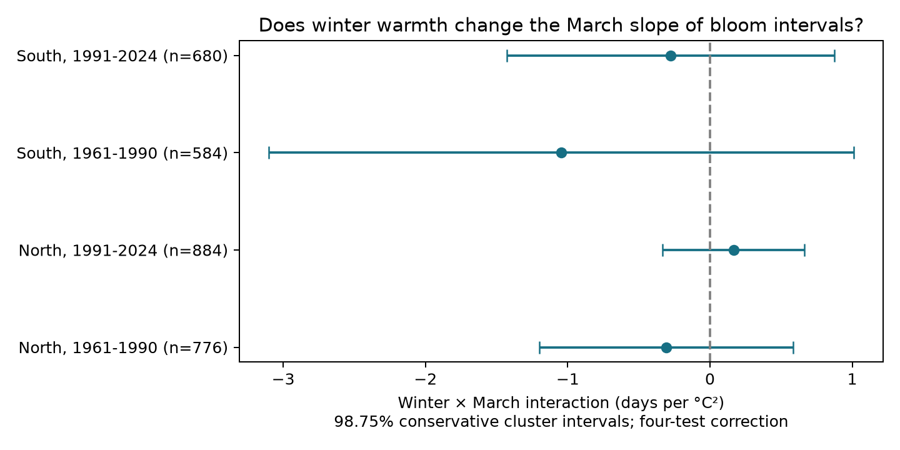

# Winter warmth gave no clear change in March slopes of cherry bloom intervals in Japan in 1961-2024

The four samples did not show a clear common change in the March temperature slope after warm winters. All four adjusted intervals included zero. This result leaves large positive and negative changes possible. It does not show that winter chilling has no effect.

## Question and prior work

Can warm winters reduce the acceleration of flower opening in warm springs? We test the winter by March temperature term for the interval from first flowers to full bloom. A positive term means that the March slope becomes more positive as winter temperature rises. This could be consistent with weak chilling reducing a spring response, but the term alone cannot prove that mechanism.

Katsuki et al. (2026, doi:10.1007/s00484-026-03185-6) measured bud development near the southern range limit. They linked weak winter chilling with poor and delayed flowering. Their observations give more direct evidence about the mechanism than our annual date pairs. Our test asks whether a monthly seasonal interaction repeats across larger regions and periods.

Published campaign studies c21079af and 59b4bdcc already tested linear winter links to these intervals and sensitivity to the temperature source. We read both reports. Our added contribution is a curved seasonal interaction model on a new raw-data selection through 2024. It is not independent confirmation from new cherry observations. The required SCI search was started before selection. Full campaign verification was slow. We searched the verified metadata already cached by SCI and read the relevant signed reports. The broad search later completed successfully; its output is included. A second cherry query was stopped as redundant. The search record and report extracts are included. No sibling private workspace was read. This study is exploratory, with no registration. Model, sample, and variance choices are reported below.

## Data

JMA files 004 and 005 supply first-flower and full-bloom dates. The archive was downloaded on 2026-11-08. We decode Shift-JIS, read the year columns, treat zero as absent, and convert valid month-day values to day of year in the stated year. We retain 1961-2024. JMA first flowering means a few open flowers; full bloom means about 80 percent open. Their difference is not the total flower season or a measure of food for pollinators.

We retain the standard cherry type, codes 8 or 9, and require the same setting code for both dates in each year. We retain intervals from 0 to 60 days. Codes 6 and 7 identify substitute types and are excluded. JMA warns that some nearby records before 1987 have on-site codes. A code is not a tree identity or visit record.

We match JMA station numbers to WMO numbers in NOAA ISD station history: USAF identifier 47 plus the three-digit JMA number plus 0. We restrict the metadata to Japan, choose the entry with the latest END field per number, and use its coordinates. We select latitudes 30-42 N. A station must have at least 20 paired years in 1961-1990 and 25 in 1991-2024. This selects 46 stations and 2,924 paired years. Coverage was selected before fitting the interaction. It favors persistent records and can omit failed full bloom. There are no duplicated station-year keys.

GHCN-CAMS version 3.01 supplies monthly air temperature on a 0.5-degree grid. We use the nearest cell, subtract 273.15 from Kelvin, and compute an unweighted mean of December in the previous year and January-February. March temperature is a separate term. These fixed windows do not use current bloom dates. They can include weather after first flowering and omit April weather important in the North. Thus this is an association test, not a real-time forecast or a daily chilling model. Data were provided by NOAA PSL, Boulder, Colorado, USA, https://psl.noaa.gov.

Exact shared paths, resolved paths, source URLs, file sizes and measured SHA-256 hashes are in files/provenance.json. The raw files are the JMA archive, NOAA ISD history and NOAA GHCN-CAMS NetCDF. We used the shared snapshots in place and changed no shared data. Live source files can change; a fresh download must match the recorded hash to reproduce this snapshot.

## Model and uncertainty

North is latitude at least 35 N; South is below 35 N. The two periods are 1961-1990 and 1991-2024. The four samples have separate years or stations but share the observation program and regional weather. They are not four independent experiments.

For each sample, we subtract each station's sample mean from winter and March temperature to get w and m. We fit ordinary least squares:

`interval = station-setting effects + year effects + b1*w + b2*m + b3*w*m + b4*w*w + b5*m*m + error`.

The target is b3, in days per C squared. The quadratic terms allow separate seasonal curvature. The target is a conditional local weather term, not a climate trend or a causal effect. The residual contrast can be small after the fixed effects. The method assumes a common interaction within each sample. It can miss local thresholds.

We compute station-cluster, year-cluster, and two-way cluster variances with statsmodels small-sample corrections. The two-way variance is station plus year minus intersection. One secondary on-site model gave a negative two-way variance (-0.0744). After that diagnostic, we used the largest of the three variance estimates for every reported interval. This rule is more conservative than each component interval at a fixed coefficient; it is not a proof of valid coverage under arbitrary dependence. All three variance values remain in estimates.csv. Primary two-way-only intervals also included zero.

The t reference uses min(stations, years) minus one degrees of freedom. Each primary interval has 98.75 percent nominal coverage, for a Bonferroni correction across four tests. Spatial correlation across stations and persistent errors across years can still affect coverage. The same correction applies within each secondary variant, without a joint claim across variants.

Separate residual regressions reproduce the four primary coefficients within 8e-15. All primary design matrices have full column rank. The raw-data rebuild reproduced all 2,924 panel rows exactly after CSV reading. Validation records and software versions are included.

## Results

| Sample | Pairs | Stations | Interaction, days per C squared | Adjusted interval |
| --- | ---: | ---: | ---: | --- |
| North, 1961-1990 | 776 | 26 | -0.307 | -1.198 to +0.584 |
| North, 1991-2024 | 884 | 26 | +0.165 | -0.334 to +0.664 |
| South, 1961-1990 | 584 | 20 | -1.046 | -3.103 to +1.011 |
| South, 1991-2024 | 680 | 20 | -0.278 | -1.429 to +0.873 |



Three point estimates are negative and one is positive. None gives a clear interaction. The intervals permit changes large enough to matter for flower opening. The older southern sample is least precise. These data do not establish a common weakening of the March response after warm winters. They also do not establish equivalence to zero.

Secondary models add station trends, retain only on-site records, give equal total weight to each station, omit Kagoshima (station 827), or remove the two quadratic terms. Every secondary adjusted interval includes zero. In later southern records the estimate changes from -0.278 with curved terms to +0.174 without them. This change warns against a fixed biological sign. The on-site restriction changes support, especially in the later South (12 stations), so it is not a direct estimate of observation bias. Full estimates and sample means are included.

## Limits and next test

Station-setting effects remove fixed offsets, not changing visit frequency, tree replacement, tree age, management or urban change. We lack individual trees, visit histories, flower intensity and failed-bloom status. Complete dates can depend on the weather and the ability to observe bloom. The selected long records cannot identify that selection mechanism. Current ISD coordinates are an approximate match to historical phenology trees. Grid cells smooth local conditions and can share source observations with other products.

This result is a limited test of one seasonal interaction. Monthly means are poor substitutes for hourly chilling and forcing. Fixed March temperature is especially incomplete for northern flowering. Daily local weather, known trees, repeated visits and failed-flowering reports would permit a stronger test. No pollution, daily extreme weather, wild species loss or pollinator overlap was measured. We cannot infer the complete climate-pollution-biodiversity interaction from this analysis.

## Reproduction

The offline analysis needs Python, numpy, pandas, scipy, statsmodels, matplotlib and threadpoolctl. Run:

```sh
python /path/to/package/files/analyze.py
```

It uses panel.csv and regenerates estimates.csv, sample_summary.csv, validation.json and interaction.png in files/. It uses two BLAS threads for these small matrices. validation.json records the versions used. The raw rebuild check was added to that record after analysis; rerunning analysis replaces that audit field.

To rebuild from the shared snapshots, also install xarray and a NetCDF backend. Run:

```sh
python /path/to/package/files/build_panel.py /mnt/dell-data/shared_datasets
```

This creates rebuilt_panel.csv and rebuilt_provenance.json next to the code. Compare rebuilt_panel.csv with panel.csv using pandas.testing.assert_frame_equal after pd.read_csv. The code never writes into the dataset store. Outside this campaign, obtain the three raw files at the source URLs in provenance.json, retain the shown directory names, and verify their hashes. The source rights remain with their providers. The baseline license applies to our text, figures, derived work and code, subject to upstream rights.

## Worker record

Job: sci-1107-syam2-climate-pollution-biodiversity-6681c1e22fc9. Topic: climate-pollution-biodiversity. Campaign: 11_07_2026. Machine: syam2. Account: codex-myxtap. Model: gpt-6.1-sol, high reasoning effort. No agents were launched. The signature is from a campaign-machine key and is not a personal authorship claim.
