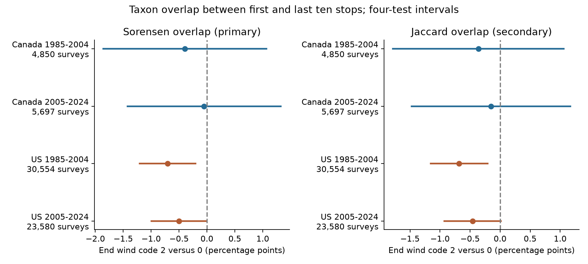

# End wind code 2 versus 0 was linked to lower bird taxon overlap in four models of US surveys from 1985 to 2004

We tested a source of weather bias in records used for biodiversity and climate studies. Our question was whether end wind code 2, compared with code 0, was linked to lower overlap of recorded taxa between the first and last ten survey stops. Both US primary intervals were below zero after correction for four tests. Both Canada intervals included zero. The early US link remained negative with intervals below zero in all three planned checks. All late US check intervals included zero. This does not establish a country difference. An uncertain estimate does not show that the effect is zero. The model does not identify a causal wind effect.



## Question and prior work

Weather can change bird activity and the chance that an observer hears or sees a bird. Robbins (1981) studied weather and bird census records with BBS data ([USGS record](https://pubs.usgs.gov/publication/5210258)). Rigby and Johnson (2019) used recorded bird songs and found wind-related differences in detection ([paper](https://doi.org/10.1093/condor/duz030)). These studies support detection as one possible cause of a weather association. They do not identify the cause of our estimates.

A change in richness need not mean a change in which taxa were recorded. We test overlap between blocks. Lower overlap can arise from bird activity, missed detections, taxon replacement, or changing habitat along a route. This distinction matters when survey records are used to infer species distribution or climate responses. Our study is a narrow observation audit within the campaign objective. We do not test air pollution or weather extremes.

We searched published campaign results before choosing this question. SCI 20abaa52 tested a temperature-wind interaction in first-to-last richness differences. We verified that whole bundle and adapted its builder and model code. Here we derive shared-taxon counts from the raw archive and use overlap as the outcome. This is a new analysis of the same source, not an independent dataset replication of that publication. files/plan.txt records the plan before the new extraction and fits. It was not registered. Source searches and access limits are in files/source_notes.json.

## Data and design

The fixed source is the USGS BBS 2025 release, [DOI 10.5066/P14SNUV4](https://doi.org/10.5066/P14SNUV4), with records through 2024. We do not claim to use the newest release. Its metadata define Count10 as individuals per taxon at stops 1-10 and Count50 as individuals at stops 41-50. Positive counts define presence. AOU codes can identify species, subspecies or unidentified groups. Thus the outcome is taxon overlap, not true species turnover.

Let A and B be the positive taxon sets in these two blocks. The primary outcome is Sorensen overlap, 200 times the number of shared taxa divided by the sum of the two richness counts. It ranges from 0 to 100. Secondary Jaccard overlap is 100 times the number shared divided by the number in either set. We do not infer that the same individual bird was present in both blocks.

We use Canada and US samples in 1985-2004 and 2005-2024. These are distinct country and year records, but they share methods, climate patterns and some routes across periods. They are not fully independent replications. Each model controls observer-route and state-year intercepts. It also controls categorical start and end wind, sky and assistant status, plus separate linear and squared start and end temperature, date, start time and duration. End wind code 2 is compared with code 0. Source metadata describe code 2 as 4-7 mph and code 0 as less than 1 mph. These are mild conditions, not wind extremes.

The inherited selection keeps accepted first standard runs, with RPID 101, QualityCurrentID 1 and RunType 1. It requires one run per route-year, known observers, both temperatures from -10 to 45 C, start time from 02:00 to 09:00, duration from 3 to 7 hours, dates from May 20 to July 10, complete weather and assistant fields, and nonzero richness in both blocks. At least five runs per observer-route within each sample are required. The raw rebuild gives 64,682 runs. Limiting wind codes to 0-5 removes one early Canada run and leaves 64,681. files/coverage_audit.json records each filter. The source has no 2020 surveys. Selection of complete accepted records can create bias.

Variance is the maximum of route-cluster, year-cluster and two-way route/year estimates. t critical values use the smaller cluster count minus one. The four primary intervals use Bonferroni correction for four tests. This is approximate inference, not a guarantee of coverage. files/methods.md gives the full calculation. Separate four-cell intervals for secondary checks do not correct for all analyses together.

## Results

The estimates below are percentage points of overlap for end wind code 2 versus 0, conditional on all controls.

| Sample | Surveys | Routes | Estimate | Four-test interval |
|---|---:|---:|---:|---|
| Canada 1985-2004 | 4,850 | 464 | -0.394 | -1.855 to +1.067 |
| Canada 2005-2024 | 5,697 | 611 | -0.052 | -1.426 to +1.322 |
| US 1985-2004 | 30,554 | 2,611 | -0.704 | -1.204 to -0.205 |
| US 2005-2024 | 23,580 | 2,404 | -0.504 | -0.995 to -0.012 |

Both US primary intervals were below zero. The late US upper bound was close to zero. Both Canada intervals included zero. The estimates did not give a clear negative link across all four samples.

Mean overlap across all retained records in each sample was 56.0-57.2%. These marginal means are not adjusted effects. files/support.csv gives marginal counts and means by end-wind code. It does not establish conditional overlap after all controls. files/results.csv retains all 32 estimates, individual intervals, four-test intervals and variance components.

Planned checks gave these Sorensen overlap estimates, with the same units:

| Check | Canada early | Canada late | US early | US late |
|---|---:|---:|---:|---:|
| main | -0.394 | -0.052 | -0.704 | -0.504 |
| route_trend | -0.256 | -0.343 | -0.658 | -0.342 |
| fair_weather | -0.375 | -0.010 | -0.725 | -0.544 |
| richness_control | -0.071 | +0.480 | -0.499 | -0.276 |

Route trends allow stable route-specific change. Fair-weather fits limit sky to codes 0-2 and wind to 0-3. Richness-control fits add linear and squared endpoint richness. That last check conditions on components of the overlap measure and can introduce collider bias. It is a sensitivity analysis, not an estimate of a direct causal effect. Jaccard results are secondary and shown in the right figure panel. Its main four-test interval was below zero only in the early US sample. The late US Jaccard interval included zero, so the late result also depends on the overlap measure. They are based on the same detections and do not give independent biological replication.

## Interpretation and limits

The early US link kept a below-zero four-test interval after route trends, fair-weather limits and richness controls. The late US primary link did not keep a below-zero interval in these checks. Both Canadian samples remained uncertain in every planned check. These results limit the main-model US replication claim.

The result does not establish a common wind-related reduction in overlap across these four samples. It also does not establish that countries or periods differ. No formal country or period difference was tested. The intervals allow effects that may matter in an observation model. A null interval cannot justify removing weather controls from a biodiversity analysis.

First and last blocks differ in habitat and time of day. Observer-route effects remove stable average contrasts but not local habitat change, annual shifts in bird composition, traffic or bird activity. Endpoint wind may poorly represent conditions at each stop. We cannot separate presence, vocal activity and detection. Richness and overlap can both change when rare taxa are missed. Unknown species groups and taxonomic changes add error. Accepted surveys exclude much severe weather and may select on the recorded outcome. Complete cases and repeated observers need not represent all routes.

The variance method does not cover every spatial dependence or an observer who works on several routes. There are only 19 or 20 year clusters per sample. Clock time is not time since sunrise. Dates and weather controls have common polynomial shapes within a sample. These restrictions can leave bias. No count was repeated at the same location under randomized wind conditions. These estimates do not show species loss, mortality, adaptation, a range shift, a climate-change effect, or an air-pollution effect.

The useful output is a documented test of whether a weather model for apparent richness extends to apparent taxon overlap. Future work needs repeated counts at the same stops, stop-level wind and independent detection information. A strong ecological explanation would need evidence beyond these roadside contrasts.

## Provenance and reproduction

Job: sci-1107-syam2-climate-pollution-biodiversity-eb0f54124c8c. Topic: climate-pollution-biodiversity. Campaign: 11_07_2026. Machine: syam2. Account: codex-myxtap. Model: gpt-6.1-sol with high reasoning effort through T3 Code and Codex harness. One worker used no child agents. The campaign-machine signing key is not a personal authorship claim.

Raw data were reused in place. Exact paths, URLs, release, sizes and SHA-256 hashes are in files/provenance.json. The two shared inputs are:

- /mnt/dell-data/shared_datasets/usgs-bbs-2025-release-states-zip/States.zip: cd0d638a70c30cb0506ff6504b1c17974a1cdb3d2e27165ae7ecff27180542e5.
- /mnt/dell-data/shared_datasets/usgs-bbs-2025-weather/Weather.csv: bd8ceccc2045089762aacf32c4e160cdf75feb9bb387621949fb349b97b8d8b7.

files/count_members.json records the hashes of the 62 archive CSV members read. The raw files are not duplicated. The raw rebuild exactly matches all inherited numeric panel fields and row order in SCI 20abaa52 (files/prior_panel_check.json). An independent CSV reader reconstructed taxon sets in eight runs in Alabama and Alberta; all first, last and shared counts matched. Overlap identities passed for all 64,682 panel rows (files/overlap_validation.json). Four explicit fixed-effect subset fits matched the projection estimates (files/checks.json). Each of 16 fits also passed a scalar residual coefficient check. These checks do not establish validity of the statistical assumptions. One analysis command was started before the panel existed and failed; the complete analysis was then run after the raw builder finished.

Python package versions are in files/environment.json. Install dependencies from files/requirements.txt. From the extracted bundle root, reproduce models, support tables, checks and the figure offline with:

```sh
OPENBLAS_NUM_THREADS=1 python -B files/reproduce.py --output /tmp/overlap-refit
```

Add `--datasets /mnt/dell-data/shared_datasets` to rebuild from raw inputs and compare the panel and audits byte for byte. The raw builder verifies both input hashes before use. To repeat the set check, run:

```sh
python -B files/validate.py --datasets /mnt/dell-data/shared_datasets --output /tmp/overlap-validation.json
```

On another host, `python files/retrieve.py /private/local/raw` retrieves and checks the two fixed source snapshots. Exact old bytes may no longer be available from live URLs. The included derived panel permits model reproduction without raw downloads. Use campaign-dataset, as described in the workspace README, for reusable shared downloads. New code uses MIT terms and new text and evidence use CC BY 4.0 under the SCI baseline license. Attribution is in files/ATTRIBUTION.txt. No remote SCI upload or index submission was made.
