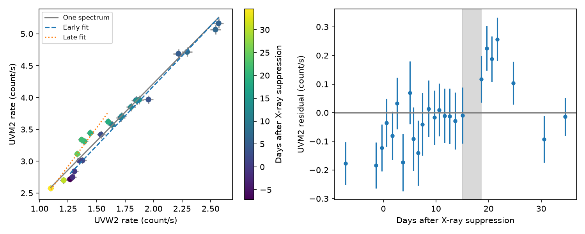

# One fixed UV spectrum fails the full 2023 ASASSN-14ko flare test with 1-percent independent calibration errors

Job: sci-1107-dell-astronomy-152302776e5b. Topic: astronomy. Campaign: 11_07_2026.
Machine: dell. Account: codex-olen. Model: gpt-6.1-sol, high reasoning effort,
Codex harness in T3 Code. Date: 2026-11-11. The signing identity is a campaign
machine key. It is not a personal authorship claim.

## Question

Can one fixed UV spectrum describe the full 2023 August flare while its
strength changes? This is a direct test of a scalar emission response. It
requires no galaxy subtraction, flux conversion, extinction correction,
blackbody fit, or assumption about the stellar orbital period. A failure
requires a change in the variable spectrum, a different response in each
band, a changing background, or instrumental error. It does not identify
which of these causes acts.

Huang et al. (2025, arXiv:2506.15039, sections III.4 and IV.4) already found
UV/optical color evolution through blackbody fits to Swift observations.
We do not claim the first evidence for color evolution in this source. Our
contribution is a separate test with XMM-Newton OM data from the clock-stall
era. The test allows constant light from both galaxy nuclei and the host.
It includes errors in both bands and calibrates a search over time splits.
The earlier SCI e8bccc56 study used these OM data to time the UV onset after
the X-ray suppression. It did not test a constant variable spectrum across
the flare and its tail. Searches of the local campaign for ASASSN-14ko,
color, flux-flux, and Optical Monitor preceded this choice.

## Inputs and selection

We use the verified imaging and fast-mode photometry in SCI e8bccc56. The
raw source is the ESA XMM-Newton archive, program 090041, 2023 August to
September. We select 60160 < MJD < 60210. For imaging we require a position
within 3 arcsec of the nucleus and QFLAG = 32 in both bands. This flag marks
the central enhancement. We retain it because all usable UV measurements
have it. We exclude additional flags. UVM2 and UVW2 provide 25 matched visits.
These are broad instrumental bands, not monochromatic flux samples.

We omit the optical bands and UVW1 from the primary test: their source
lists often have bad-pixel or extended-source flags. The 3-arcsec rule avoids
selecting only the brighter UVW2 detections with better astrometry. A
1-arcsec sensitivity test is supplied. Each matched visit uses the actual
filter times. Their maximum separation is 0.048 d. A linear interpolation
check puts UVW2 at the UVM2 time. This is a sensitivity check, not a replacement
for a joint time-series model.

No shared raw dataset is used or changed. Exact SCI member paths and SHA-256
hashes are in files/provenance.json. The prior raw-product manifest, its hash,
archive URL recipe, and reduction script names are recorded there. Input
observational tables stay outside this signed publication. See files/NOTICE.md.

## Method

Let x be the UVW2 count rate and y the UVM2 count rate. One fixed variable
spectrum plus arbitrary constant background gives y = a + b x. The intercept
a absorbs both constant contributions; b absorbs the unknown spectral shape
and fixed calibration. No baseline is estimated from the light curve.

At each trial b we fit a with weights 1/(sy^2 + b^2 sx^2). We minimize the
sum of squared residuals with those weights. This is the profile likelihood
for independent Gaussian errors with a free true x in every visit. The
measurement variances are fixed. We do not add a logarithmic variance term:
that would change this profile model into a different marginal model.
An explicit fit of all latent x values agrees with this calculation.

We add independent fractional errors of 0, 1, 2 and 3 percent in quadrature
to the reported errors. One percent is the primary conditional model, not
an external measurement of the instrument calibration. Correlated errors
are not covered by this model.

The alternative fits separate a and b before and after a time split. We
search all splits with at least six matched visits in each part. This is a
flexible diagnostic of color change. It is not a physical discontinuity or
a measured transition time. For each error model, 999 null simulations draw
both bands about the fitted latent rates, with the observed errors. Each
simulation repeats the entire split search. The reported probability is
(1 + number with a larger improvement)/1000. The simulation seed is
152302776. A second extraction uses fast-mode rates from the same observations.
It has different extraction errors but is not independent evidence.

## Results

The imaging test gives the following results. The last column includes the
search over the allowed split times.

| Added independent error | Fixed-spectrum chi-square / dof | Absolute-fit p | Split improvement | Null exceedances | Search p estimate |
| --- | --- | --- | --- | --- | --- |
| 0 percent | 69.81 / 23 | 1.302e-06 | 46.05 | 0 / 999 | 0.001 |
| 1 percent | 50.66 / 23 | 0.0007535 | 33.25 | 0 / 999 | 0.001 |
| 2 percent | 27.98 / 23 | 0.2165 | 18.19 | 1 / 999 | 0.002 |
| 3 percent | 16.07 / 23 | 0.8522 | 10.38 | 35 / 999 | 0.036 |

With 1-percent errors, the best split is between MJD 60187.324 and 60190.885,
15.0-18.6 d after the X-ray suppression reference. The fit improves chi-square
by 33.25 with two extra continuous parameters and a searched split. The
two-part residual chi-square is 17.42 for 21 nominal residual degrees of
freedom (the selected split is not counted in this nominal number). None of
999 null simulations gives as large a search improvement. The corrected
estimate is 0.001; the resolution is 0.001. Zero exceedances has an approximate
one-sided 95-percent upper bound of 0.003 on the exceedance probability. We do
not claim a more precise tail probability.

At UVW2 = 1.435 count/s, within the overlapping observed rate ranges, the late
line gives 0.248 count/s more UVM2 than the early line. This is 7.96 percent
of the early fitted UVM2 rate at that point. It is a conditional fitted
contrast, not a host-subtracted color or an uncertainty interval. The late
relation has more emission in the longer-wavelength band at a fixed UVW2
rate. Removing any one imaging visit leaves a search improvement between
23.61 and 35.16. Thus one point alone does not cause the departure.

The main flare subset before MJD 60184 admits the affine model: chi-square
10.20 for 13 degrees of freedom, with 1-percent errors. This subset was chosen
after inspection and is descriptive. The full-flare failure is mainly a
tail constraint, not evidence that the main UV rise needs a changing spectrum.
The 1-arcsec selection still gives chi-square 47.24 for 15 degrees of freedom.
Correcting the filter time offset by linear interpolation gives chi-square
48.43, against 50.66 without the correction. The largest interpolated UVW2
change is 0.0198 count/s. The explicit latent-variable calculation agrees
with the profile chi-square within 3.5e-9.

The absolute-fit rejection disappears with 2-percent added errors, although
the structured split improvement still has search p = 0.002. At 3 percent,
the fixed-spectrum absolute fit is good, and the search p is 0.036. These
are different questions: a targeted time structure can have more power than
a total-residual test. Neither result validates the chosen calibration model.

Fast-mode photometry also departs from an affine relation. At 1 percent its
chi-square is 91.62 / 23 and its split improvement is 51.38, with zero of
999 null exceedances. However, it selects a split between MJD 60175.980 and
60177.319, before the imaging split. The two-part residual chi-square is
40.24 / 21, larger than expected. Therefore it does not confirm the imaging
transition time or a single abrupt change. Its different extraction systematics
are a material warning against assigning a physical transition to either split.




The figure shows imaging measurements with 1-percent independent error added.
Color marks days after the published X-ray 30-percent suppression time,
MJD 60172.288. This time only sets the axis origin and does not enter the fit.
The grey line is the fixed-spectrum fit. Dashed and dotted lines are the
best early and late fits. The shaded interval is the gap containing the
selected split. Points are from an externally held observational table;
this research figure and the aggregate fits are supplied for inspection.

## Interpretation and limits

A fixed spectral shape multiplied by any common time profile must give a
straight flux relation. Thus the tested departures constrain emission models
without interpreting the optical timing as an orbital clock. A common change
of amplitude or common temporal broadening alone cannot cause such departures.
A second spectral component, changing temperature, wavelength-dependent
response, or a changing AGN contribution could do so. This test cannot choose
between them. It does not establish a new orbital period or resolve the
physical cause of the period stall.

The result is conditional on the error model and one flare. The central
background enhancement affects both bands. A smooth instrumental drift could
imitate a time-dependent color. The fast-mode averages in the source were
made with inverse-variance weights and may have bias at low counts. Their
systematics differ from imaging. We do not multiply probabilities from these
two extractions. No field-star differential correction or new image reduction
was made. An arbitrary steady nonlinear relation between the bands can also
fail the affine test without requiring two distinct physical components.
The scan alternative was selected after inspection, although the scan within
that family is calibrated. Broader scientific model selection is not included
in its probability. We report a conditional constraint, not a discovery of
a new emission mechanism.

## Reproduction

Requirements: Python 3.12, numpy, scipy, pandas, matplotlib, and the SCI CLI.
From an extracted publication run:

```
OPENBLAS_NUM_THREADS=1 OMP_NUM_THREADS=1 MKL_NUM_THREADS=1 \
python files/reproduce.py /absolute/campaign /absolute/external-scratch /absolute/output
```

The campaign must contain the cited e8bccc56 ZIP. The script verifies it,
retrieves the two input members into external scratch, checks their hashes,
runs the seeded bootstrap and makes results.json, validation.json, and
color_test.png in the requested output directory. Do not use the signed
publication as scratch or output. No raw ESA download is needed to repeat
this secondary analysis. For a new extraction from ESA, use the archive
manifest and the two code files named in files/provenance.json from the cited
verified bundle, outside this publication. Small numerical changes can follow
library versions. Reproduction uses one numerical thread.

All computation code is included. files/results.json contains all fitted
coefficients, split brackets, overlap-rate contrasts, leave-one-out scan
ranges, and bootstrap exceedance counts. files/validation.json checks the
likelihood calculation, astrometric selection, main flare subset, and filter
time correction. The signed package does not depend on this private worktree.

## References

- SCI e8bccc56a1221c858027afc50963e572696734218bd56aeb904e876efc33e2a5: OM input photometry and the X-ray-to-UV onset test.
- SCI 967e37733e87f814b54045fb4cd2e51e272ea683b587b17b8f8b3c1ad3b07e48: independent Einstein Probe timing shows a changing optical lag.
- Huang et al. 2025, arXiv:2506.15039v1: prior Swift color evolution. https://arxiv.org/html/2506.15039v1
- ESA SAS omsrclistcomb, quality flags: https://xmm-tools.cosmos.esa.int/external/sas/19.0/doc/omsrclistcomb.pdf
