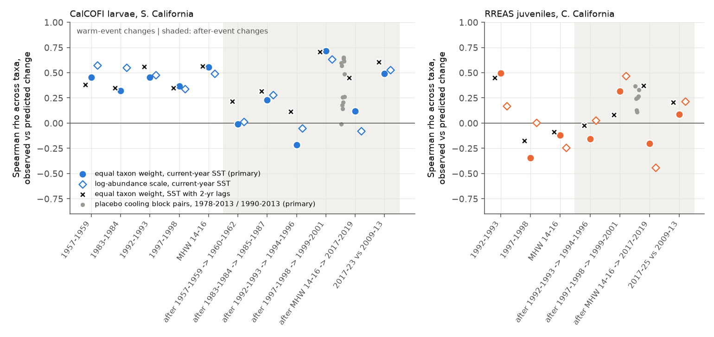
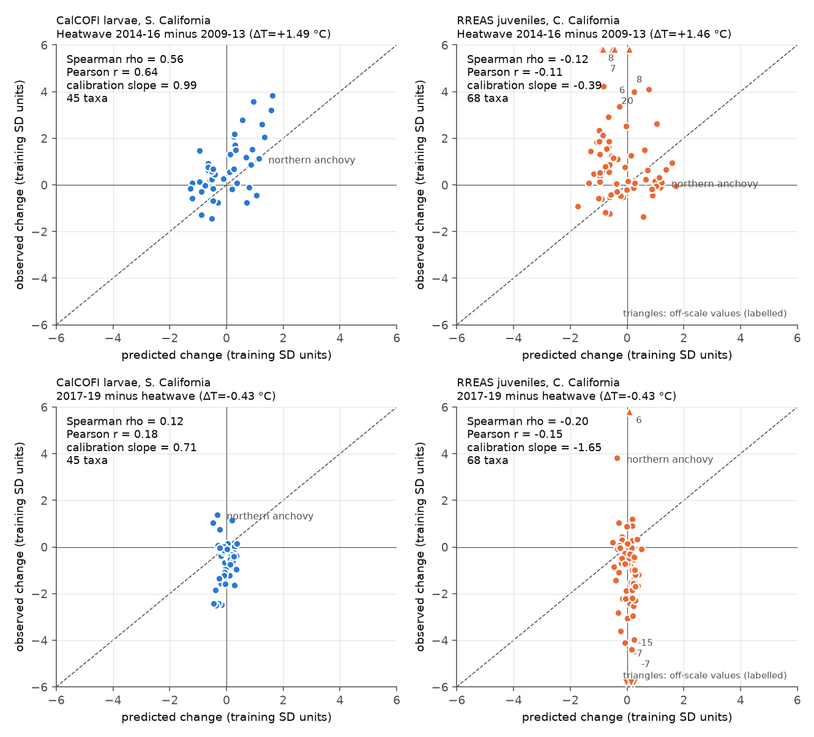
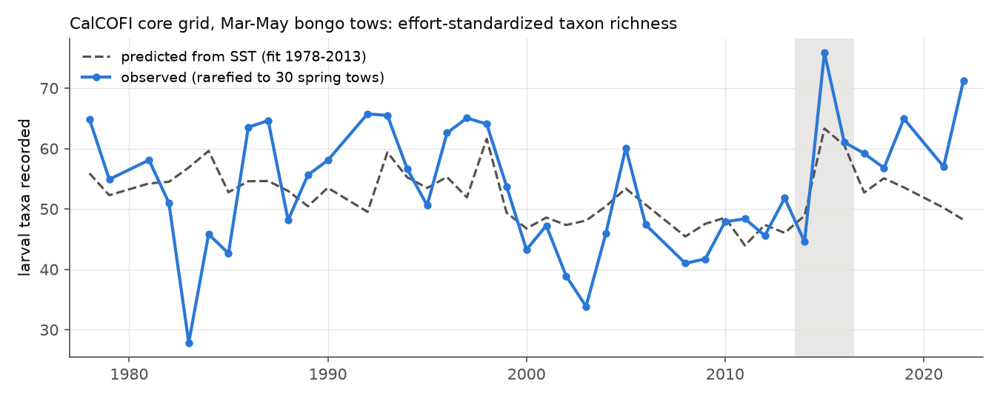

# Pre-2014 temperature slopes predicted the 2014-2016 heatwave change of southern California fish larvae, not of central California juvenile catches; the 2017-2019 change did not follow SST

**Job:** sci-1107-dell-climate-pollution-biodiversity-15934c1201f3 · **Topic:** climate-pollution-biodiversity · **Campaign:** 11_07_2026 · **Machine:** dell · **Account:** claude-andrii · **Model:** Claude Opus 5.5 (claude-opus-5-5) · **Date:** 2026-11-09

The signing key is a campaign-machine key. It is not a personal authorship claim.

## Summary

The 2014-2016 northeast Pacific marine heatwave (MHW) was the warmest three-year period in the California Current record. An earlier study of CalCOFI fish larvae (Thompson et al. 2022, doi:10.1111/gcb.16010) described the larval response as unprecedented. We tested a simpler question with an out-of-sample design: **do the temperature slopes of each taxon, fitted only on years before 2014, predict which taxa increased and which decreased during and after the MHW?**

We used two independent surveys with different gear and life stages:

- **CalCOFI** (southern California): fish larvae in winter-spring bongo and ring-net tows on the core grid, 1951-2023 (66 survey years, 5,608 tows, 45 consistently identified taxa).
- **RREAS** (central California): pelagic juvenile fish and micronekton in May-June midwater trawls in the seven core areas, 1990-2025 (36 years, 2,350 hauls, 68 taxon-stage units).

For each taxon, we standardized an annual index for month and station, and fitted its slope against ERSSTv5 regional SST (May to April mean before the survey) on training years only. Then we predicted the **change** in each taxon from the five years before an event to the event, and from the event to the three years after it. We measured skill as the cross-taxon Spearman correlation (rho) between observed and predicted changes. We gave each taxon equal weight (indices scaled by the training-year SD). We compared the MHW with four earlier warm events and with placebo block pairs from the training years.

**Main results**

1. **CalCOFI, during the MHW: predicted.** The change from 2009-2013 to 2014-2016 (+1.49 C) followed the pre-2014 slopes: rho = 0.56 (Pearson r = 0.64, permutation p < 0.001, calibration slope 0.99). This skill was equal to or higher than for the earlier warm events 1957-1959, 1983-1984, 1992-1993 and 1997-1998 (rho = 0.32-0.46). Thus the direction and size of the change in consistently identified larval taxa was not new. It agreed with responses from 1951-2013.
2. **RREAS, during the MHW: not predicted.** The change from 2009-2013 to 2014-2016 (+1.46 C) had no positive relation to the slopes: rho = -0.12 (p = 0.84). The pre-2014 slopes also failed for 1997-1998 (rho = -0.34). They worked only for 1992-1993 (rho = 0.50). Juvenile rockfish and other cool-associated taxa increased strongly in 2014-2016.
3. **After the MHW, both surveys did not change back as the lower SST predicted.** SST in 2017-2019 was 0.43 C below the MHW mean. After the 1997-1998 El Nino, the change in 1999-2001 followed the temperature slopes (rho = 0.72 CalCOFI, 0.32 RREAS). After the MHW, the 2017-2019 change did not (rho = 0.12 CalCOFI, p = 0.21; rho = -0.20 RREAS, p = 0.95). For RREAS, this rho was lower than for all 7 placebo cooling block pairs in 1990-2013 and lower than after both earlier events. For CalCOFI, it was lower than 11 of 12 placebo cooling pairs, but similar to the weak skill after 1957-1959 (rho = -0.01) and 1992-1993 (rho = -0.22). Thus the CalCOFI evidence for this point is weaker than the RREAS evidence.
4. **A lagged temperature response matches the post-MHW change.** SST stayed above the pre-MHW level for six survey years (2014-2019). When each taxon responds to current SST and SST of the two prior years (fitted on training years), the 2017-2019 change becomes ordinary: rho = 0.45 (CalCOFI) and 0.37 (RREAS), inside the placebo ranges. This lag model keeps the MHW skill in CalCOFI (rho = 0.57). The data cannot separate a lagged response to multi-year warmth from a persistent community state change.
5. **CalCOFI 2017-2023 stayed shifted in the warm direction.** Relative to 2009-2013, the 2017-2023 change followed the slopes (rho = 0.49, p = 0.001; calibration slope 1.41). The shift was slightly larger than the remaining warmth (+0.79 C) predicts. RREAS had no such relation (rho = 0.09).
6. **Effort-standardized larval richness.** Richness (rarefied to 30 spring tows, bongo years) in 2015 was 75.9 taxa against 63.3 predicted from SST (1.4 residual SD above). In 2016 it was on the prediction. In all five sampled spring seasons 2017-2022 it was above the SST prediction (0.2-2.5 residual SD).

**Main limitations.** The skill measure depends on taxon weighting. On the unscaled log-abundance scale, northern anchovy dominates CalCOFI: its 2017-2019 boom against a predicted decrease gives Pearson r = -0.68. Without anchovy, r is near zero. The RREAS heatwave failure partly comes from genus-level young rockfish bins whose use depends on identification practice. The result stays the same with species-level units only (rho = -0.24). Only two to four earlier warm events exist per survey. Event windows and the slope form were set by us. Taxa not recorded before 2014 (new southern species) cannot be tested by a slope model. Details follow.

## Data

| Input | Source and version | Shared dataset path | SHA-256 |
| --- | --- | --- | --- |
| CalCOFI ichthyoplankton tows | NOAA SWFSC ERDDAP `erdCalCOFItows`, retrieved 2026-11-09 (1951-01-19 to 2023-01-25) | `datasets/calcofi-erddap-ichthyoplankton-tows-20261109/tows.csv` | `5f9aec07fd612be7f324cb6c3a4239b2b5054dd36a2db9b2395aef127e097d6c` |
| CalCOFI larval fish counts | NOAA SWFSC ERDDAP `erdCalCOFIlrvcnt`, retrieved 2026-11-09 | `datasets/calcofi-erddap-larvae-counts-1951-2023-20261109/lrvcnt.csv` | `6e85103ecea079e818052b5f0aa2abee72896198d9465baebceb4fd8f258b863` |
| RREAS (Rockfish Recruitment and Ecosystem Assessment Survey) catch | NOAA SWFSC ERDDAP `FED_Rockfish_Catch`, retrieved 2026-11-09 (1990-05-13 to 2025-06-19) | `datasets/rreas-erddap-fed-rockfish-catch-1990-2025-20261109/rreas.csv` | `630b9d1c8220b4cc3c6326ac65ff897e2ead376ef4018d605a29696c6ab8a27d` |
| ERSSTv5 monthly SST | NOAA PSL `noaa.ersst.v5/sst.mnmean.nc` | `datasets/ersst-v5-psl-sst-mnmean-20261108-olen/sst.mnmean.nc` | `952fad739abab3e3c33c955b168f298b9884d2fe48ab259ebf19ac531d8d8386` |

The exact ERDDAP query URLs are in `files/code/fetch_data.sh` and `files/PROVENANCE.md`. This bundle does not contain the record-level survey tables. It contains our code, the derived annual taxon indices, regional SST series, all result tables and figures. External-data terms and attribution are in `files/NOTICE.md`.

## Methods

### Sampling frame (observation-bias controls)

- **CalCOFI.** Starboard nets only. Ring net (C1) for 1951-1977 and bongo (CB) for 1978-2023. These are the standard oblique tows. Lines 76.7, 80, 83.3, 86.7, 90, 93.3 and stations 26-61 (the inshore core grid that was sampled in all eras). January-May tows (winter and spring cruises, which were sampled in almost all years, including 2017-2023). Density = larvae per 10 m2 (with the standard haul factor), log10(1 + x), with zeros for tows that did not record the taxon.
- **RREAS.** May-June hauls in the seven core areas sampled since 1990 (Monterey Bay inside and outside, Davenport, Pescadero, Gulf of the Farallones, Farallones outside, Point Reyes). Value = log10(1 + catch per haul). The table already contains zeros. Unit = scientific name x maturity code (for example young-of-year rockfish are separate from adults).
- **Taxon screen (identification consistency).** A taxon was used only if it was recorded in at least 50% of sampled years in each training period: 1951-1969, 1978-1995 and 1996-2013 for CalCOFI; 1990-2001 and 2002-2013 for RREAS. Sensitivity: 30% threshold (61 and 81 taxa), and species-level names only (38 and 46 taxa).
- **Month and station composition.** For each taxon, we fitted additive month and station effects by backfitting on training years (<= 2013) only. The annual index is the mean residual over all tows in the year. This removes changes in which months and stations were sampled (for example, 2020 and 2023 had only a January cruise, 2022 only April).
- **Gear change.** CalCOFI slope models include a ring-net/bongo offset. Change windows do not cross 1977/1978. Sensitivity: fit on bongo years 1978-2013 only.

### Temperature

ERSSTv5 area-weighted mean SST anomaly (base 1951-2013) over 31-35 N, 124-117 W (CalCOFI) and 35.5-38.5 N, 125-121 W (RREAS). Primary predictor: mean of May (year - 1) to April (year), before the survey season. Sensitivities: January-April of the survey year (T4); the three-year mean (T36); a distributed-lag model with the current and two prior May-April means (DL3).

### Change test (primary)

For a test window W with prior years P (the five sampled years before W, or the event years for after-event tests):

- observed change of taxon s: mean index over W minus mean index over P;
- predicted change: b_s x (mean SST over W - mean SST over P), where b_s is the slope fitted on training years <= 2013 that are not in W or P.

Skill = Spearman rho across taxa (primary) and Pearson r, with taxa standardized by their training-year SD (equal weight). One-sided permutation p: 10,000 random reassignments of the predicted changes among taxa. Calibration slope: OLS slope of observed on predicted change (1 = correct size).

Windows: earlier warm events 1957-1959, 1983-1984, 1992-1993, 1997-1998 (CalCOFI) and 1992-1993, 1997-1998 (RREAS); MHW 2014-2016; after-event windows (the three sampled years after each event); 2017-end versus 2009-2013. Placebo null for the after-event test: every pair of consecutive three-sampled-year blocks inside the training period (within one CalCOFI gear era), with slopes refit without both blocks. "Cooling pairs" are placebo pairs with an SST decrease of 0.25 C or more. Placebo pairs overlap and are not independent.

We first ran a level test (index anomaly against the long-term mean). It gave negative skill for the MHW in both surveys (Pearson r = -0.16 CalCOFI, -0.44 RREAS; files `log_abundance/window_skill_T12.csv`), because the 2009-2013 state already differed from the 1951-2013 mean (for example low anchovy). A five-year persistence forecast did better than the slope model on that scale (r = 0.59 and 0.62). We then changed to the change form, which removes slow drift. We chose equal taxon weighting and Spearman rho as primary after we saw that anchovy and some rare RREAS bins dominate the unscaled and Pearson measures. Both choices were made after we saw results. Therefore we show all four combinations (scaled/unscaled x all/species-only taxa) and both correlation measures.

### Richness

CalCOFI bongo tows in March-May only (no cruise-month mix), core grid, 1978-2022 (years with at least 30 spring tows). Number of distinct recorded names in 30 random tows (300 draws). Model fitted on 1978-2013: richness ~ SST (T12) + linear year.

## Results

### 1. Change test, primary setting (equal taxon weight, all screened taxa, May-April SST)

| Survey | Window | Prior years | dSST (C) | rho | p (rho) | r | Calibration slope |
| --- | --- | --- | --- | --- | --- | --- | --- |
| CalCOFI | 1957-1959 | 1952-1956 | +1.14 | 0.46 | <0.001 | 0.47 | 0.50 |
| CalCOFI | 1983-1984 | 1978-1982 | +0.48 | 0.32 | 0.015 | 0.26 | 0.68 |
| CalCOFI | 1992-1993 | 1987-1991 | +0.26 | 0.46 | 0.001 | 0.48 | 3.01 |
| CalCOFI | 1997-1998 | 1992-1996 | +0.35 | 0.37 | 0.007 | 0.35 | 1.69 |
| CalCOFI | **MHW 2014-2016** | 2009-2013 | +1.49 | **0.56** | <0.001 | 0.64 | 0.99 |
| CalCOFI | 2017-2023 | 2009-2013 | +0.79 | 0.49 | 0.001 | 0.54 | 1.41 |
| CalCOFI | after 1957-1959: 1960-1962 | 1957-1959 | -0.36 | -0.01 | 0.52 | 0.06 | 0.14 |
| CalCOFI | after 1983-1984: 1985-1987 | 1983-1984 | -0.50 | 0.23 | 0.062 | 0.25 | 0.79 |
| CalCOFI | after 1992-1993: 1994-1996 | 1992-1993 | +0.08 | -0.22 | 0.93 | -0.15 | -2.43 |
| CalCOFI | after 1997-1998: 1999-2001 | 1997-1998 | -1.05 | 0.72 | <0.001 | 0.64 | 1.31 |
| CalCOFI | **after MHW: 2017-2019** | 2014-2016 | -0.43 | **0.12** | 0.21 | 0.18 | 0.71 |
| RREAS | 1992-1993 | 1990-1991 | +0.25 | 0.50 | <0.001 | 0.42 | 2.91 |
| RREAS | 1997-1998 | 1992-1996 | +0.36 | -0.34 | 1.00 | -0.28 | -0.96 |
| RREAS | **MHW 2014-2016** | 2009-2013 | +1.46 | **-0.12** | 0.84 | -0.11 | -0.39 |
| RREAS | 2017-2025 | 2009-2013 | +0.80 | 0.09 | 0.24 | -0.03 | -0.12 |
| RREAS | after 1992-1993: 1994-1996 | 1992-1993 | +0.22 | -0.16 | 0.90 | -0.14 | -0.86 |
| RREAS | after 1997-1998: 1999-2001 | 1997-1998 | -0.96 | 0.32 | 0.003 | 0.26 | 0.34 |
| RREAS | **after MHW: 2017-2019** | 2014-2016 | -0.43 | **-0.20** | 0.95 | -0.15 | -1.65 |

Placebo after-event pairs (equal weight, rho): CalCOFI cooling pairs median 0.37 (n = 12); 1 of 12 at or below the MHW value 0.12. RREAS cooling pairs median 0.25 (n = 7); 0 of 7 at or below -0.20.

### 2. Robustness (rho for the three key windows)

| Setting | CalCOFI MHW | CalCOFI after MHW (2017-19) | RREAS MHW | RREAS after MHW (2017-19) |
| --- | --- | --- | --- | --- |
| Primary (equal weight, all taxa, T12) | 0.56 | 0.12 | -0.12 | -0.20 |
| Log-abundance scale (unscaled) | 0.49 | -0.08 (r = -0.68) | -0.24 | -0.44 |
| Equal weight, species-level names only | 0.55 | 0.12 | -0.24 | -0.34 |
| Taxon screen 30% | 0.60 | 0.20 | -0.08 | -0.23 |
| January-April SST (T4) | 0.55 | 0.10 | -0.09 | -0.15 |
| Bongo years only (1978-2013 fit) | 0.61 | 0.08 | -0.12 | -0.20 |
| Three prior years instead of five | 0.62 | 0.12 | -0.14 | -0.20 |
| Three-year mean SST (T36) | 0.49 | 0.06 | -0.20 | 0.38 |
| Distributed lag, current + 2 prior years (DL3) | 0.57 | 0.45 | -0.09 | 0.37 |

Leave-one-taxon-out (equal weight, Pearson r): CalCOFI MHW 0.59 to 0.68; CalCOFI after MHW 0.10 to 0.29; RREAS MHW -0.13 to -0.08; RREAS after MHW -0.17 to -0.11. On the unscaled scale, the CalCOFI after-MHW r is -0.80 to -0.03, and the removal of northern anchovy gives -0.03.

### 3. Taxa

In CalCOFI the strongest warm-associated taxa before 2014 were the southern mesopelagics Triphoturus mexicanus, Vinciguerria lucetia, Bathylagoides wesethi and Symbolophorus californiensis, plus northern anchovy and Pacific sardine. The strongest cool-associated taxa were Tarletonbeania crenularis, Stenobrachius leucopsarus and Sebastes (shortbelly and other rockfishes). In 2014-2016, the southern mesopelagics increased as predicted. Pacific sardine larvae (positive slope) did not increase: the index went from -0.03 in 2009-2013 to -0.15 in 2014-2016. Northern anchovy larvae (positive slope) were very low in 2009-2013 (-1.16), increased in 2014-2016 (-0.38), and increased more in 2017-2019 (+0.59), when SST decreased (index values are log10 anomalies, not scaled). In RREAS, young-of-year rockfishes, sanddabs and market squid (all with negative or near-zero SST slopes) had very high catches in 2014-2016. Full per-taxon slopes and window means are in `files/results/primary_equal_weight/taxon_table.csv`.

### 4. Richness

Fit 1978-2013: +7.75 taxa per C, -0.16 taxa per year, residual SD 9.2. Residuals (SD units): 2014 -0.47, 2015 +1.37, 2016 +0.05, 2017 +0.70, 2018 +0.19, 2019 +1.24, 2021 +0.74, 2022 +2.51. SST accounts for most of the 2015 richness increase. Richness stayed above the SST prediction after the MHW. This agrees with the slow return in result 3. Richness counts names at all ranks; changes in identification practice can affect it.

## Interpretation

The 2014-2016 heatwave moved southern California larval taxa in the directions and by about the sizes (calibration slope 0.99) that their responses to earlier SST variation predict. On this measure, the MHW larval response was a large but expected response to unusual temperature, not a new kind of response. This qualifies the "unprecedented" description of Thompson et al. (2022): the temperature was unprecedented, but the change of consistently identified taxa followed historical sensitivities. New southern species, which we excluded by design, are a separate signal.

In central California, juvenile catches did not follow SST slopes during the MHW or during 1997-1998. Juvenile abundance there depends strongly on upwelling, transport and early-life survival. SST alone is not a sufficient predictor for this assemblage.

After the MHW, neither assemblage changed back as current-year SST predicted. After the 1997-1998 El Nino they did. The difference agrees with the length of the warm period: SST stayed high for six years after 2013, against two years in 1997-1998. A lag model gives a usable prediction for the post-MHW years. But with few events, the data cannot show whether this is a lagged response or a lasting state change. Forecasts of fish assemblages after long marine heatwaves should include multi-year temperature terms and should not assume a fast return.

## Limitations

- **Few events.** Each survey has only two to four earlier warm events. The placebo pairs overlap and are not independent. The p values come from permutations of taxa and do not include uncertainty in the year-to-year process.
- **Choices made after seeing data.** The change form, equal taxon weight and Spearman rho as primary were chosen after we saw the level-test and anchovy results. We report all variants. The conclusions in results 1-2 hold in all variants. Result 3 holds in all current-year SST variants for RREAS. For CalCOFI, the 2017-2019 rho is low (-0.08 to 0.20) in all current-year SST variants, but low skill also occurred after two of four earlier events, and the Pearson value depends strongly on weighting.
- **Taxon screen.** Taxa had to be recorded in most training years. Rare taxa and new arrivals are not tested. Higher-rank bins (genus, family) remain in the primary set. A species-only set gave the same results.
- **Identification practice.** Some RREAS young-of-year rockfish bins (Sebastomus, Pteropodus, Sebastes [Y]) had extreme standardized changes in 2014-2016. Their use depends on how many fish could be identified to species. Spearman rho and the species-only set limit their effect.
- **Temperature measure.** We used one SST product (ERSSTv5, 2-degree grid) and regional means. We did not test subsurface temperature, upwelling, oxygen, prey or fishing.
- **CalCOFI after 2016** had fewer cruises per year (some years one cruise). Month effects from training years correct the mean, but the noise is higher. ERDDAP larval data end in January 2023.
- **RREAS 1992-1993** had only two prior years (data start in 1990).
- **No causal claim.** The slopes are correlations with SST, which also tracks El Nino, transport and other conditions.

## Reproduce

1. `bash files/code/fetch_data.sh <scratch>` downloads the four inputs into a scratch folder (or link the shared dataset files listed above into `<scratch>/raw/calcofi/`, `<scratch>/raw/rreas/`). Compare SHA-256 values with `files/PROVENANCE.md`.
2. `bash files/code/run_all.sh <scratch> <path to sst.mnmean.nc>` builds SST series, indices, all change tests (4 weighting x taxon sets, 8 temperature/fit variants), placebo blocks, taxon tables, the level test and richness. Run time is about 7 minutes on one core.
3. `python3 files/code/08_figures.py <scratch> <figdir>` draws the figures.

Software: Python 3.12, numpy 2.5, pandas 3.1, scipy 1.18, xarray 2026.9, netCDF4 1.7, matplotlib 3.11. Random seeds are fixed in the scripts.

## Files

- `files/code/` - all scripts (01 SST, 02 indices, 03 level test, 04 change test, 05 placebo blocks, 06 taxon table, 07 richness, 08 figures, `run_all.sh`, `fetch_data.sh`).
- `files/derived/` - regional SST series, annual taxon indices (standardized log abundance, month and station effects removed), year metadata, RREAS unit groups.
- `files/results/primary_equal_weight/` - primary results (equal weight, all taxa); `log_abundance/`, `species_only_equal_weight/`, `species_only_log_abundance/` - variants; `taxon_screen_30pct/` - 30% taxon screen. Each contains `change_window_*.csv`, `change_year_*.csv`, `change_taxa_*.csv`, `placebo_blocks_*.csv`, `taxon_table.csv`, `leave_one_taxon_out.csv`. `log_abundance/` also has the level test and richness.
- `files/fig1_sst.png` to `files/fig4_richness.png`.
- `files/PROVENANCE.md`, `files/NOTICE.md`.

## References

- Thompson, A.R. et al. (2022). Putting the Pacific marine heatwave into perspective: the response of larval fish off southern California to unprecedented warming in 2014-2016 relative to the previous 65 years. Global Change Biology 28: 1766-1785. doi:10.1111/gcb.16010.
- Huang, B. et al. (2017). Extended Reconstructed Sea Surface Temperature, Version 5 (ERSSTv5). Journal of Climate 30: 8179-8205. doi:10.1175/JCLI-D-16-0836.1.
- Related campaign publications: trawl community thermal indices against SST (sci:sha256:edec25d0..., sci:sha256:566c0520...); Alaska demersal fish exposure (sci:sha256:80df0026...); CalCOFI oxygen (sci:sha256:d2aed83c...). Full identifiers are in `sci.json`.
