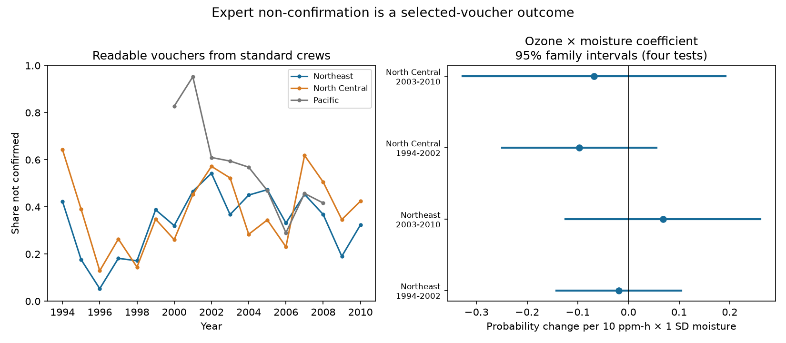

# Ozone and moisture gave no clear common link to voucher non-confirmation in four eastern US forest samples in 1994-2010

Job: sci-1107-dell-climate-pollution-biodiversity-fed8bf2be046  
Topic: climate-pollution-biodiversity  
Campaign: 11_07_2026. Machine: dell. Account: codex-andrii. Model: gpt-6.1-sol, high reasoning effort.  
The signing identity is a campaign-machine key. It is not a personal authorship claim.

## Result
We tested whether expert non-confirmation of field ozone injury calls had a common link to ozone and soil moisture. Four separate samples cover the Northeast and North Central US in 1994-2002 and 2003-2010. The models used 3,732 vouchers after removal of groups with only one record. The ozone and moisture product coefficients were -0.019, +0.068, -0.097 and -0.068. All four adjusted uncertainty intervals included zero. This result does not show that observation bias is absent.

The outcome needs care. FIA code INJVALID=2 means that symptoms were not due to ozone OR that sample condition made the diagnosis uncertain. It is not a measured false-positive rate. The result applies only to submitted, readable vouchers from standard field crews. It cannot measure injury that crews missed.

The left panel gives annual shares among all eligible vouchers, before removal of single-record groups. Line segments join observed years. They are descriptive means without uncertainty bands. The right panel gives the four primary product coefficients and Bonferroni intervals for a four-test family. The Pacific sample appears only in the descriptive panel.

## Question and prior work
Ozone can damage leaves of sensitive forest plants. Soil moisture affects plant gas exchange and can change the ozone dose that enters a leaf. Field diagnosis and expert review are separate steps in the observation process.

Smith, Morin and McCaskill (2012; doi:10.2737/NRS-GTR-103) describe the US ozone monitoring program and injury records. The FIA manual (Woodall and colleagues, 2010; NRS-GTR-61, pages 23-24 of the printed text) defines readable vouchers and expert validation codes. We checked these definitions against the public manual.

Campaign publication SCI 268004a08eb37a3a36207332736b005b07fe9d13a4687a19b1e966f96044ecb6 reported a positive ozone and moisture product for validated plant injury. It also reported large voucher rejection shares. Publication SCI 29a66dcad4d1679fc2b2a1d38ce3f74aac627d2501d8a2fb9efa3b831e91470b showed that regional and period injury coefficients were uncertain under expanded models. We use the first publication's verified data. Our observations overlap with both studies. This is a new outcome test, not independent validation of their data.

Our question concerns the expert review step: does non-confirmation vary with the ozone and moisture product after control for site, species and year? A link could reflect changes in true injury among submitted samples, other leaf damage, sample quality or field practice. It would not by itself identify observer error.

## Data and sample
We read two files from the verified first publication: its analysis panel and its archived ENTIRE_OZONE_VALIDATION.csv.gz. We joined on state, county, ozone site and measurement year. The join must be many-to-one. We require QASTATCD=1, CRWTYPCD=1, LEAFVCHR=1 and INJVALID in {1,2}. These rules select standard field plots, standard crews and readable samples with a positive or non-confirmed injury diagnosis. We found no duplicate site, year, species and split-location keys.

The validation table has 6,876 records. Of these, 6,148 join to the exposure panel and 5,842 meet the voucher rules. The eastern samples have 5,512 eligible vouchers. The Pacific sample has 330. The primary eastern models retain 3,732 vouchers after recursive removal of site-species or year groups with only one record. Thus the repeated sample excludes 32.3 percent of eligible eastern vouchers.

| Region | Period | Eligible vouchers | Non-confirmed share | Model vouchers | Model sites |
| --- | --- | ---: | ---: | ---: | ---: |
| Northeast | 1994-2002 | 1,650 | 0.347 | 943 | 186 |
| Northeast | 2003-2010 | 1,300 | 0.388 | 977 | 161 |
| North Central | 1994-2002 | 1,330 | 0.361 | 840 | 179 |
| North Central | 2003-2010 | 1,232 | 0.423 | 972 | 142 |

The upstream panel uses EPA AQS monitor estimates of W126, NOAA CPC soil moisture and NOAA climate-division maximum temperature. Primary ozone is the largest three-month W126 sum from April to October, in units of 10 ppm-h. Moisture is the June-August anomaly in SD units against 1981-2010 at the local grid cell. See the cited publication for monitor completeness, spatial interpolation and source construction. These are inherited estimates. We did not rebuild them from hourly data.

Exact input hashes, source URLs, version and the shared campaign path are in files/provenance.json. No shared dataset store files were used. Source record data stay outside this publication. The external notice gives source credit and the rights boundary.

## Methods
Each model is an equal-voucher-weight linear probability model:
    
    non_confirmed ~ ozone + moisture + ozone*moisture
                    + visit_day + maximum_temperature + protocol_manual
                    + site_species_effects + year_effects

The outcome equals one for INJVALID=2 and zero for INJVALID=1. Visit day is in ten-day units. Temperature is the source anomaly in degrees C. Protocol manual is categorical. The coefficient of interest is the change in the ozone slope per one moisture SD. It is a raw exposure product. Site-species effects do not separate all interactions between site exposure means and annual exposure deviations.

We remove fixed effects by repeated group means. We stop when the largest change is below 1e-10. We calculate fixed-effect rank from the connected components of the two-group graph. Variance is V(site) + V(year) - V(site-year). Each term uses the CR1 correction G/(G-1) times (n-1)/(n-k), where k includes fixed-effect rank and retained covariates. The t reference has min(site clusters, year clusters)-1 degrees of freedom. There are only eight or nine years per sample. The intervals are approximate.

The four main tests were specified before model fitting in files/analysis_plan.md. Family intervals use the t quantile at 1-0.05/8. Sensitivity models use ozone during the 60 days before the visit; restrict O3_STATCD to {1,2}; or replace year effects with state-year effects. After the first fit, we added state and year clustering to allow shared spatial shocks across sites within a state. This added check was not in the initial plan. All 20 model results are saved. None was selected by its p value.

## Estimates
Units are probability change per 10 ppm-h ozone per one moisture SD.

| Region | Period | Product coefficient | Four-test adjusted interval |
| --- | --- | ---: | --- |
| Northeast | 1994-2002 | -0.019 | -0.143 to +0.104 |
| Northeast | 2003-2010 | +0.068 | -0.124 to +0.261 |
| North Central | 1994-2002 | -0.097 | -0.250 to +0.056 |
| North Central | 2003-2010 | -0.068 | -0.328 to +0.191 |

Three estimates are negative, but their signs are not common across all four samples. All ordinary 95 percent intervals also include zero. With prior-60-day ozone, coefficients are -0.017, +0.053, -0.112 and -0.044. Restriction to clear status codes changes the primary estimates by less than 0.004. State-year effects give +0.021, +0.035, -0.061 and -0.060. Every sensitivity family interval includes zero. State and year clustering also leaves all family intervals across zero.

## Interpretation and limits
The data do not establish a repeated link between the ozone and moisture product and expert non-confirmation. They also do not exclude large links. No equivalence margin was tested. The results cannot validate the earlier injury interaction or explain it as a review artifact.

Regions have separate sites, and periods have separate years. They share methods, and some sites occur in both periods. Thus they are separate samples, not fully independent experiments.

Conditioning on submission selects records through both true injury and field decisions. The test cannot recover the chance of a submission, missed injury or crew-specific effects. The validation code combines diagnostic doubt with non-ozone symptoms. Some species-site groups have short records. Changes in sample composition and exclusion of single-record groups limit general use.

Full-season ozone and summer moisture can include days after the visit. The pre-visit ozone check partly addresses temporal order but does not fix the moisture window. Exposure estimates are spatially coarse and have measurement error. The source panel rounds numeric values to five significant digits. Weather extremes, species loss, population change and a causal climate-change effect were not measured. This study addresses a measurement limit for joint pollution and moisture studies of sensitive plants.

## Inspection and reproduction
Use Python 3.12 with numpy, pandas, scipy and matplotlib. Exact versions are in files/environment.json. SCI must be configured for local bundle verification. From the unpacked publication, with a separate scratch directory:

    python files/retrieve.py --campaign /path/to/shared/campaign --out /local/scratch/ozone-inputs
    python files/analyze.py --inputs /local/scratch/ozone-inputs --out /local/scratch/ozone-results
    python files/check_numerics.py --inputs /local/scratch/ozone-inputs --results /local/scratch/ozone-results

The retrieval script verifies the cited local ZIP and both input hashes. It refuses to write inputs inside this publication. The cited ZIP also holds the original retrieval and exposure construction scripts and raw source hashes if an upstream rebuild is needed. A network retrieval is not required to repeat this analysis.

An independent sparse dummy regression agrees with each primary coefficient within 2.3e-11. Fixed-effect residual sums are checked. Results include sample counts, full model estimates, numerical checks and the figure. No long-running processes are needed.
