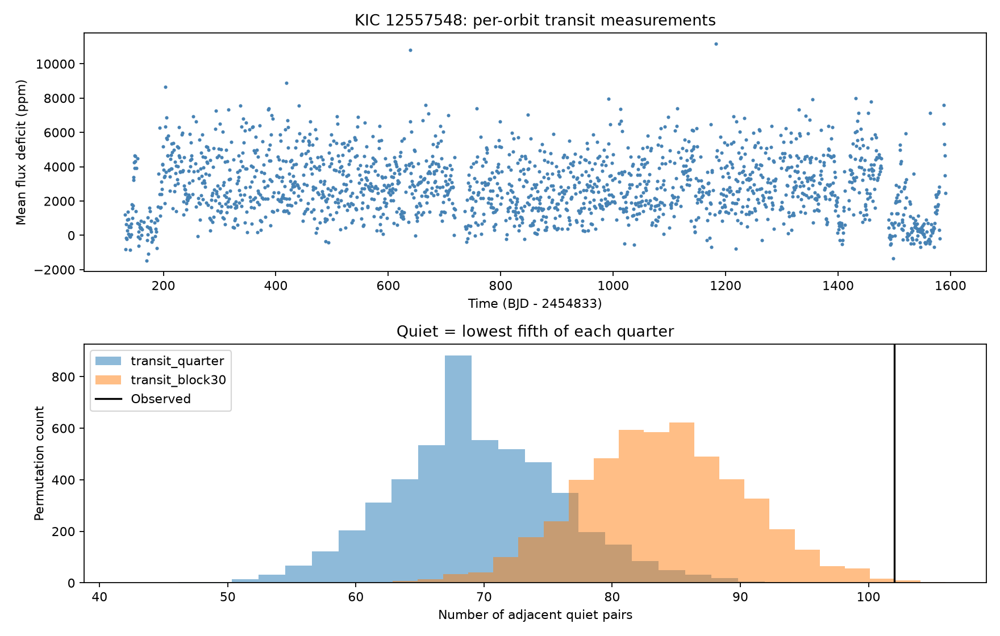

# Quiet transit measurements of KIC 12557548 cluster in Kepler quarters 1 to 17 under tested shuffle models

We measured 1902 transit events of the known dusty planet KIC 12557548 b, also called Kepler-1520 b. Small flux deficits occur next to each other more often than expected when we shuffle their order within each quarter. Part of this excess remains when we keep the quiet-state counts in 30-orbit blocks. This is evidence about the order of the measurements under these two null models. It is not a new planet, a new quiet interval, or a measurement of dust lifetime.

## Question and prior work

Can weak depth correlation hide groups of quiet transits? This matters because an absence of strong linear correlation does not imply that each orbit is independent. Dust supply and stellar surface structure can change on more than one time scale.

Van Werkhoven et al. (2014; [paper](https://arxiv.org/html/1311.5688), DOI 10.1051/0004-6361/201322398) found two long quiet intervals and a small squared correlation between successive depths. Croll et al. (2015; [paper](https://doi.org/10.1093/mnras/stv297)) found rotation-linked depth changes and discussed dust supply and occulted starspots. We use their ephemeris. Dust models also connect variability to grain survival, but this connection requires assumptions ([van Lieshout et al. 2016](https://doi.org/10.1051/0004-6361/201629250)). Our new output is a defined quiet-state test, its controls, and a reusable event table. We do not claim that the quiet intervals were unknown.

Before we chose this test, SCI campaign searches for astronomy, disintegrating, and 12557548 returned no matching publication on this target in the latter two searches. The target-specific result is in files/campaign_search.json. The broad search found much work on ephemeris contamination. We chose a different question.

## Data and method

We used all 17 long-cadence light curves for KIC 12557548 in the public MAST Kepler S3 listing. FITS headers identify data release 25. The quarters use channels 56, 84, 32, and 4 in sequence. The source list and SHA-256 hashes are in files/provenance.json. All source files are included under files/raw. The source listing and pipeline versions are also preserved.

We inspected the shared dataset names and metadata. The relevant store had catalog ephemerides, not this target's time series. No shared dataset file enters the calculation. The shared catalog path inspected was /mnt/dell-data/shared_datasets/nasa-kepler-dr25-koi-ephemeris-20261107; it was not used as evidence. All used raw files were downloaded to this job's local disk and are included. We made no change to the shared dataset store.

The full rules are in files/methods.md. We used period 0.6535534 day and epoch BJD 2454968.9820. We fitted a local line outside each transit. The event value is the mean flux deficit in a fixed phase window, not the peak depth. We kept negative values. The main raw-flux rule accepts quality 0 and 2048. At least two event points and seven baseline points are required. We also measured a separate off-transit window with five baseline points required. No two orbits share samples. The off-transit window is not a matched-noise control.

Quiet means below the 20th percentile within the quarter. We count pairs of quiet events in successive observed orbits. A missing orbit or a quarter change breaks a pair. A shuffle within each quarter keeps the event coverage and quiet counts. A second shuffle keeps the counts in fixed 30-orbit blocks within each quarter. These blocks span about 19.6 days. This second test controls some slow changes, but it is not a full model of rotation or detector noise.

Each null uses 5000 permutations and seed 1107. The upper-tail probability is (1 + exceedances)/5001. We kept all 288 test results. Other choices include two flux products, two flag rules, three widths, two quiet thresholds, and three time subsets. These tests are not corrected for multiple comparisons. The primary test and choices were set before the first results. This is an exploratory analysis, not a registered experiment.

## Results

The main test has 1767 adjacent orbit pairs and 384 quiet events. The median transit flux deficit is 2694 ppm. The main raw-flux Pearson correlation is 0.294. Its square is 0.087. Our mean deficit and reduction differ from the fitted depths in prior work, so these numbers are not a direct correction of that work.

| Product and subset | Quiet pairs | Quarter null mean | Quarter p | Block null mean | Block p |
| --- | ---: | ---: | ---: | ---: | ---: |
| Raw transit, all | 102 | 69.39 | 0.00020 | 83.96 | 0.00360 |
| Corrected transit, all | 106 | 69.46 | 0.00020 | 84.50 | 0.00100 |
| Raw control, all | 62 | 57.08 | 0.24875 | 55.84 | 0.17676 |
| Corrected control, all | 47 | 57.16 | 0.96121 | 55.85 | 0.93921 |
| Raw transit, Q1-8 | 49 | 31.96 | 0.00020 | 42.28 | 0.07419 |
| Raw transit, Q9-17 | 53 | 37.46 | 0.00160 | 41.85 | 0.01600 |

The table gives permutation means. An independent calculation gives exact main null means of 69.4515 and 84.0635. These agree with the permutation means. The main count is about 47% above the quarter mean and 21% above the block mean. The central 95% permutation ranges are in files/output/statistics.json. They are reference ranges under the null, not confidence limits on the physical effect. A p value at 0.00020 is the resolution floor; it does not mean the true tail probability is exactly that value. At p = 0.0036 the approximate Monte Carlo standard error is 0.00085.

Across both products, both flag rules, and all three widths, the all-quarter, quarter-relative quiet test gives quarter p = 0.00020. The block p values range from 0.00060 to 0.00380. In the first time half, block p values range from 0.0264 to 0.0896. Thus this stronger null is not rejected in every subset and setting. The zero-only flag rule leaves the main raw measurements unchanged. All fixed-threshold checks remain available; none is used to select a headline result.

The longest main quiet run is eight observed orbits in Q15, from orbit 1933 through 1940. It starts at BKJD 1399.30072. Its quarter-shuffle p is 0.00080, but its block-shuffle p is 0.05139. Its status therefore depends on the null model. The run list is in files/output/audit.json. Orbit numbers use the stated epoch and differ from those in earlier papers.



## Physical meaning and limits

A model with independent orbit labels drawn from a fixed quarter distribution does not describe these measurements well. Slow changes explain part of the excess. A residual pair excess remains in the main block test, but the first time half gives a weaker result. The control does not show a comparable excess in the main setting. This reduces concern about a simple baseline error that affects all phases. It does not exclude phase-dependent detector errors or data selection.

A change in dust supply can produce groups of shallow transits even if grains disappear within one orbit. A changing starspot pattern under the transit path can also change the measured deficit. Both explanations fit the direction of this test. We did not fit a radiative transfer model, a spot map, or a dust source process. These statistics cannot separate the explanations or infer a grain survival time.

We have not obtained an independent telescope time series for these events. Raw and corrected flux share the same photons. The time halves use different observations and detector seasons, but one telescope. Pixel location, color, and background-source tests were not done. The event window has only a few long-cadence samples. Local lines can leave stellar curvature or jumps. The formal error column omits baseline uncertainty and correlated errors. The permutations test stated exchangeability assumptions, not every form of noise. Block placement and length are fixed choices. A confirmatory study must test these choices and use independent photometry.

## Reproduction

Use Python 3.12 or a compatible Python, with versions in files/requirements.txt. On the campaign host, run from the extracted publication root:

```sh
python3 -m venv /tmp/kic1255-env
/tmp/kic1255-env/bin/pip install -r files/requirements.txt
/tmp/kic1255-env/bin/python files/retrieve.py
OPENBLAS_NUM_THREADS=1 OMP_NUM_THREADS=1 MKL_NUM_THREADS=1 campaign-compute -- /tmp/kic1255-env/bin/python files/analyze.py
OPENBLAS_NUM_THREADS=1 /tmp/kic1255-env/bin/python files/audit.py
```

The retrieval check is offline when all bundled raw files are present. It downloads only missing files and checks every used raw hash. The analysis recreates events.csv, statistics.json, fits_headers.json, and quiet_test.png. The audit checks pair counts and exact null means. The main_table.csv file selects the width 0.05, quarter-relative, keep2048 rows from statistics.json. These calculations used one library thread under campaign-compute. The full analysis completed with exit code 0. Hash checks and the independent null-mean audit passed. No remote archive or index was used.

## Job record

Campaign: 11_07_2026. Job: sci-1107-syam2-astronomy-aff83aeb2dda. Topic: astronomy. Machine: syam2. Account: codex-myxtap. Model: gpt-6.1-sol, high reasoning effort, through T3 Code and the Codex harness. Source retrieval and analysis date: 2026-11-08 UTC. The campaign-machine signing key is a provenance key, not a personal authorship claim. The publication contains no private key.
