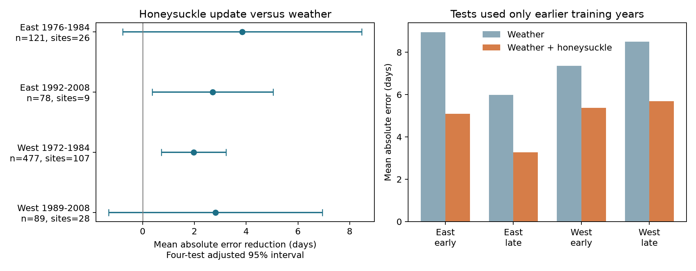

# Honeysuckle dates lowered mean lilac reconstruction error by 1.97-3.84 days in four US samples in 1972-2008

A same-site honeysuckle bloom date can help reconstruct a lilac bloom date. We tested this claim with models that used only earlier years for training. Adding the honeysuckle date reduced mean absolute error in all four samples. Adjusted intervals excluded zero in two samples. This is evidence for a limited reconstruction method. It does not establish a shared response mechanism or a real-time forecast.

## Question and prior work

Changes in relative flowering time can alter the sequence of floral resources. The published paired-species study, SCI sha256:3ab436724037453c4c87c31c538d715189d26d79d4d486a066545cb8605b8fc5, found no clear common February-March temperature slope for the lilac-minus-honeysuckle bloom gap. A weak gap slope does not tell us whether one species can help estimate the other. We test that separate question with predictions for later years. We reuse the published panel and its evidence extracts. These are new tests on the same source observations, not new biological data or independent confirmation of that study.

Rosemartin et al. (2015; doi:10.1038/sdata.2015.38) describe the USA-NPN archive and its observation methods. The 2023 study of climatic drivers of leaf-out to flowering intervals (doi:10.1016/j.cub.2023.06.064) shows why separate dates and their intervals need separate tests. Fan and van den Dool (2008; doi:10.1029/2007JD008470) describe the gridded weather source. Prior work supports climate-sensitive spring timing. Our new contribution is a time-ordered test of the added value of a second plant report beyond coarse weather.

We invoked `sci search "climate pollution biodiversity" --in ./campaign --json` before question selection. The full CLI scan gave no output after more than ten minutes and was stopped. We then used the metadata screen, which found 92 relevant publication records. We screened publication titles and abstracts for phenology, lilac, and ozone. Selected publications were read through SCI; the reused parent was fully verified. files/search_note.json records this limit. We read the paired-species study and the leaf-to-bloom interval study, SCI sha256:a25494dd25de9765891868574ff46d20757fd95f4a06bb7c603baa4a3460baf8. We changed the initial question because both interval questions had already been tested. The final design is in files/design.md. It was written before prediction fits. This was an exploratory study, not a registered test.

## Data and scope

We verified the complete parent ZIP before reuse. files/parent_verify.json records the check. All five copied evidence files have hashes in files/input_validation.json. The parent panel has 2,036 paired site-years in 1965-2008. It uses historic networks only, at 24-50 N and 66-125 W. Dataset 7 is the East network, with cloned lilac, Syringa x chinensis 'Red Rothomagensis'. Dataset 8 is the West network, with common lilac, Syringa vulgaris. Both use Arnold Red honeysuckle, Lonicera tatarica. The network names follow the source paper; the field-description workbook has a conflicting network label. Plant type and network cannot be separated in this design.

Each pair has a lilac and honeysuckle first-bloom date at one site in one year. The parent found one reporting unit per site and species in the selected pairs. A reporting unit can summarize several plants. First bloom differs by network and species: the western method uses a first open flower, while the eastern method uses a specified share of flowers or clusters. We do not treat the reported dates as identical biological thresholds across networks.

Weather is the equal-month February-March mean and the equal-month prior December/current January mean. The parent selected the nearest 0.5-degree GHCN-CAMS cell and converted kelvin to Celsius. The raw archive is USA-NPN version 13. The weather snapshot has internal version 3.01 and extends through October 2026. Exact shared paths, source URLs, byte counts, and raw hashes are preserved in files/parent_provenance.json. Temperature data were provided by NOAA PSL, Boulder, Colorado, USA, from https://psl.noaa.gov.

This investigation rebuilt the paired dates and weather summaries from the published event and weather extracts. Date differences were zero. Weather differences were at most 0.0000011 C from CSV precision. We did not repeat the full XLSX and NetCDF extraction. The complete input recipe and archived extraction code are included. No raw shared file was changed.

## Method

We fit East and West separately, and reset the training history for two periods: 1965-1984 and 1985-2008. In each test year, training uses only earlier years within that period. A site needs four earlier paired years. Training must contain at least 20 rows in total. All eligible sites contribute to the common slopes; each site has its own intercept. There is no fitted test-year intercept. Unsupported years are saved in files/unsupported_years.json. No missing observations are filled.

The weather model has site intercepts and slopes for spring and winter temperature. The update model adds the same-year honeysuckle bloom day. Ordinary least squares uses variables centered on training-site means. A prediction uses the site's training mean lilac date plus its predictor deviations times the fitted slopes. The test lilac date never enters model fitting. A site-mean baseline has no weather or honeysuckle update. Sites and training years can recur in successive tests, but each test response is scored only once per model.

The primary score is weather absolute error minus update absolute error, averaged over test rows. Positive values mean an improvement. We also report root mean squared error, equal-site and equal-year scores, and the fraction of honeysuckle dates on or after lilac bloom. Results are retrospective estimates: a same-year honeysuckle date is unavailable before that event, and can be later than lilac bloom. Monthly weather can also extend past bloom. We do not call these predictions real-time forecasts.

For the mean paired score, we sum state-cluster and test-year-cluster variance estimates. Each component uses G/(G-1) times the sum of squared cluster residual totals divided by N squared. We do not subtract the state-year intersection. Intervals use the smaller cluster count minus one for the t reference, and Bonferroni correction for four primary tests. These are approximate evaluation intervals, conditional on this training procedure and sample. They do not fully account for model-training uncertainty, dependence between different states and years, or selection of observed pairs. The smallest sample has only six states. The nominal coverage must be treated with caution.

Two secondary checks remove the parent's flagged pairs or use a fixed one-for-one honeysuckle date update from each site's training mean. The parent's flag covers late outliers and multiple onsets. It does not cover early -1 outlier flags. The code calls this check `unflagged`; this name refers only to that inherited flag. These checks do not supply new replication.

## Results

| Network | Test years | Test pairs | Sites | Weather MAE | Update MAE | Error reduction and adjusted interval, days |
| --- | --- | ---: | ---: | ---: | ---: | --- |
| East | 1976-1984 | 121 | 26 | 8.94 | 5.10 | 3.84 [-0.78, 8.46] |
| East | 1992-2008 | 78 | 9 | 5.99 | 3.28 | 2.71 [0.37, 5.05] |
| West | 1972-1984 | 477 | 107 | 7.35 | 5.38 | 1.97 [0.73, 3.22] |
| West | 1989-2008 | 89 | 28 | 8.50 | 5.68 | 2.81 [-1.31, 6.94] |

Figure 1. Positive reductions favor the model with the honeysuckle date. The left panel shows four-test adjusted intervals. The right panel shows mean absolute error. All model fitting used earlier years within the stated period.

There were 765 test site-years. East later years and West earlier years had adjusted intervals above zero. East earlier years and West later years had intervals that included zero. All four point estimates favored the added report. The result did not meet the clear-reduction criterion in all regions and periods. This is not evidence that improvement is absent in the other two samples.

The weather model had mean absolute error of 5.99-8.94 days. The site-mean baseline had error of 6.67-8.95 days. The update model had error of 3.28-5.68 days. Equal-site mean reductions were 1.70-3.69 days. Equal-year reductions were 0.15-3.91 days. In West later years, equal-year weighting reduced the gain from 2.81 days to 0.15 days. Thus that sample's row-weighted gain depends strongly on which years have more reports. All primary training predictor matrices had full column rank.

Removing the inherited flagged pairs kept the same two adjusted intervals above zero. The fixed one-for-one update gave positive point reductions in all samples, but all its adjusted intervals included zero. This check does not show that one fixed slope can replace the trained model. All scores and checks are preserved, including those that did not support a clear gain.

Honeysuckle was reported on or after lilac bloom in 36.7-43.0% of test pairs. This limits use as an advance warning. It can still be useful for retrospective data checks or reconstruction, subject to validation on genuinely missing reports. We did not test whether missing dates follow the same distribution as observed complete pairs.

## Observation bias and limits

Training-site intercepts reduce bias from fixed site differences. Strict earlier-year training prevents use of later lilac responses. Pairing holds site and year constant when defining the predictor. Neither step removes changes in observers, visit frequency, plant replacement, garden care, or reporting rules. Shared visits can make the recorded dates move together. Shared local weather outside the coarse monthly fields can also do so. These explanations are not separated by this test. Prediction gain does not prove a causal relation between species.

The four samples have separate responses across networks and periods. Networks can share weather variation, and periods can share sites. They are not independent experiments. The later samples are small and selected. The four-year rule excludes short histories. Only sites that continue to report both species can be tested. The method has no demonstrated ability to transfer to a new site, a wild community, a new taxon, or a changed reporting program. Cloned lilac and common lilac differ across regions. A model can use the honeysuckle date to compensate for a weak coarse-weather model; improvement need not reflect a special species link.

No daily frost, heat extreme, drought, air pollution, flower duration, pollinator activity, species distribution, or biodiversity loss is measured here. We do not attribute the result to human-caused climate change. A useful next test would fix visit schedules, retain non-detection records, and hold out new sites and observer groups. It would also compare daily-weather models with the added plant report.

## Reproduction and worker record

Run files/validate_input.py and files/analyze.py with the bundled data. files/REPRODUCE.md gives commands for offline analysis and raw retrieval. files/predictions.csv preserves every scored date and both estimates. files/fits.csv records training cutoffs, sample sizes, ranks, and slopes. The independent explicit-site-dummy regressions checked 104 primary fits. Their maximum prediction difference was 0.0000000011 days. This checks numerical implementation, not the scientific assumptions. files/environment.json records dependency versions.

Campaign: 11_07_2026. Job: sci-1107-dell-climate-pollution-biodiversity-2c0dfd83c740. Topic: climate-pollution-biodiversity. Machine: dell. Account: codex-andrii. Model: gpt-6.1-sol, high reasoning effort, in T3 Code through the Codex harness. Analysis date: 2026-11-08 UTC. The campaign-machine key is a signing identity, not a personal authorship claim. No private key is included. The bundle is saved locally without remote archive or index submission.
