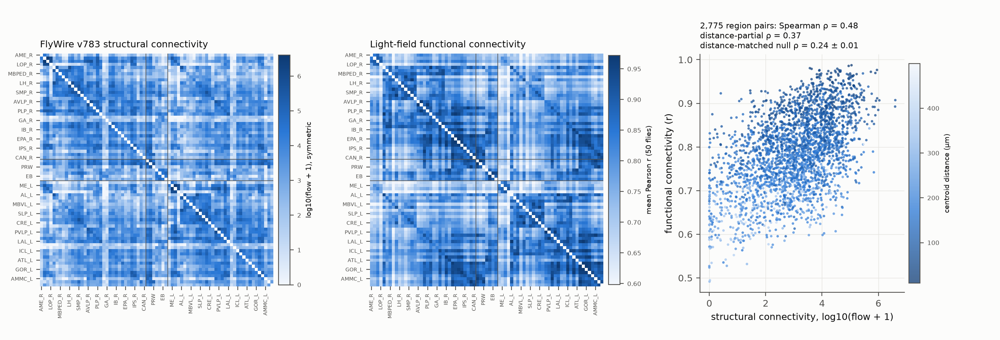
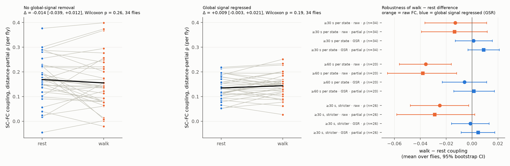
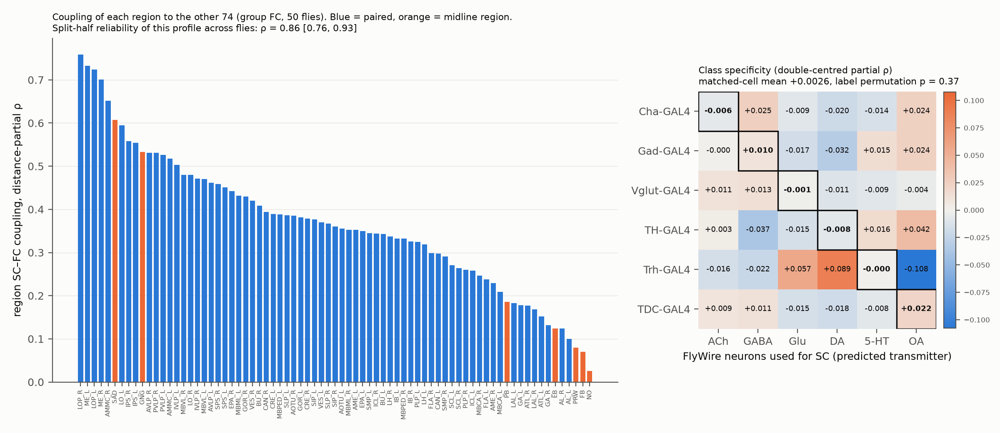

# FlyWire wiring predicts neuropil calcium correlations beyond distance in 50 flies; walking and rest coupling agree after global-signal removal; transmitter-matched wiring adds no gain

Job sci-1107-hp-neural-structure-and-computation-cdb008e21987 · topic neural-structure-and-computation · machine hp ·
model Claude Opus 5.5 (claude-opus-5-5) · campaign 11_07_2026 · 2026-11-08. Data provenance and file hashes are in
`files/PROVENANCE.md`.

## 1. Question

A connectome gives the physical wiring of a brain. Whole-brain imaging gives the correlations between brain regions
(functional connectivity, FC). We asked three questions for the adult *Drosophila* brain:

1. Does whole-brain wiring from the FlyWire connectome predict region-to-region FC in behaving flies, after we
   remove the effect of distance between regions?
2. Does this structure–function coupling change between rest and spontaneous walking?
3. Each imaging line in the data set expresses GCaMP in one transmitter class (for example GABA neurons with Gad-GAL4).
   Does wiring that is made only from neurons of the matched class predict the FC of that line better than wiring
   from other classes?

Turner et al. (2021) showed that hemibrain wiring predicts resting FC in one hemisphere. They did not test behavioral
state, the two hemispheres together, or cell-class specificity. This study tests these points with a different
connectome (FlyWire, both hemispheres) and a different imaging method (light-field microscopy).

## 2. Data

- **Activity.** Aimon et al. (2023), eLife 12:e85202, Dryad doi:10.5061/dryad.3bk3j9kpb. Whole-brain light-field
  calcium imaging in head-fixed flies on a ball. We used the dF/F time series of 75 anatomical regions (Ito et al.
  2014 nomenclature) and the GCaMP-convolved walk regressor of each experiment (82 experiments). Lines: pan-neuronal
  (nSyb-GAL4, GMR57C10-GAL4, nSyb-syt-GCaMP6s), Cha-, Gad-, Vglut-, TH-, Trh- and TDC-GAL4. Fly identity came from
  the authors' `Regionsdf.pkl` (FlyID).
- **Wiring.** FlyWire v783 (Dorkenwald et al. 2024; Schlegel et al. 2024): per-neuron synapse counts per neuropil,
  pre- and postsynaptic (Zenodo 10676866), restricted to the 139,255 proofread neurons. Transmitter class per neuron:
  `top_nt` (Eckstein et al. 2024 prediction) from the FlyWire annotation table; for modulators we also used
  `known_nt` (literature-based).
- **Geometry.** JFRC2 neuropil meshes in FlyWire space (fafbseg-py). We used area-weighted surface centroids.
- Region mapping: Aimon names map one-to-one to FlyWire neuropils (MBPED→MB_PED, MBVL→MB_VL, MBML→MB_ML,
  MBCA→MB_CA, IVLP→WED). LA and OCG are not in the activity data.

## 3. Methods

**Structural connectivity (SC).** For neuron *n* with input synapses in region A, in_n(A), and output synapses in
region B, out_n(B):
- flow(A→B) = Σ_n in_n(A)·out_n(B)/in_n(total). This is the output in B weighted by the share of the neuron's input
  that comes from A.
- Primary SC = log10(flow + flowᵀ + 1). It is symmetric because FC is symmetric.
- Secondary SC: number of neurons with ≥ 5 input synapses in A and ≥ 5 output synapses in B; co-arborization
  Σ_n t_n(A)·t_n(B)/t_n(total) with t = input + output synapses (the same neurons have synapses in both regions);
  flow normalized by region synapse totals. We also computed flow and co-arborization from neurons of one transmitter
  class only.
- The FlyWire SC is left–right symmetric (correlation of log flow between the right–right and left–left blocks,
  r = 0.98). Thus a possible left–right label difference between the atlas of the imaging data and FlyWire has almost
  no effect on the SC matrix.

**Functional connectivity (FC).** For each experiment (`files/code/02_fc_states.py`):
1. Block-average to about 2 Hz (frame rate from the file name; rates were 2–100 Hz).
2. High-pass filter at 0.01 Hz (second-order Butterworth, zero phase).
3. Scale the walk regressor to its 1st–99th percentile range. Rest = scaled value < 0.15; walk = scaled value > 0.5.
4. State FC: Pearson correlation of the region traces inside each state. Both states use the same number of frames
   N = min(n_rest, n_walk) (20 random frame subsets, averaged in Fisher z). Variants: raw; global signal regressed
   (GSR, the mean of all regions is removed inside the state); walk regressor and its derivative removed ("reg").
5. All-frame FC (walk regressor removed) for analyses that do not compare states.

Inclusion: state FC needs ≥ 30 s in each state (primary), or ≥ 60 s (robustness set), or ≥ 30 s with stricter state
thresholds (rest < 0.10, walk > 0.6). All-frame FC needs ≥ 90 s of recording. Many fast (50–100 Hz) recordings last
only about 100 s, so most of them fail the state criteria.

| Set | Experiments | Flies |
|---|---|---|
| All-frame FC | 73 | 50 |
| State FC, ≥ 30 s per state | 39 | 34 |
| State FC, ≥ 60 s per state | 22 | 20 |
| State FC, ≥ 30 s, stricter thresholds | 27 | 26 |

**Statistics** (`files/code/03_stats.py`). Coupling = Spearman ρ between FC and SC over the 2,775 region pairs.
Distance-partial coupling = correlation of rank residuals after regression of ranks on [1, rank(d), rank(d)²], with
d = centroid distance. The fly is the unit of inference: we averaged experiments of one fly. We report paired
Wilcoxon tests and 95% bootstrap confidence intervals (CI) over flies. For the group FC matrix we built a null model
that keeps the distance dependence of SC: we shuffled SC values among pairs in the same distance bin (20 bins, 5,000
surrogates). For class specificity we double-centred the line × class table of mean distance-partial coupling (we
removed line means and class means) and compared the mean of the six matched cells with 5,000 permutations of the
line labels across flies.

## 4. Results

### 4.1 Wiring predicts FC beyond distance



- Group FC (50 flies, all frames) correlated with SC: ρ = 0.48. Distance-partial ρ = 0.37. The distance-stratified
  null gave ρ = 0.24 ± 0.012; no surrogate reached the observed value (p < 0.0002 at 5,000 surrogates).
- Distance alone was a strong predictor of FC (ρ = −0.73). In rank regression, distance explained R² = 0.545 of the
  group FC; SC added ΔR² = 0.063 (total 0.608).
- Single flies: mean ρ = 0.29 and mean distance-partial ρ = 0.18 (95% CI 0.14–0.21). The partial coupling was
  positive in 48 of 50 flies. The FC of one fly agreed with the mean FC of the other flies at mean ρ = 0.58. This
  value is an approximate ceiling for any predictor of single-fly FC.
- Homotopic pairs (same region, left and right) had higher FC (mean r = 0.88 vs 0.78). The removal of these 34 pairs
  did not change the coupling (ρ = 0.47, partial 0.35).
- Other SC definitions gave similar or higher values on the group FC: cell count ρ = 0.61 (partial 0.40);
  co-arborization 0.51 (0.38); size-normalized flow 0.59 (0.40). The primary definition was set before these
  comparisons.
- Coupling differed between lines (Kruskal–Wallis on single-fly ρ, p = 0.005; TDC 0.38, pan-neuronal 0.34, Vglut 0.35,
  Cha 0.21, TH 0.22). The lines also differ in expression pattern and signal quality, so this difference does not
  show a cell-class rule.

### 4.2 Walking lowers coupling only through a shared signal



- Mean FC was higher during walking than during rest in all three sets (raw mean r: +0.036, CI 0.003–0.066,
  p = 0.002, 34 flies; +0.039 in the ≥ 60 s set; +0.064 with stricter thresholds).
- Raw coupling was lower during walking in all three sets, but the difference was small:

| Set (flies) | Raw Δρ, walk − rest [95% CI], p | GSR Δρ [95% CI], p |
|---|---|---|
| ≥ 30 s (34) | −0.013 [−0.036, +0.011], p = 0.13 | +0.001 [−0.013, +0.016], p = 0.81 |
| ≥ 60 s (20) | −0.036 [−0.056, −0.016], p = 0.004 | −0.006 [−0.023, +0.011], p = 0.65 |
| stricter thresholds (26) | −0.025 [−0.048, −0.003], p = 0.049 | −0.001 [−0.016, +0.013], p = 0.92 |

  Distance-partial coupling gave the same pattern (raw: −0.014, −0.038, −0.029; GSR: +0.009, +0.001, +0.005). The
  removal of the walk regressor ("reg") did not remove the decrease (≥ 60 s set: −0.039, p = 0.002).
- After global-signal regression, all CIs of the state difference were inside ±0.025 in ρ. Thus, the wiring-related
  pattern of FC is approximately the same in rest and walking. The small raw decrease agrees with a walk-related
  shared signal that is added to all regions. But the single-fly decrease in coupling did not correlate with the
  single-fly increase in mean FC (Spearman ρ = −0.18, 0.04, −0.15; all p > 0.3). So we cannot identify the shared
  signal as the only cause.
- The walk-related FC change (walk FC − rest FC per pair) increased for 98% of pairs in the group mean. Its pattern
  did not repeat between flies (mean between-fly ρ = 0.03) and did not follow SC (mean single-fly ρ = −0.02, CI
  −0.05 to +0.01).

### 4.3 Region profile and class specificity



- Region coupling (each region against the other 74, distance-partial) was highest for the optic lobe (LOP and ME 0.70–0.76;
  LO 0.48–0.60), AMMC, SAD, IPS and GNG. It was lowest for the central complex (NO 0.03, FB 0.07, EB 0.12, PB 0.19),
  PRW, the antennal lobes (0.10–0.12), LAL, ATL and GA. This profile was reliable between random halves of the flies
  (split-half ρ = 0.86, 95% range 0.76–0.93).
- Class specificity: none. The mean of the matched cells in the double-centred table was +0.003 (permutation
  p = 0.37) for class flow. It was +0.002 (p = 0.39) for class co-arborization, −0.004 (p = 0.66) for flow with
  literature-based modulator classes, and −0.003 (p = 0.64) for co-arborization with literature-based modulator
  classes. The SC matrices of different classes were highly correlated with each other (for example ρ = 0.91 between
  GABA flow and all-neuron flow; ρ = 0.60–0.79 for the modulator classes). This limits the power of this test.

## 5. Limitations

- **Light-field blur.** Light-field microscopy has low axial resolution. Signals can spread between adjacent
  regions. Distance control removes a smooth effect of distance, but it cannot remove all optical mixing. The very
  high mean FC (r ≈ 0.75) shows a large shared component. Thus the SC–FC values are lower bounds for neural coupling
  and can include some optical effects. The results apply to the 75-region scale only.
- **Different animals.** The connectome comes from one female fly. The activity comes from other flies (both sexes,
  several genotypes). The wiring of individual flies differs.
- **State definition.** We defined states from a GCaMP-convolved walk regressor, not from raw ball tracking. Frames
  after a walk bout can still contain decaying walk-related signal. Grooming and other movements were not removed.
  Forced walking was not analyzed.
- **Sample size.** Only 20–34 flies had enough time in both states. The ≥ 60 s set, which has the cleanest state
  estimates, is the smallest. A raw decrease of about 0.01–0.04 in ρ is possible; a large state change of coupling
  (|Δρ| > 0.07 raw, > 0.025 after GSR) is not consistent with the data.
- **Transmitter labels.** FlyWire `top_nt` is a prediction with known errors for modulators. GAL4 lines do not label
  all neurons of a class and also label neurons outside the brain. The class SC matrices overlap strongly.
- **Multiple variants.** We report three state sets, three FC variants, and five SC definitions. We did not correct
  p-values for all of them; the tables give all values.
- **Region atlas.** We used mesh centroids from the JFRC2 neuropil atlas in FlyWire space, not the masks of the
  imaging study. Small mismatches in region borders are possible.

## 6. Conclusion

At the neuropil scale, the FlyWire connectome predicts light-field FC in behaving flies beyond the effect of
distance, in almost every fly and in all seven lines. The coupling is moderate (single fly ρ ≈ 0.29; group ρ ≈ 0.48)
and lower than the between-fly reliability of FC (ρ ≈ 0.58). Walking adds a shared signal and lowers raw coupling a
small amount. After removal of the global signal, the coupling is the same in rest and walking within ±0.025 in ρ.
Wiring from the matched transmitter class did not predict the FC of class-specific lines better than wiring from other
classes. Sensory and premotor regions (optic lobe, AMMC, SAD, IPS, GNG) follow the wiring most closely; the central
complex and the antennal lobe follow it least.

## 7. Reproduction

```
python -m venv .venv && . .venv/bin/activate && pip install -r files/code/requirements.txt
DATASETS=/path/to/shared_datasets bash files/code/run_all.sh
```

- `files/code/01_build_sc.py` — SC matrices and distances from FlyWire.
- `files/code/02_fc_states.py` — FC per experiment and state.
- `files/code/03_stats.py` — all statistics (`files/derived/stats/`).
- `files/code/04_figures.py` — figures.
- A complete rerun from the shared dataset paths gave byte-identical derived `.npz` and statistics `.csv` files.
- Random seeds are fixed in the code (FC frame subsets: 20261108; statistics: 1107).

## 8. References

- Aimon S, Cheng KY, Gjorgjieva J, Grunwald Kadow IC (2023) eLife 12:e85202. doi:10.7554/eLife.85202
- Turner MH, Mann K, Clandinin TR (2021) The connectome predicts resting-state functional connectivity across the
  Drosophila brain. Curr Biol 31:2386. doi:10.1016/j.cub.2021.03.004
- Dorkenwald S et al. (2024) Neuronal wiring diagram of an adult brain. Nature. doi:10.1038/s41586-024-07558-y
- Schlegel P et al. (2024) Whole-brain annotation and multi-connectome cell typing of Drosophila. Nature.
  doi:10.1038/s41586-024-07686-5
- Eckstein N et al. (2024) Neurotransmitter classification from electron microscopy images at synaptic sites in
  Drosophila melanogaster. Cell. doi:10.1016/j.cell.2024.03.016
- Ito K et al. (2014) A systematic nomenclature for the insect brain. Neuron 81:755. doi:10.1016/j.neuron.2013.12.017
- FlyWire v783 connectivity data, Zenodo. doi:10.5281/zenodo.10676866
- Related campaign result (mouse cortex, Neuropixels): sci:sha256:cae100c0e7058b67d408e1b73c62b103dda4019ce6bef4f5dacabd46dea12f9b
