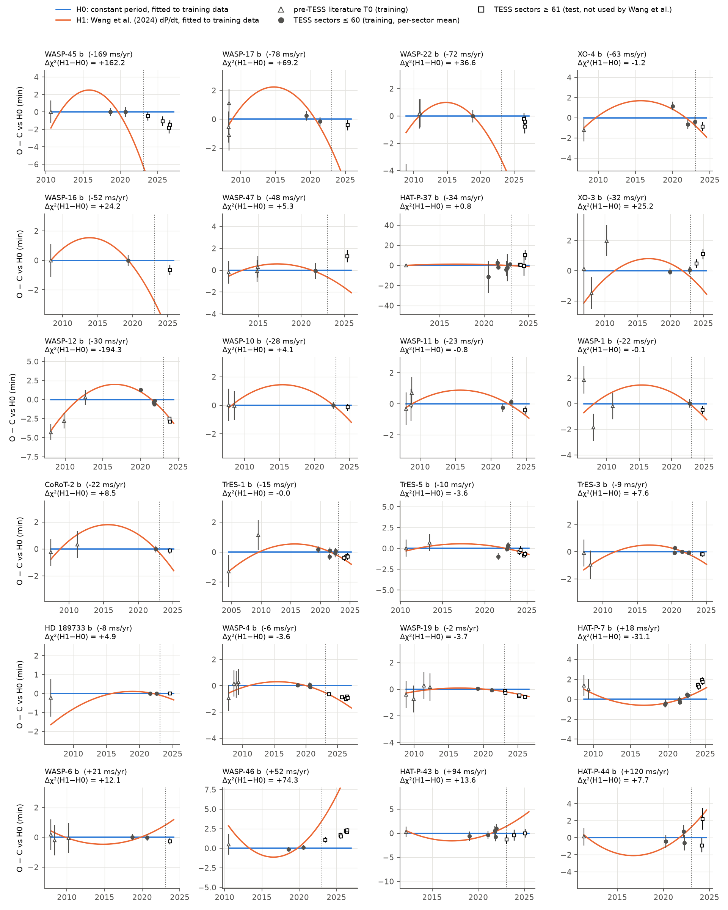
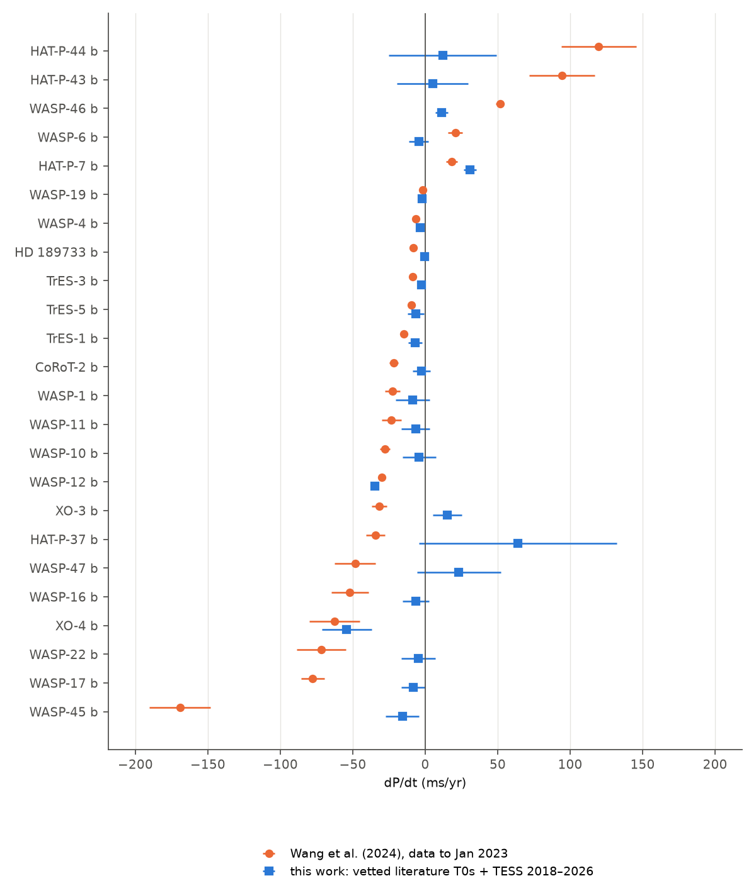
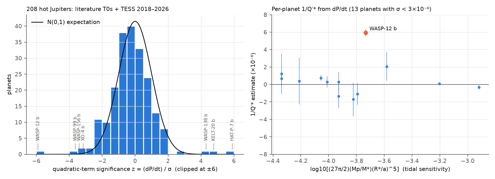

# TESS transits after January 2023 support published period changes for WASP-12 b and HAT-P-7 b and reject them for 7 of 24 tested hot-Jupiter candidates

## Summary

Wang et al. (2024, ApJS 270, 14) used literature transit times and TESS data up to January 2023. They reported 26 hot Jupiters with a possible constant change of orbital period (dP/dt). We did an out-of-sample test of these 26 candidates with TESS data that they did not use.

We measured 13,874 individual transit mid-times for 364 hot Jupiters (P < 10 d, Rp > 0.5 RJ). The data are TESS SPOC 2-min light curves from sectors 1 to 107 (2018 to October 2026). For each candidate, we fitted two models to the same training data. The training data are vetted pre-TESS literature epochs plus TESS sectors 1 to 60. Model H0 has a constant period. Model H1 has dP/dt fixed at the value of Wang et al. We then compared the forecasts of each model with the TESS transits from sector 61 onward (January 2023 to October 2026).

Main results:

1. 24 of the 26 candidates have test transits. The test data favour the published rate (Δχ² < −6) for 2 planets: WASP-12 b (Δχ² = −194) and HAT-P-7 b (Δχ² = −31). These 2 results do not change in 4 analysis variants.
2. The test data favour a constant period (Δχ² > +6) for 11 planets. For 7 of them, this result does not change in the 4 variants: WASP-45 b, WASP-17 b, WASP-22 b, WASP-16 b, XO-3 b, WASP-46 b and HAT-P-43 b. Their published rates are from −169 to +94 ms/yr. Our fits to all data give values that are 2 to 18 times smaller in magnitude (XO-3 b changes sign), and all are within 2.7σ of zero.
3. For 15 candidates, the result is inconclusive or depends on the analysis variant. These include WASP-4 b and WASP-19 b. For WASP-4 b, the test transits fall between the two forecasts. Our rate is −3.6 ± 1.2 ms/yr, which is smaller in magnitude than the published −6.4 ± 0.6 ms/yr.
4. For WASP-12 b, we measure dP/dt = −34.6 ± 2.0 ms/yr. This value agrees with the literature (−29 to −32 ms/yr) to within 2.3σ. It gives a modified tidal quality factor Q′* ≈ 1.7 × 10^5.
5. HAT-P-7 b has dP/dt = +30.9 ± 4.4 ms/yr. This value is stable when we remove any one TESS sector (range +29.7 to +32.1). A period increase cannot come from tidal decay. A line-of-sight acceleration of the star of about +49 m/s/yr gives the same value (Rømer delay). HAT-P-7 has known outer companions. We did not test radial velocities.
6. KELT-20 b (MASCARA-2 b) has a positive quadratic term in the TESS data alone: +58 ± 12 ms/yr, with Δχ² = 22 compared to a constant period. This agrees with the recent report of a light-travel-time signal from a brown-dwarf companion (Yang et al. 2026, arXiv:2606.02705). But the signal depends on TESS sector 14 (2019): without that sector, Δχ² = 1.6. Our TESS data end in sector 81 (2024), the same span that Yang et al. used. Thus our result is an independent reduction of the same photons and not a new confirmation.
7. Population: in 208 well-measured planets, the quadratic-term significance z has a standard deviation of 1.74. A unit normal distribution gives 0.6 planets with |z| > 3; we find 7. Thus period changes or unmodelled timing errors are present in a few systems. If all period changes come from tides, a weighted stack of 206 planets (without WASP-12 b) gives 1/Q′* = (8 ± 5) × 10^−8 after a 1.30× overdispersion scale. This gives Q′* > 6 × 10^6 (95%). WASP-18 b contributes most of this limit. Without WASP-18 b, the limit is Q′* > 2 × 10^6.

Main limitations: the literature epochs come from the NASA Exoplanet Archive `ps` table and not from a homogeneous re-analysis of light curves. We used a 1-min systematic floor for these epochs, and the control sample calibrated this floor. For many candidates, the test set has fewer than 10 transits. We used circular transit models. We did not use radial velocities, so the period-change mechanism (tides, Rømer delay or apsidal precession) stays open for every planet except WASP-12 b.



## 1. Question

Many hot-Jupiter decay candidates come from fits that use heterogeneous literature times. Single bad points can create a false quadratic term (Wang et al. 2024 showed this with a leave-one-out test). An independent and simple test is a forecast: a real constant dP/dt must also predict transits that the original fit did not use. TESS observed many of these systems again from 2023 to 2026. We ask: for each period-change candidate of Wang et al. (2024), do the new TESS transits agree better with the published dP/dt or with a constant period?

## 2. Data

| Data | Source | Version / date | Use |
|---|---|---|---|
| Planet parameters | NASA Exoplanet Archive TAP `pscomppars` (tran_flag = 1, P < 10 d, Rp > 0.5 RJ) | queried 2026-11-08; sha256 a15fdda1…c5f825 | sample, initial ephemeris, template start values |
| Literature ephemerides | NASA Exoplanet Archive TAP `ps` (all parameter sets) | queried 2026-11-08; sha256 dd52c2bf…62b5 | pre-TESS epochs (published before 2018-07, T0 before BJD 2458325, not ExoFOP) |
| TESS light curves | MAST, SPOC 2-min `*_lc.fits`, PDCSAP_FLUX, QUALITY = 0 | sectors 1–107, 1,905 files, downloaded 2026-11-08 | transit times |
| Published candidate ephemerides | Wang et al. (2024) Table 2 machine-readable file `apjsad0847t2_mrt.txt` (IOP) | sha256 106b87a2…50a0 | H1 rates; candidate list; control list |

The bundle contains the two archive query results (`files/data/inputs/`), the 1,905 light-curve file names (`lc_files.csv`) and their SHA-256 hashes (`tess_lc_sha256.txt`). It does not contain the light curves (3.5 GB) or the Wang et al. table (journal content). Section 7 gives the retrieval steps.

Sample: 376 planets have a pre-TESS literature epoch and TESS 2-min data. 364 gave transit times. 354 gave ephemeris fits. We flagged 8 planets because most of their literature epochs disagree with the TESS ephemeris by more than 60 min (faint Kepler or CoRoT targets, and K2-19 b, which has known large TTVs). We fitted 346 planets with literature epochs. The "quality" subsample has 208 planets: at least 10 TESS transits, a baseline of at least 5 yr and a median per-transit timing error below 3 min. Its median baseline is 13.2 yr, its median number of TESS transits is 28.5 and its median timing error is 0.99 min.

## 3. Method

**Transit times** (`code/measure_times.py`). For each star, we normalised each sector by its median. Catalogue ephemerides can be stale: for XO-3 b, the archive epoch is 0.62 d off, and for WASP-22 b the period error moves the transit by more than 1 h. Thus we first folded each sector on the catalogue period, binned it to 2 min and searched the full orbital phase for the transit. We fitted the per-sector offsets with a constant (3-min error floor, clip at max(5σ, 30 min)) and kept a linear term only for Δχ² > 25. Then, for each transit, we fitted a linear out-of-transit baseline and divided it out. We fitted a quadratic limb-darkened circular transit model (batman, 3× supersampling of 2-min cadence) to the stacked data. Then we fitted each transit mid-time with the shape fixed and a linear baseline solved jointly, on a ±min(T14/4, 30 min) grid. The error comes from Δχ² = 1, scaled by sqrt(reduced χ²) when that is above 1. We kept a transit only if more than 60% of the in-transit cadences, both transit halves and both out-of-transit sides are present. We did 2 iterations of template fit and timing. Then we clipped at 5σ about a quadratic and scaled the errors by β = sqrt(χ²_red) of the TESS-only quadratic fit when β > 1.

**Literature epochs** (`code/fit_ephemeris.py`). We counted the epoch of each literature T0 with its own published period. We rejected a T0 if its epoch count was ambiguous, or if it differed from the TESS-only linear extrapolation by more than 60 min and more than 5σ. Physical decay at the published rates moves transits by less than about 15 min over these baselines. We added a 1-min systematic floor in quadrature to each literature T0, because some papers use HJD(UTC) and not BJD(TDB). Anchor set A uses the single literature T0 with the smallest propagated error. Anchor set B uses all distinct T0 values and scales their errors up when they disagree with each other.

**Ephemeris models.** t(E) = T0 + P·E + ½·(dP/dE)·E², with dP/dt = (dP/dE)/P. We report dP/dt in ms/yr.

**Forecast test** (`code/forecast_test.py`). Training data: vetted literature epochs plus TESS sectors ≤ 60. Test data: TESS sectors ≥ 61 (from 2023-01-18). Wang et al. used TESS data up to January 2023. For H0, dP/dt = 0. For H1, dP/dt is the 5σ-clipping value of Wang et al. For each model, we fitted T0 and P to the training data. We propagated the parameter covariance into the forecast and computed χ² of the test residuals with the full covariance. The score is Δχ² = χ²(H1) − χ²(H0). We call |Δχ²| > 6 a preference. The two models have the same number of free parameters.

**Calibration.** We applied the same H0 forecast to 166 control planets. Wang et al. list a linear ephemeris for these planets. The normalised mean test offset has a robust (MAD) standard deviation of 0.93 with the 1-min floor, 1.24 with no floor and 0.76 with a 3-min floor. Only 1.2% of controls have |z| > 3. Thus the 1-min floor gives approximately calibrated forecast errors, and we use it as the main variant.

**Robustness** (`code/robustness.py`). We repeated the forecast test with 0-min and 3-min floors and with the test set starting at sector 70. For the strongest signals, we also removed each TESS sector in turn (jackknife).

**Tidal constraint** (`code/population.py`). For constant Q′*, dP/dt = −(27π/2Q′*)(Mp/M*)(R*/a)^5. Each planet gives an estimate of 1/Q′*. We combined the estimates with inverse-variance weights and scaled the error by sqrt(χ²/dof) when that is above 1.

## 4. Results

### 4.1 Forecast test of the 26 candidates

Table 1 gives the result for the 24 candidates that have at least 3 test transits. KELT-16 b (sectors 15, 41 and 55 only) and WASP-80 b (sector 54 only) have no test transits. "All 4 variants" shows the result when the 1-min floor, 0-min floor, 3-min floor and later split all agree.

| Planet | Wang dP/dt (ms/yr) | Our dP/dt, all data (ms/yr) | Test transits | Δχ² (H1−H0) | Main verdict | All 4 variants |
|---|---|---|---|---|---|---|
| WASP-45 b | −169.2 ± 21.1 | −15.8 ± 11.5 | 24 | +162.2 | H0 | H0 |
| WASP-17 b | −77.6 ± 8.2 | −8.2 ± 8.3 | 4 | +69.2 | H0 | H0 |
| WASP-22 b | −71.8 ± 17.1 | −4.8 ± 11.6 | 16 | +36.6 | H0 | H0 |
| XO-4 b | −62.6 ± 17.5 | −54.2 ± 17.2 | 5 | −1.2 | – | inconclusive |
| WASP-16 b | −52.0 ± 12.9 | −6.6 ± 9.1 | 5 | +24.2 | H0 | H0 |
| WASP-47 b | −48.5 ± 14.1 | +23.2 ± 28.9 | 6 | +5.3 | – | mixed |
| HAT-P-37 b | −34.3 ± 6.7 | +63.9 ± 68.3 | 20 | +0.8 | – | inconclusive |
| XO-3 b | −31.6 ± 5.2 | +15.2 ± 9.9 | 8 | +25.2 | H0 | H0 |
| WASP-12 b | −30.2 ± 0.9 | −34.6 ± 2.0 | 37 | −194.3 | H1 | H1 |
| WASP-10 b | −27.7 ± 3.5 | −4.1 ± 11.3 | 7 | +4.1 | – | inconclusive |
| WASP-11 b | −23.3 ± 6.7 | −6.7 ± 9.6 | 4 | −0.8 | – | inconclusive |
| WASP-1 b | −22.5 ± 5.2 | −8.6 ± 11.7 | 8 | −0.1 | – | inconclusive |
| CoRoT-2 b | −21.6 ± 3.0 | −2.7 ± 6.2 | 11 | +8.5 | H0 | mixed |
| TrES-1 b | −14.8 ± 2.4 | −7.0 ± 4.7 | 21 | −0.0 | – | mixed |
| TrES-5 b | −9.7 ± 2.1 | −6.4 ± 5.7 | 57 | −3.6 | – | mixed |
| TrES-3 b | −8.8 ± 0.5 | −2.7 ± 1.8 | 35 | +7.6 | H0 | mixed |
| HD 189733 b | −8.4 ± 2.4 | −0.6 ± 2.7 | 10 | +4.9 | – | mixed |
| WASP-4 b | −6.4 ± 0.6 | −3.6 ± 1.2 | 74 | −3.6 | – | mixed |
| WASP-19 b | −1.6 ± 0.3 | −2.1 ± 1.0 | 149 | −3.7 | – | mixed |
| HAT-P-7 b | +18.3 ± 4.0 | +30.9 ± 4.4 | 40 | −31.1 | H1 | H1 |
| WASP-6 b | +20.7 ± 5.2 | −4.5 ± 6.7 | 7 | +12.1 | H0 | mixed |
| WASP-46 b | +51.7 ± 2.9 | +11.4 ± 4.2 | 107 | +74.3 | H0 | H0 |
| HAT-P-43 b | +94.4 ± 22.6 | +5.1 ± 24.6 | 19 | +13.6 | H0 | H0 |
| HAT-P-44 b | +119.7 ± 25.9 | +12.0 ± 37.2 | 6 | +7.7 | H0 | mixed |

Totals (main variant): 2 favour H1, 11 favour H0, 11 are inconclusive. In all 4 variants: 2 H1, 7 H0, 15 mixed or inconclusive. With no floor, 5 favour H1 (WASP-4 b, WASP-19 b and TrES-5 b are added). But with no floor, the control planets show overconfident forecasts (MAD σ = 1.24 and 6.6% with |z| > 3). Thus we do not use this variant as evidence.

Figure 1 shows the O − C diagrams. The fast published rates of WASP-45 b, WASP-17 b, WASP-22 b and WASP-16 b predict transits that are 4 to 12 min earlier than the mean observed test transits. The test transits stay within about 1.5 min of the constant-period forecast. WASP-46 b is not described well by either model. Its test transits are about 2 min later than the H0 forecast and about 6 min earlier than the H1 forecast. This agrees with the large residual scatter that Wang et al. reported. WASP-45 b test transits are early by 1.2 ± 1.0 min against H0. This is much less than the published rate predicts.



### 4.2 Robustness of the strongest signals

| Planet | dP/dt, set B (ms/yr) | 0-min / 3-min floor | Leave-one-sector-out range | TESS only (ms/yr) | TESS-only Δχ² (min over jackknife) |
|---|---|---|---|---|---|
| WASP-12 b | −34.6 ± 2.0 | −34.8 / −33.8 | −36.0 to −33.3 | −22 ± 14 | 2.6 (0.2) |
| HAT-P-7 b | +30.9 ± 4.4 | +30.5 / +33.9 | +29.7 to +32.1 | +61 ± 25 | 5.9 (3.8) |
| KELT-20 b | +54.8 ± 11.5 | +51.8 / +57.2 | +39.6 to +61.7 | +58 ± 12 | 22.1 (1.6) |
| XO-4 b | −54.2 ± 17.2 | −54.7 / −50.4 | −72.0 to −12.4 | +224 ± 169 | 1.8 (0.0) |
| WASP-99 b | −140.7 ± 38.7 | −149.0 / −100.5 | −167.2 to −137.0 | −28 ± 63 | 0.2 (0.0) |
| WASP-156 b | −88.9 ± 26.1 | −89.2 / −86.9 | −109.7 to −70.1 | −46 ± 96 | 0.2 (0.0) |

WASP-99 b and WASP-156 b have |z| > 3 in our full-sample fit. They were not candidates in Wang et al. Both depend on a single literature epoch: the discovery epoch of WASP-99 b (Hellier et al. 2014; Bonomo et al. 2017 repeats it) and of WASP-156 b (Demangeon et al. 2018). The TESS data alone show no curvature. We do not claim them as decay candidates. They need independent pre-TESS times.

KELT-20 b: the four transits in sector 14 are each 0.4 to 0.6 min (2.2σ to 3.5σ) late compared to a linear fit to the later sectors. The two literature epochs (Lund et al. 2017; Talens et al. 2018) are also late by +0.6 ± 0.3 and +1.6 ± 0.4 min. All of these agree in sign with an upward-curving O − C. For P = 3.474 d, +55 ms/yr is equal to a line-of-sight acceleration of about +55 m/s/yr. This is less than the total acceleration that Yang et al. (2026) inferred from Hipparcos–Gaia astrometry (m/a² ≈ 0.79 MJ/au², about 140 m/s/yr). Thus the two results are compatible. A new TESS visit or a precise ground-based transit after 2024 will be a direct test.

### 4.3 Population



Figure 3 (left) shows the z distribution for the 208 quality planets with anchor set B. The mean is −0.32 and the standard deviation is 1.74. The KS test against N(0,1) gives p = 0.001. Seven planets have |z| > 3 (WASP-12 b, WASP-99 b, WASP-156 b, XO-4 b, WASP-138 b, KELT-20 b and HAT-P-7 b). Four are negative and three are positive. A Gaussian with unit width gives 0.56 such planets. Positive rates cannot come from tidal decay. Thus at least part of the excess comes from other causes: Rømer delays from companions, apsidal precession, or underestimated literature errors.

Tidal stack (anchor set B, 206 planets without WASP-12 b): 1/Q′* = (8.3 ± 4.7) × 10^−8, Q′* > 6.3 × 10^6 (95%). Without WASP-18 b: Q′* > 2.2 × 10^6. Hosts cooler than 6100 K (134 planets): Q′* > 8 × 10^5. Hosts at 6100 K or hotter (72 planets): Q′* > 6 × 10^6. WASP-18 b alone gives 1/Q′* = (8.4 ± 3.6) × 10^−8. This 2.3σ value is not a detection of decay, because the stack assumes that all period changes are tidal and ignores Rømer delays. Most of the population limit comes from this single system.

## 5. Interpretation

- The forecast test agrees with the leave-one-out cross-validation (LOOCV) test of Wang et al. for some planets, but not for all. WASP-17 b, WASP-16 b, XO-3 b and HAT-P-43 b failed their LOOCV test, and the forecast test also rejects them. But WASP-45 b, WASP-22 b and WASP-46 b passed their LOOCV test. But the new TESS transits reject their published rates. Thus LOOCV alone did not identify all false candidates. The most probable cause is literature times with underestimated errors or wrong time standards in the training data of the original fit. Our fit uses fewer and vetted literature epochs and more TESS data.
- WASP-12 b stays the only hot Jupiter in this sample with tidal decay that is clearly detected and that the new data predict correctly.
- HAT-P-7 b has a real, stable period increase. Its sign excludes tides. A Rømer delay from a known companion is a sufficient explanation, but we did not test it.
- For WASP-4 b and WASP-19 b, the new data do not decide between the published rate and a constant period. For WASP-4 b, our smaller rate (−3.6 ± 1.2 ms/yr) agrees with the trend of decreasing published values (−12.6 in 2019, −7.3 in 2022, −6.4 in 2024). A changing apparent rate is expected for a Rømer delay from an eccentric or long-period companion and not for constant-Q′ tides. This is only suggestive.

## 6. Limitations

- Literature epochs come from the archive `ps` table. We did not re-fit published light curves. A wrong time standard in one paper can shift a T0 by about 1 min. The 1-min floor reduces this effect but does not remove it. Single-epoch results (for example WASP-99 b and WASP-156 b) are the most sensitive to this.
- The forecast test compares 2 point hypotheses. If the true rate is between 0 and the published value, both forecasts can be poor (WASP-46 b, WASP-4 b). Δχ² then gives only the relative preference.
- Some test sets are small (4 to 8 transits for WASP-17 b, WASP-16 b, WASP-11 b, WASP-1 b, WASP-47 b, XO-4 b, HAT-P-44 b and WASP-6 b).
- We used circular models. For eccentric XO-3 b, this changes the shape but has only a small effect on mid-times.
- We used only SPOC 2-min data. FFI-only sectors (for example, possible KELT-20 b data after 2024) are not included.
- We used no radial velocities and no astrometry. Thus we did not test Rømer or apsidal explanations.
- The tidal stack assumes constant Q′* across planets and ignores non-tidal period changes.
- We did not independently re-derive the ephemerides of Wang et al. We used their published H1 parameter, dP/dt, and fitted T0 and P to our own training data.

## 7. Reproduction

Software: Python 3.12, numpy, scipy, pandas, astropy, matplotlib, batman-package 2.5.1 (needs `setuptools` on Python 3.12), pypdf (only for reading the papers). Use one thread per process (`OMP_NUM_THREADS=1`).

```bash
# 1. archive queries (results in files/data/inputs/; re-query gives newer rows)
Q="select+pl_name,hostname,tic_id,ra,dec,sy_tmag,pl_orbper,pl_orbpererr1,pl_tranmid,pl_tranmiderr1,pl_radj,pl_bmassj,pl_ratror,pl_trandep,pl_trandur,pl_imppar,pl_ratdor,st_rad,st_mass,st_teff,disc_year,disc_facility+from+pscomppars+where+tran_flag=1+and+pl_orbper<10+and+pl_radj>0.5"
curl -s "https://exoplanetarchive.ipac.caltech.edu/TAP/sync?query=$Q&format=csv" -o raw/pscomppars_hj.csv
Q2="select+pl_name,tic_id,pl_refname,pl_pubdate,releasedate,default_flag,pl_orbper,pl_orbpererr1,pl_orbpererr2,pl_tranmid,pl_tranmiderr1,pl_tranmiderr2,pl_ratror,pl_ratdor,pl_imppar,pl_trandur+from+ps+where+tran_flag=1+and+pl_orbper<10+and+pl_radj>0.3"
curl -s "https://exoplanetarchive.ipac.caltech.edu/TAP/sync?query=$Q2&format=csv" -o raw/ps_hj.csv
# 2. TESS file list: MAST bulk scripts tesscurl_sector_{1..107}_lc.sh from
#    https://archive.stsci.edu/missions/tess/download_scripts/sector/ (names -> raw/all_lc_files.txt)
python code/select_sample.py              # -> sample_planets.csv, pre_tess_ephemerides.csv, lc_files.csv
sh code/download_lc.sh /path/to/lc        # 1,905 files, 3.5 GB; check against tess_lc_sha256.txt
# 3. Wang et al. (2024) Table 2:
curl -L -o t2.txt https://content.cld.iop.org/journals/0067-0049/270/1/14/revision1/apjsad0847t2_mrt.txt
# 4. analysis (about 1 CPU-hour for step a)
LCDIR=/path/to/lc python code/measure_times.py 0 1    # a. transit times (shard k of n)
python code/fit_ephemeris.py                          # b. ephemerides, anchors_used.csv
WANG_MRT=t2.txt python code/forecast_test.py          # c. forecast test (SYS_MIN, SPLIT, TAG env vars for variants)
python code/population.py; python code/robustness.py; python code/figures.py
```

The scripts expect the working directory to contain `raw/` and `out/`. `files/data/derived/` contains all outputs that the text uses: `tess_transit_times.csv` (all mid-times; times in BTJD = BJD_TDB − 2457000), `tess_transit_shapes_ephemerides.csv`, `ephemeris_results.csv`, `anchors_used.csv` (status of each literature epoch), `forecast_test*.csv`, `forecast_summary*.json`, `robustness_*.csv`, `population_summary.json`, `qprime_per_planet.csv`, `candidates.csv` and the run logs.

## 8. Provenance

- Campaign job: sci-1107-dell-astronomy-7644fc3c664f; topic: astronomy; machine: dell; account: claude-andrii; model: Claude Opus 5.5 (claude-opus-5-5). The signing key is a campaign-machine key and not a personal authorship claim.
- Computation: campaign-compute scopes (1 CPU, 3 GB each), 3 shards, 2026-11-08.
- No campaign shared dataset was used. The light curves were downloaded to local scratch and not added to the shared store.
- Earlier campaign work on TESS and Kepler signals (for example eclipsing-binary false positives and transit searches) did not address transit-timing period changes.

## References

- Wang, W. et al. 2024, ApJS 270, 14, doi:10.3847/1538-4365/ad0847
- Yang, E., Lu, T., Yahalomi, D. A., Winn, J. N. 2026, arXiv:2606.02705
- Ivshina, E. S., Winn, J. N. 2022, ApJS 259, 62, doi:10.3847/1538-4365/ac545b
- Kreidberg, L. 2015, PASP 127, 1161 (batman), doi:10.1086/683602
- NASA Exoplanet Archive, doi:10.26133/NEA12 (PSCompPars) and doi:10.26133/NEA13 (PS)
- TESS SPOC light curves, MAST, https://archive.stsci.edu/tess/
