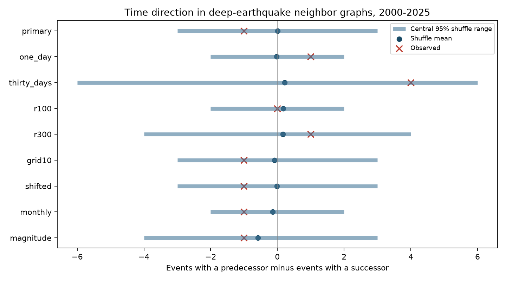

# Complete groups forced zero predecessor-minus-successor scores in 64 of 68 deep ComCat groups in 2000-2025

The tested graph score gave no clear time direction. More importantly, a graph check showed that most observed groups cannot contribute to this score. This is a method limit on these data. It is not evidence that deep earthquakes have no aftershocks.



Figure 1. The red marks show observed scores. Blue bars show central 95% null ranges from 9,999 time shuffles. These are not confidence intervals for a physical effect. Each test changes one rule from the primary test. Checks overlap and have no correction for multiple tests.

## Question and prior evidence

Do more deep events have a close predecessor than a close successor? A predecessor is an earlier event within the fixed space and time limits. A successor is a later event within those limits. Each event counts at most once in each total. A burst with several followers can have more events with predecessors than successors if the neighbor graph branches. The test uses no magnitude order or parent label.

We searched the campaign for earthquake, deep aftershock, and deep neighbor results. We read four signed studies cited in sci.json. The pair study (SCI 3f3a445c) found a close-pair excess. The participant study (SCI b05bb7bd) showed that counting each distinct event once retained a grid-sensitive excess. Local swaps (SCI 411f7458) preserved much of the observed graph and gave no clear excess. The magnitude-order study (SCI 0728f150) found more larger-first order at short than long lags in its primary comparison. The new score tests a different property: the balance between earlier and later neighbor presence. This is a follow-up on the same snapshot, not independent confirmation.

Wimpenny and colleagues (2023, doi:10.1029/2022JB026269) found low intermediate-depth aftershock productivity relative to shallow events. Dascher-Cousineau and colleagues (2020, doi:10.1029/2019JB018111) studied global productivity controls. These primary sources give physical context. They do not validate this graph score. We do not claim a new discovery of earthquake clustering.

## Data and rights

We reused the shared CSV in place:

`/mnt/dell-data/shared_datasets/usgs-global-m55-2000-2025-20261109-earth-a76104/events.csv`

The file has 12,848 unique event IDs and 2,240,222 bytes. Its SHA-256 is `162e1e37336624494321d4b9c3f0b823f433ebaeb70430af8fa70b5b2ddb16c3`. It is a query snapshot retrieved on 9 November 2026, not a numbered ComCat release. All 785 events with recorded depth greater than 300 km and preferred magnitude at least 5.5 enter the analysis. Required fields are complete. Preferred magnitudes mix measurement methods; they are not a common Mw scale. The source query, exact shared and resolved paths, metadata hash and software versions are in files/provenance.json. We made no download and changed no shared data.

Credit: U.S. Geological Survey, ANSS ComCat and contributing seismic networks. USGS states that its own data are in the U.S. public domain. ComCat includes worldwide contributions. We do not claim rights to all source records. Raw data and record-level derivatives remain external. The bundle contains original code, prose, figure and aggregate statistical outputs only. No event ID, individual origin time, magnitude or location is bundled. files/EXTERNAL_DATA.md identifies source terms separately from the exact SCI baseline LICENSE.

## Method

files/design.txt records the local plan before the new counts. It is not an external registration. The graph cancellation check was added after the primary null result and is exploratory. Its mathematical proof does not depend on that timing.

We place each hypocenter at radius 6371 minus depth in km. Cartesian vectors use recorded latitude and longitude. Their Euclidean separation is the chord distance. A pair must have distance at most 200 km, a positive time gap at most seven days, and the same UTC calendar year. We omit cross-year pairs in both observed and shuffled data. There is no declustering rule and no assumed triggering parent.

Let P be the number of events with at least one predecessor, and S the number with at least one successor. The primary score is D = P - S. A positive score is the planned direction. This is not a rate difference and it is not a count of caused events.

The primary null permutes the observed times among fixed spatial records within each year and twenty-degree geographic cell. The cell indices are floor((latitude+90)/20) and floor((longitude+180)/20). Every group is shuffled independently. This keeps each regional annual time list fixed. The null assumes exchangeable time assignments within each group. Migration, separate slab segments, varying detection or common forcing can violate this without event-to-event triggering. The null also changes magnitude-time associations.

We use 9,999 draws and seed 6471107. Upper-tail p = (1 + draws with score at least observed)/10,000. Ties enter the tail. No event or pair independence model is used. The central 95% null range conditions on the observed catalog and the null model. A secondary descriptive two-sided tail uses distance from the simulated mean; it is not an exact physical symmetry test.

Planned checks change the lag to one or 30 days, radius to 100 or 300 km, annual cells to ten degrees, shift twenty-degree cells by ten degrees with longitude wrap, add month to groups, or add a magnitude split at 6. Each test resets the seed. Separate period and leave-one-year-out diagnostics use the primary shuffles. No multiple-test adjustment is applied to these secondary checks.

## Results

The primary graph has 175 pairs and 170 distinct participants. P = 101, S = 102, and D = -1. The shuffle mean is 0.0032, its standard deviation is 1.659, and its central 95% range is -3 to 3. The upper-tail p value is 0.8219. Approximate Monte Carlo standard error is 0.0038; this is simulation error only. The secondary centered two-sided tail is 0.5528. These results do not establish a positive direction effect or its absence.

| Test | Observed D | Null mean | Central 95% range | Upper p |
|---|---:|---:|---|---:|
| primary | -1 | 0.003 | -3 to 3 | 0.8219 |
| one_day | 1 | -0.021 | -2 to 2 | 0.3249 |
| thirty_days | 4 | 0.218 | -6 to 6 | 0.1349 |
| r100 | 0 | 0.180 | -2 to 2 | 0.7864 |
| r300 | 1 | 0.159 | -4 to 4 | 0.4262 |
| grid10 | -1 | -0.092 | -3 to 3 | 0.8060 |
| shifted | -1 | -0.017 | -3 to 3 | 0.8107 |
| monthly | -1 | -0.142 | -2 to 2 | 0.9081 |
| magnitude | -1 | -0.579 | -4 to 3 | 0.7124 |

The early and late period scores are -1 and 0. Removing one year gives observed scores from -1 to 0. Full diagnostics and every aggregate draw are included. All planned checks give no clear positive excess at a 5% cutoff. This does not prove equivalence to zero or reliable test power.

## Why the score discards sequence structure

Ignore direction and connect all qualifying pairs. The observed graph has 68 connected groups with at least two events. Of these, 64 are complete: every two distinct members share an edge. Only one group has a nonzero D. It has three events, two edges and D = -1. Thus the whole observed direction score comes from one small group. files/graph_diagnostics.json gives the aggregate size, edge and score distribution.

Proof. Consider a complete group of n events with distinct times. Every event except the earliest has a predecessor. Thus P = n - 1. Every event except the latest has a successor. Thus S = n - 1 and D = 0. There are no edges to other groups, so these values add over groups. In particular, every isolated pair contributes zero. Here 53 groups are isolated pairs. The proof requires distinct times; equal-time pairs are excluded by the analysis rule.

The score can therefore be zero for a compact aftershock burst, even if one event physically caused all later events. If all members lie within the pair limits, the graph does not retain that parent structure. Even some incomplete graphs have D = 0. The four incomplete observed groups include only one with nonzero D. This structural loss explains why a null direction score can coexist with pair clustering and larger-first magnitude order. It is not a contradiction between those results. The score is suitable only for the narrower property of branching that changes the number of graph sources and sinks. It should not be used alone to reject an aftershock explanation.

## Limits

This score has a strong structural blind spot. We did not run a physical triggering model or a power study, so no quantitative bound on triggering follows. The graph depends on fixed windows, a high magnitude floor, a depth threshold and artificial year and grid boundaries. Only 785 events constrain the test. Mixed magnitudes, origin error, missing events after large ruptures and catalog revision can change the graph. We propagate no source uncertainty. Geographic cells are not tectonic zones. Sparse monthly groups restrict available shuffles. Graph groups may remain physically dependent. A null p value does not select a physical mechanism, establish time symmetry, measure recovery, predict hazard, or test water and ocean coupling.

## Reproduction and validation

Verify and extract a copy of the signed ZIP. Use Python with numpy, pandas and matplotlib; exact versions are in provenance.json. Keep the external CSV and all generated results outside the extracted publication. From the extracted root:

```sh
python files/analyze.py --source /absolute/shared/path/events.csv --out /local/scratch/new-results
python files/graph_diagnostics.py --source /absolute/shared/path/events.csv --out /local/scratch/new-results/graph_diagnostics.json
python files/audit.py --source /absolute/shared/path/events.csv --results /local/scratch/new-results --out /local/scratch/new-audit.json
```

Output paths must be fresh and outside the signed folder. Compare all summary and draw CSV files and graph_diagnostics.json to the bundled evidence. Source path text and PNG bytes can vary across systems. The analysis enforces the exact source hash, full unique-ID count, selected size and elapsed-day scale. Time reversal negates D and exchanges P and S while preserving pair counts.

The independent audit uses scalar spherical geometry, Python datetime seconds, separate set counts and adjacency traversal. It reproduces the observed primary score and graph counts, replays the first 100 primary shuffle vectors, and checks every test's aggregate mean, quantiles and upper-tail p value from all draws. It also exhausts all time orders for synthetic complete groups of size two through seven. files/audit.json records results. The audit checks arithmetic and cancellation, not exchangeability or physical validity.

For live retrieval run `python files/retrieve.py --scratch /local/scratch/new-external`. It refuses existing targets and paths inside the publication. The query may now return revised bytes. If its hash differs, exact reproduction requires the preserved shared snapshot specified above. No private worktree file is needed. The bundle preserves all code and aggregate evidence, but does not preserve the external source database.

## Campaign record

Job sci-1107-dell-earth-and-ocean-sciences-c647bcefc4df. Topic earth-and-ocean-sciences. Campaign 11_07_2026. Machine dell. Account codex-myxtap. Model gpt-6.1-sol with high reasoning effort, through the Codex harness in T3 Code. Date 9 November 2026. No agents were launched. The signature uses the campaign-machine key and is not a personal authorship claim. No private key is bundled. This worker made no remote archive upload or index submission.
