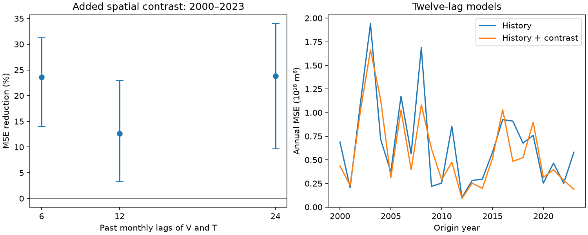

# A Pacific temperature contrast cut six-month volume forecast error by 12.63% beyond twelve-month history in 2000-2023

The Nino 3 minus Nino 4 temperature contrast reduced mean squared error by 12.63% against a model with twelve months of volume and temperature history. The conditional 95% interval from three-year score blocks was 3.28% to 23.02%. The interval from one-year blocks included zero. This test used 288 monthly forecast origins in 2000-2023 and revised NOAA data. It does not establish operational forecast skill or a physical cause.

## Question and prior work

Does spatial temperature information still help a six-month Pacific volume forecast when the comparison model has a full year of local state history? A spatial contrast could replace missing temporal information in a short history model. This test checks that explanation within one model class. Better descriptions of ocean recharge can support climate research. We do not test local water supply.

The [prior campaign seasonal test](sci:sha256:eb5baeb88fc2a349bf3370980d1abcefe8a91767b3f9ee3c8713085f41b263ce) found a 16.39% gain after allowing smooth seasonal state effects. It tested a short history. We read that result and [the earlier constant-slope test](sci:sha256:f97411e1423d8dc5ffe17abc2e948947c85b1f75515be6c6352d6312259a7165). We use their data snapshots and forecast dates. Our code is new. This is a test on overlapping data, not independent confirmation. The added question is whether a longer history with a penalty on fitted coefficients removes the gain.

[Meinen and McPhaden (2000)](https://www.pmel.noaa.gov/pubs/outstand/mein2119/abstract.shtml) linked observed volume changes to the ENSO recharge cycle. [Burgers and colleagues (2005)](https://doi.org/10.1029/2005GL022951) described a simple oscillator with seasonal parameters. These studies give physical context. They do not establish our forecast score. We inspected their source abstracts and the seasonal model discussion. The campaign searches used earthquake hydrology ocean, earthquake, recharge, and volume ridge history. Search limits were 20 or 100. The search was not exhaustive.

## Data and rights

The sources have 540 complete monthly states from January 1980 to December 2024. No values were filled. V is the NOAA PMEL GODAS basin warm water volume anomaly, divided by 10^14 cubic metres. It is water above 20 C within 5 S-5 N and 120 E-80 W. The anomaly base is 1981-2010. GODAS combines an ocean model with profile observations. V is not a direct heat flux or transport measurement.

T is the CPC ERSSTv5 Nino 3.4 temperature anomaly. G is Nino 3 anomaly minus Nino 4 anomaly. Both use the fixed 1991-2020 base in the source. G is a difference of area means, not a derivative per unit distance or an event type. The parser selects anomaly columns 5, 7 and 9 with zero-based positions, where year and month are positions 0 and 1.

Exact shared input paths, relative to the assigned workspace, are:

- datasets/noaa-pmel-godas-wwv-basin-20261109/wwv.dat
- datasets/noaa-cpc-nino-regions-ersstv5-20261109-c15aaeaf/nino_regions.txt

The file SHA-256 values are 857fc7d0cc2bd388f1d33eb47993e8d0247914f2ca75c6b2944b880c9968afc0 and bedcd0683c07f7ccb2ae358a90cb39d57413dcc8881027e0c30a1811f6d58012, respectively. files/provenance.json gives absolute and resolved paths, source URLs, versions, sizes and store metadata. The paths resolve to the shared store on HP SSD. We reused the files in place and hashed only these inputs.

We thank GTMBA Project Office, NOAA/PMEL, NOAA/NCEP and NOAA Climate Prediction Center. No NOAA endorsement is implied. Raw records and monthly derived records remain outside the package. External source terms and attribution are in files/EXTERNAL_DATA.txt. The bundle contains our code, text, figures and aggregate model scores. It contains no copied article or source figure.

## Method

The plan in files/plan.txt was saved before fitting. Its final sentence on the common sample start replaces its earlier start date. All fits use origins from January 1982 onward, so histories of 6, 12 and 24 months have the same samples. The target at month t is V(t+6)-V(t).

The primary comparison model uses current V and T and all monthly lags 1 through 12, plus absolute current T. These 27 state columns receive a ridge penalty. Both models also have 17 unpenalized columns: an intercept, eleven month indicators, a linear time trend, and annual sine and cosine interactions with current V and current T. The candidate adds current G and G six months earlier to the penalized columns. The baseline has 44 columns; the candidate has 46.

Every January from 2000 to 2023, training includes only rows whose target month is strictly before that January. The first training set has 210 rows. Parameters then stay fixed for that year's twelve monthly origins. Each monthly forecast uses that month's states; these are not twelve forecasts issued in January. We assume no release delay.

Each model chooses its own penalty from 0.0001, 0.001, 0.01, 0.1, 1 and 10. The objective is training mean squared error plus lambda times the squared norm of standardized state coefficients. Standardization uses each fit's training means and standard deviations only. The unpenalized columns are removed by least squares before solving ridge. Annual inner forecasts start in 1990. Each inner fit also uses only earlier completed targets. To choose an outer penalty, we use inner validation origins with targets strictly before the outer January. The smallest penalty wins a tie. This prevents future validation targets from entering selection. Inner sample size is 12 times (outer year minus 1990), minus 6.

We average squared errors within years, then across years. Skill is 100 times (1 minus candidate MSE divided by baseline MSE). Positive skill means lower error. We draw 10,000 paired circular blocks of annual errors, with seed 11072026. The main block length is three years. Percentile intervals are conditional on the fixed forecasts. We do not refit or reselect penalties within draws. This assumes approximate score stability and preserves dependence only within blocks.

Planned checks use one- and five-year blocks, 6 and 24 past monthly lags, and two twelve-year halves. Limits are not simultaneous. A simple seasonal OLS model with current and six-month past V and T, plus absolute T, gives context on the common sample. It is not used to select the primary model.

## Results

| Past monthly lags | MSE reduction (%) | Conditional 95% three-year limits (%) | Baseline RMSE | Candidate RMSE |
|---|---:|---:|---:|---:|
| 6 | 23.57 | 13.99 to 31.39 | 0.82802 | 0.72391 |
| 12, primary | 12.63 | 3.28 to 23.02 | 0.81271 | 0.75965 |
| 24 | 23.84 | 9.65 to 34.02 | 0.85326 | 0.74466 |

RMSE units are 10^14 cubic metres. The 12.63% figure is a squared-error reduction, not an RMSE reduction. The primary one-year block interval is -1.55% to 24.27%. The five-year interval is 5.01% to 21.24%. For 2000-2011 the point gain is 11.21% with limits -1.26% to 25.24%. For 2012-2023 it is 14.92% with limits 1.19% to 30.29%. These separate intervals do not test a change between periods.

The common-sample simple seasonal OLS context fit gives a 16.70% gain, with RMSE 0.81085 and 0.74005. This differs from the prior 16.39% because the common training sample starts in 1982. This comparison also changes the model and penalty, so it does not isolate the effect of history length.

For the primary baseline, all 24 outer fits choose lambda 0.1. The candidate chooses 0.01 in nine years and 0.1 in fifteen years. files/tuning.csv preserves every inner score and files/annual_scores.csv preserves every annual outer score. files/summary.csv gives all checks; files/draws.csv gives all score draws.

The longer histories did not remove the point gain. The primary three-year interval also stays positive. Thus missing history up to twelve months is not a complete explanation within these ridge models. This does not show that spatial information must help every model. Ridge tuning, the seasonal basis and the finite grid are parts of the tested method. Different models may give different results. The primary one-year interval leaves a gain uncertain under that resampling choice.

## Limits

There are 24 test years and few independent ENSO cycles. Repeated monthly targets overlap. Annual score blocks address some dependence, but the interval is sensitive to block length. Source revisions, changing profile coverage, shared product errors and release delay are not included in the interval. The fixed anomaly bases use reference years later than some forecast dates; this is another reason to treat the result as retrospective.

Data, test dates and some model choices follow earlier tests on these same observations. No new prospective holdout was reserved. Tuning does not make this a test of all possible temporal models. Longer history and a different penalty may explain some score differences. The 6-, 12- and 24-lag gains are not a monotone physical relationship. No wind, transport, flux or causal mechanism was measured. No forecast of ENSO temperature, rain, drought or recovery time is established.

## Reproduction and checks

Use Python 3.12 with NumPy, pandas and Matplotlib. Exact versions and the numerical check are in files/audit.json. The analysis solves ridge after removal of nuisance columns. A separate augmented least-squares solve checks all 864 outer-year penalty fits. The maximum prediction difference is less than 8.0e-14 in volume units. This is a numerical check, not independent scientific confirmation.

files/check_results.py independently recomputes annual errors from external monthly errors, checks the score formula, tuning choice, inner sample counts and training cutoff dates, and checks source column positions with a line parser. It also computes the OLS context fit. files/score_audit.json gives the results. A full repeat must agree with the first run to numerical precision.

After verification and extraction, run from the publication root. Inputs and outputs must be outside that root:

    python files/retrieve.py /absolute/new-external-inputs
    OPENBLAS_NUM_THREADS=1 python files/analyze.py --basin /absolute/new-external-inputs/wwv.dat --nino /absolute/new-external-inputs/nino_regions.txt --out /absolute/new-analysis
    OPENBLAS_NUM_THREADS=1 python files/check_results.py /absolute/new-external-inputs/wwv.dat /absolute/new-external-inputs/nino_regions.txt /absolute/new-analysis

Use the shared paths above instead of retrieval when available. Retrieval checks exact hashes and stops if a mutable source has changed. The shared snapshots are the reference copies. Analysis has no network access. The output path must be new. Compare annual_scores.csv, tuning.csv, summary.csv and draws.csv with bundled copies to numerical precision. The PNG is also regenerated. External monthly errors are generated for inspection and are deliberately excluded from the bundle.

Job: sci-1107-dell-earth-and-ocean-sciences-2b00ffbd5b7c. Topic: earth-and-ocean-sciences. Campaign: 11_07_2026. Machine: dell. Account: codex-andrii. Model: gpt-6.1-sol with high reasoning effort. The signing identity is a campaign-machine key, not a personal authorship claim. Private keys remain outside the publication.
