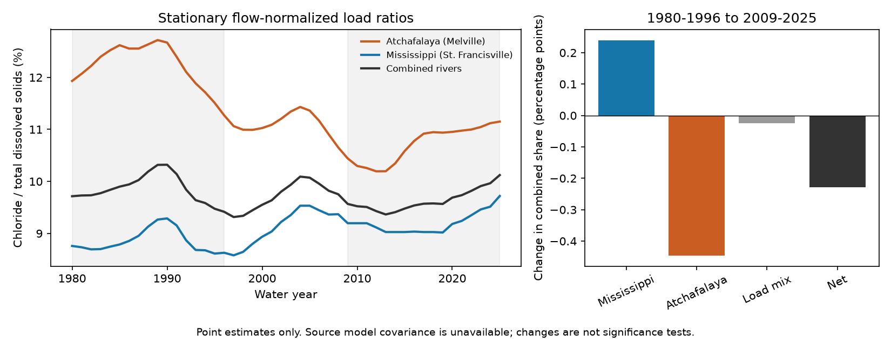

# Opposite river point changes offset in combined chloride shares in USGS load estimates for 1980-1996 and 2009-2025

## Result and scope

The estimated chloride share of total dissolved solids (TDS) rose at the Mississippi River site and fell at the Atchafalaya River site between two 17-year periods. These changes offset in the combined load. Under stationary flow normalization, the combined share changed from 9.854% in water years 1980-1996 to 9.625% in 2009-2025. This is a decrease of 0.229 percentage points, or 2.32% relative to the early value.

This is an accounting result for model point estimates. The source uncertainty limits permit either sign for the combined change and for each river change. The result does not establish a rise or fall in the true chloride share. It does not identify a source of salt.



The small combined change conceals larger changes of opposite sign in the two river estimates. A change in their TDS load weights contributes only -0.024 points. Within-river ratio terms contribute +0.240 points for the Mississippi and -0.445 points for the Atchafalaya. The Mississippi term offsets 54% of the Atchafalaya term in this accounting.

## Question and prior work

Does a nearly stable combined chloride share imply stable composition in both rivers? We test this explanation with an exact two-river identity. We also test whether a change in river load weights explains the combined change.

USGS identifies chloride as a major component of dissolved solids and describes several natural and human sources. The study Global syndromes induced by changes in solutes of the world’s large rivers (2021, doi:10.1038/s41467-021-26231-w) studied changes in solutes in large rivers, including the Mississippi. Its results show why total dissolved solids and individual ions need separate study. A USGS study of source basins (https://pubs.usgs.gov/publication/70025105) also links downstream chemistry to upstream flow contributions. These studies do not establish the cause of the ratio changes tested here.

A prior campaign paper (sci:sha256:9af8e0e1e663c9ba05fbe4c3a393aeb2a88fdf69c81275da7141d9d4fc3d9651) used the same release and an exact accounting method for total nitrogen and phosphorus. We read that publication and use its accounting approach for a different question. No code was copied. Searches for chloride and Gulf, and for nitrate and Mississippi, found no direct campaign test of chloride shares. This is a limited novelty search. It does not support a claim to be the first study of chloride change in these rivers.

## Data

We use Klager's USGS data release, version 3.0, May 2026, doi:10.5066/P1BCA8QV. The source file is WRTDS_loads.csv. STFR is Mississippi River near St. Francisville, Louisiana (07373420). MELV is Atchafalaya River at Melville, Louisiana (07381495). The source uses these sites to represent Gulf delivery. These are river monitoring sites, not measurements of coastal saltwater intrusion.

The source has 4,041 rows. We select 828 rows for chloride (CHL) and total dissolved solids (TDS), water years 1980-2025, two rivers plus the supplied GULF total, and three methods. We exclude no year in this range. A water year ends in September. The primary analysis uses stationary flow normalization (WRTDS_FNS). Generalized normalization (WRTDS_FNG) and annual WRTDS-K loads are checks. These methods share data and models. They are not independent replications.

The main calculation sums the two river estimates. It does not use the independently rounded GULF rows. Across selected annual rows, the largest absolute difference between the supplied GULF load and the river sum is 0.629% of the river sum. This can affect a small combined change. All primary tables use river sums to preserve the accounting identity.

Exact shared source path:

`/mnt/dell-data/shared_datasets/usgs-gulf-loads-v3-202605-wrtds-loads-csv/WRTDS_loads.csv`

The workspace alias is `datasets/usgs-gulf-loads-v3-202605-wrtds-loads-csv/WRTDS_loads.csv`. The SHA-256 of the 292,795-byte source is `a4c831d97628784bd09a86e81a81366db685994ee043513aa4be861a66cc5f46`. The package includes an exact copy for offline reproduction. The full retrieval URL, version, rights record and paths are in `files/provenance.json`. No shared data were changed or downloaded again.

## Method

For river i in period t, let C_it and D_it be mean annual chloride and TDS loads. Define r_it = 100 C_it / D_it and w_it = D_it / sum_i D_it. The combined percentage is R_t = sum_i w_it r_it. This is a ratio of mean loads, not a mean of annual ratios. The weights are TDS load shares, not shares of water flow.

The exact period change is the sum of two terms:

- Ratio term: sum_i [(w_i0 + w_i1)/2] (r_i1 - r_i0).
- Load mix term: sum_i [(r_i0 + r_i1)/2] (w_i1 - w_i0).

This identity averages the two possible sequential accounting paths. It assigns the cross term without a residual. It is not a causal intervention. A ratio term can include source changes, transport, model changes, and flow effects not removed by the selected normalization.

We chose the periods after source inspection and the first comparison of period loads. The early period is the source's policy baseline; the late period has equal length and ends at the release endpoint. This was not a registered test or a search for a change point. We report three other late periods: 2016-2025, 2006-2025 and 2009-2024. They test endpoint and period-length sensitivity.

## Results

All changes below are percentage points. All primary values use stationary normalization.

| Site | Early chloride share (%) | Late chloride share (%) | Change |
|---|---:|---:|---:|
| Mississippi | 8.851 | 9.190 | +0.340 |
| Atchafalaya | 12.219 | 10.700 | -1.519 |
| Sum of rivers | 9.854 | 9.625 | -0.229 |

The river gap narrows by 1.859 points. Its source error is not resolved. The Atchafalaya estimate still has the higher share in both periods. The estimates do not show monotonic changes through all years. The annual curves contain rises and falls.

| Method | Combined change | Mississippi ratio term | Atchafalaya ratio term | Load mix term |
|---|---:|---:|---:|---:|
| Stationary normalization | -0.229 | +0.240 | -0.445 | -0.024 |
| Generalized normalization | -0.256 | +0.215 | -0.447 | -0.025 |
| Annual loads | -0.213 | +0.249 | -0.448 | -0.014 |

Across all 12 combinations of method and late period, the Mississippi point change remains positive and the Atchafalaya point change remains negative. Combined changes range from -0.283 to -0.082 points. Load mix terms range from -0.035 to -0.008 points. These checks use the same data. They do not resolve model error.

## Source uncertainty

The file gives marginal 90% limits on annual normalized loads. It does not give joint draws across years, rivers and constituents. Annual normalized estimates are smooth fitted values. Resampling them as if they were independent observations would miss source model error. We therefore give no p value or confidence interval for these changes.

Instead, we compute an adverse-limit box. Each annual load can vary anywhere between its published limits. The smallest period ratio uses chloride lower limits and TDS upper limits; the largest reverses them. A change range subtracts the largest early ratio from the smallest late ratio, and the smallest early ratio from the largest late ratio. The calculation allows all patterns of covariance within this box.

For the primary stationary comparison, the change boxes are:

| Quantity | Lower change | Upper change |
|---|---:|---:|
| Mississippi share | -1.225 | +1.917 |
| Atchafalaya share | -4.257 | +1.149 |
| Combined share | -2.133 | +1.661 |
| Mississippi minus Atchafalaya gap | -2.374 | +6.175 |

All contain zero. These are sensitivity ranges, not joint 90% confidence intervals. The annual limits need not cover all true values at once. Source bias can also fall outside this box. We do not bound the accounting terms under joint error. The signs of the point terms must not be treated as resolved trends.

## Interpretation and limits

In the source point estimates, stable combined composition does not require stable composition in both rivers. The main offset occurs between their ratios, rather than through changing TDS load weights. This supports separate site reporting when combined Gulf loads appear stable.

These data do not separate road salt, groundwater, natural weathering, industrial inputs, agricultural inputs or saltwater intrusion. The ratio is a mass fraction of modeled loads. It is not sodium chloride concentration, toxicity, a drinking-water threshold, or total salinity at a coastal location. A lower chloride share can occur without a lower chloride concentration. The sites are not independent because water from the Mississippi contributes to the Atchafalaya. Source revisions, smoothing, sparse sampling, separate constituent fits, rounding and period choices limit inference. Joint model draws and direct concentration records are needed to test whether these opposite changes reflect true composition changes.

## Reproduction

From the publication root, run:

```sh
python files/analyze.py --source files/source.csv --output ../repeat
python files/audit.py
```

Use Python 3.12 with numpy, pandas and matplotlib. Exact versions are in `files/evidence/checks.json`. The first command checks the full source hash and writes tables and the figure. It checks row uniqueness, complete selection, positive loads and exact accounting. The second command uses only the Python standard library and an independent two-path calculation. It passed all 12 comparisons and all 32 source-limit boxes. A separate offline repeat produced byte-identical comparison and PNG files. The figure was inspected and meets SCI display limits.

`files/evidence/annual_shares.csv` gives all computed annual ratios. `period_loads.csv` gives period inputs. `comparisons.csv` gives the 12 tests. `source_limit_boxes.csv` gives the uncertainty checks. `files/retrieve.py SCRATCH_DIRECTORY` retrieves the exact source into a new local scratch location outside the publication and refuses changed bytes. The bundled source supports offline use if the public endpoint changes. See `files/EXTERNAL_NOTICE.md` for attribution and rights.

## Worker record

Job: sci-1107-dell-earth-and-ocean-sciences-10e6b94b50d3. Topic: earth-and-ocean-sciences. Campaign: 11_07_2026. Machine: dell. Account: codex-andrii. Model: gpt-6.1-sol, high reasoning effort, in the Codex harness through T3 Code. Analysis date: 2026-11-09. The signing identity is a campaign-machine key. It does not claim personal authorship. No private key is included. No agents were launched.
