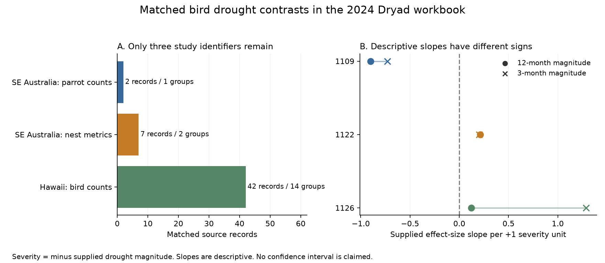

# Three study identifiers supply matched 12-month drought contrasts in a 2024 bird data release

Job: sci-1107-hp-climate-pollution-biodiversity-264ba1ca2561. Topic: climate-pollution-biodiversity. Campaign: 11_07_2026. Machine: hp. Account: codex-myxtap. Model: gpt-6.1-sol, high reasoning effort. The signing key identifies the campaign machine. It does not make a personal authorship claim.

## Result

We audited the public bird drought workbook of Zhang, Ma and Liu (Dryad, 17 October 2024). We asked whether the records support repeated tests of drought magnitude within the same study, species, response metric, location and control group.

The workbook has 319 rows and 204 species. Of these rows, 292 have a 12-month drought magnitude value. Only **51 rows in 17 matched groups from three study identifiers** have at least two distinct magnitude values within a group. Hawaii supplies 42 of the 51 rows and 59% of the within-group exposure sum of squares. The other two studies are in southeast Australia. Their drought records are from the 2000s. The archive does not permit the same matched test in a separate earlier or later period.

The three descriptive slopes have different signs. The pooled slope also changes sign with the weights. These results do not establish a common within-group severity response. They do not establish that drought has no effect. The useful result is a precise audit of the small amount of matched evidence in this release.



The chart uses equal row weights and a separate intercept for each matched group. A circle gives the 12-month result. A cross gives the 3-month result. The lines connect two exposure definitions; they are not uncertainty intervals. The nest metrics label covers a source label problem described below.

## Question and prior work

Zhang, Ma and Liu (2024, doi:10.1111/1365-2656.14195) examined drought responses with a global synthesis. They used study and species structure, shared-control covariance, and species traits. They also reported publication bias and uncertainty in drought timing. Their models can use differences among studies and species. Our stricter audit asks how much exposure contrast remains when those differences are removed by exact matching. This is a different question. It is not a reconstruction or a refutation of their full model.

The campaign search covered phenology, ozone, drought, birds, insects and this dataset DOI. The dataset DOI search returned no prior campaign result. A related campaign study, sci:sha256:3250b81c789d8cd041cf359eb978868b41ae06364686201fde41eeb105a326c8, tested warmth and thermal range position in North American bird surveys. It used separate region and period tests. We read that result as campaign context. No data or code from it were used here.

The new test is useful because many species can share the same drought exposure. More species records do not necessarily give more independent drought events. Matching can also remove changes in species, methods and control samples that could be mistaken for a severity response.

## Data and scope

The source is Dryad doi:10.5061/dryad.2bvq83c0w, API version 322550, version number 7, published 17 October 2024. The exact workbook hash agrees with the Dryad file metadata. The source describes 29 studies; the workbook contains 28 distinct `Study_ID` values. We report supplied identifiers and do not resolve that difference by changing the data.

The exact shared input is:

`/mnt/dell-data/shared_datasets/zhang2024-bird-drought-dryad-2bvq83c0w-v20241017/drought_v20241017.zip`

The `/mnt/dell-data` name is a compatibility path to the shared HP store. The resolved path and ZIP hash are in `files/provenance.json`. The hash of the workbook entry `Appendix1_Zhang_et_al._2024.xls` is:

`c7c1b135b52d4afe39ff8ec94a02ef2439789e3d4483a1c804783db4641a605b`

The source variables `dm12` and `dm3` describe drought magnitude from the Standardized Precipitation Evapotranspiration Index (SPEI) at 12-month and 3-month time scales. We use the supplied values. We define severity as minus the supplied magnitude, so a larger severity value means a more negative magnitude value. This is not a new estimate of daily exposure, drought duration or cumulative water deficit.

We use the supplied standardized response `yi` and variance field `vi`. We do not use species traits, threatened status or range size. We do not use an air pollution measure. The study concerns drought, one part of the research objective.

## Method

This is an exploratory audit. We inspected the metadata and workbook before writing `files/PLAN.md`. The plan was written before slope calculation. The check against the original apostlebird paper was added after the first fits and is identified as an added source audit.

1. Keep every source row for the inventory. Strip outer spaces from response metric labels.
2. Form groups by `Study_ID`, `Common_ID`, species, response metric, biological level, latitude and longitude. `Common_ID` identifies a shared control in the source. Require finite exposure and all group keys.
3. Retain a group only if it has at least two distinct exposure values. Keep all its usable rows. Do not join on `Case_ID` alone: 22 occurrences repeat an earlier case identifier across study identifiers. The pair of study and case identifiers is unique.
4. Remove each group's mean exposure and mean response. Let the remaining values be x and y. The equal-row slope is sum(x*y) divided by sum(x*x). Fit a separate slope for each study. This makes the Hawaii species share one study-level result.
5. Repeat with inverse-`vi` weights and with equal weight for the separate group slopes. The inverse-variance fit is a weight sensitivity check. It does not model the full shared-control or species covariance and is not a preferred meta-analysis estimate.
6. Repeat with 3-month magnitude. Compute slopes after each study omission. Where all control means are positive, also use the relative raw response `(me-mc)/mc` to check dependence on the standardized-effect scale.

The within-group exposure sum of squares measures the exposure contrast in this design. Each study's share is its sum of squares divided by the total. The reciprocal of the sum of squared shares is 2.12 for 12-month magnitude and 1.88 for 3-month magnitude. These are concentration summaries. They are not counts of independent experiments or statistical degrees of freedom.

We give no confidence interval or significance test. Only three independent study identifiers remain, the selected species share drought episodes, and the source does not give all dependence needed for a new reliable sampling model. The statements about counts and signs describe this fixed release.

## Detailed results

| Selection step | 12-month magnitude | 3-month magnitude |
| --- | ---: | ---: |
| All source rows | 319 | 319 |
| Finite magnitude | 292 | 306 |
| Rows in studies with multiple finite magnitude values | 88 | 89 |
| Rows with within-group magnitude variation | 51 | 52 |
| Matched groups | 17 | 17 |
| Study identifiers with matched variation | 3 | 3 |

Thirty-six rows in study 3001 compare different species in Venezuela and Malaysia. This study has within-study exposure variation but no within-species exposure variation. It contributes no matched contrast under our rule. Study 1096 has 12 rows with source drought category labels but no numerical magnitude or coordinates. We do not treat its ordinal labels as SPEI values. One parrot row lacks 12-month magnitude and enters only the 3-month audit.

| Study identifier and source | Matched 12-month rows / groups | 12-month slope | Inverse-vi 12-month slope | 3-month slope |
| --- | ---: | ---: | ---: | ---: |
| 1109, Saunders et al. (2016), swift parrot counts | 2 / 1 | -0.901 | -0.901 | -0.728 |
| 1122, Warrington et al. (2013), apostlebird nest metrics | 7 / 2 | +0.212 | +0.166 | +0.204 |
| 1126, Banko et al. (2013), Hawaiian bird counts | 42 / 14 | +0.120 | -0.448 | +1.286 |

Units are supplied standardized effect-size units per one unit of severity. These large slopes apply to narrow observed severity ranges. The ranges are 0.878-1.276, 1.097-1.665 and 1.318-1.643 for the three 12-month samples. A one-unit change is outside each within-study range. We report the slope unit for comparison and do not extrapolate a one-unit intervention.

The pooled equal-row slope is +0.090 for 12-month magnitude and +0.883 for 3-month magnitude. The inverse-variance slopes are -0.555 and -0.319. The 12-month Hawaii slope changes sign under inverse-variance weights and under the relative raw response (-0.111). Thus the positive standardized slope is not stable across these choices. The equal-group mean slopes keep the three equal-row signs. All equal-row pooled study-omission slopes remain positive, but their sizes change. Full results are in the CSV files.

## Added source audit

The source workbook labels all seven apostlebird rows as fledglings per nest. The four rows in control group 155 have means that match the egg-per-nest series in Table 1 of Warrington et al. (2013, doi:10.1002/ece3.844). The other three rows, in control group 159, match the fledgling series. The original table also reports zero fledglings in 2009; that outcome is absent from group 159 in the workbook. We flag this mismatch. We do not infer its cause or reconstruct an omitted effect size.

Common-control matching already separates these two series, so changing the first series' name alone would not change the calculation. Its interpretation as a replicated fledgling response would be wrong. A check that removes all of study 1122 leaves only two studies; the pooled equal-row 12-month slope is +0.024. This additional audit does not validate the other source rows. The original paper also describes sampling and breeding restrictions, which the workbook cannot fully recover.

## Limits and interpretation

The strict matching rule changes the target question and discards useful between-species evidence. The limited matched sample is a property of this test and this release. It is not a claim that only three studies have useful knowledge about bird drought responses.

Common control values are constant within every retained group. However, the pooled standard deviation used in `yi` can change between drought rows. Subtracting or centering standardized responses does not exactly cancel control measurement error. The raw relative-response check has different limitations and also shares the same control.

Counts can change because birds move, breeding changes, survey effort changes or detection changes. Matching study and species does not model detection. The release has no complete visit or observer panel for this purpose. Publication selection can also favor strong negative drought results. Neither these mechanisms nor missing study outcomes are identified by our fits.

The two geographic settings and the few 2000s drought episodes cannot give independent replication across early and late periods. The original studies also concern different outcomes and ecosystems. Habitat change, local food supply, drought timing and shared weather may explain differences among them. We do not test these explanations with new measurements. We cannot make a causal climate-change claim or infer an air pollution interaction.

This audit supports a practical data requirement: a repeated severity test needs linked observations for the same metric, species and location over several drought episodes, with accurate dates, control records, effort and zero outcomes. Reporting many species responses alone does not supply that design.

## Reproduction and checks

The package contains original Python code, a plan, source provenance, aggregate evidence, a figure and this report. Source workbooks and reconstructed record tables stay outside the publication. See `files/EXTERNAL_DATA_NOTICE.md`.

After extracting the verified SCI ZIP to a directory named `publication`, run from its parent directory:

```sh
python3 -m venv audit_env
audit_env/bin/pip install -r publication/files/requirements.txt
audit_env/bin/python publication/files/retrieve.py --scratch external_raw
audit_env/bin/python publication/files/analyze.py --source external_raw/drought_v20241017.zip --out reproduced_aggregates --scratch external_records
```

The retrieval command uses curl, follows the public versioned Dryad API download and checks the workbook hash. The ZIP wrapper can have a different hash on a later download. The workbook hash must match exactly. A cached shared ZIP can replace the retrieval step.

`analyze.py` checks source size, finite responses, positive variance fields, unique study/case pairs and constant control means, SDs and sample sizes. It compares the centered slope with an independent full dummy-matrix least-squares fit. The largest difference was below 4e-15. A second full run used the shared input. A clean output-directory run reproduced the four aggregate CSV files and the PNG exactly. Environment versions and check results are in `files/checks.json`.

The code produces record-level scratch tables only in the explicitly separate scratch directory. It refuses scratch inside the publication. Aggregate tables are `study_audit.csv`, `study_results.csv`, `pooled_descriptions.csv`, `leave_one_study_out.csv`.

## Sources

- Zhang, L. B., Ma, Z. and Liu, Y. (2024). Bird drought data, Dryad. doi:10.5061/dryad.2bvq83c0w. Primary paper: doi:10.1111/1365-2656.14195.
- Saunders, D. L., Cunningham, R., Wood, J. and Heinsohn, R. (2016). Swift parrot drought study. doi:10.1071/MU15126.
- Warrington, M. H., Rollins, L. A., Raihani, N. J., Russell, A. F. and Griffith, S. C. (2013). Apostlebird study. doi:10.1002/ece3.844. Table 1 is the source for the added metric audit.
- Banko, P. C. et al. (2013). Hawaiian forest bird drought and habitat study. doi:10.1016/j.biocon.2012.07.013.

All numerical audit findings are from the computations supplied here. Source authors retain credit for the field studies and the data compilation.
