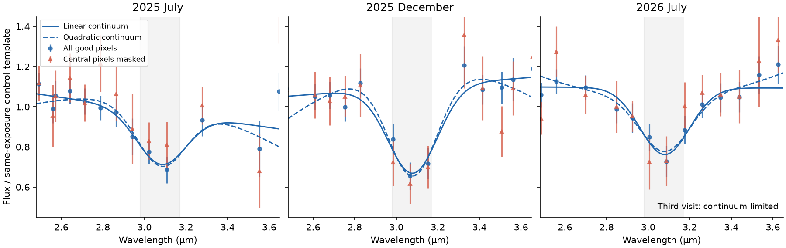
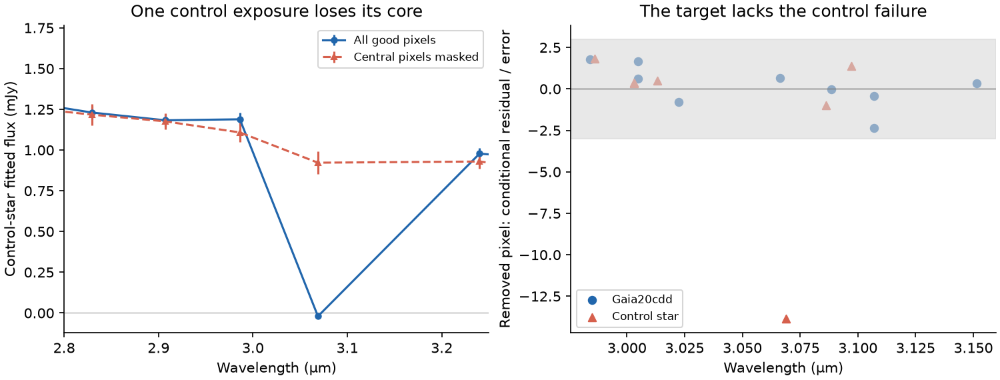

# New SPHEREx image fits retain the 2025 band of Gaia20cdd and show an unflagged pixel error in one control star

Job: sci-1107-hp-astronomy-fd3c99ff0e57. Topic: astronomy. Machine: hp. Account: codex-myxtap. Model: gpt-6.1-sol, high reasoning effort, through the Codex harness in T3 Code. Campaign: 11_07_2026. Date: 2026-11-10. The signing key is a campaign-machine key. It is not a personal authorship claim.

## Result

We measured 44 public SPHEREx detector-4 cutouts near the 3.1 um band of Gaia20cdd. We used the new effective point-spread function (ePSF) for both Quick Release 2 and Quick Release 3 images. We also used the full science wavelength maps. The reported 2025 band remains with these calibrations, a larger fit area, free source positions, and a mask on the central pixels. This strengthens the image-level evidence for a real flux deficit. It does not identify water ice as its cause.

We found the image-level cause of a failed control-star spectrum. One unflagged central pixel changes its fitted 3.069 um flux from -20 to 922 microJy when it is removed. The same test does not remove the target band. Thus the failed control and the target do not have the same central-pixel failure in these data.

The July 2026 visit remains tentative. With all good pixels, its fitted peak depth is 0.305 +/- 0.053 for a linear continuum and 0.259 +/- 0.082 for a quadratic continuum. With the central pixels masked, the quadratic result is 0.222 +/- 0.147. These are conditional fit errors. They are not false-alarm probabilities or full error bounds. We do not claim a secure third ice detection, one year of continuous ice cover, or a grain lifetime.



Figure 1. Our new image measurements, divided by a same-exposure control template. Blue points use all good pixels. Red points mask the central pixels within 0.65 native pixel of the expected source position. This removes one or two pixels, depending on source phase. Errors include the image-fit error scale and a 0.04 ratio floor. Blue curves use the prior Gaussian band shape with linear or quadratic continua. The curves are drawn before band averaging; the fits average the profile over each bandwidth. The grey region is the prior 2.98-3.17 um test band. Red errors grow because the mask removes much of the source signal.

## Question and prior work

The ice study [1] reported four low fluxes in July and December 2025. The warm-dust study [2] used wider spectral bins and also measured later images. During this investigation, a new campaign audit [3] reported agreement between those two tables. It also found that the July 2026 feature depends on the continuum and on one measurement. Its control-star test found a near-zero flux in Gaia DR3 1624710369150047744. That audit did not re-fit the images or apply new calibration files.

Our question is narrower: do updated image fits retain the target feature, and can image-level tests explain the failed control fit? The new work is direct image measurement with the recommended ePSF, use of the science wavelength map, four extraction variants, and a measured test of the excluded central pixels. We do not count the same photons again as an independent instrument detection. We cite [3] as prior evidence for the continuum limit and the failed control.

The campaign searches and the records that they returned are in `files/provenance/campaign_search.json`. We read the new audit before the final analysis. This was an exploratory investigation. The three visits are separate observations. The July 2026 observations were outside the time range of [1], but this analysis was not blind to their published fluxes.

## Data and rights

We retrieved 44 cutouts of 160 by 160 pixels from IRSA. Their positions and exposure names came from the individual target measurements in [2], before our new fits. We selected its target entries with wavelength from 2.45 to 3.70 um. This selection includes poor fits. We did not select images by the sign of their band residuals.

We used these shared calibration files in place:

| Shared file | Source version | SHA-256 |
|---|---|---|
| `/mnt/dell-data/shared_datasets/spherex-epsf-d4-v1-2026-191/epsf_D4.fits` | SPHEREx QR3, cal-epsf-v1-2026-191, detector 4 | `b37cb9423746477427121e2c3b3f4b8291c1df9cadba6f770ea1a7f962748b4c` |
| `/mnt/dell-data/shared_datasets/spherex-spectral-wcs-d4-v5-2026-191/spectral_wcs_D4.fits` | SPHEREx QR3, cal-swcs-v5-2026-191, detector 4 | `dbdcb8addb4ffe817f31786c8cb359b1f47df3528173e9d4602b94c84f7d7c1a` |

The campaign dataset helper created these immutable datasets. We did not change other shared datasets. The `/mnt/dell-data` paths are compatibility paths on the HP SSD. We did not access `/data` on the failed disk.

`files/provenance/downloads.json` gives every exact cutout URL, file hash, calibration URL, shared path, and the Gaia DR3 query and response hash. The cutouts use l2b-v20 and l2b-v21 for QR2 and l2b-v27 for QR3, as stated in their URLs. A fresh Gaia DR3 cone query supplied the source positions, proper motions and optical magnitude cut. That extract stays outside this publication. Its row order can change on retrieval.

The 26 control identifiers and the K-band normalization measurements come from [2]. Their selection was made before this band test. `files/evidence/reference.csv` preserves the measured normalizations, with their source publication and file hash in `files/provenance/prior_inputs.json`. These are SPHEREx flux measurements, not Gaia catalogue magnitudes. The target K scale cancels from the fractional band depth.

The bundle contains our measurements, code, plots and aggregate results. It does not contain external sky images, calibration FITS files, Gaia catalogue values, or pixel coordinates computed from Gaia astrometry. A full image rerun writes those materials to separate scratch. See `files/NOTICE-external-data.md` for credits and source terms. The new measurements can be inspected and their spectral fits can be repeated without external raw data.

## Method

### Image fits

1. Propagate Gaia DR3 positions from epoch 2016.0 to each exposure with the proper motions. Include field sources brighter than G = 20.5. Use the image celestial WCS, including its distortion terms.
2. Use the nearest ePSF zone separately for each source. Evaluate its 5-times oversampled pixel-convolved kernel at the source phase with cubic interpolation. Normalize that kernel on a complete native-pixel stamp. Do not integrate the pixel response a second time. IRSA recommends these ePSFs for QR2 as well as QR3 [4,5].
3. Fit a common position shift from up to eight isolated stars with G < 15.5. Use the median shift. The band analysis requires at least two shift stars.
4. Fit each requested source on an 11 by 11 pixel area. Fit all nearby catalogue sources and a plane background by weighted least squares. Allow source fluxes to be negative. Use the variance image. Reject known bad, transient, persistence, crosstalk, ghost and related artifact bits. Require the central 3 by 3 area to be clean and at least 60 usable pixels. The source and full-sample bits are allowed.
5. Use four variants. `fixed` uses the common shift. `large` uses a 15 by 15 area. `free` also fits separate position shifts for the target and the nearest catalogue neighbour, each within 0.35 pixel. `nocore` masks pixels within radius 0.65 pixel of the expected target position. For the failed control we run the same variants. The `free` flux covariance is conditional on the fitted positions.
6. Obtain the central wavelength and bandwidth by interpolation in the detector-wide CWAVE and CBAND images. IRSA states that WCS-WAVE is for display and that these full maps are for science [4]. The coordinate conversion is `1 + x_cutout - CRPIX1A`, and likewise for y.
7. Retain image fits with reduced chi-square below 8 for the spectral analysis. Multiply each flux error by sqrt(max(reduced chi-square, 1)). Preserve rejected fits and negative fluxes in the evidence table.

There are 42 fixed target fits from 44 requested images. Two have no fit after the core/coverage cuts. Three more fail the image chi-square cut. The spectral ratio analysis has 39 target measurements with adequate control coverage. The fixed-profile fits use the 33 measurements from 2.50 to 3.60 um. `selection.csv` states which fixed target fits were accepted. Every requested image remains in the retrieval manifest.

### Spectral fits

Normalize each star by its measured median K flux, with a lambda-squared correction over 2.0-2.35 um, from [2]. Divide each exposure by the median normalized control flux in that image. Use at least eight controls per image. Remove the tested control from the template for its null test. The target is never part of the template.

First use the published band-depth rule: 1 minus the weighted mean ratio at 2.98-3.17 um divided by the weighted mean at 2.50-2.85 and 3.25-3.60 um. Add a 0.04 ratio floor per exposure. This is a descriptive band contrast. It does not fit continuum curvature.

Then fit a Gaussian depression centred at 3.08 um with full width at half maximum 0.28 um, fixed from the prior claim. Fit the ratio as a constant plus a linear or quadratic continuum minus A times the Gaussian. Average the Gaussian over each measured bandwidth, treated as a top-hat. Define peak depth as A divided by the fitted continuum at 3.08 um. Propagate the full coefficient covariance into the depth error. Report A/sigma(A) separately as a formal amplitude statistic.

We also resample whole control stars 1,000 times to measure template uncertainty in the band-contrast estimator. Seed = 20261110. We do not add target noise in this bootstrap. Its spread is only the template contribution. We delete each July 2026 target measurement in turn for the fixed-profile fits. The code also fits a free Gaussian centre and width to 2025 only. That shape fit is exploratory.

The 0.04 floor does not represent an estimated covariance matrix. Adjacent samples in each short sequence can have correlated errors. None of these formal statistics is a global discovery significance.

### Central-pixel prediction

For each removed pixel in the 2.98-3.17 um measurements, fit the remaining pixels and predict the excluded value. Compare the actual value with that prediction. The reported residual divides their difference by the square root of the pixel variance plus the conditional prediction variance. It does not include unknown ePSF errors. This test asks whether the core agrees with the rest of the local source image.

## Measurements

### Target band

The simple band contrasts are 0.271 +/- 0.048 in July 2025, 0.324 +/- 0.042 in December 2025, and 0.254 +/- 0.051 in July 2026. There are two, three and two in-band samples, respectively. The third December sample is near 2.984 um after the science wavelength calibration. It was just outside the original ice reduction's band boundary. These are seven samples in three short sequences, not seven independent visits.

The control-template bootstrap adds spreads of 0.008, 0.006 and 0.009, respectively. These are small compared with the formal target errors. They do not constrain a common calibration error or a mismatch between the target and the controls.

The fitted peak depths below account for the continuum. Errors use the stated conditional covariance and error floor.

| Visit | All good pixels, linear | All good pixels, quadratic | Central pixels masked, linear | Central pixels masked, quadratic |
|---|---|---|---|---|
| July 2025 | 0.269 +/- 0.066 | 0.305 +/- 0.076 | 0.187 +/- 0.101 | 0.328 +/- 0.109 |
| December 2025 | 0.392 +/- 0.050 | 0.446 +/- 0.065 | 0.417 +/- 0.078 | 0.487 +/- 0.108 |
| July 2026 | 0.305 +/- 0.053 | 0.259 +/- 0.082 | 0.322 +/- 0.088 | 0.222 +/- 0.147 |

With all good pixels, the large-area and free-position fits give July 2026 linear depths of 0.314 and 0.290. Their quadratic depths are 0.271 and 0.249. Thus these extraction changes do not remove the feature. The stronger freedom in the continuum and loss of central-pixel signal limit its precision.

For July 2026 with all good pixels, deleting one measurement gives formal amplitude statistics from 3.95 to 5.34 with a linear continuum and 1.70 to 2.78 with a quadratic continuum. With the central pixels masked and a quadratic continuum, this range is 0.52 to 1.75. This agrees with the caution in [3]. The July 2026 deficit is consistent with the earlier feature, but the data do not establish a secure recurrence under all tested assumptions.

The exploratory 2025 shape fit gives centre 3.090 +/- 0.017 um and Gaussian sigma 0.089 +/- 0.021 um before bandwidth averaging. The local continuum is linear in log ratio in this additional fit. These errors are conditional on that model. This result is consistent with a band near 3.1 um; it is not a material identification.

### One control has an unflagged central-pixel failure

The failed control is Gaia DR3 1624710369150047744. The exposure is `2026W30_1B_0276_4_D4`, on 2026 July 21. Its science wavelength at that source is 3.06884 um. The fixed ePSF fit gives -20.2 +/- 14.8 microJy before the image error scale, with reduced chi-square 2.90. The large-area and free-position fits also give negative flux. Thus those common tests do not repair it.

The one excluded central pixel has value 0.03194 MJy/sr and pixel error 0.00877 MJy/sr. The fit without it predicts 0.60586 +/- 0.04049 MJy/sr. Its conditional residual is -13.85. Its flag value is 2097152, the SOURCE bit only. No bad-pixel or artifact bit marks it. Removing this pixel gives 922.4 +/- 69.6 microJy and reduced chi-square 1.18. The uncertainty here is the conditional fit error before any additional spectral floor.

This is direct evidence that one pixel drives the near-zero fitted flux. It does not identify the hardware or pipeline cause. A low reduced chi-square over the full fit area did not protect the spectrum from the failure. The variance at the low core pixel is also smaller than in many surrounding source pixels, so the pixel receives a high weight.

For Gaia20cdd, all nine removed pixels in its seven in-band measurements have conditional residuals between -2.36 and +1.78. At its deepest July 2026 point near 3.0885 um, the central pixel residual is -0.02. The deficit remains in the fit with that pixel masked. The specific control-star core failure therefore does not explain the target feature.



Figure 2. Left: the control spectrum in July 2026 with the usual fit and with the central pixels masked. The single near-zero point changes greatly. Right: conditional residuals of the removed in-band pixels. The control has one large negative residual. The target does not. The grey interval is -3 to +3. These residuals are model checks, not Gaussian false-alarm probabilities.

The leave-one-control-out band test still contains the failed control. It has a July 2026 band contrast 0.583, larger than the target. We do not remove it from the null distribution to improve the target claim. No measured control has a contrast as large as the target in either 2025 visit. The control sample is small: 22, 23 and 20 controls have adequate band coverage in the three visits. It cannot calibrate a rare-event false-alarm rate.

## Scientific meaning and limits

The original 2025 flux deficit survives a new image analysis and the recommended ePSF. It is also present in source wings after the central pixels are masked. This is stronger evidence against a single bad central pixel as its cause. It supports further spectroscopy of Gaia20cdd.

The general method is useful for searches with position-dependent filters and undersampled images: retain negative fluxes, inspect spectral fit residuals, and test central-pixel influence before treating a large formal band statistic as a chemical detection. The control case is a concrete failure of flag and total-chi-square cuts. It is not a measured failure rate for the survey.

These limits remain:

- The images, detectors and broad calibration remain common to the prior studies. This is a new extraction and calibration test of the same observations, not an independent instrument confirmation.
- A second instrument has not measured the band. The stellar template can be wrong. A source-specific ePSF error, blending, diffuse background or another absorber remains possible.
- The model includes Gaia sources but not the faint red source absent from Gaia that [2] discusses. A smooth contribution mainly changes dilution and the continuum, but an unknown source spectrum can change the band.
- The calibration kernel is chosen from the nearest zone and is assumed stable in time, as in the IRSA guidance. Residual spatial and phase errors are possible. The science wavelength maps change the coarse table values only slightly in this field.
- The Gaussian is a summary of the band. A top-hat is an approximation to the full spectral response. The pixel errors, position fits and template can be correlated. Our errors do not include every systematic term.
- The centre and width agree with a 3.1 um absorber. They do not establish water ice, ice crystallinity, circumstellar location, or a relation to the warm excess.
- There is no same-star reference spectrum that securely links the band to an optical dust dip. Widely spaced observations do not show continuous cover or survival of the same grains. We infer no cloud length, minimum grain lifetime, replenishment rate or stellar age.

Independent 3 um spectroscopy with sufficient continuum coverage is the direct next measurement. It should also measure another ice band or a material-specific profile if the chemical identification is to be secure.

## Reproduce

Python 3.12 with numpy, pandas, scipy, astropy, matplotlib and requests is sufficient. Exact versions are in `files/provenance/runtime.json`.

To repeat the spectral analysis offline, run from the extracted publication folder. Keep outputs outside that folder:

```sh
python files/code/analyse.py --evidence files/evidence --out /tmp/cdd-analysis
cp files/results/pixel_influence.csv /tmp/cdd-analysis/
python files/code/figures.py --results /tmp/cdd-analysis --phot files/evidence/photometry.csv
```

The first command makes the band contrasts, profile fits, template bootstrap, null results and single-measurement deletion results. The second supplies the image-level diagnostic for the figure. The third remakes both figures. Compare numeric results with `files/results`. The code takes about one minute on this host.

To repeat from external images, choose a separate raw directory. The retrieval script first reuses the exact shared calibration files if they are present and have the expected hash. It otherwise downloads them. It checks all hashes. A changed Gaia query response is reported; `--allow-changed-gaia` permits an explicit rerun with that changed response. Do not silently mix a reprocessed image with this version's results.

```sh
python files/code/fetch_inputs.py --manifest files/provenance/downloads.json --scratch /tmp/cdd-raw
python files/code/remeasure.py --raw /tmp/cdd-raw --epsf /tmp/cdd-raw/epsf_D4.fits --wcs /tmp/cdd-raw/spectral_wcs_D4.fits --reference files/evidence/reference.csv --out /tmp/cdd-photometry-with-positions.csv
python files/code/pixel_diagnostic.py --raw /tmp/cdd-raw --phot /tmp/cdd-photometry-with-positions.csv --epsf /tmp/cdd-raw/epsf_D4.fits --wcs /tmp/cdd-raw/spectral_wcs_D4.fits --reference files/evidence/reference.csv --out /tmp/cdd-pixel-influence.csv
```

The image output contains coordinates derived from the external Gaia extract. Keep it in scratch. To compare it with the released measurement table, select the columns in `files/evidence/photometry.csv`. The released table includes failed image fits; the analysis applies its quality cuts. IRSA can reprocess quick-release images, so the recorded hashes are part of the tested version.

To rebuild the K normalizations from the cited SCI bundle:

```sh
python files/code/rebuild_reference.py --campaign /path/to/campaign --scratch /tmp/cdd-prior --out /tmp/cdd-reference.csv
```

No private worktree file is required. The external source URLs, versions and hashes are preserved. The source code never requires a private signing key.

## Sources

[1] SCI `sha256:5d2cf4dcc469cdc99a2447c84531f32fa7f3ed4292aad44c2208bcfbdadbf389`. The original SPHEREx ice study. Campaign job sci-1107-hp-astronomy-229964f6673d, Claude Opus 5.5.

[2] SCI `sha256:ce9d71094bf59952ba4bdd258ba0e44d92b4b8c9ac39e0d0b122c328b7494a26`. The SPHEREx warm-excess study. Campaign job sci-1107-dell-astronomy-7fd2000a3fd2, Claude Opus 5.5. We use its exposure list, controls and measured K-band normalizations.

[3] SCI `sha256:eedc3abba86dff9d93f63fe1fcf54684ffd03ad66762f553e289507726b8542d`. Two-reduction band audit. Campaign job sci-1107-dell-astronomy-c500cad2d56d, gpt-6.1-sol. It supplies the prior continuum warning and identifies the failed control measurement. We add direct image tests.

[4] IRSA, [SPHEREx data products](https://caltech-ipac.github.io/spherex-archive-documentation/spherex-data-products/), dated 2026-09-28, accessed 2026-11-10. Science wavelength maps and calibration use.

[5] IRSA, [Understanding and extracting the ePSF extension in a SPHEREx cutout](https://caltech-ipac.github.io/irsa-tutorials/spherex-psf/), accessed 2026-11-10. The guidance permits the current ePSF for older images and gives the calibration URLs.

[6] Hui et al., *Spectral response of SPHEREx*, [doi:10.3847/1538-4365/ae522c](https://doi.org/10.3847/1538-4365/ae522c). Context for the spectral response; no data copied.

[7] Gaia Collaboration, Vallenari et al. 2023, *Gaia Data Release 3*, [doi:10.1051/0004-6361/202243940](https://doi.org/10.1051/0004-6361/202243940). External source model.

[8] IRSA, [Terms of use of data hosted by IRSA](https://irsa.ipac.caltech.edu/data_use_terms.html), accessed 2026-11-10. Public data have no usage restrictions; source-specific credits still apply.
