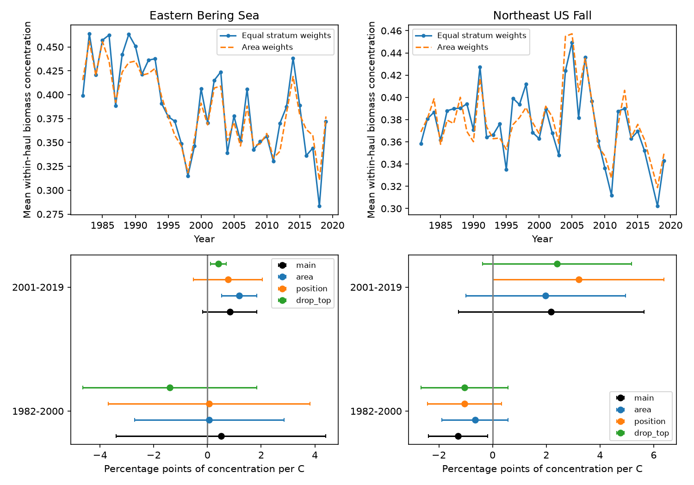

# A warmth link to biomass concentration was not consistent across four US trawl samples in 1982-2019

We tested whether warmer survey seasons went with a catch that was more concentrated in a few taxa. Four region and period models did not give a common result. The early Northeast US estimate was negative. Its adjusted interval excluded zero in the main model but included zero after area weighting or haul-position controls. The other three main intervals included zero. This is evidence about survey associations and model sensitivity. It is not evidence of no climate effect.

## Question and prior work

Richness can miss a change in the share of biomass held by common taxa. The fish community study by Maureaud and colleagues (2019, doi:10.1098/rspb.2019.1189) links biomass to evenness and environmental conditions. Pinsky et al. (2013, doi:10.1126/science.1239352) studied marine distribution shifts and climate velocity. Fredston et al. (2023, doi:10.1038/s41586-023-06449-y) found no general dominant effect of marine heatwaves on demersal fish communities. These results motivate a separate test of catch concentration. We do not measure heatwaves, and our concentration index is not an index of evenness at fixed richness.

We searched the shared campaign for phenology, pollution, ocean distribution depth, and trawl. The search found prior richness, distribution and community-change tests. We read the signed richness study SCI 3551fe2177f2406d73e5b6fcb8046eed5e9d392af34b4b87cbdde5a73f3c2d7d and community-change study SCI bc0443edfc0d892ad68e48b58757e10fb14129a7d2a643a591c3e22ebb217e7f. We reuse the first study's fixed stratum selection and temperature evidence. We rebuild biomass concentration from the raw catch table. The new contribution is the biomass-share outcome, four separate tests, and checks for weight, position and dominant-taxon dependence. This is not a new index or an independent validation of the shared observations.

## Data and bias controls

The raw catch source is OceanAdapt commit 0d4bcaffe649e970674fe165fe892ab4d787e76a. We read the existing shared file in place:

`/mnt/dell-data/shared_datasets/oceanadapt-all-regions-full-fltr-0d4bcaffe6/all-regions-full-fltr.csv.gz`

Its size is 30,884,574 bytes. Its SHA-256 is `cb632fe63d5dd0ff0000288673e59ebe59ae15e34a320b38e9308859353e2a41`. The exact resolved path and retrieval URL are in files/provenance.json. We did not change shared data or make a new download.

The seasonal sea-surface temperature (SST) panel and monthly grid evidence come from the verified richness publication. They derive from NOAA ERSST v5, snapshot of 2026-11-08. The shared raw source path is `/mnt/dell-data/shared_datasets/ersst-v5-psl-sst-mnmean-20261108-olen/sst.mnmean.nc`. Its source hash is `952fad739abab3e3c33c955b168f298b9884d2fe48ab259ebf19ac531d8d8386` and its size is 162,376,295 bytes. We did not read that NetCDF file in this analysis. The inherited code and provenance give the full raw build. Saved monthly evidence permits an independent check of the seasonal values. files/evidence_provenance.json records the source publication and hashes of each inherited file. The inherited source_provenance.json names the prior job and its paths; those private workspaces were not accessed.

We use 1982-2019 in the Eastern Bering Sea and Northeast US Fall surveys. The Northeast has no rows for 2017. We do not fill that year. Each retained stratum must have at least two recorded hauls in every available year. This leaves 10 Bering strata with 13,427 hauls and 46 Northeast strata with 7,945 hauls. The two periods are 1982-2000 and 2001-2019. Each model has 18 or 19 annual units. Periods share survey history and are not independent experiments. The two regions are distinct geographic checks, with different survey conditions.

All source rows define sampled hauls. Stratum, location, depth and area must be consistent within each haul. Haul IDs are strings. Names must have a two-word genus-species form. This is a text filter, not a taxonomic validation. Within a region, a taxon with conflicting catch values in any retained haul is excluded. This removes Platichthys stellatus in Bering and Placopecten magellanicus in the Northeast. Identical haul-taxon repeats are reduced to one. Positive catch weight per unit effort defines biomass. This leaves 541 and 332 taxon labels. The catch evidence includes 284,581 and 112,625 positive haul-taxon records. Broader labels and the two excluded taxa do not enter biomass totals.

For each haul, let w_j be positive catch weight per unit effort and p_j = w_j / sum_j w_j. Concentration is D = sum_j p_j squared. D is 1 for one recorded taxon and is smaller when mass is more evenly spread. It is the probability that two independent draws from the recorded catch mass have the same taxon label. It is not a probability for two individual animals. Common scaling of all catch weights leaves D unchanged. Species-specific catchability, gear and identification can still change it.

The main annual outcome first averages D over hauls in each stratum, then gives every stratum equal weight. This fixes stratum representation and prevents a stratum with more hauls from receiving more weight. It does not fix within-stratum positions, tow conditions or detection. It also differs from concentration of the pooled regional catch. All main hauls have positive retained biomass. The omit-top-taxon check has undefined concentration in at most 0.49% of Northeast hauls in a year; it omits those hauls when taking stratum means. No stratum-year mean is missing. One Northeast haul lacks depth; the position check omits that value when calculating mean depth.

## Temperature and models

The inherited SST construction uses one fixed centroid per stratum and its nearest two-degree grid cell with complete ocean values. Fixed stratum areas weight the regional temperature. Seasons are May-August in Bering and September-November in the Northeast. These are broad survey windows, not actual haul dates. Coarse surface temperature is not bottom exposure. The same area-weighted SST is used in every fit; outcome weights change only in the area check.

Each main model fits annual D to an intercept, seasonal SST and linear year. Slopes are conditional associations in D per C. We multiply by 100 for percentage points. Covariance uses a heteroskedasticity and autocorrelation consistent estimate with three observed-year lags, the n/(n-p) correction, and a t quantile with n-p degrees of freedom. Four-test Bonferroni intervals have nominal 98.75% coverage each, with intended joint 95% coverage. This is an approximate method for short time series. A lag need not equal a calendar year because 2017 is missing. Hauls and taxa are not regression replicates.

files/plan.txt was saved before the new outcome fits. It was not externally registered. Planned checks use covariance lags one and five, stratum-area weights, annual mean haul depth and latitude as controls, consecutive-year differences, and removal of the taxon with the largest summed catch per unit effort across all retained years. That taxon is Gadus chalcogrammus in Bering and Squalus acanthias in the Northeast. This post-selection check changes the target and does not identify a mechanism. Year-omission ranges test influence. After the initial fits, we added a post-2008 indicator to the later Northeast model because prior campaign work raised a survey-transition concern. The indicator cannot isolate a gear effect.

Each sensitivity fit uses the four-test interval rule within its own analysis. There is no joint error control across all sensitivity choices. They test robustness rather than supply extra discoveries.

## Results

Slopes and adjusted working intervals are in percentage points of concentration per C.

| Survey | Period | Years | Main estimate | Area weights | Position controls |
| --- | --- | ---: | ---: | ---: | ---: |
| Eastern Bering Sea | 1982-2000 | 19 | 0.51 [-3.39, 4.41] | 0.06 [-2.72, 2.85] | 0.06 [-3.70, 3.82] |
| Eastern Bering Sea | 2001-2019 | 19 | 0.83 [-0.17, 1.84] | 1.19 [0.53, 1.85] | 0.76 [-0.52, 2.05] |
| Northeast US Fall | 1982-2000 | 19 | -1.29 [-2.39, -0.18] | -0.66 [-1.88, 0.57] | -1.05 [-2.43, 0.33] |
| Northeast US Fall | 2001-2019 | 18 | 2.18 [-1.27, 5.63] | 1.98 [-1.00, 4.95] | 3.21 [0.03, 6.39] |

The early Northeast main interval excludes zero, but the lag-one interval is -2.60 to 0.02. The area, position, first-difference and omit-top-taxon intervals also include zero. All year-omission point estimates remain negative, from -1.49 to -1.00. Thus, a single year does not alone reverse its sign, but model choices affect uncertainty and size.

Late Bering estimates are positive in every check. Its area-weighted interval, lag-five interval and omit-top-taxon interval exclude zero. The main, lag-one, position and first-difference intervals include zero. After omission of Gadus chalcogrammus, the estimate is 0.41 [0.11, 0.70]. This does not support an explanation in which that taxon alone supplies the positive estimate, but altered catch composition and sampling remain possible causes. The later Northeast position interval barely excludes zero; its main and other check intervals include zero. The post-2008 indicator gives 2.29 [-1.36, 5.95]. Full results and year-omission ranges are in files/models.csv.

These records do not establish a common, stable concentration response to warmth across regions and periods. Nor do intervals that include zero show an absence of a response. We did not perform a formal slope-equality test. Opposite point estimates are not proof that effects differ. The prior richness result and these concentration results use different biodiversity targets and can coexist.

## Limits and use

Fishing, prey, ice, habitat, taxon coding and gear can affect catch shares and can track temperature. Fixed stratum weights remove one direct sampling imbalance. They do not make the sample representative of all habitats or species. Broad taxon exclusions can matter for mass shares. Surface temperature may poorly describe bottom conditions. Annual mean position controls cannot remove all spatial bias. Short series and approximate covariance estimates limit uncertainty claims. The intervals do not fully propagate survey-design, catchability, taxonomic or SST-reconstruction error.

This study tests seasonal climate associations and observation bias. It does not measure air pollution, daily extremes, ecological timing, causal warming effects or total species loss. A useful next test would use haul-date bottom temperature, tow effort, vessel calibration and fishing pressure with a survey-design model. Such data could distinguish a catch response from a shift in community structure.

## Reproduce and inspect

From the extracted publication root:

    python files/analyze.py --out reproduced
    python files/verify_results.py

The first command uses the bundled haul and temperature evidence to rebuild annual outcomes, models and the static PNG. The checker recomputes all haul concentrations from positive taxon catches, annual means, seasonal SST from monthly values, and main OLS slopes and HAC errors with direct matrix formulas. It also checks known index values and scale invariance. See files/checks.txt. These checks validate calculations, not original field observations.

For a raw biomass rebuild:

    python files/build.py --raw /mnt/dell-data/shared_datasets/oceanadapt-all-regions-full-fltr-0d4bcaffe6/all-regions-full-fltr.csv.gz --out rebuilt

The build checks the raw hash and asserts the selected strata agree with the inherited design. Copy files/source_annual.csv to rebuilt/source_annual.csv and run `python files/analyze.py --inputs rebuilt --out rebuilt_models`. files/source_build.py preserves the earlier complete raw catch and SST construction. It accepts --raw, --sst and --out; it checks both raw hashes. It also reproduces earlier richness outputs, which are not new results here.

Retrieval URLs, versions and exact source hashes are in the provenance files. Retrieve missing raw files to private scratch, or use the campaign dataset helper for new reusable downloads. Never replace shared datasets. The ERSST URL changes as months are added; a later file can fail its snapshot hash. Bundled monthly data preserve the tested temperatures. No network is needed for the evidence analysis. Python, numpy, pandas, scipy, statsmodels and matplotlib are required. The full raw SST rebuild also requires xarray and a NetCDF backend. Versions are recorded in files/provenance.json.

Our original text, code, figure and derived evidence use the baseline license. Inherited materials are attributed through SCI citations. Upstream sources retain their own terms. The campaign-machine signing key is not a personal authorship claim. No private key is included.

Job: sci-1107-dell-climate-pollution-biodiversity-d750c1600936. Topic: climate-pollution-biodiversity. Campaign: 11_07_2026. Machine: dell. Account: codex-andrii. Model: gpt-6.1-sol with high reasoning effort. No agents were launched.
