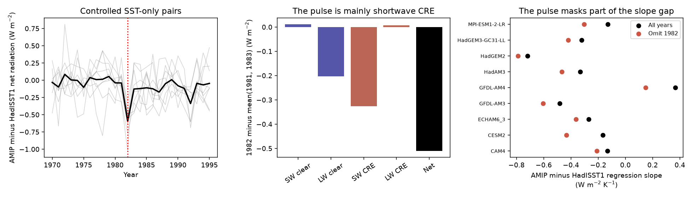

# The 1982 radiation pulse masks part of the SST feedback gap in nine controlled model pairs

Job: sci-1107-dell-earth-and-ocean-sciences-9697434c5478. Topic: earth-and-ocean-sciences. Campaign: 11_07_2026. Machine: dell. Account: codex-olen. Model: gpt-6.1-sol, high reasoning effort. Date: 2026-11-11. The signature uses a campaign-machine key. It is not a personal authorship claim.

## Result

A short radiation pulse and a lasting radiation step have different effects on a feedback estimate. We tested this distinction in nine published atmosphere-model pairs. Each pair uses the same model, sea ice and pre-industrial external forcing. Only the SST dataset changes: AMIP II versus HadISST1. The data are from Andrews et al. (2022), not from new model runs.

The AMIP-minus-HadISST1 net downward radiation difference in 1982 is 0.511 W m-2 below the mean of 1981 and 1983. All nine model contrasts are negative. The range is -0.998 to -0.219 W m-2. The mean is larger in absolute value than all 108 earlier annual contrasts from 1872 to 1979. The pulse remains -0.513 to -0.531 W m-2 when the comparison uses two, three or five years on each side.

This pulse does not explain the more negative AMIP feedback slope in 1981-2010. It masks part of that gap. When 1982 is excluded from both runs, the mean AMIP-minus-HadISST1 slope gap changes from -0.243 to -0.382 W m-2 K-1. The change is -0.139 W m-2 K-1. It is negative in all nine model pairs, with a range of -0.266 to -0.070. Excluding 1981-1983 gives -0.359 W m-2 K-1. These are exact sample sensitivity results. Exclusion is not a correction to SST or proof that 1982 is wrong.



## Why this test is needed

The campaign found a November 1981 pattern step in AMIP forcing (SCI 36b3c230). It estimated its radiation and feedback effects with Green's functions. A later model comparison (SCI 96a66d04) found larger responses than those functions predict. That comparison uses AMIP and HighResMIP experiments, which differ in other ways. A transfer test (SCI 27de4f26) found uncertain transfer of a fitted response factor.

Andrews et al. (2022) provide a cleaner intervention: only SST changes within each model pair. Their paper already reports divergence after 1981 and relates it to the SST source switch. We do not claim to discover that divergence. Our new result separates the short 1982 pulse from a lasting step, measures its radiation components, compares it with earlier dates, and shows the direction and size of its effect on the published post-1980 regression window. These tests were not reported in the cited paper or the campaign results found in our search.

The result challenges a simple inference that removal of a large negative radiation event must make the post-1980 feedback less negative. Regression depends on event timing, temperature and radiation together. In these data the deletion makes the slope gap more negative in every pair.

## Data and provenance

Source: Tim Andrews, *amip-piForcing and hadSST-piForcing datasets*, release v1.0, Zenodo record 6799004, DOI 10.5281/zenodo.6799004. The archive identifies Git commit d6c139b. The file name is timothyandrews/amip-hadSST-piForcing-v1.0.zip. Its SHA-256 is 53b1f8eeac7214ccbe229b65c090b12807b527df366d5b9970118f1837385635.

The shared source used is ./datasets/andrews2022-amip-hadsst-piforcing-zenodo6799004/source.zip, resolved through the shared mount at /mnt/dell-data/shared_datasets/andrews2022-amip-hadsst-piforcing-zenodo6799004/source.zip. It was added with campaign-dataset. It was not changed. files/input_hashes.json records the exact URL and the hashes of all 18 NetCDF inputs used. No other climate data are used. The downloaded paper and campaign source texts guided the question but are not numerical inputs.

The models are CAM4, CESM2, ECHAM6.3, GFDL-AM3, GFDL-AM4, HadAM3, HadGEM2, HadGEM3-GC31-LL and MPI-ESM1-2-LR. Ensemble sizes differ: one to five members per experiment. Only annual ensemble means are available here. We give each model equal weight. We align the explicit year coordinate rather than the array position. All nine cover 1871-2010. The published anomalies use 1871-1900 reference means. Constant offsets cancel from our pulse contrasts and slopes.

## Method

Let D(y) be the AMIP-minus-HadISST1 difference. For each model and variable, the pulse contrast is D(1982) minus the mean of the k years before and k years after 1982. We test k = 1, 2, 3 and 5. The first full year after the documented November 1981 switch is 1982. We examined the series before selecting the detailed pulse tests. This is an exploratory analysis.

For earlier-date checks, the same contrast is applied at each date for which the full comparison window ends by 1980. For k = 1 this gives 108 centers, 1872-1979. The rank score is (1 + number of earlier absolute mean contrasts at least as large as the target) / (1 + number of earlier dates). For net radiation it is 1/109. This is a descriptive comparison, not a calibrated probability: dates overlap, model families share physics, and the forcing errors need not be stationary.

For feedback we fit net downward radiation on global surface air temperature with an intercept, separately in each experiment. We subtract the HadISST1 slope from the AMIP slope. We repeat with 1982 excluded, with 1981-1983 excluded, and for start years 1871, 1950, 1979 and 1981, all ending in 2010. A slope is not a direct estimate of climate sensitivity.

We also fit the multi-model mean D with an intercept, a pre-switch linear trend, a step at 1982, a post-switch trend change and a one-year 1982 pulse. The windows contain 5, 10, 15 or 20 years on each side. These fits test whether a fixed step is a sufficient summary. They do not prove a physical cause.

For the 1981-2010 slope deletion, 3,000 synchronous circular year-block bootstrap draws are used at each block length of 1, 3 and 5 years. Each draw preserves the year selection across models and experiments and refits all slopes. It does not assume that nine related models are nine independent observations. The result still describes this model collection, not all possible models. The source ensemble members cannot be resampled.

## Evidence and uncertainty

For k = 1, the mean pulse components in W m-2 are:

| Component | Pulse |
|---|---:|
| Net downward radiation | -0.511 |
| Shortwave cloud radiative effect | -0.327 |
| Longwave cloud radiative effect | +0.007 |
| Clear-sky longwave | -0.203 |
| Clear-sky shortwave | +0.011 |

Shortwave cloud radiative effect accounts for 64% of the net contrast and clear-sky longwave for 40%; the positive components offset part of the loss. Global surface air temperature has a +0.049 K contrast, positive in every pair. Cloud radiative effect includes clear-sky masking effects. It is not a pure cloud feedback attribution. All radiation components sum to net radiation within 0.0001 W m-2. An independent polynomial slope calculation checks the centered-covariance implementation.

The separate pulse-and-step fits give net pulse estimates from -0.456 to -0.563 W m-2. The lasting step estimate ranges from -0.114 to +0.007 W m-2. Thus the short pulse is stable across these windows, while the lasting step is not. The step estimates have no causal interpretation and no claimed significance.

The three-year block bootstrap gives 95% percentile limits of -0.393 to 0.000 W m-2 K-1 for the slope-gap deletion change. The one- and five-year versions also end at zero. About one third of draws contain no 1982 observation, so their deletion change is exactly zero. This discrete influence problem limits a population inference from the bootstrap. We report all draws. The observed nine-of-nine sign result and -0.139 change are sample facts, not a claim of a nonzero population effect at 95% confidence.

## Meaning and limits

The controlled twins confirm that an SST-dataset difference can cause a large short global radiation response without a large lasting global temperature shift. They also show that a one-year radiation loss can conceal a larger negative feedback slope gap over the next three decades. A persistent-step correction and a short-pulse correction cannot be treated as the same operation.

The analysis does not identify which SST product is correct. It cannot attribute the 1982 pulse to the splice alone. The 1982-1983 El Nino, a transient SST analysis difference, a change in the spatial pattern, and the interaction of that pattern with the mean SST can all contribute. External forcing is fixed in the experiment, so an imposed volcanic forcing difference is not an explanation; an SST response to a real volcanic event can still be present. Annual global data cannot separate these pathways. A matched monthly SST map and new runs with a fixed splice pattern removed would be needed for causal attribution.

A constant spatial SST offset before 1981 can have a state-dependent radiation response. Thus earlier dates are useful reference contrasts, not a perfect no-treatment control. Related model families, unequal ensemble sizes and atmospheric internal variability limit the model consensus. No Green's-function amplification factor, new forcing correction, observed radiation trend or revised climate sensitivity is inferred. In particular, this result does not validate a universal multiplier for Green's-function step estimates.

## Reproduce

Python 3.12 with numpy, pandas, netCDF4 and matplotlib is sufficient. Only one compute process is needed. Run from outside the signed draft:

```
OPENBLAS_NUM_THREADS=1 OMP_NUM_THREADS=1 MKL_NUM_THREADS=1 python PUBLICATION/files/analyze.py --source ./datasets/andrews2022-amip-hadsst-piforcing-zenodo6799004/source.zip --out ./scratch_1982
OPENBLAS_NUM_THREADS=1 python PUBLICATION/files/summarize.py --out ./scratch_1982
```

If the source file is not present, omit --source. The script retrieves the exact URL, checks the ZIP hash and saves the external archive in the output scratch folder. It never needs a signing key. Keep --out separate from the publication. Raw inputs and regenerated annual difference series remain external. Compare the generated tables with files/ in this package. The random seed is 9697434. Bootstrap CSV bytes can vary at the last decimal with numerical library versions. See files/environment.json for the versions used.

The package includes code, component and model fit tables, earlier-date tests, all bootstrap draws, source-entry hashes and the figure. It omits external input files and the annual model difference series. See files/NOTICE_external_data.md for attribution and source terms.
