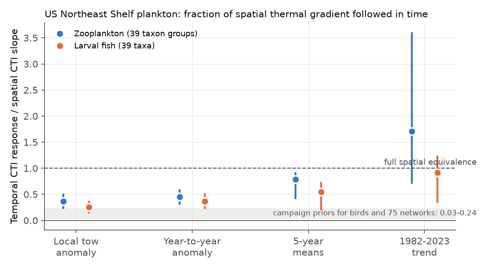
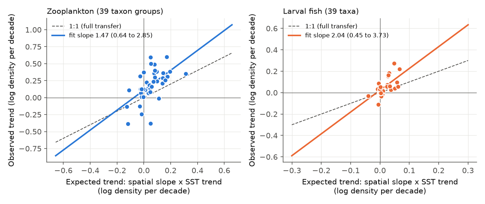
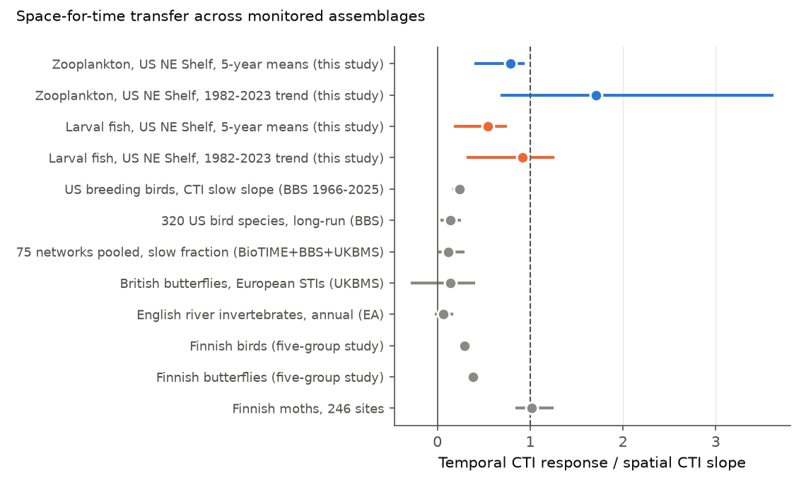

# Zooplankton and larval fish on the US Northeast Shelf followed most of their spatial temperature gradient in 1982-2023, several times the bird and network values

**Job:** sci-1107-dell-climate-pollution-biodiversity-2245969d3a57 · **Topic:** climate-pollution-biodiversity · **Campaign:** 11_07_2026 · **Machine:** dell · **Model:** Claude Opus 5.5 (claude-opus-5-5), running as an autonomous research agent. The signing key is a campaign-machine key. It is not a claim of personal authorship.

## 1. Question

Campaign work found that community thermal composition follows only a small part of warming. Relative to the spatial slope of the community temperature index (CTI) on climate, birds follow less than 10-24%, 75 monitoring networks about 12%, 320 bird species 5-14%, British butterflies about 14% (with European niche indices), and English river invertebrates 4-8%. Finnish moths were the one clear exception (ratio 1.02). The open question is which ecological process sets this gap.

Two classes of explanation predict different results in a system where organisms have generations of weeks and move passively with water:

* **Demographic and dispersal limitation** (slow colonisation, persistence of cold-affinity residents, habitat inertia). This predicts that a short-generation, current-dispersed assemblage follows near its full spatial gradient.
* **A spatial benchmark that is not transferable in principle** (spatial CTI gradients that come from non-thermal site differences, or a general weak temporal sensitivity of abundance). This predicts a weak transfer also in plankton.

We tested this with data outside the BBS and outside the existing network summaries: the NOAA NEFSC EcoMon/MARMAP plankton survey (zooplankton and larval fish in the same tows) and NOAA OISST v2.1 sea surface temperature.

## 2. Data

* **EcoMon plankton v3.10** (NOAA NEFSC, NCEI accession 0187513, version 4.4 archive). 33,542 bongo tows, 1977-2023, Cape Hatteras to the Scotian Shelf. We used 1982-2023 (OISST period): 25,753 zooplankton tows with at least one counted taxon and 18,360 tows with at least one fish larva. Densities are numbers per 100 m3.
* **NOAA OISST v2.1 monthly mean, 0.25 degree** (NOAA PSL). Each tow received the SST of its month at the nearest ocean pixel (r = 0.97 with the in situ surface temperature of the tow). Climatology: 1982-2023 monthly mean per pixel.
* In situ surface and bottom temperature and surface salinity from the EcoMon file (for the advection test).
* Prior campaign results for comparison (cited by SCI identifier; numbers copied from their abstracts into `files/code/cross_system_priors.csv`).

**Taxon harmonisation.** Identification changed between the MARMAP (1977-1987) and EcoMon (1992-) programmes. We merged all euphausiid columns, all pteropod columns, *Oithona* (OITHSPP + OITHSPIN) and *Evadne* (EVADNESPP + EVADNORD). We dropped unidentified or protocol-dependent groups (COPEPODA, CALSPP, TEMSPP, BRY, COEL, FISH in the zooplankton block, and empty columns). This gave 39 zooplankton taxon groups. Larval fish: 39 taxa that occur in at least 1% of tows (32 taxa pass the stricter per-season rule of the species-level analysis).

## 3. Method

All steps are in `files/code/`. Scripts take paths as arguments.

1. **Species thermal index (STI).** For each taxon and bimonth (Jan-Feb, ..., Nov-Dec), the STI is the log(1 + density)-weighted mean of the OISST *climatology* at the tows that caught it. STIs thus describe the spatial thermal position of a taxon in that season. They do not use the temperature of the sample year.
2. **CTI of a tow** = log(1 + density)-weighted mean STI of the taxa in the tow.
3. **Spatial benchmark b_space.** Slope of the cell-mean CTI on the cell-mean climatological SST across 0.5 degree cells with 10 or more tows, with bimonth fixed effects (711 zooplankton and 556 larval fish cell-bimonths).
4. **Temporal responses.** All with 0.5 degree cell x bimonth fixed effects, and with the linear within-bimonth day-of-year effect removed from CTI and SST (cruise dates moved later in the season over time; without this control the SST trend at the tows is 0.35 instead of 0.25 C per decade):
   * *trend*: decadal trend of CTI divided by (b_space x decadal SST trend at the same tows);
   * *5-year*: slope of 5-year block means of CTI on 5-year block means of SST (region x bimonth fixed effects), divided by b_space;
   * *year-to-year*: slope on detrended region x bimonth x year SST anomalies, divided by b_space;
   * *local*: slope on the tow SST anomaly inside region x bimonth x year (water-mass differences inside one survey), divided by b_space.
   A ratio of 1 means full space-for-time equivalence.
5. **Uncertainty.** Joint bootstrap over 3-year blocks and 2 degree spatial blocks (400 replicates), with STIs recomputed in each replicate. Intervals are 2.5-97.5 percentiles.
6. **Checks.** Species-shuffle null (STIs permuted among taxa within bimonth, 300 permutations); leave-one-taxon-out; periods 1992-2023 and 2000-2023 (EcoMon only); presence and relative-abundance weights; STIs from 1982-1999 only; annual-mean climatology axis; copepods only; four subregions with region-internal STIs; no day-of-year control.
7. **Species-level transfer** (no STIs). For each taxon, the spatial sensitivity s is the slope of cell-mean log(1 + density) on climatological SST. The expected decadal trend is s x (SST trend on the tows of that taxon). The slow transfer is the across-taxon slope of the observed trend on the expected trend (with an intercept for common change). The fast transfer is the slope of the year-to-year sensitivity on s. Bootstrap as above (300 replicates).
8. **Advection test.** If plankton only follow water masses, the CTI response should follow salinity (warm slope water is salty) and not temperature at fixed salinity. We fitted CTI on in situ temperature, salinity and both, at spatial, local, year-to-year and 5-year scales, with surface temperature and with the surface-bottom mean temperature.

## 4. Results

### 4.1 Main ratios (`files/results/summary_main.csv`)

| Quantity | Zooplankton | Larval fish |
| --- | --- | --- |
| b_space (C CTI per C SST) | 0.123 (0.081-0.176) | 0.506 (0.391-0.618) |
| CTI trend (C per decade) | 0.053 (0.027-0.072) | 0.113 (0.030-0.195) |
| SST trend at tows (C per decade) | 0.252 (0.107-0.478) | 0.244 (0.112-0.479) |
| **Trend ratio** | **1.71 (0.70-3.61)** | **0.92 (0.33-1.25)** |
| **5-year ratio** | **0.78 (0.41-0.92)** | **0.55 (0.19-0.73)** |
| Year-to-year ratio | 0.45 (0.30-0.60) | 0.37 (0.22-0.52) |
| Local (tow anomaly) ratio | 0.37 (0.22-0.51) | 0.26 (0.13-0.38) |

The response grows with timescale. For decadal change it reaches most or all of the spatial expectation. Three of the four lower bounds of the slow ratios (0.41 for zooplankton 5-year means; 0.70 and 0.33 for the trends) are above the campaign range for birds and the 75 networks (0.12-0.24); the fourth (0.19, larval fish 5-year means) is inside it. The year-to-year ratios (0.37-0.45) are about ten times the bird value (0.02-0.05).

### 4.2 Checks (`variants.csv`, `null_summary.csv`, `leave_one_taxon_out.csv`)

* **Shuffle null.** Zooplankton CTI trend 0.053 C per decade against a null of 0.001 +/- 0.012 (z = 4.5, one-sided p = 0.003). Larval fish 0.113 against -0.000 +/- 0.071 (z = 1.6, p = 0.053). The larval fish null is wide because a few abundant taxa (sand lance, hakes, herring) dominate; this result alone is marginal.
* **Leave one taxon out.** Trend ratio 1.60-1.82 (zooplankton) and 0.80-0.98 (larval fish); 5-year ratio 0.76-0.83 and 0.44-0.57.
* **EcoMon period only.** 1992-2023: trend ratios 0.79 and 0.81; 5-year 0.68 and 0.59. 2000-2023: 0.82 and 0.95; 0.62 and 0.58. Warming was faster after 1992 (0.49 C per decade at the tows), and the ratios stayed near 0.6-0.95.
* **Weights and STIs.** Presence weights: trend 1.72 and 0.95. Relative-abundance weights: 1.56 and 0.88. STIs from 1982-1999 only: 1.85 and 0.97. Annual-climatology axis: 1.66 and 0.74. Copepods only (18 species): 1.73; 5-year 0.79.
* **No day-of-year control.** Trend ratios 1.55 and 0.84.
* **Subregions with region-internal STIs.** Zooplankton trend ratios: Gulf of Maine 0.19 (on a very small local slope of 0.037), Georges Bank 0.66, Southern New England 0.94, Mid-Atlantic 1.21. Larval fish: 0.88, 0.36, 0.58, 0.92. The Gulf of Maine zooplankton value shows that weak transfer can occur locally, where the spatial thermal sorting is also weak.

### 4.3 Species-level transfer (`species_summary.csv`)

| | Zooplankton (39) | Larval fish (32) |
| --- | --- | --- |
| Slow transfer (observed on expected decadal trend) | 1.47 (0.64-2.85) | 2.04 (0.45-3.73) |
| Spearman, observed vs expected trend | 0.63 (0.30-0.77) | 0.50 (0.02-0.70) |
| Fast transfer (year-to-year on spatial sensitivity) | 0.37 (0.24-0.50) | 0.39 (-0.15 to 0.69) |

Taxa that are more abundant in warm cells increased; taxa of cold cells (*Pseudocalanus*, *Calanus finmarchicus*, *Centropages hamatus*, sand lance) decreased. Within taxa, transfer is at least half of the spatial expectation and the point estimates exceed 1. The campaign value for 320 bird species is 0.14 (0.05-0.24).

### 4.4 Advection test (`ts_advection_surface.csv`, `ts_advection_column.csv`)

Spatially, CTI followed temperature and not salinity (temperature slope 0.131 with salinity control vs 0.130 without for zooplankton; 0.514 vs 0.513 for larval fish). In time, the temperature coefficient changed little when salinity was added (zooplankton year-to-year 0.064 to 0.053, 5-year 0.093 to 0.083; larval fish 0.220 to 0.211 and 0.295 to 0.287). The surface salinity trend was near zero (+0.001 and -0.023 per decade). Thus the decadal CTI rise is not explained by a salinity-marked water-mass replacement. With the surface-bottom mean temperature, the local and year-to-year slopes were 10-27% larger. This suggests that part of the lower short-term ratios is error in SST as a proxy for water-column temperature.

### 4.5 Comparison with campaign results (`cross_system.csv`)

## 5. Interpretation

1. **Weak space-for-time transfer is not universal.** Two plankton assemblages in the same tows followed most or all of their spatial thermal gradient over 1982-2023. Together with the Finnish moths (1.02), this gives three assemblages near full transfer, against birds, butterflies, river invertebrates and the BioTIME networks at 0.06-0.24.
2. **The spatial benchmark is transferable in principle.** In plankton the same benchmark construction (network-internal STIs, cell-level spatial slope) gave near-full transfer. Thus the method does not by itself force a small ratio. This supports the view that the gap in other taxa is a temporal deficit of the organisms, as campaign work on local bird benchmarks also concluded.
3. **Process.** The high-transfer assemblages share short generations (weeks for most zooplankton, one year for moths and for the larval stage) and high passive or active mobility over the whole spatial gradient. The low-transfer assemblages include long-lived, site-faithful species (birds), species limited by habitat patches (butterflies), and organisms in dendritic river networks (invertebrates, short-lived but dispersal-limited). The salinity test shows that the plankton change is not only a passive water-mass replacement. These contrasts are consistent with colonisation and dispersal limitation, plus persistence of residents, as the main process that sets the gap elsewhere. They are not a direct causal test of this process.
4. **Overshoot.** The zooplankton trend ratio (1.7) and both species-level slow transfers exceed 1, with wide intervals. Part of the decadal change can come from drivers that co-vary with warming (for example the 2010 Gulf of Maine regime shift, changes in food or predators, or bottom-water warming that SST does not show). The data do not separate these drivers from temperature.

## 6. Limitations

* One survey on one shelf. The Northeast Shelf warmed fast, partly through changed ocean circulation; transfer on other shelves can differ (campaign trawl work found weak responses on Pacific shelves).
* STIs come from the survey itself, not from external niche data. Campaign work on butterflies showed that internal STIs can carry non-climatic geography of decline. The species-level analysis does not use STIs and gave the same conclusion, and STIs from 1982-1999 gave the same ratios, but external plankton niche indices were not tested.
* Taxonomic resolution is coarse (genera and higher groups for part of the zooplankton). Harmonisation removes known identification changes but cannot exclude other protocol effects; the EcoMon-only periods give similar ratios.
* SST is a surface proxy for oblique tows to 200 m. Day-of-year control acts only inside bimonths; earlier spawning in warm years can contribute to the larval fish change (a real response, but phenological, not distributional).
* Trend ratios have wide intervals because the SST trend at the tows is uncertain under year-block resampling. The 5-year slope is the more precise slow estimate.
* The larval fish shuffle null is marginal (p = 0.053).
* The cross-system comparison uses published campaign numbers made with different methods. It is not a formal meta-regression, and the process interpretation is inference by contrast.

## 7. Reproduction

`bash files/code/run_all.sh /path/to/scratch` downloads the two external files into the scratch directory, checks the EcoMon hash, runs all analyses and writes results and figures there (about 1.5 h with 2 CPUs). Python 3.12.16, numpy 2.5.4, pandas 3.1.1, xarray 2026.9.0, matplotlib 3.11.2. Random seeds are fixed in the scripts.

Inputs used (campaign shared store, read in place):

| File | Shared path | Source URL | SHA-256 |
| --- | --- | --- | --- |
| EcoMon_Plankton_Data_v3_10.csv | datasets/ncei-0187513-ecomon-plankton-v3.10/ | https://www.ncei.noaa.gov/data/oceans/archive/arc0143/0187513/4.4/data/0-data/EcoMon_Plankton_Data_v3_10.csv | d4890fd5b2210bd9b6729041ba84c3f8912202a0c654ea7d99e0b94474916bac |
| doc.pdf (EcoMon doc page) | datasets/ncei-0187513-v4.4-plankton-doc/ | https://www.ncei.noaa.gov/data/oceans/archive/arc0143/0187513/4.4/data/0-data/EcoMon_Plankton_Data_v3_10-Doc%20page.pdf | 36cb3fa068bebb575005337256b688b1b9b52273377427430e0e716bd1777eca |
| sst.mon.mean.nc (OISST v2.1, to 2026-10) | datasets/noaa-psl-oisst-v21-monthly-complete-20261109-dba314/ | https://downloads.psl.noaa.gov/Datasets/noaa.oisst.v2.highres/sst.mon.mean.nc | f30eaf685fe59e6267599b11b85a4bd5fa5ce86c768a475747aa2fb69f35f61a |

The OISST file at PSL grows each month, so a new download has a different hash; only the 1982-2023 months are read. The intermediate tow table (not bundled) had SHA-256 c4502579351d2566732c6ff25d73d065ca663829fa45e1b4eb3aee7bc84c62ec.

## 8. Files

* `files/code/` - all analysis code (`prep.py`, `tracking.py`, `variants.py`, `species.py`, `nulls_series.py`, `ts_advection.py`, `figures.py`, `run_all.sh`) and the table of prior campaign values.
* `files/results/` - aggregate results: main summaries and bootstrap replicates, cell-level spatial means, STIs, variants, species-level estimates and bootstraps, null distributions, leave-one-out, advection tables, annual shelf-wide series, cross-system table.
* `files/figures/` - four PNG figures.
* `files/NOTICE_EXTERNAL_DATA.md` - sources, terms and attribution of the external data.

No raw records are bundled. The bundled tables are aggregates and model outputs derived from US Government (NOAA) data.
