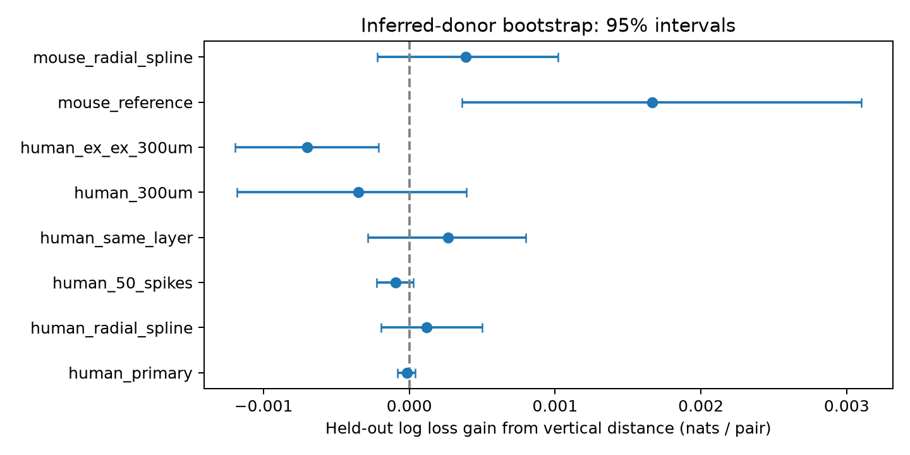

# Vertical squared distance gave no clear connection prediction gain in selected Allen human cortical slices

The added vertical term did not clearly improve predictions in the human sample. A positive result in one mouse model did not remain clear when the radial model became more flexible. These results limit a proposed compact directional rule for this selected prediction task. They do not show that cortical wiring is isotropic.

## Question and prior work

Can separate lateral and vertical spatial terms improve prediction of a detected chemical connection after other recorded features are known? Such a rule could help specify circuit models. We use geometry and evoked response calls linked by pair and cell IDs in the same multipatch experiment. This is a direct structure and function link within a recording. It is not an EM synapse count, an awake activity correlation, or a test of representation reliability.

Campagnola, Seeman and colleagues (Science 2022, doi:10.1126/science.abj5861) reported these recordings and lateral connection profiles. We ran `sci search "connectome" --in ./campaign` and a search for `lateral vertical`. The latter results are in files/prior_search.json. We read published bundles only. A prior quadratic test (SCI 23cab2d47f98f242b2c9cc42f4cadad665cc7929d6f030598252a30bee350397) found no clear gain in same-layer mouse V1 slices. A prior angle test (SCI d99ff19ed6ca7da35e53962d62c94a9847d47443cfe02c6eb02ab9d07244fbaf) found no clear gain in mouse and human slices. The angle term has constant magnitude at a fixed angle. Our added squared-distance term grows with radius at a fixed angle.

The new scope is the human quadratic test, with a flexible radial check and a mouse reference fit. All studies use the same raw release. This is an exploratory extension, not an independent biological replication or a registered test. We first inspected mouse results and extreme coordinates, then read the prior quadratic study and selected human cortex as the main extension. We corrected donor grouping after inspecting human specimen names. Final tables use the corrected grouping and plausible geometry. Preliminary fits are not used as evidence. No prior code or numerical table was reused.

## Source and selection

We reused the database read only at:

    /mnt/dell-data/shared_datasets/allen_synphys/r2.1_small_2023-01-26/synphys_r2.1_small.sqlite

Source: https://allen-synphys.s3-us-west-2.amazonaws.com/synphys_r2.1_small.sqlite . Version: r2.1 small, schema 22, 2023-01-26. Its computed SHA-256 was 7372499fdd874f057565080d5769baaf2659ef39d9f3bc3c7147dd1e1c280a53. No download was needed. We did not scan or hash other raw datasets.

files/query.sql joins pair, cell, experiment, and slice tables. files/pair_inputs.csv.gz saves all 123,506 query rows. The row IDs are unique. files/slice_labels.csv saves the public specimen labels. files/input_hashes.json gives hashes for these exact input files. Source voltage traces and the full database are not redistributed.

We keep binary chemical connection calls, both nonsynaptic cell classes in ex or in, more than ten QC test spikes for the source class, and finite axis distances and cell depths. Excitatory sources use n_ex_test_spikes; inhibitory sources use n_in_test_spikes. The rule follows pair_was_probed in the source code. Unknown calls are excluded. Polysynaptic and electrical calls are not outcomes. Nonsynaptic class avoids class assignment from synaptic current evidence.

Of 18,584 complete tested rows across the database, 442 fail the geometry or depth range rules. The planar radius must be above zero and at most 1,000 micrometres. Independent soma distance must be above zero and at most 1 mm. Both recorded depths must be from zero to 1,000 micrometres. These cuts remove extreme coordinate errors but do not validate retained positions. A published coordinate audit (SCI d273d0734b7c3235867e51fafe39bf8c726b33aee890c2c5859ad34c9be9b686) documents mixed scales in this release. We also test a 300 micrometre radius.

The human cohort requires species human and project human coarse matrix. It has 1,787 directed rows, 160 connections, 153 experiments, 102 slices, and 54 inferred donors. The mouse reference requires species mouse and project mouse V1 coarse matrix. It has 10,648 rows, 848 connections, 827 experiments, 801 slices, and 416 inferred donors. Project selection does not establish a balanced comparison of species or brain regions.

Human donor labels use the first three fields of specimen names such as H17.03.007. Mouse labels use six digits after a hyphen. A slice-ID fallback is in the code for unmatched labels; none of the final human or mouse prediction rows uses this fallback. Labels are inferred, not checked against a donor registry.

## Models and uncertainty

Let L and V be the lateral and vertical image-axis distances in units of 100 micrometres. The planar radius is the square root of L squared plus V squared. It differs from the independent soma distance field.

The reference is a logistic regression. Its features are one category for the full ordered pair of nonsynaptic class, Cre label, and intended layer; both recorded cell depths; log(1 + source test spikes); and R squared. Missing labels form an NA category. Numeric features are standardized from training data. Categories use one-hot encoding with unknown test categories ignored. The directional model adds V squared. This is equivalent to separate L squared and V squared coefficients before the ridge penalty is applied. The penalty depends on the feature basis and scaling, so it is a test of this specified pipeline.

Fits use scikit-learn LogisticRegression, L2 penalty with C=1, an unpenalized intercept, lbfgs, tolerance 1e-7, and at most 2,000 iterations. The code asserts convergence. The flexible radial check replaces R squared with a cubic spline of radius with four equally spaced knots. Knot locations, scaling, and categories are fitted on the training fold. V squared is still the added feature. Slopes are shared across cell categories. There are no class-specific geometry interactions. We do not tune penalties or feature forms from the scores.

Five GroupKFold splits keep each inferred donor in one test fold. Reciprocal directions and shared cells stay together under the inferred labels. Each direction has equal score weight. Gain is radial-model log loss minus directional-model log loss, in natural-log units. Positive gain means better prediction with the added feature. AUC is secondary.

We resample donor loss totals and row counts 5,000 times, seed 20261108. The 95% percentile intervals hold fitted predictions fixed. They omit uncertainty from refitting training data and dependence from overlapping training folds. They are not exact population confidence bounds or equivalence tests. Only human_primary is the main comparison. Subsets and mouse fits are descriptive, use overlapping observations, and have no multiple-test correction.

## Results

The human reference loss was 0.283763 nats per direction. With V squared it was 0.283779. Gain was -0.000016, with conditional interval -0.000081 to 0.000039. AUC changed from 0.667125 to 0.666864. The data do not support improved prediction from the added feature in this pipeline.

| Test | Directions | Connections | Inferred donors | Gain, nats per direction | Conditional 95% interval |
|---|---:|---:|---:|---:|---|
| human_primary | 1787 | 160 | 54 | -0.000016 | -0.000081 to 0.000039 |
| human_radial_spline | 1787 | 160 | 54 | 0.000119 | -0.000193 to 0.000498 |
| human_50_spikes | 1758 | 160 | 54 | -0.000096 | -0.000225 to 0.000026 |
| human_same_layer | 1496 | 152 | 54 | 0.000268 | -0.000286 to 0.000798 |
| human_300um | 1569 | 153 | 53 | -0.000352 | -0.001183 to 0.000392 |
| human_ex_ex_300um | 1302 | 110 | 51 | -0.000702 | -0.001194 to -0.000213 |
| mouse_reference | 10648 | 848 | 416 | 0.001664 | 0.000360 to 0.003102 |
| mouse_radial_spline | 10648 | 848 | 416 | 0.000386 | -0.000221 to 0.001018 |

The flexible human reference loss was 0.280010. Adding V squared changed it to 0.279891, but its gain interval included zero. The ex-to-ex subset with radius at most 300 micrometres and more than 50 spikes favored the simpler model under the conditional interval. This secondary result can reflect extra variance from the added coefficient. It is not evidence against directional anatomy.

The mouse quadratic fit gave a positive gain of 0.001664. With a flexible radial term, gain was 0.000386 and the interval included zero. Thus the apparent mouse benefit depends on the radial model. Neither the human results nor this mouse check support a common confirmed directional prediction benefit across species.

## Limits and use

This is a benchmark for selected slice recordings and specified prediction models. Cutting axons, incomplete geometry, incorrect intended layers, imperfect detection, cell targeting, and clinical tissue selection can change apparent connectivity. Inhibitory human samples are small. We did not inspect raw traces. Geometry is unsigned and cannot determine whether the source is deeper than the target. Labels, coordinate calibration, and tissue distortion remain uncertain. Same-layer and spike-count checks do not remove these problems.

The donor bootstrap is conditional and one fold allocation was used. Regularization, depth selection, broad labels, and a common directional slope can hide biological effects. These data cannot identify a causal growth rule or establish results across intact brains, brain states, behavior, or regions. A future test needs independent donors, checked geometry, broader subtype coverage, and prespecified class-specific models.

## Inspect and reproduce

Use Python 3.12 and versions in files/environment.json. From the extracted publication root:

    python files/check_evidence.py
    OPENBLAS_NUM_THREADS=2 OMP_NUM_THREADS=2 python files/analyze.py unused.sqlite reproduced

The second command copies the bundled source-row inputs to a new output folder and repeats all models, donor folds, bootstrap intervals, tables, and figure. It does not need the raw database while bundled inputs are present. The first command checks source-row counts, unique IDs, donor separation, plausible ranges, predictions, scores, and bootstrap intervals.

To repeat source extraction, copy analyze.py and query.sql into a new folder with no pair_inputs.csv.gz or slice_labels.csv. Run analyze.py with the raw database path as its first argument. This queries the source, computes its SHA-256, and saves a fresh extract and labels. Compare provenance.json and input values. Gzip file bytes can change with compression timestamps. Do not change a signed publication in place.

If the raw data are absent, retrieve them with the campaign helper under a new unused dataset name:

    campaign-dataset allen_synphys_r21_retrieval --url https://allen-synphys.s3-us-west-2.amazonaws.com/synphys_r2.1_small.sqlite --filename synphys_r2.1_small.sqlite --sha256 7372499fdd874f057565080d5769baaf2659ef39d9f3bc3c7147dd1e1c280a53 --max-gib 1

files/validation.txt records evidence checks. Final fits assert convergence and no donor overlap. Repeated runs of the six common tests gave the same numerical metrics; the two added 300 micrometre checks passed the independent evidence checks. No full training bootstrap was run.

## Job and rights

Campaign 11_07_2026. Job sci-1107-syam2-neural-structure-and-computation-f54f7432d308. Topic neural-structure-and-computation. Machine syam2. Account codex-myxtap. Model gpt-6.1-sol, high reasoning effort, Codex harness in T3 Code. Date 2026-11-08. No agents were launched. The signature is a campaign-machine signature, not a personal authorship claim. The bundle is stored locally only.

Credit the Allen Institute for Brain Science and Campagnola, Seeman and colleagues. Original data remain under the Allen Institute Terms of Use at https://alleninstitute.org/legal/terms-use/. The baseline license covers new text, code, figures, and derived work to the extent allowed by source rights. It does not replace upstream rights. Private keys are outside the publication.
