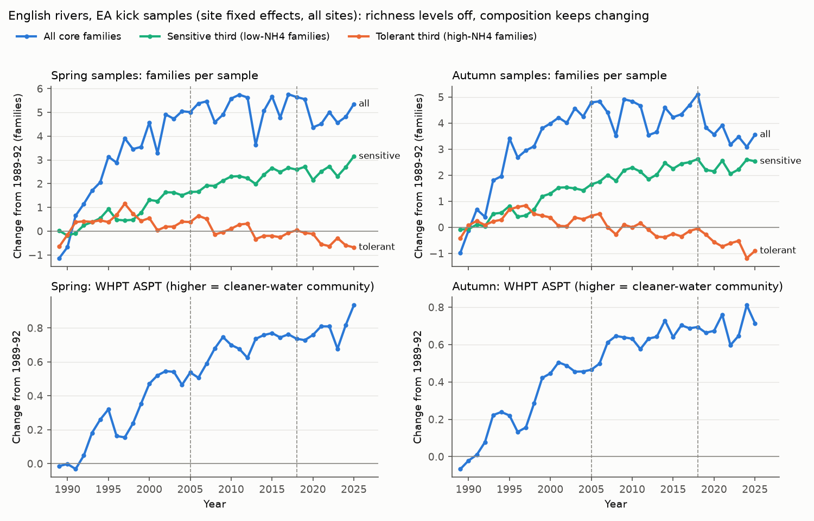
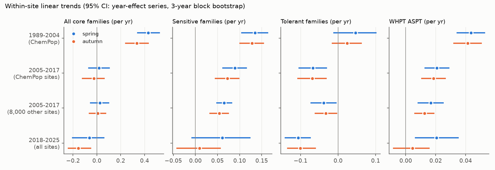
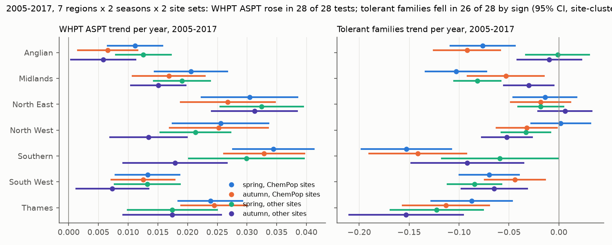

# English river invertebrate richness stopped rising after about 2001, but communities kept shifting to pollution-sensitive families to 2017 at 23,600 sites; autumn gains stopped in 2018-2025

## Summary

Freshwater invertebrate recovery in Europe "came to a halt" after about 2010 (Haase et al. 2023). English river data show the same pattern for family richness. We asked a different question: did recovery from organic pollution stop, or did only the richness count stop?

We used Environment Agency (EA) kick samples from English rivers. Two sources gave three independent tests:

- ChemPop (EIDC, 1,515 long-term sites, 1989-2017), with matched 6-month water quality, air temperature and flow.
- EA open data (2026-11-10 release) for 22,106 other sites; about 8,000 of them have samples in 2005-2017 (independent sites).
- EA open data for all sites in 2018-2025 (independent period).

We split the 100 core families into three groups by their association with ammonia in 1989-1995 (cross-fitted between two site halves). We also used the EA Walley-Hawkes-Paisley-Trigg average score per taxon (WHPT ASPT). WHPT ASPT is an external pollution index. It does not use our data to define the groups.

Main results:

1. **Richness levelled off.** Within-site family richness rose by 0.42 families per year until a break in 2001-2002 (EA, all sites; bootstrap range 1999-2004). After the break, the slope was -0.004 per year in spring (95% CI -0.044 to +0.031) and -0.043 in autumn (CI -0.079 to -0.012).
2. **Composition did not level off in 2005-2017.** At ChemPop sites, sensitive families increased by +0.089 per year in spring and +0.072 in autumn. Tolerant families decreased by -0.067 and -0.069 per year. WHPT ASPT increased by +0.021 and +0.019 per year. These intervals use a block bootstrap of national year effects and exclude zero. Total richness did not change because the gains and losses cancelled.
3. **The composition shift repeated everywhere we tested.** WHPT ASPT increased, and the community ammonia index decreased, with site-clustered 95% CIs that exclude zero in all 28 tests (7 EA regions x 2 seasons x ChemPop sites and 8,000 independent sites). The tolerant-family decrease had the expected sign in 26 of 28 tests. The results held with log-category records only, a fixed-site panel and a central sampling-date window.
4. **Sites that were still polluted kept gaining families.** From 2003-06 to 2014-17, sites in the most polluted ammonia third at the start gained +1.15 (spring) and +0.89 (autumn) families. Sites in the cleanest third lost -0.65 and -0.25 families. All three groups gained sensitive families and lost tolerant families.
5. **In 2018-2025 the pattern changed in autumn.** Richness decreased (-0.155 families per year in autumn, CI -0.238 to -0.053; spring uncertain). Tolerant families kept decreasing (-0.10 per year in both seasons). In autumn, the sensitive-family gain stopped (+0.010, CI -0.042 to +0.056) and WHPT ASPT gains stopped (+0.005, CI -0.008 to +0.016). In spring, WHPT ASPT kept increasing (+0.021 per year).
6. **Climate did not explain the plateau or the recent autumn stall.** In a post-hoc region-year test, warmer summers lowered autumn WHPT ASPT by 0.040 per 1 C (CI 0.003 to 0.077), and wetter summers lowered autumn richness. But the warmer and drier summers of 2018-2025 predicted a small richness gain (+0.22 families), not the observed loss (-0.49). They predicted an autumn WHPT ASPT loss of 0.024, which is about one third of the observed level gain from 2005-2017 to 2018-2025 (+0.071).

Thus the richness plateau in 2005-2017 does not show that recovery from organic pollution stopped. Communities kept changing toward clean-water families at about half the earlier rate. The richness count stopped rising because tolerant families disappeared as sensitive families arrived. After 2018, the autumn composition gain stopped and richness fell. Summer climate did not explain this, and its cause is still open.



## Question and context

Haase et al. (2023) analysed 1,816 European time series and reported that the recovery of freshwater invertebrates stopped after about the 2010s. They proposed that wastewater improvements had reached their limit, and that warming and new stressors limit further recovery. Qu et al. (2023) reported that English river invertebrate richness stopped rising after about 2003. Earlier campaign publications found weak links between local water-quality change and community change in the same English source (sci:e4d7fbbd, sci:859b8d0e, sci:f25760cd).

A plateau in species or family richness has two possible meanings. Recovery can have stopped. Or composition can continue to change while gains and losses cancel. These two meanings need different management responses. We tested three explanations:

- **(S) Saturation and turnover:** recovery continued as composition change, but total richness stopped.
- **(C) Climate offset:** warming or flow extremes cancelled further gains.
- **(O) Observation artefact:** changes in recording method, site set or sampling day made the plateau.

We wrote the plan (`files/PLAN.md`) after two exploratory looks, which the plan lists. All other tests followed the plan, except the climate test in section "Post-hoc climate test", which we label as post-hoc.

## Data

- **ChemPop:** Bachiller-Jareno et al. (2025), EIDC doi:10.5285/23f194b0-1e21-4f14-be9c-6eabdcc1feb7, v2.0, Open Government Licence (OGL) v3. Campaign copy `datasets/eidc-chempop-minv-english-rivers-1965-2018-v2-23f194b0/` (ZIP SHA-256 06ff765e64667a9af38cf0ae44bdd8d797480f5058a5963b5ad9a567c32a0b9e). All 91 inner CSV files that we read match the SHA-256 values in the package ro-crate metadata. We used 50,665 spring (March-May) and autumn (September-November) samples from 1,515 sites in 1989-2017, with the three main recording methods.
- **EA Ecology & Fish Data Explorer open data:** INV_OPEN_DATA.zip and OPEN_DATA_TAXON_INFO.zip (OGL v3), release file of 2026-11-10. We added them to the shared campaign store: `datasets/ea-ecology-inv-open-data-20261110/` (SHA-256 ac2b745db263d1f31d3a8f5c08dbf555469ff68fffa373ed2fd7a20e4dfa9a40) and `datasets/ea-ecology-open-data-taxon-info-20261110/` (SHA-256 f0f87858347e7060c831255487cc5562530705bff5c4df1fe45c8f932b84309b). We used river samples (WBRV), 3-minute kick-net method (S3PO), EA data only (no third-party data), and the same three recording methods. This gives 201,155 spring and autumn samples at 23,604 sites in 1989-2025. The metrics file supplies WHPT ASPT and BMWP ASPT for each sample.
- **Met Office HadUK-Grid areal series** (OGL v3): seasonal mean temperature and rainfall for England regions, "last updated 01-Nov-2026". Used only in the post-hoc climate test.

The EA analysis IDs in ChemPop are the same as in the EA open data (99.98% match). The two sources are thus one monitoring programme. The 22,106 non-ChemPop sites and the 2018-2025 period are independent of the ChemPop sample.

## Methods

**Family harmonisation (observation bias).** The EA taxon dictionary uses current taxonomy, and ChemPop uses historic family labels. We mapped taxa to families through the dictionary parent chain. We merged labels that changed over time: Limoniidae and Pediciidae into Tipulidae, Tateidae (Potamopyrgus) into Hydrobiidae, Pisidiidae into Sphaeriidae, and four spelling variants. The core list has the 100 families that occur in at least 1% of ChemPop 1991-2017 samples. For the 61,115 samples in both sources, the family count agreed exactly in 93% of samples. The mean difference by year was at most 0.11 families (`files/results/ea_vs_chempop_nfam_diff_by_year.csv`). Without the harmonisation, the difference drifted by 1 family over time.

**Ammonia tolerance groups.** For each family, tau is the mean log10 ammoniacal nitrogen of the 1989-1995 ChemPop samples that contain the family, minus the mean of all these samples. We split sites into two halves by site-ID parity. Sites in each half use tau values that we calculated from the other half. Non-ChemPop sites use tau from all ChemPop sites. Terciles of tau give the sensitive, middle and tolerant groups. The community ammonia index (CAI) is the mean tau of the families present. Tau values and groups are in `files/results/family_tolerance.csv`. The two halves gave nearly the same ranking (for example Philopotamidae -0.61 and -0.71; Naididae is the most tolerant).

**Trend models.** Each model has site fixed effects, a natural cubic spline of the sampling day (4 df) and recording-method dummies. For trends, we used a linear year term. We give two intervals:
- site-clustered standard errors (they assume independent years), and
- the slope of the national year-effect series with a circular 3-year block bootstrap (2,000 resamples). This interval includes common national year shocks. It is wider, and we use it for decisions.

**T1 (plateau).** We fitted a broken line to the national year effects, with the break year profiled over 1997-2012, and a block bootstrap of the break year and both slopes.

**T2 (main test of S).** Trends in 2005-2017 for ChemPop sites and for independent sites, by season and EA region; trends in 2018-2025 for all sites; and 1989-2004 for comparison.

**T3 and T4 (links to ammonia and climate).** Site means in three windows (W0 1989-92, W1 2003-06, W2 2014-17). Changes between windows were regressed on changes in log10 NH4-N, log10 BOD, 6-month air temperature, relative high-flow and low-flow levels, the share of count-method samples, the sampling day and EA region (HC1 errors). We also compared change by the site's NH4 tercile at the window start.

**T5 (observation).** Repeat of T2 with log-category records only, a fixed-site panel (sites with samples in at least 75% of the years), and the central 80% of sampling days. An event test estimated the change in a site's samples after its first count-method sample (site and year fixed effects).

## Results

### T1: the richness plateau is real and early

| Series | Break year (95% range) | Slope before (families/yr) | Slope after (families/yr) |
| --- | --- | --- | --- |
| ChemPop, spring 1989-2017 | 1997 (1997-1999) | +0.66 (0.50 to 0.76) | +0.061 (0.015 to 0.090) |
| ChemPop, autumn 1989-2017 | 1997 (1997-1999) | +0.58 (0.43 to 0.68) | +0.007 (-0.038 to 0.037) |
| EA all sites, spring 1989-2025 | 2002 (2000-2004) | +0.42 (0.34 to 0.53) | -0.004 (-0.044 to 0.031) |
| EA all sites, autumn 1989-2025 | 2001 (1999-2003) | +0.42 (0.33 to 0.53) | -0.043 (-0.079 to -0.012) |

The break for richness is about 1997-2002, earlier than 2010. The sensitive-family series had no clear break (break-year range 1997-2012). The tolerant-family series changed from an increase (+0.11 to +0.14 per year) to a decrease (-0.06 per year) at about 1997 (`files/results/T1_break.csv`).

### T2: composition kept changing after 2005



Year-effect bootstrap slopes per year (95% CI):

| Set, season | All families | Sensitive | Tolerant | WHPT ASPT |
| --- | --- | --- | --- | --- |
| ChemPop 1989-2004, spring | +0.431 (0.344, 0.523) | +0.135 (0.105, 0.163) | +0.046 (-0.011, 0.101) | +0.044 (0.034, 0.053) |
| ChemPop 1989-2004, autumn | +0.335 (0.241, 0.430) | +0.128 (0.101, 0.154) | +0.024 (-0.015, 0.062) | +0.041 (0.032, 0.050) |
| ChemPop 2005-2017, spring | +0.018 (-0.068, 0.104) | +0.089 (0.062, 0.115) | -0.067 (-0.104, -0.031) | +0.021 (0.013, 0.029) |
| ChemPop 2005-2017, autumn | -0.026 (-0.121, 0.061) | +0.072 (0.046, 0.098) | -0.069 (-0.107, -0.032) | +0.019 (0.011, 0.027) |
| Independent sites 2005-2017, spring | +0.025 (-0.053, 0.098) | +0.065 (0.049, 0.082) | -0.038 (-0.072, -0.006) | +0.017 (0.008, 0.025) |
| Independent sites 2005-2017, autumn | +0.008 (-0.062, 0.073) | +0.054 (0.033, 0.074) | -0.033 (-0.061, -0.004) | +0.013 (0.006, 0.019) |
| All sites 2018-2025, spring | -0.063 (-0.203, 0.059) | +0.061 (-0.008, 0.123) | -0.106 (-0.141, -0.074) | +0.021 (0.007, 0.035) |
| All sites 2018-2025, autumn | -0.155 (-0.238, -0.053) | +0.010 (-0.042, 0.056) | -0.101 (-0.134, -0.061) | +0.005 (-0.008, 0.016) |

The 2005-2017 rate of WHPT ASPT gain was about half of the 1989-2004 rate. The decision rule for S (PLAN.md) required cleaner CAI and WHPT ASPT trends in both seasons, the expected sign in at least 5 of 7 regions, and repetition in both independent sets. The 2005-2017 results met the rule in both site sets. The independent 2018-2025 period met it in spring. In autumn, the CAI trend was cleaner (CI excludes zero with site clusters; the year-effect CI touched zero), but WHPT ASPT did not increase.



### T3: polluted sites kept recovering; per-unit ammonia links did not weaken


From 2003-06 to 2014-17 (about 1,050-1,080 sites per season), only the most polluted third at the start gained families in both seasons (+1.15 spring, +0.89 autumn); the cleanest third lost families (-0.65, -0.25), and the middle third gained in spring (+0.60) and lost in autumn (-0.81). All three ammonia groups gained sensitive families (+0.64 to +1.19) and lost tolerant families (-0.38 to -1.12). At clean sites, the tolerant losses were larger than the sensitive gains, so richness fell slightly. At polluted sites, the sensitive gains were larger, so richness kept rising. This agrees with S: richness stops rising first where the pollution-related gains are complete.

In the window regressions with all covariates (smaller sample: 141-183 sites in period 2), a larger ammonia decrease predicted more families in autumn in both periods (-1.19 families per log10 unit, CI -2.26 to -0.13, 1989-92 to 2003-06; -5.78, CI -9.26 to -2.30, 2003-06 to 2014-17). It also predicted a larger WHPT ASPT gain in autumn in both periods (-0.215 and -0.242 per log10 unit). Spring coefficients were uncertain. The plan predicted a smaller ammonia coefficient for richness in the later period. This prediction failed: the per-unit link did not weaken. Measured local water-quality change explained only a small part of the mean change, as earlier campaign work found (`files/results/T3_contributions.csv`). For example, ammonia and BOD changes predicted +0.6 of the +4.2 autumn families in period 1.

### T4: no clear climate offset in 2005-2017

From 2003-06 to 2014-17, the 6-month air temperature changed by +0.73 C before spring samples and -0.58 C before autumn samples. Temperature contributions to richness change were uncertain (spring -1.08 families, CI -2.66 to +0.49; autumn -0.38, CI -1.54 to +0.79). Flow terms gave small and uncertain contributions. Thus C is not supported for 2005-2017. The data cannot exclude a small offset.

### T5: observation checks

All 2005-2017 composition trends kept their sign and size with log-category records only, the fixed-site panel and the central 80% sampling days (`files/results/T5_obs_checks.csv`). The 2018-2025 autumn stall also repeated in all three checks. The share of count-method samples changed over time (`files/results/method_share_by_year.csv`), but a count-method sample had only a small direct effect (+0.23 families in spring, -0.20 in autumn). Sites that changed to counts had +0.57 to +0.68 more families after the change than other sites in the same years. This is mostly a site selection effect, and the method dummies in all trend models absorb the direct effect.

### Post-hoc climate test (not in the plan)

We made this test after we saw the 2018-2025 autumn result. We calculated region-year effects for the 7 EA regions in 1989-2025. We removed a region-specific spline trend (4 df) from the effects and from the climate anomalies, then regressed residual effects on residual climate. Errors are clustered by year (257 region-years in autumn, 250 in spring).

| Season, outcome | Per 1 C warmer preceding season | Per log-unit more rain | Observed change, 2018-25 minus 2005-17 | Change predicted by climate |
| --- | --- | --- | --- | --- |
| Autumn, all families | +0.03 (-0.19, 0.25) | -0.84 (-1.40, -0.28) | -0.49 | +0.22 |
| Autumn, tolerant families | +0.11 (-0.05, 0.27) | -0.09 (-0.38, 0.20) | -0.46 | +0.11 |
| Autumn, WHPT ASPT | -0.040 (-0.077, -0.003) | -0.039 (-0.106, 0.028) | +0.071 | -0.024 |
| Spring, all families | -0.03 (-0.18, 0.12) | -0.57 (-1.12, -0.02) | -0.04 | -0.07 |
| Spring, WHPT ASPT | +0.002 (-0.017, 0.020) | +0.077 (0.026, 0.127) | +0.106 | +0.009 |

Summers in 2018-2025 were 0.83 C warmer and 21% drier than in 2005-2017. Hot summers made autumn communities slightly less pollution-sensitive. The climate terms predict a spring-minus-autumn difference in WHPT ASPT change of 0.033, close to the observed difference of 0.035 (+0.106 minus +0.071). They cannot explain the autumn richness decrease. Drought years (2018, 2022, 2025) did not have lower autumn richness than other recent years (`files/code/16_climate_posthoc.py` output).

## Interpretation

The English data separate two meanings of "recovery stopped". Family richness stopped rising at about 1997-2002. Composition did not stop: sensitive families kept arriving and tolerant families kept leaving through 2017, in every region, in both seasons and at 8,000 sites outside the long-term network. Richness is a poor recovery indicator late in recovery, because the loss of pollution-tolerant families cancels the gain of sensitive families. Pollution-sensitivity indices (WHPT ASPT, or our cross-fitted CAI) and group counts show the continued recovery.

The independent 2018-2025 period gives a warning. Tolerant families kept decreasing, but in autumn the sensitive-family and WHPT ASPT gains stopped, and richness fell. Warm summers lowered autumn ASPT slightly, but summer climate did not explain the richness decrease. Other possible causes that we did not test are: water-quality change after 2017 (we did not link EA water-quality data for this period), changes in the EA site network or in sample processing after 2017, the 2020 sampling gap, and new stressors (for example, fine sediment or chemical pollutants).

## Limitations

- **Tolerance groups come from the same data source.** Cross-fitting removes same-site circularity, and the external WHPT ASPT gave the same result. But tau measures the 1989-1995 association with ammonia, which also includes other stressors that varied with ammonia.
- **Associations.** We did not test causes experimentally. Region and national effects absorb most of the mean change, so other drivers that changed at the same time can explain part of it.
- **Water quality after 2017** was not linked. The 2018-2025 test uses biology only.
- **Window regressions with all covariates** have few sites in period 2 (141-183), because flow and BOD data are incomplete. The larger status check uses NH4 only.
- **Air temperature** is a proxy for water temperature, and the climate test uses regional areal means, not site values.
- **Year effects** are partly national. The block bootstrap uses 13 (2005-2017) or 8 (2018-2025) annual values, so its intervals are approximate.
- **2025 and 2018-2025 records** come from the 2026-11-10 EA release. The EA updates these files monthly. Later releases can add or change samples.
- **Regional tests for 2018-2025** were not done.
- **England only.** Haase et al. (2023) used many European countries; we did not test other countries.

## What is new

Earlier campaign publications on the English source (sci:f25760cd, sci:e4d7fbbd, sci:859b8d0e, sci:53d04d00) tested warming slopes and the transfer of spatial pollution gradients to time, for 1989-2017 and ChemPop sites only. This publication tests the richness plateau itself. It adds the EA open data release of 2026-11-10 (22,106 independent sites and 2018-2025), a family harmonisation between the two taxonomies, cross-fitted tolerance groups, an external index (WHPT ASPT), and a post-hoc regional climate test.

## Open questions for the next study

1. Link EA water-quality archive data (WIMS open data) for 2018-2025 and test if the autumn stall follows ammonia, phosphate or sediment change.
2. Repeat the turnover test for Wales, Scotland or other European countries (for example the Haase et al. 2023 time series).
3. Test species-level or mixed-taxon data after 2012, where finer identification is available.
4. Test whether the loss of tolerant families at clean sites follows nutrient decrease (re-oligotrophication).

## Reproduce

Requirements: Python 3.12 with pandas, numpy, pyarrow, patsy, statsmodels and matplotlib; bash, curl and unzip.

```bash
mkdir -p /tmp/rivers && cp -r files/code /tmp/rivers/code
bash files/code/00_get_data.sh /tmp/rivers /path/to/campaign/datasets   # second argument optional
cd /tmp/rivers && bash code/run_all.sh                                    # about 10 minutes on 2 CPUs
```

The scripts write `derived/` (record-level, not published), `results/` and `figures/`. Compare the inner file hashes with `files/results/input_file_sha256.json`. The EA and Met Office files are updated monthly. With a later release, the 2018-2025 numbers can change slightly.

## Files

- `files/PLAN.md`: analysis plan with the exploratory looks that we saw before it.
- `files/code/`: all code. `01_load.py`, `02_build.py` and `fe.py` come unchanged from sci:f25760cd.
- `files/results/`: aggregate results (year effects, break fits, trends, change regressions, status means, observation checks, post-hoc climate test, family tolerance values, harmonisation check, input hashes, run logs).
- `files/figures/`: PNG figures.
- `files/NOTICE-external-data.md`: sources, licences and required attribution for the external data.

## Provenance

Campaign 11_07_2026; job sci-1107-hp-climate-pollution-biodiversity-97cfc96af68b; topic climate-pollution-biodiversity; machine hp; account claude-sci; model Claude Opus 5.5 (claude-opus-5-5). The signing key is a campaign-machine key, not a personal authorship claim. Analysis dates 2026-11-11 to 2026-11-12.

## References

- Haase P. et al. (2023) The recovery of European freshwater biodiversity has come to a halt. Nature 620, 582-588. doi:10.1038/s41586-023-06400-1
- Qu Y. et al. (2023) Significant improvement in freshwater invertebrate biodiversity in all types of English rivers over the past 30 years. Science of the Total Environment 905, 167144. doi:10.1016/j.scitotenv.2023.167144
- Bachiller-Jareno N. et al. (2025) ChemPop English rivers macroinvertebrate data product v2.0. EIDC. doi:10.5285/23f194b0-1e21-4f14-be9c-6eabdcc1feb7
- Environment Agency Ecology & Fish Data Explorer, https://environment.data.gov.uk/ecology/explorer/
- Met Office HadUK-Grid UK and regional series, https://www.metoffice.gov.uk/research/climate/maps-and-data/uk-and-regional-series
