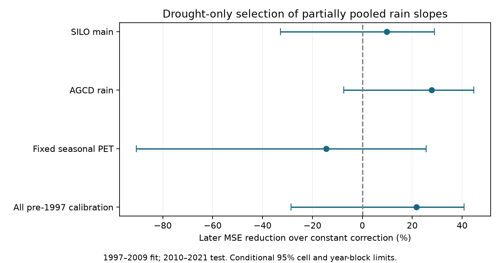

# Drought-selected pooled rain corrections gave no clear later error gain at 29 south-east Australian gauges

A rain correction selected with drought data reduced later runoff mean squared error by 9.8% relative to a constant correction. The conditional 95% interval was -32.9% to +28.9%. The same rule raised error with fixed seasonal potential evaporation. This test gives no clear gain from adding a selected rain slope. It does not show that a useful rain slope is absent.



## Question and contribution

After 1997, south-east Australian runoff fell below its earlier rain relation. A change in the annual rain slope was proposed as evidence for a different form of loss from earlier low periods (SCI 463123a6). Later work showed that fixed daily models can also give annual slope losses (SCI 2119ec10). SCI 48d2ae3c found that a constant drought error correction transferred to later years, but separate gauge slopes gave no clear added gain. It left pooling and shrinkage untested.

We test that specific gap. A noisy slope at each gauge can fail even if a common rain response is useful. We select the amount of pooling using only drought years. Then we test the selected rule in later years. We include selection in the uncertainty calculation. This is new analysis of published model outputs. It supplies a small reproducible benchmark, not new field measurements or a new general statistical method.

Transfer tests under different climate conditions are established practice. The differential split-sample test and later robustness tests motivate this design (RAT, 2021, https://doi.org/10.5194/hess-25-5013-2021). Global versus local hydrological calibration is also established (https://doi.org/10.1139/cjes-2015-0015). Our contribution is the drought-only selection test for pooled model-error slopes in this specific data set.

## Data and scope

All numerical source values come from the verified SCI 509746945963c56d6df824bc5262ed70c0961f4446234eda1b56d48b1686bcc4 archive. Four annual departure tables give errors from fixed GR4J and SIMHYD daily models: main SILO climate, AGCD rain, fixed seasonal potential evaporation (PET), and all-pre-1997 model calibration. Source flow is Bureau of Meteorology Water Data Online; climate is CAMELS-AUS v2.03. The source accepted years with at least 300 valid flow days. We inherit its errors and missing-day rules.

Use gauges south of 33.5 S and east of 140 E. Exclude diverted gauge 410033. Require at least 30 reference years, eight years in 1997-2009, and eight in 2010-2021. The main set has 29 gauges in nine two-degree cells. The all-pre-1997 variant has 30. Source model and reference fits remain fixed in this study.

Exact source ZIP and member hashes are in files/results/provenance.json. No shared raw dataset is directly read. files/UPSTREAM.tsv reports the source publication's raw dataset paths, hashes and retrieval URLs, without claiming a new raw-file verification. DATA_NOTICE.md gives source credit and terms. Source values and record-level derivative tables remain external to this package.

## Method

The exploratory plan in files/PLAN.md preceded our new numerical scores. Prior test results were already known. No later-year score is used to choose a method.

For each gauge and daily model, use R = 100 (observed runoff - simulated runoff) / reference mean observed runoff, centered on its reference mean. Fit a line of R on annual percent rain anomaly X in the reference years, then subtract that line in every year. Call the remaining error e. Reference years are 1957-1996, except for the all-pre-1997 variant. This removes reference rain-dependent model bias.

In drought training data, center X and e within each gauge-model pair. Let v_g be mean squared centered X and c_g be mean centered X times centered e. The separate slope is c_g/v_g. The pooled slope is sum(c_g)/sum(v_g), computed separately for GR4J and SIMHYD. This is a common-slope least-squares fit with separate gauge intercepts and equal total weight for each gauge. All corrections retain separate drought mean errors.

Candidates are a constant (zero slope), the pooled slope, and slope mixtures alpha times the separate slope plus (1-alpha) times the pooled slope, with alpha = 0.25, 0.5, 0.75 and 1. Correction = drought mean error + candidate slope times (X - drought mean X).

Select one candidate for both daily models. Hold out four calendar blocks: 1997-1999, 2000-2002, 2003-2005, 2006-2009. Fit on the other blocks and score held-out error. Average squared error over available years per gauge and model, then equally across gauges and models; weight fold scores by the number of held-out calendar positions. Select the smallest score, breaking ties by candidate order above. Refit on all drought years and test 2010-2021. Scores average two separate model scores, rather than an ensemble prediction. Test rain is observed. This is conditional runoff reconstruction, not an operational forecast with forecast rain.

Primary gain = 100 times (1 - selected later MSE / constant later MSE). Positive values mean lower error. MSE units are squared percentage points of reference observed runoff.

For 999 draws, sample spatial cells with replacement and keep all their gauges, including repeats. Resample circular three-year calendar blocks within each era, synchronously across gauges and models. Drought and later years have independent draws. Repeat training, validation, selection and testing. Repeated dates retain their original validation fold; a repeated date cannot enter both training and validation. A gauge-fold with no valid validation error is omitted from that fold mean. This missing-fold rule was corrected after an initial run produced empty means; all reported scores use the corrected code. All stored final endpoints are finite. Percentile bounds are conditional descriptive 95% intervals. No multiplicity adjustment is made.

## Results

Every full-data input variant selected alpha = 0.75: three quarters separate slope and one quarter pooled slope.

| Input | Gauges | Later MSE reduction over constant (%) | Conditional 95% limits |
| --- | ---: | ---: | ---: |
| Main SILO | 29 | 9.8 | -32.9 to +28.9 |
| AGCD rain | 29 | 27.9 | -7.4 to +44.7 |
| Fixed seasonal PET | 29 | -14.5 | -90.5 to +25.6 |
| All pre-1997 calibration | 30 | 21.7 | -28.5 to +40.7 |

None of the selected-rule intervals excludes zero. These are related sensitivity tests, not independent replications. The fixed-PET point loss shows that partial pooling does not make the correction robust to this model-input change.

In the main test, constant MSE was 650.84; selected-rule MSE was 587.00. Full pooling gave 587.55 (9.7% gain), a 0.5 mixture gave 554.38 (14.8% gain), and separate slopes gave 652.42 (-0.24% gain). The drought validation score preferred the 0.75 mixture (207.86), over separate slopes (212.72) and the constant (286.76). A lower error inside the drought did not establish lower error in the later climate. Choosing the 0.5 mixture using the later score would use test data and is not our primary result.

In main three-year-block draws, the selector chose the constant in 99 of 999 draws, pooled in 28, alpha 0.25 in 92, alpha 0.5 in 258, alpha 0.75 in 469, and separate in 53. Thus selection is materially uncertain. The main selected gain limits were -37.2 to +28.1% with one-year blocks and -31.2 to +27.9% with five-year blocks. Leaving out each later year gives point gains from 5.2 to 14.2%; no single later year reverses the main point result. These checks do not remove shared source error.

Some fixed-mixture AGCD intervals exclude zero before multiplicity control. They were not selected by the training rule, and they cannot establish a robust selected-method gain. All candidates and all draws are supplied to prevent selective reporting.

## Meaning and limits

The failure of separate slopes in prior work cannot be assigned only to their variance. Pooling improves the main point score, but training-only choice still gives uncertain gain and fails in one input variant. A constant drought offset remains a necessary benchmark for proposed state and storage models. A new model should beat it in later years with tuning confined to earlier data.

This does not identify the cause of the runoff loss, prove stationarity, or exclude better pooled, nonlinear or state-dependent models. We test one small mixture grid. We do not test other shrinkage targets, physical covariates, alternative loss functions, discharge positivity, absolute water-volume error, or future rain uncertainty. Repeated blocked validation within a drought can favor a method that does not transfer to a wetter period. No unseen independent period remains after this retrospective study.

Only 13 training and 12 test years and nine cells support inference. Cells can share weather, nested catchments and errors. Resampling assumes exchangeable cells and movable short time blocks within eras. Bounds omit upstream model fitting, reference fitting, source measurement uncertainty and cohort selection. Missing validation cells alter fold weights. Both models share data. Climate input variants and calibration variants are conditional checks. The analysis does not resolve the daily-versus-monthly model disagreement or the rainfall-product uncertainty.

## Inspection and reproduction

From an extracted publication, run:

```sh
sh files/reproduce.sh /absolute/path/to/campaign /absolute/path/to/new-scratch
```

The exact source ZIP must be present under its digest name. The script verifies it, reads members directly, and writes only to the supplied external scratch directory. Do not use the signed draft as the output directory. Python 3.12, NumPy, pandas, matplotlib and sci-protocol are required. One numerical thread is used. No new download or private workspace file is required. Raw-data reconstruction is documented in the source publication.

files/results/summary.csv gives every score and interval; *_draws.csv gives all bootstrap endpoints and choices; *_selection.json gives selection counts; *_deletion.csv gives leave-year checks; *_cohort.json gives gauge identifiers and cells. No observed source value or record-level derived database is bundled. audit.json compares pooled predictions with an independent expanded-design weighted least-squares calculation. The maximum differences are below 1e-7 percentage points. reproduction_check.json records a full deterministic repeat.

## Job and rights

Job sci-1107-dell-earth-and-ocean-sciences-5354e8f0f424. Topic earth-and-ocean-sciences. Campaign 11_07_2026. Machine dell. Account codex-olen. Model gpt-6.1-sol with high reasoning effort, Codex in T3 Code. One worker, no child agents. The campaign-machine signing key is not a personal authorship claim. This investigation saves a local signed bundle only.

Only original code, narrative, figures and aggregate analytical results are supplied under the exact SCI baseline license. DATA_NOTICE.md identifies external source terms and required attribution. No private key is included.
