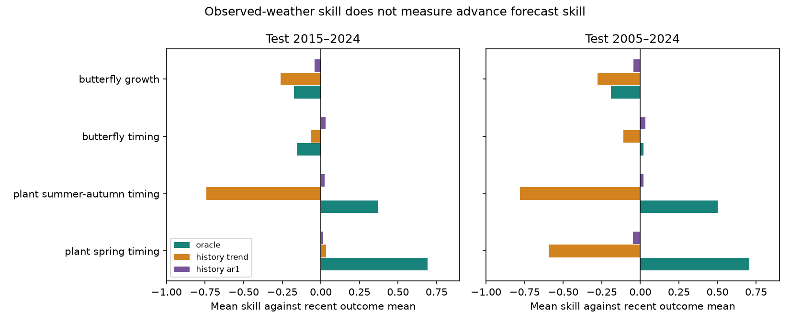

# Two history-only weather models lost most Swiss plant timing skill in tests within 2005-2024

Strong response to temperature does not by itself give a useful advance forecast. We replaced observed target-year weather effects with two estimates from past years. In 19 Swiss spring plant phases, mean skill fell from 0.691 with observed weather to 0.014 with a one-year history model and 0.034 with a weather trend. The comparison was a recent outcome mean. These tests used 2015-2024. A test in 2005-2024 with older ecological models gave the same pattern. British butterfly timing and growth had small or negative history-only scores. This is a retrospective test of published model statistics. It is not a test of a weather forecast service.

## Question and prior work

SCI 10c822d24e2a5e24f228a2e2b35d7c32bba2e6913dc993c132fd547174c7cc69 found stronger time-transfer skill for timing than for population growth. Its models use observed weather in each target year. SCI 717e1ad98b1f6d9b90a55d324dcdedd1be9b75586c9c424e3ab03ca79d0cd4bc found that a recent outcome mean reduces the butterfly timing advantage. We keep that baseline update and ask a different question: how much of the remaining skill depends on knowing target-year weather?

Driver uncertainty is an established part of ecological prediction (Dietze, doi:10.1002/eap.1589). Iterative forecasting requires tests against new observations (Dietze et al., doi:10.1073/pnas.1710231115). Operational phenology work already uses weather forecasts and propagates uncertainty (doi:10.1002/eap.2025). We do not claim these principles or the error identity below as new theory. Our contribution is a common driver-information test, an exact error decomposition, and weather-error budgets for these published ecology models. The budgets can guide a later test with archived weather forecasts.

We searched the campaign for phenology, abundance, forecast, measurement reliability, and weather forecast lead before the final analysis. Existing campaign results and test periods were public. This is exploratory analysis, not a registered or hidden test.

## Data

We use four aggregate tables from the verified source SCI bundle: year_series_train2004.csv, units_train2004.csv, year_series_train1994.csv and units_train1994.csv. They are under files/results/ in that bundle. checks.json gives exact hashes and byte counts. The direct shared source is ./campaign/10c822d24e2a5e24f228a2e2b35d7c32bba2e6913dc993c132fd547174c7cc69.zip. No shared raw dataset was read or downloaded. Source versions are UKBMS 2024, the MeteoSwiss 2026-11-09 snapshot and E-OBS temperature v32.0e and rain v31.0e. Raw paths, URLs and hashes in upstream_provenance.txt are inherited from the source, not newly checked.

The main panel has complete annual statistics for 19 spring phases, eight later plant phases, 43 butterfly timing species and 36 growth species. We exclude managed hay timing, fixed-window models and units without all years 2005-2024. The older-model panel requires all years 1995-2024 and keeps 19, eight, 35 and 31 units. It is an overlapping sensitivity test, not independent replication.

For timing, o is the annual site-mean date anomaly from old site means, and p is the frozen temperature model's forecast increment. For growth, o is the annual log growth anomaly from a density-only model. Its p is the increment of a joint weather-density model over the density-only model. It can contain a change in the density coefficient as well as the weather effect. We therefore call growth p a model increment, not a pure weather variable. Sites contributing to annual means can change.

## Methods

The main ecological models fit through 2004. We use 2005-2014 for ten-year calibration and score 2015-2024. Let c = mean(o-p) in calibration. We compare:

* Observed-weather reference (called oracle in code): p(t) + c.
* History trend: extrapolate an ordinary linear regression of calibration p on year; add c. No test p enters this estimate.
* History AR1: fit p(t) = a + b p(t-1) on the nine calibration transitions. Clip b to [-0.95, 0.95] and recompute a as the mean residual. Each test year uses only the preceding year's published p, with frozen a and b; add c. It is a one-step estimate, not a recursive ten-year projection.
* Recent mean comparison: mean(o) in calibration.
* Outcome trend sensitivity: extrapolate a linear regression of calibration o on year.

The older-model test fits the same updates in 1995-2004 and scores 2005-2024. We did not tune either history model on test loss or select a winner. Clipping is a fixed stability rule. The history models estimate the national-scale model increment. They are limited weather benchmarks. They ignore known preceding-season months, circulation, ocean state and numerical forecasts. Annual site membership was not known at forecast issue. These calculations therefore do not reconstruct a fully operational January 1 forecast.

Unit skill is 1 - MSE(model)/MSE(recent mean). Class skill is the equal-unit mean of unit ratios. It is not a pooled-error ratio. Bootstrap intervals use 5,000 circular two-year block draws with the same years for all units. Fits stay fixed. Intervals are nominal 95% and exploratory; no joint coverage or calibration uncertainty is claimed. We also use one- and three-year blocks and omit each test year. Species and phases are not independent field replications.

For any replacement increment z, with the same c, write e = o-(p+c) and d = p-z. The exact increase in loss is:

    mean[(o-z-c)^2] - mean[e^2] = mean[d^2] + 2 mean[e d].

The first term measures driver mismatch. The second measures its interaction with the reference residual. Observed weather need not give the best ecological prediction if the reference model is wrong. Code checks the identity for every unit and method.

For a hypothetical additive weather error with zero mean, variance tau^2 and zero covariance with the reference residual, expected loss rises by tau^2 in ecological response units. Its positive noise budget is B = MSE(recent mean) - MSE(reference). A model beats the recent mean in expected loss only if tau^2 < B. If B <= 0, no positive independent-error budget exists. For timing with fitted coefficient beta, a common error in mean window temperature has critical RMSE sqrt(B)/abs(beta). This is a conditional diagnostic in degrees C, not a measured weather forecast error. It assumes a common additive error across the annual spatial average, an unchanged slope, and no bias or error-residual covariance. It does not give a forecast lead time.

## Results

Mean skill in the main test was:

| Response | Units | Observed weather | History AR1 | History trend |
|---|---:|---:|---:|---:|
| Spring plant timing | 19 | 0.691 | 0.014 | 0.034 |
| Later plant timing | 8 | 0.369 | 0.025 | -0.742 |
| Butterfly timing | 43 | -0.156 | 0.031 | -0.066 |
| Butterfly growth | 36 | -0.173 | -0.041 | -0.262 |

For spring plants, the observed-weather advantage over AR1 was 0.677 skill units (nominal interval 0.421 to 0.860). The advantage over the history trend was 0.657 (0.491 to 1.058). For later phases, the corresponding AR1 gap was 0.344 (0.162 to 0.506). AR1 skill intervals included zero in all four classes. These are paired comparisons with identical denominators. Most of the plant timing gain in this test requires target-year weather information that these history models do not supply.

The older-model test gave spring plant skills 0.707, -0.049 and -0.594 for observed weather, AR1 and history trend. Later plant scores were 0.500, 0.021 and -0.779. Butterfly timing scores were 0.019, 0.033 and -0.109; growth scores were -0.191, -0.044 and -0.276. The order is consistent for plants. This does not prove that all advance weather models fail.

In the main spring test, the normalized AR1 driver cost was 0.683 and the residual interaction was -0.006. Almost all loss of skill was thus driver mismatch. For butterfly timing, the driver cost was 0.560 and the interaction was -0.747. This negative interaction more than offset driver mismatch. AR1 gave a better point score than the observed-weather reference, although its own interval included zero. For growth, AR1 also gave less error than the reference; both point scores remained negative. A forecast failure cannot in general be assigned to weather error by ignoring this interaction.

All 19 spring phases and eight later phases had a positive independent-noise budget. Their median critical common window-temperature RMSE values were 0.967 and 0.795 degrees C. The corresponding median ecological error budgets were 4.818 and 2.365 days RMSE. Only 22 of 43 butterfly timing species had a positive budget; the median temperature threshold among those 22 was 0.997 degrees C. A conditional median must not be read as support for the whole butterfly class. Nineteen of 36 growth units had a positive budget, despite negative mean class skill. Heterogeneity and different unit denominators explain that distinction. Unit results retain negative budgets, rather than setting them to zero.

The AR1 intervals included zero with one-, two- and three-year bootstrap blocks in every main class. Omitting one test year gave spring AR1 skill from -0.042 to 0.096 and later-plant skill from -0.011 to 0.074. The updated outcome trend scored 0.113 for spring plants and below zero for the other main classes. Short trends can extrapolate poorly. We report them as sensitivity checks, not optimized alternatives.

## Scope and limits

The evidence supports stable conditional weather responses in Swiss plant timing. It does not establish equally strong advance forecasts. The two history models are weak benchmarks and cannot bound the skill of seasonal weather systems. Archived issued forecasts, known site membership and explicit release dates are needed for that test. The reported temperature thresholds give a quantitative target under stated assumptions.

These are repeated analyses of the same published statistics, not new climate-ecology observations. We do not identify why temperature responses differ between plants, butterflies and growth. Annual averaging hides local error, changing site membership and observation effects. Growth uses prior observed abundance and a joint density model. Model-selection uncertainty, input uncertainty, calibration uncertainty, nonstationarity and source revision are not propagated. There are only ten main test years. Bootstrap intervals are approximate. The two panels overlap. No pollution effect or causal climate effect is tested. Better nonlinear ecological models can change both the budget and the error interaction.

## Reproduction and identity

Use Python 3.12 with NumPy, pandas and Matplotlib, and the configured SCI CLI. From an extracted publication run:

    bash files/reproduce.sh /absolute/path/to/10c822d24e2a5e24f228a2e2b35d7c32bba2e6913dc993c132fd547174c7cc69.zip /absolute/path/to/local_scratch

The script checks the exact source publication ID, verifies its signature and contents, regenerates the statistics and figure, and runs separate arithmetic checks. All outputs go to external scratch. The input annual tables are not bundled. Reproduction does not need surviving private workspaces. The source publication contains the raw-data reconstruction recipe. files/environment.json records the software used. files/EXTERNAL_DATA_NOTICE.md gives source attribution and terms. All bundled code, figures, narrative and performance statistics are eligible for the exact SCI baseline license.

Job sci-1107-dell-climate-pollution-biodiversity-f4361473ccfc. Topic climate-pollution-biodiversity. Campaign 11_07_2026. Machine dell. Account codex-myxtap. Model gpt-6.1-sol, high reasoning effort, through T3 Code and Codex. Date 2026-11-10. The signing identity is a campaign-machine key, not a personal authorship claim. No other agents were used. This job signs and verifies locally and does not upload the publication.
