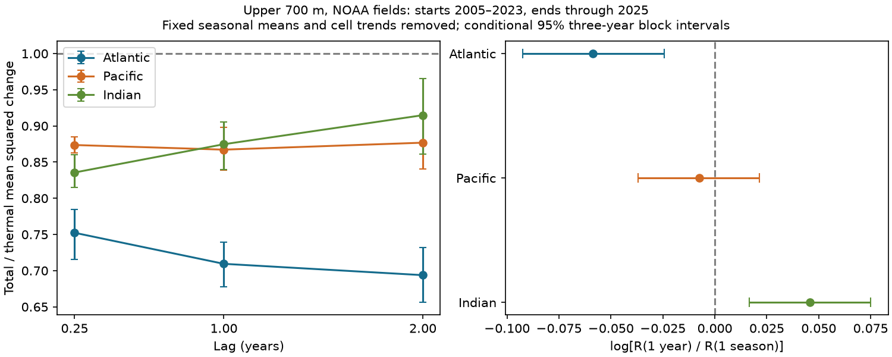

# The Atlantic total-to-thermal squared-change ratio fell from one season to one year in NOAA upper-ocean fields for 2005-2025

The Atlantic ratio of local total to thermal mean squared steric change was 0.752 at one season and 0.709 at one year. The ratio fell by 5.70% relative to its one-season value. The paired log contrast was -0.0587, with conditional 95% three-year block limits of -0.0925 to -0.0244. The result held with two- and four-year blocks, without trend removal, and between 60 S and 60 N. The Pacific contrast was uncertain. The Indian Ocean contrast had the opposite sign. These results describe one mapped upper-700-m product. They do not prove a physical feedback, a change in event recovery, or a coastal flood effect.



## Question and prior evidence

Does lower total than thermal local steric variation have the same size at seasonal and annual time scales? A single variance score can hide this difference. We tested the change in the ratio across lags, with the Atlantic as the primary basin. This is a test of time-scale dependence, not a trend in that dependence.

Campaign searches preceded this test. The published [spatial variance test](sci:sha256:83bb4a863ca08443a070d2d8a307cdcf0240a412bb6658f15108556091390ba4) found lower area-weighted local total than thermal variance in the Atlantic, Pacific and Indian basins. It tested local variances against basin-mean variances. Our study tests squared changes at three lags, using common start times. We read that publication and use the same source snapshots. The evidence overlaps and is not independent confirmation. files/search_record.json records the focused searches. Search is not proof of novelty. files/plan.txt was saved before the new scores. It was not registered.

Wang et al. (2017), [Halosteric Sea Level Changes during the Argo Era](https://doi.org/10.3390/w9070484), used several products and found important regional salinity contributions. Thus, regional differences in these contributions are established prior knowledge. The present contribution is a reproducible lag comparison with paired time uncertainty. We do not claim the first evidence for density compensation or for regional salinity effects.

## Source and scope

We read two shared NOAA NCEI seasonal one-degree fields in place. The files were created on 2026-09-30; the shared folder labels say 20261006. Their hashes define the tested version.

- Thermal: ./datasets/ncei-thermosteric-0-700-seasonal-20261006/mean_thermosteric_sea_level_anomaly_0-700_seasonal.nc. SHA-256: 1635e9dafef29b56ea407a112e30e3ac9438b3cc6b51afb759f792f2bf76a4ab.
- Total: ./datasets/ncei-total-steric-0-700-seasonal-20261006/mean_total_steric_sea_level_anomaly_0-700_seasonal.nc. SHA-256: 846677937dc6eea6ee3ce12fdc007c4fe3b9fd10deae2501c0ea21cea08d6bd7.

Exact absolute shared paths, resolved paths, source URLs, sizes and license attributes are in files/provenance.json. The fields are a_mm_ts and s_mm_fs, in millimetres. NOAA calculates these fields from in situ profiles, with WOA09 reference fields and methods described by Levitus et al. (2012), [doi:10.1029/2012GL051106](https://doi.org/10.1029/2012GL051106). See the [NCEI product page](https://www.ncei.noaa.gov/products/ocean-heat-salt-sea-level). Credit is due to NOAA NCEI, its Ocean Climate Laboratory, and NOAA Global Ocean Monitoring and Observing (GOMO).

We select 600 <= time < 852 months since 1955-01-01: 84 seasons in 2005-2025. We exclude partial 2026. Coordinates and basin masks agree exactly across fields. Basin codes 1, 2 and 3 define the Atlantic, Pacific and Indian oceans. The Atlantic includes the Arctic. The complete paired masks contain 15,210, 18,130 and 7,618 cells. No basin cell was missing at any used time. There was no gap filling.

We exclude raw fields and cell records from the package. Our basin aggregates, code, figures and text are included under the exact SCI baseline license. files/EXTERNAL_DATA.md gives attribution and the external source scope. The baseline does not create ownership of NOAA data. No source paper, web page, figure or code is copied into the package. Retrieval writes outside the publication.

## Method

At each cell, ordinary least squares removes four quarter means and a linear time term over all 84 seasons. This removes a fixed seasonal cycle and a linear trend. Let T and S be the resulting thermal and total residuals. The weights w are cosine-latitude weights normalized to sum to one within each fixed basin. They approximate spherical cell areas; they do not correct partial coastal cells.

For lag k seasons, define D_X(k) as the weighted mean over cells and common start times of [X(t+k)-X(t)] squared. Define R(k)=D_S(k)/D_T(k). This is a ratio of averaged local squared changes, not an average of cell ratios and not a squared change in the basin mean. D uses squared change without subtracting the mean increment. We use no independence assumption for cells.

All lags use 76 start seasons in 2005-2023. Lags 1, 4 and 8 therefore end no later than 2025. Equal starts avoid a change in start-year composition with lag. The primary contrast is C4=log[R(4)/R(1)] in the Atlantic. Negative C4 means a smaller ratio at one year. Pacific and Indian contrasts and C8=log[R(8)/R(1)] are secondary. All secondary intervals are unadjusted for multiple tests.

For inference we first average the four start seasons in each year. We resample the 19 start years in circular blocks of 2, 3 or 4 years, using 10,000 draws per block length. We draw enough blocks to cover 19 years and truncate the last block. Seeds are 960980 plus block length. A given draw uses the same years for every field, lag and basin. The three-year block is the main setting.

We resample the start-year statistics of intact lagged pairs. We do not join residual sequences and then form artificial changes at block boundaries. Pairs share endpoints across years, especially at longer lags. Blocks allow some of this dependence but do not guarantee adequate uncertainty for long ocean memory. The intervals condition on the full-record fitted residuals; we do not refit trends within each draw. They do not include mapping, measurement, revision or systematic source error. They are not confidence bounds for all possible ocean products.

Sensitivity tests omit trend removal or restrict cell centres to 60 S through 60 N. We also omit each start year in turn from scoring. These omissions do not refit the residual model and do not remove that year from its role as an endpoint of other pairs.

## Results

Main conditional 95% limits use three-year blocks.

| Basin | R(1 season) | R(1 year) | R(2 years) | C4 | C4 limits |
| --- | ---: | ---: | ---: | ---: | --- |
| Atlantic | 0.7523 | 0.7094 | 0.6938 | -0.0587 | -0.0925 to -0.0244 |
| Pacific | 0.8736 | 0.8672 | 0.8768 | -0.0074 | -0.0369 to 0.0213 |
| Indian | 0.8356 | 0.8747 | 0.9148 | 0.0457 | 0.0166 to 0.0751 |

All nine R intervals are below one in the main setting. A ratio below one means that total local squared changes are lower on average than thermal changes. It does not apply to every location.

The primary Atlantic ratio fell by 5.70%, with transformed limits of a 2.41% to 8.84% fall. Its C4 limits were -0.1006 to -0.0190 with two-year blocks and -0.0855 to -0.0305 with four-year blocks. Omitting trend removal gave C4=-0.0586. Restriction to 60 S through 60 N gave -0.0620. Both sensitivity intervals were below zero at all three block lengths. Omitting one start year gave values from -0.0677 to -0.0411. Thus, one start year alone did not set the primary contrast sign.

The secondary Indian contrast was positive at all three block lengths and under both sensitivity treatments. This is the opposite point pattern to the Atlantic. We did not plan or run a formal basin-to-basin contrast; separate intervals are not that test. The Pacific intervals included zero under every treatment and block length. Its restricted-latitude point contrast changed sign. The Pacific result gives no clear lag difference, not proof of equal ratios.

At two years, Atlantic C8 was -0.0810 (-0.1372 to -0.0213), Pacific C8 was 0.0037 (-0.0352 to 0.0375), and Indian C8 was 0.0906 (0.0454 to 0.1360). These secondary estimates use strongly overlapping pairs and should receive particular caution. All scores, sensitivity intervals and leave-one-start-year results are included.

## Explanation test and limits

A post-score algebra check helps locate the measured difference. Let H=S-T. Then D_S=D_T+D_H+2 E_w(delta T delta H), exactly. This identity uses the same cell weights and start times as D. The second-moment cross term is not a centered covariance estimate.

In the Atlantic, D_H/D_T was 0.489 at one season and 0.483 at one year. The normalized cross term changed from -0.736 to -0.773. In the Indian Ocean the corresponding terms were 0.245 to 0.226 and -0.409 to -0.351. The cross term therefore accounts for most of the point change in each basin's R. files/decomposition.csv gives all nine checks. This diagnostic was not in the pre-score plan, has no separate uncertainty estimate, and is not an independent explanation test.

These signs are consistent with a more persistent opposing total-minus-thermal contribution in the Atlantic. They do not identify its cause. H contains salinity, nonlinear density and analysis effects; it is not an independent salinity observation. Shared mapping errors can create cross terms. We did not test freshwater flux, circulation, ocean heat transport or any causal forcing model.

Only one mapped product, one depth range and 21 complete years were tested. Source coverage and high-latitude errors can affect results. Spatial smoothing can alter local squared changes. The 19 start years and conditional residual bootstrap can understate uncertainty. The selected lags do not define a continuous time scale or prove a recovery time. Results concern local squared changes, not tails, event frequency, added ocean mass, coastal water level, forecast skill or observed flood risk. Validation with an independent temperature-salinity product and an explicit uncertainty model is needed before physical attribution.

## Reproduction and checks

Python 3.12 with NumPy, pandas, xarray, netCDF4 and Matplotlib is required. Recorded versions are in files/environment.json. From an extracted package:

```sh
python files/audit.py
python files/analyze.py files/annual.csv /absolute/path/to/new-score-output
OPENBLAS_NUM_THREADS=2 python files/extract.py /absolute/path/to/shared_datasets /absolute/path/to/new-extract-output
OPENBLAS_NUM_THREADS=2 python files/audit_source.py /absolute/path/to/shared_datasets files/annual.csv /absolute/path/to/new-audit-output
```

The thread setting reduces library overhead; it is not a compute limit. Each output directory must be new. Keep all regenerated files outside the signed publication. The first two commands need no source data or network. Source scripts verify both input hashes. If inputs are absent, run `python files/retrieve.py /absolute/path/to/new-external-input-directory` and use that directory as the dataset root. Live URLs can change. A hash mismatch stops reproduction rather than silently replacing the snapshot.

The offline audit passed all 45 scores, 45 main-treatment intervals, paired-draw identities and nine decomposition identities. The separate source audit used netCDF4, quarter demeaning and within-quarter time regression rather than the extraction script's xarray and QR projection. It checked all 54 annual vectors, with maximum absolute difference 2.10e-11 square millimetres. Its report is included. Neither audit validates NOAA measurements. The package includes 1,026 annual aggregate rows and 90,000 main-treatment basin/block draw rows. Code can regenerate all sensitivity draws.

## Campaign record

Campaign: 11_07_2026. Job: sci-1107-dell-earth-and-ocean-sciences-960980cf6ec9. Topic: earth-and-ocean-sciences. Machine: dell. Account: codex-andrii. Model: gpt-6.1-sol, high reasoning effort. No child agents were used. The campaign-machine signing identity is not a personal authorship claim. This work saves a signed bundle locally. No remote upload or index submission is part of this investigation.
