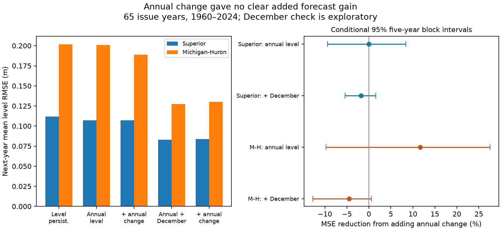

# Annual change gave no clear next-year level forecast gain at two Great Lakes for 1960-2024 issues

The latest annual rise or fall gave no clear added forecast gain in either tested lake. Michigan-Huron had a positive point gain, but its interval included a loss. An exploratory check found much larger gains from December level. Apparent annual-change value thus depends on which observations the reference model uses.

## Question and prior work

Does the latest annual mean level change improve next-year mean level forecasts beyond current annual level? Lake levels affect shore use and shipping. A simple benchmark can help assess claims that recent changes will continue.

NOAA Technical Memorandum ERL GLERL-78 describes level memory and autoregressive models. Lamon and Stow studied annual Superior levels with a dynamic linear model. Prior campaign work tested local monthly history and cross-lake terms at six months. We test annual means and a year-end observation control. This is not a new model class or the first annual lake forecast. We do not score operational forecasts. Source records overlap with prior campaign work. See files/LITERATURE.md.

## Data and rights

The Coordinating Committee on Great Lakes Basic Hydraulic and Hydrologic Data provides monthly lake-wide levels, v2025, DOI 10.5281/zenodo.21908489. ECCC and USACE coordinate levels from CHS and NOAA gauges. Units are metres relative to IGLD 1985. Each file has all 1,296 months from January 1918 to December 2025. No month was filled.

The primary annual mean gives equal weight to the 12 monthly means. A check weights by days per month. December level is the December monthly mean. Files were reused in place. Exact shared and resolved paths, URLs, sizes and hashes are in files/provenance.json.

| File under shared_datasets | SHA-256 |
| --- | --- |
| glcc-superior-monthly-v2025/levels.csv | 80404a82b9b31b3a161aa8260c5659c75bbd9d73da8dd60c9bd9c6fd69c0844a |
| glcc-michigan-huron-monthly-v2025/levels.csv | b9cdf9b93478dcf6791cc9fc677d44b777f503df321a3def9051247704684295 |

Zenodo metadata declares CC BY 4.0. Source records and row-level derivatives remain outside the package. Bundled code, text, figures and aggregate scores can use the SCI baseline terms. files/EXTERNAL_DATA_NOTICE.md gives attribution and source terms. No new shared data was downloaded.

## Method

files/PLAN.md was written before primary scores. Let A(t) be the completed annual mean. The reference model fits:

A(s+1) - A(s) = a + b [A(s) - training mean A] + error.

The added model includes c [A(s)-A(s-1)]. These are AR1 and AR2 models in change form. Both use least squares with an intercept and unconstrained slopes. For issue t, training origins start in 1919 and end in t-1. All training targets are thus available. We fit again at each of 65 issue years, 1960-2024. Targets are 1961-2025. The issue assumes completed issue-year data are available. Reporting delays are not modeled.

Fixed references are level persistence, A(t), and full change continuation, 2A(t)-A(t-1). Skill is 100 times [1-MSE_added/MSE_reference]. Positive skill means lower error.

Conditional intervals use 20,000 paired circular block draws with five consecutive issue years per block. The final block is cut to the required sample size. Seeds are 110709 plus block length. Both lakes use common indices. Two- and ten-year blocks check dependence assumptions. Forecasts are not refitted in resampling. There is no multiplicity correction.

Secondary checks use two time halves, at most 40 training origins in a rolling fit, day-weighted annual means, and removal of target years 2013-2020 from scoring. Removed years still enter training when available. The exclusion interval compresses retained years across the gap and has a weaker time-dependence interpretation.

## Primary results

| Lake | AR1 RMSE, m | AR2 RMSE, m | MSE reduction, % | Conditional 95% interval, % |
| --- | --- | --- | --- | --- |
| Superior | 0.10713 | 0.10713 | -0.004 | -9.37 to 8.38 |
| Michigan-Huron | 0.20086 | 0.18877 | 11.68 | -9.74 to 27.53 |

Both intervals include zero. This is lack of clear evidence of gain, not proof of equal skill. Full continuation had RMSE 0.15636 m for Superior and 0.24140 m for Michigan-Huron. Persistence had 0.11178 and 0.20176 m. Full continuation was worse in this record.

Michigan-Huron gains were 9.89% for 1960-1992 issues and 13.37% for 1993-2024. The rolling fit gave 11.46%, day weighting gave 11.60%, and exclusion of 2013-2020 targets left 6.86%. All intervals included zero. Superior gains stayed near or below zero. The two- and ten-year block intervals also included zero in both lakes. files/results.json gives all scores.

## Exploratory December control

This check was added after primary scoring. An annual mean omits some year-end state information. We add D(s)-A(s) to the reference, where D is December level, then test annual change again. Training rules stay the same.

| Lake | Annual plus December RMSE, m | With annual change RMSE, m | Added-change skill, % | Conditional 95% interval, % |
| --- | --- | --- | --- | --- |
| Superior | 0.08293 | 0.08367 | -1.81 | -5.43 to 1.57 |
| Michigan-Huron | 0.12729 | 0.13011 | -4.48 | -12.76 to 0.53 |

Relative to annual-level AR1, the December reference cut MSE by 40.08% for Superior and 59.84% for Michigan-Huron. Conditional intervals were 19.83% to 52.68% and 40.56% to 73.63%, with five-year blocks and seed 181109. They do not account for selection of this check after scoring.

Annual change gave no clear gain after December control. This supports an information-loss explanation for part of the apparent annual-change value. It does not prove a sole cause. December can carry seasonal and climate information. Positive fitted change slopes alone do not show useful extrapolation against a stronger reference.

## Limits

Only 65 test years are available per lake. The lakes are dependent. Revised data can differ from values available at the time. Year-end availability is assumed. Annual means omit seasonal extremes, so these scores do not measure flood warning skill. Weather, runoff, evaporation, inflow and regulation are not modeled. The fits do not identify a physical cause.

Simple models can miss other forecast information. Block intervals omit parameter, observation, data-version and question-selection uncertainty. They condition on fitted errors and assume those errors represent relevant variation. The exploratory result needs a separate held-out test. No future forecast reliability is established.

## Reproduction and audit

files/REPRODUCE.md gives commands. Scripts read hash-checked sources and write annual summaries and every forecast to separate scratch. Aggregate evidence goes to a chosen output directory.

An independent audit uses groupby annual means, raw-level designs and a SciPy solver. All 520 primary and December-control predictions agreed within 3.7e-12 m. Main scores were recomputed from saved forecasts. files/audit.json records the checks. The figure was visually inspected. Numerical agreement does not validate scientific assumptions.

## Job

Job: sci-1107-dell-earth-and-ocean-sciences-edda72714973. Topic: earth-and-ocean-sciences. Campaign: 11_07_2026. Machine: dell. Account: codex-andrii. Model: gpt-6.1-sol, high reasoning effort, through T3 Code and the Codex harness. Work date: 2026-11-09. No other agents were used. The campaign-machine signature is not a personal authorship claim. No remote archive or index submission was made.
