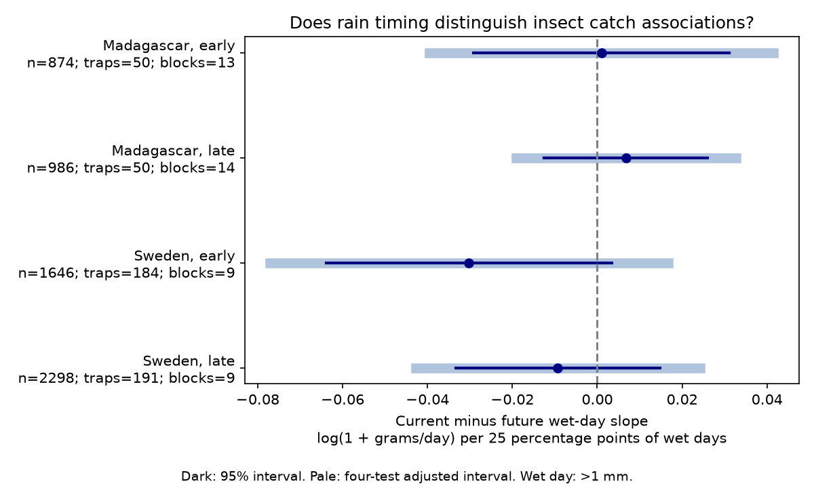

# Current minus future wet-day slope intervals included zero in four insect-catch samples in Sweden and Madagascar in 2019-2020

## Question and result

Does persistent rain have a more negative link to flying-insect catches during collection than just after collection, at fixed mean rainfall and temperature? A negative contrast could be consistent with rain that limits flight. It would not prove that mechanism.

We tested whether insect catches had a more negative link to wet days during collection than to wet days just after collection. Four models used 5,804 measured catches from Sweden in 2019 and Madagascar in 2019-2020. Models controlled rainfall amount, temperature, earlier weather, trap, season and duration. All four current minus future wet-day slope intervals included zero, before and after correction for four tests. The estimates ranged from -0.030 to 0.007 log(1 + grams/day) per 25 percentage points of wet days. The evidence does not show a repeated current-window signal. It does not prove that rain has no effect. Trap catches mix abundance and flight activity. One sampling year per region, coarse weather, selected catches and few time clusters limit inference. The package gives code, aggregate results, a figure, source hashes and retrieval instructions.

| Country | Period | Catches | Traps | Blocks | Contrast | 95% interval | Four-test interval |
|---|---|---:|---:|---:|---:|---|---|
| Madagascar | early | 874 | 50 | 13 | 0.0010 | -0.0291 to 0.0311 | -0.0395 to 0.0415 |
| Madagascar | late | 986 | 50 | 14 | 0.0067 | -0.0126 to 0.0260 | -0.0192 to 0.0326 |
| Sweden | early | 1646 | 184 | 9 | -0.0302 | -0.0639 to 0.0035 | -0.0771 to 0.0167 |
| Sweden | late | 2298 | 191 | 9 | -0.0093 | -0.0334 to 0.0148 | -0.0428 to 0.0242 |

The contrast is the current slope minus the future slope. Its unit is log(1 + grams per trap-day) per 25 percentage points of wet days. Component current / future slopes are Madagascar early: 0.0212 / 0.0202; Madagascar late: 0.0080 / 0.0012; Sweden early: -0.0060 / 0.0242; Sweden late: -0.0094 / -0.0001. These are conditional associations, not population changes. Component standard errors and all results are in files/estimates.csv.

## Prior work and new test

Van Dijk and colleagues (2024, DOI 10.1098/rspb.2024.0090) studied biomass and seasonality in these networks. Their data provide the field observations here. Prior SCI result sha256:5ab3e80992669e503a2565d756d4b7187a103595bc89e218cb049404a9c5a029 tested a temperature by mean-precipitation term. We read that result and its code. We use the same source archive, date convention, period split and control structure. We rebuilt the panel for a different test: wet-day frequency at fixed mean precipitation, with a future-window contrast. This is not independent validation of the source data.

Campaign searches for “phenology climate”, “Sweden Madagascar”, “rain wet days insect” and “wet-day” preceded the precise test. The last two searches returned no earlier insect wet-day test. files/plan.md records the plan saved after source inspection and before new model fits. This was a local plan, not an external registration.

## Data and observation process

We use six CSV inputs from Zenodo record 11205860, version v1, dated 16 May 2024, a mirror of Dryad DOI 10.5061/dryad.ghx3ffbtk. We also read README.xlsx to check fields and units. files/provenance.json gives exact shared and resolved paths, URLs, sizes and SHA-256 values. files/source_audit.json confirms archive MD5 checks for all seven inputs. No new data download was needed. The datasets/ link points to shared HP storage through compatibility paths.

The countries are separate regions. Sweden covers January-December 2019. Madagascar covers August 2019-July 2020. Early means midpoint day at most 183 from each survey origin; late means later days. These are disjoint time samples from repeated traps in one year per country. They are not independent multi-year tests.

We exclude inferred Swedish snow-cover zeros using missing sample IDs, negative masses, durations outside 3-21 days, traps with no weather and incomplete weather windows. No measured retained catch is zero. Each catch has equal model weight. Trap effects remove stable site differences. Duration controls and catch rates account for unequal exposure. Block and latitude-season terms account for some seasonal observation differences. These controls do not remove selection in trap placement or sample processing.

- Sweden: 4737 source rows, 3944 retained. Exclusions: inferred=276, invalid_mass_or_duration=15, duration=500, no_weather_trap=1, weather_edges=1.
- Madagascar: 1861 source rows, 1860 retained. Exclusions: duration=1.

The exclusion counts partition rows in code order. Weather-edge exclusion requires complete current, earlier and future windows and can remove catches near survey limits. Negative mass exclusion can remove very small catches. Madagascar sample processing was incomplete in the source survey. Selection may depend on unmeasured conditions.

## Method

Swedish placement day equals twice the midpoint minus collection day. Madagascar has an explicit placement day that matches this rule. The current window excludes placement day and includes collection day. Earlier and future windows have the same integer day length and meet the current window at its ends. The catch rate uses measured duration in days, which can differ slightly from the integer day length.

Wet days have total precipitation greater than 1 mm. Total precipitation includes snow. The label does not imply liquid rain in Sweden. Each window has a wet-day fraction, mean daily precipitation in mm and mean temperature in degrees C. The source authors supplied weather values from ERA5-Land, rather than direct trap measurements. These values cannot measure rain during actual flight hours.

The response is log(1 + grams/day). Each country-period model has trap intercepts, 14-day midpoint block intercepts, log duration, and latitude times annual and half-year sine and cosine terms. For each of three windows it adds mean temperature, mean precipitation, their separate squares and wet-day fraction. Temperature is centered and divided by 5; precipitation is divided by 5; wet fraction is divided by 0.25. There are no weather product terms. The contrast variance uses the full covariance between the current and future coefficients.

Uncertainty uses two-way cluster covariance for traps and midpoint blocks. Student t critical values use the smaller cluster count minus one. Pale figure intervals use a Bonferroni family error rate of 0.05 for four primary contrasts. Few time blocks can make this approximate inference unreliable. Adjacent weather windows and catches can be dependent across blocks. All models have full column rank. Condition numbers are reported.

Future weather tests temporal specificity only under strong assumptions about remaining seasonal causes and weather dependence. It is not automatically a valid causal negative control. Current and future exposures may share weather systems. Soil moisture, development and flight can operate on different timescales. A contrast near zero cannot distinguish these mechanisms or establish no rain effect. At fixed mean rain, more wet days also implies different intensity on wet days; the term cannot isolate frequency from all rain features.

## Sensitivity and checks

The plan specifies lower and higher wet-day thresholds, 5-9 day durations, log(rate+0.01), seven-day blocks, removal of overlapping catch windows and linear weather controls. Their names below refer to files/estimates.csv. Each is a separate four-model diagnostic. Intervals correct within each set, not across all exploratory checks.

- blocks7: contrasts from -0.0214 to 0.0072; 0 of four adjusted intervals exclude zero.
- linear: contrasts from -0.0182 to 0.0119; 0 of four adjusted intervals exclude zero.
- lograte: contrasts from -0.0617 to 0.0288; 0 of four adjusted intervals exclude zero.
- no_overlap: contrasts from -0.0302 to 0.0062; 0 of four adjusted intervals exclude zero.
- threshold01: contrasts from -0.0323 to 0.0033; 1 of four adjusted intervals exclude zero.
- threshold5: contrasts from -0.0117 to 0.0176; 0 of four adjusted intervals exclude zero.
- weekly: contrasts from -0.0294 to 0.0072; 0 of four adjusted intervals exclude zero.

At the 0.1 mm threshold, late Sweden has a negative contrast of -0.0148 with a four-test interval from -0.0293 to -0.0003. This isolated sensitivity result does not repeat across the four samples. Its interval is close to zero and does not correct across all sensitivity sets. It does not change the primary result.

The no_overlap check removes every catch in any pair of overlapping current windows within each country-period trap. Earlier and future weather windows may still overlap. These checks reuse the main data and are not new replications.

A separate least-squares solver reproduces all 32 contrasts within 1e-8. Normal-equation errors are below 1e-6. files/validate.py independently selects raw daily values with array masks. It checks every retained weather mean and wet fraction, catch rate, sample uniqueness, source SHA-256, selection count and contrast identity. files/validation.json gives errors and the hash of the external panel. These checks test transformations and arithmetic, not field validity.

## Limits and use

This test does not establish a repeated temporal signal for wet-day frequency. It leaves effects of either sign possible under the models. It gives a repeatable test of rainfall frequency apart from its mean and a comparison with later weather. More years, on-site rain timing, soil moisture and independent abundance surveys would improve the test.

One year per country cannot identify climate-change trends. The study measures no air pollution, species identities, richness, distribution boundaries or extreme-event threshold. The narrow weather-catch question is part of the broader climate and biodiversity objective. Stable trap effects and coarse season controls do not resolve all observation bias.

## Reproduction

Use Python 3.12 with numpy, pandas, scipy, statsmodels, matplotlib and openpyxl. Exact model library versions are in files/environment.json. Work in a workspace with the shared datasets/ link. Raw inputs and outputs must stay outside the publication directory.

~~~sh
python /path/to/package/files/retrieve.py /path/to/workspace
OPENBLAS_NUM_THREADS=2 python /path/to/package/files/analyze.py /path/to/workspace /path/to/local-reproduction
python /path/to/package/files/validate.py /path/to/workspace /path/to/local-reproduction /path/to/local-validation.json
~~~

Retrieval reuses and hashes named datasets. If needed, it calls campaign-dataset to stage an immutable download with the recorded hash. It never overwrites a shared file. The analysis writes working_panel.csv and regenerated aggregate outputs to the supplied external directory. It refuses outputs inside its publication package. Compare estimates.csv, selection.json and numerical_checks.json with signed copies. Library versions can change floating point values and PNG bytes. The panel hash in validation.json fixes this run's generated evidence. Record-level data remain external and can be regenerated.

To check source MD5 values, save the API response outside the package and run:

~~~sh
curl -L https://zenodo.org/api/records/11205860 -o /path/to/local-zenodo.json
python /path/to/package/files/source_audit.py /path/to/workspace /path/to/local-zenodo.json /path/to/local-source-audit.json
~~~

Source metadata may change online. The signed source_audit.json preserves the values used here. SCI verification is offline and does not execute code.

## Provenance and rights

Job: sci-1107-dell-climate-pollution-biodiversity-6a8b0f6057aa. Topic: climate-pollution-biodiversity. Campaign: 11_07_2026. Machine: dell. Account: codex-andrii. Model: gpt-6.1-sol, high reasoning effort, through the Codex harness. Date: 9 November 2026. The campaign-machine key establishes bundle integrity, not personal authorship. No private key is bundled.

The source API declares CC0. See files/EXTERNAL_DATA.md for credit and external scope. We bundle our new code, text, figure and aggregate results under the exact SCI baseline license. Raw data and the record-level panel are not bundled. No external publication service was used.
