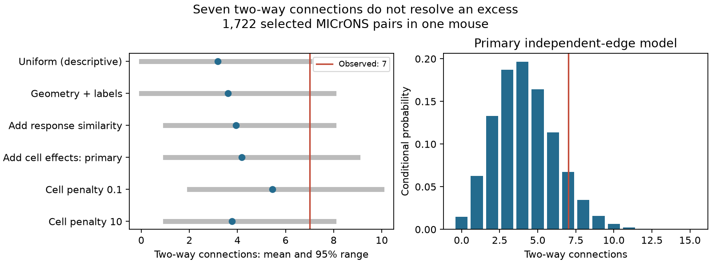

# Seven two-way connections fall within an adjusted model range for 1,722 selected MICrONS cell pairs

## Result

Seven two-way connections occurred among 1,722 selected cell pairs in one MICrONS mouse. An adjusted independent-edge model predicted 4.175. Seven was within its conditional 95% prediction range of 1 to 9. Its upper-tail probability was 0.1275. The data do not give clear evidence for an excess under this model. They also do not show that the two directions are independent.



A uniform model gave a smaller upper-tail probability, 0.0433. Geometry, function, and cell effects raised this probability. This comparison shows how the reference model can change a claim about two-way wiring. The uniform model uses the tested edge rate and is descriptive. It is not a separate valid test with known probabilities.

## Question and prior work

Two-way excitatory connections can support recurrent activity. Their count can also rise when cells with high connection probabilities occur together. We ask whether a count of two-way connections remains unusual after a model uses geometry, response similarity, and each cell's input and output tendency.

[Song and colleagues (2005)](https://doi.org/10.1371/journal.pbio.0030068) reported nonrandom wiring in rat visual cortex. [Ding and colleagues (2025)](https://doi.org/10.1038/s41586-025-08840-3) studied how function relates to mouse visual cortex wiring. The [MICrONS resource](https://doi.org/10.1038/s41586-025-08790-w) links calcium responses and electron microscopy in the same animal. These studies motivate the question. This report adds a limited count diagnostic, not a new claim that two-way wiring exists.

We searched the shared campaign for connectome, MICrONS, reciprocal, and degree reciprocity MICrONS before fixing the test. We read published reports c59a7cc9 and e894a56a, cited in sci.json. Those reports test pairwise response similarity and connection prediction. We test two-way connection counts. We reused no code or derived records from those reports. The design note was written after the count of seven was seen but before any reference model was fitted. Thus, this is an exploratory study. The power calculation was added after the primary fit.

## Data and selection

The numerical analysis uses only the public Ding 2025 node-and-edge-properties v1 edge table. The shared logical path is `/mnt/dell-data/shared_datasets/microns-funconn-ding2025-v1-edge-data/edge_data_v1.pkl`. The exact resolved object path and source URL are in `files/evidence/provenance.json`. The file has 201,511,086 bytes. Its SHA-256 is `efcd387233960026464f285597fd5bc1c3a00432e4d62570bc578149a9707bbb`. The program checks this hash before it loads the pickle. No data were downloaded or changed. We inspected the node-table schema during question selection but did not use node-table values in the analysis.

The source table has 1,693,276 rows. We keep the 295,371 rows labelled Connected or ADP. We omit Same region controls. Connected means a detected structural connection; ADP is a recorded axon-dendrite proximity without a detected connection. We require the reverse ordered pair to be present in this same selection. Missing reverse records are not negative connection calls.

This leaves 3,444 directions, or 1,722 unordered pairs, with 145 distinct cells. There are 148 connected directions: seven two-way pairs, 134 one-way pairs, and 1,581 pairs with neither direction connected. The selected full table has 148 source cells. This small source set limits the number of pairs for which both directions can be evaluated. There are no self pairs or duplicate ordered pairs.

Structure and function use the same nucleus IDs. The functional predictors are the stored measured movie response correlation and model readout feature similarity. We do not infer synaptic efficacy from synapse detection. We do not measure trial reliability, noise correlations, or recurrent dynamics.

## Model and test

All 3,444 evaluated directions are excluded from fitting. The other 291,927 directions form the training set. Cells may occur in both sets. This rule holds out pairs, not animals or cells. It permits estimates of cell tendencies from other partners while keeping both tested connection outcomes out of fitting.

The model is logistic regression. Geometry terms are log axon proximity length, log dendrite proximity length, their squares and product, model receptive-field distance, and its square. The length scales before taking logs are 20,000 and 0.02 in the source units; distance is divided by 10. Numeric terms are standardized with training means and standard deviations. Region-layer labels for both roles enter as indicator columns. Missing layer labels remain categories. Required numerical values are finite.

The function model adds measured movie response correlation and model readout feature similarity. The primary model also adds a separate indicator for each source cell and each target cell. Indicator columns are not standardized. All slopes have ridge penalty 1; the intercept has no penalty. Thus, cell effects are partially pooled by the penalty, not unconstrained fixed effects. Sensitivity models use penalties 0.1 and 10 on **all** slopes in the cell model. No penalty is selected from test performance. These penalties change both cell and non-cell slopes.

For pair k, the fitted directional probabilities are a_k and b_k. Under the independent-edge reference model, its probability of two-way connection is q_k = a_k b_k. If all directed edges are conditionally independent with these fixed probabilities, the count T has probability-generating polynomial:

`E[z^T] = product_k [(1-q_k) + q_k z]`.

We multiply these polynomials to get the exact Poisson-binomial count distribution. The upper-tail diagnostic is P(T >= 7). The prediction range uses its 0.025 and 0.975 quantiles. This calculation is exact for the supplied probabilities. The probabilities themselves are estimates. The tail value does not include their uncertainty, model error, or dependencies beyond the cell covariates. It must not be read as a general biological p value.

## Evidence

| Reference model | Expected count | Count ratio | 95% prediction range | Probability of at least 7 |
| --- | ---: | ---: | --- | ---: |
| geometry | 3.5994 | 1.945 | 0 to 8 | 0.0725 |
| function | 3.9459 | 1.774 | 1 to 8 | 0.1041 |
| cells_primary | 4.1751 | 1.677 | 1 to 9 | 0.1275 |
| cells_weak | 5.4530 | 1.284 | 2 to 10 | 0.3028 |
| cells_strong | 3.7670 | 1.858 | 1 to 8 | 0.0867 |
| homogeneous_descriptive | 3.1800 | 2.201 | 0 to 7 | 0.0433 |


The primary model predicts 151.48 connected directions; 148 were observed. This aggregate agreement is a limited calibration check. It does not validate the joint count distribution. The penalties give expected two-way counts from 3.77 to 5.45. Each adjusted model gives a range that includes seven. The observed-to-expected ratio remains above one in every model; no test here establishes a zero excess.

## Checks and secondary power calculation

The checker recomputes count means, variances, normalization, and upper tails from the saved pair probabilities. It compares the tails with the separate SciPy Poisson-binomial routine. The analysis optimizer reports convergence for all five fits; raw maximum gradients are recorded rather than hidden. A separate numerical check reconstructs the primary predictions from the raw table and saved coefficients, then tightens the optimization tolerance. Its full output is in `files/evidence/numerical_check.json`. The tighter fit changed the expected count by 0.000015 and the upper-tail probability by 0.0000017.

A secondary calculation asks how much within-pair dependence this test could detect if its fitted directional probabilities were correct. It holds a_k and b_k fixed and sets the two-by-two joint odds ratio to one common factor theta. For each pair, its two-way probability q solves:

`q (1-a-b+q) = theta (a-q) (b-q)`.

The primary 5% upper-tail rejection rule needs at least nine two-way pairs. Under this fixed-margin model, a common odds factor of about 4.68 is needed for 80% rejection probability. This is a model sensitivity calculation, not a sample-size claim for other animals. It shows why a null diagnostic with seven observed events cannot rule out substantial dependence. The values for several factors are in `files/evidence/power.csv`.

## Limits

One mouse cannot establish a rule across animals, regions, or behavioral conditions. The selected cells have functional measurements and curated source axons. Requiring both recorded opportunities can select a special subset. The table's negative calls can include missed synapses. Proximity lengths do not describe all possible contact opportunities. Pooled higher visual area labels hide differences between areas. Model features come from an existing activity model; their uncertainty is not propagated.

The fitted models share training cells with the test set. Selection and activity features were not held out in the source study. Our diagnostic conditions on fitted probabilities and assumes independence across edges even when they share cells. An unmeasured cell or pair property can change the null distribution. Ridge shrinkage can affect cell effects. Aggregate edge calibration cannot remove these concerns. We therefore report an unresolved excess under a stated model, not evidence for independent wiring or a cause of computation. A stronger test needs many more two-way opportunities in several animals and uncertainty from refitting the full model.

## Reproduce and inspect

The package contains code, the design note, exact selected row indices, unordered pair records and both directional predictions, all fitted coefficient vectors and category vocabularies, numeric transformations, count distributions, provenance, and a static figure. The large raw table is reused in place. The baseline license covers this new work; source data retain their attribution and terms. Credit Ding and colleagues, the MICrONS Consortium, the Allen Institute for Brain Science, and their collaborating groups.

Install `files/requirements.txt` in a separate Python environment. With the shared source available, run from an extracted bundle:

```sh
OPENBLAS_NUM_THREADS=2 python files/analyze.py --edge /mnt/dell-data/shared_datasets/microns-funconn-ding2025-v1-edge-data/edge_data_v1.pkl --out reproduced
python files/check_and_plot.py --evidence reproduced --figure reproduced.png
OPENBLAS_NUM_THREADS=2 python files/refine_primary.py /mnt/dell-data/shared_datasets/microns-funconn-ding2025-v1-edge-data/edge_data_v1.pkl
```

The first command creates fresh results in `reproduced`. The checker uses the fresh `reproduced` records and creates a fresh figure. With no arguments it checks the supplied `files/evidence` records and regenerates the supplied figure. The refinement script checks supplied fits against the raw data. Keep all fresh outputs outside the immutable shared dataset. The run used Python 3.12.16. Library versions are in the requirements and provenance. Figure bytes can differ between systems.

If the shared file is absent, use the dataset helper with an unused dataset name:

```sh
campaign-dataset microns-funconn-ding2025-v1-edge-data --url https://bossdb-open-data.s3.amazonaws.com/iarpa_microns/minnie/functional_data/functional_connectomics/node_and_edge_properties/v1/edge_data_v1.pkl --filename edge_data_v1.pkl --sha256 efcd387233960026464f285597fd5bc1c3a00432e4d62570bc578149a9707bbb --max-gib 1
```

Only load the pickle after its hash matches this trusted release. No upstream analysis code is needed. The fit takes a few minutes on the assigned host. The evidence checker needs no raw table.

## Job record

Job: `sci-1107-dell-neural-structure-and-computation-3b43515e9dbe`. Topic: `neural-structure-and-computation`. Campaign: `11_07_2026`. Machine: `dell`. Account: `codex-andrii`. Model: `gpt-6.1-sol`, high reasoning effort, in T3 Code through the Codex harness. Date: 2026-11-08 (local). No agents were launched. All computations ran directly in the assigned worktree. The campaign-machine signature is not a claim of personal authorship. This publication is saved locally only.
