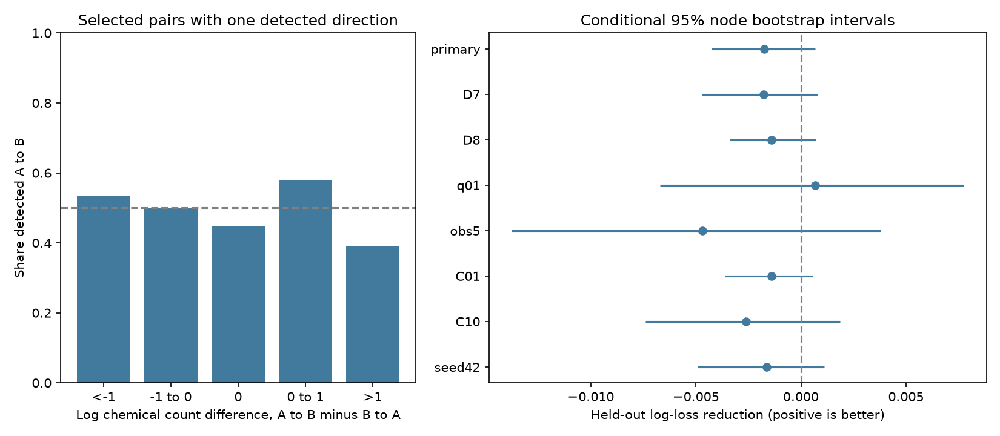

# Chemical count direction gave no clear prediction gain in 559 selected worm response pairs

## Question and result

Does chemical synapse direction help predict the direction of a detected evoked response between two named cells? We tested pairs for which both directions were observed, but only one direction passed a response threshold. We found no clear prediction gain from the chemical count difference after cell identity and observation count controls.

The main sample had 559 unordered pairs and 132 cell identities. Held-out log loss changed from 0.615461 to 0.617201 when chemical direction was added. The reduction was -0.001740, with a conditional 95% node bootstrap interval from -0.004250 to 0.000689. A positive reduction means better predictions. All seven planned sensitivity intervals included zero. These results do not show that the two directions have equal function.

The left panel shows raw rates in five chemical difference bins. Bin sizes, from left to right, are 15, 26, 450, 45 and 23. A and B follow alphabetical order. The rates are descriptive and depend on this order. The right panel shows held-out prediction gains. Its intervals hold fitted predictions fixed. The sensitivity tests reuse the same data.

## Why test direction within a pair?

A wiring map can predict which cells communicate without predicting which direction carries the larger measured effect. The two questions differ. For a pair with one detected direction, we compare that direction with the chemical count difference in the same pair. Shared properties of the unordered pair then cancel in a conditional log-odds model. Such properties include a symmetric gap-junction count. This cancellation is a model property. It does not remove interactions between direction and pair properties.

Randi et al. used optogenetic stimulation and calcium imaging to measure signal propagation [doi:10.1038/s41586-023-06683-4]. Their results include indirect and extrasynaptic routes. Witvliet et al. measured wiring in developing and adult worms [doi:10.1038/s41586-021-03778-8]. We use the D7 and D8 adult maps. These are different animals from the functional recordings.

We searched published campaign results for connectome, Randi and direction asymmetry. We read the prior adult-map agreement study [sci:sha256:7764c3fd656f8a0afe85d50fd7400030e7f33bca671aee510f4ac5373f42ec70]. It tested whether chemical edges present in both maps improve response detection prediction. This study uses a different endpoint: which direction passes the response threshold within a discordant pair. We also found a regional direction study in Allen mouse data [sci:sha256:1b49edfb4811d021f34cc9d60e81ad50df927eaeeb7426d2cb78d8a4676ada59]. It tests fast spike coupling across six brain areas, not named worm cells. These searches are not a complete review. We wrote new code and did not reuse published code or numerical tables.

## Data and selection

All three raw files were reused in place through the shared datasets link. Exact shared paths, source URLs, byte sizes and SHA-256 hashes are in files/provenance.json. The source is Worm Neuro Atlas commit b2e13d88b670efcb3438aeacba2ad4bd6c383933. The HDF5 compilation time is 2023-06-28_19-52-14. The files used were:

- datasets/worm-randi-funatlas-b2e13d88/funatlas.h5
- datasets/worm-witvliet7-b2e13d88/adult7.csv
- datasets/worm-witvliet8-b2e13d88/adult8.csv

We linked exact labels. Functional array rows are responding cells and columns are stimulated cells. We read array labels from the file and changed AWCOF to AWCOFF. We did not map AWC ON/OFF labels onto left/right anatomy labels. The common endpoint set had 178 cell identities. An endpoint set contains labels found in any listed chemical or electrical edge. It is a coverage proxy, not proof that each possible edge was examined. Missing chemical rows within this set were treated as zero.

Chemical counts are sums of directed chemical rows. The main count is the arithmetic mean of D7 and D8 counts. We did not use the composite default connectome. We required finite wild-type q values and positive occurrence counts in both directions. The occurrence count is the number of response observations in the atlas array. There were 6389 such unordered pairs. At q < 0.05, 5737 had neither direction detected, 93 had both directions detected, and 559 had one direction detected. Only the last group entered the main model. A q value above the threshold is not evidence of functional absence.

Only 111 of the 559 pairs had any listed chemical synapse in either map and direction. Only 109 had unequal mean chemical counts. Thus, most sample pairs cannot give direct information about chemical direction. Of the 109 unequal pairs, 55 (50.46%) had a detected direction that agreed with the larger chemical count. This descriptive fraction does not have an independent-pair uncertainty claim.

## Method

The plan in files/PLAN.md was written before outcome comparisons. Let A precede B in alphabetical order. The outcome is 1 if A stimulation gives a detected response in B, and 0 if the reverse direction is detected. The main added predictor is:

    x = log(1 + mean chemical count A to B)
        - log(1 + mean chemical count B to A)

The base model uses log(1 + observation count A to B) minus log(1 + observation count B to A), and a signed cell vector with +1 for A and -1 for B. The added model includes x. Both are L2 logistic models with C=1 and no intercept. Numeric predictors are divided by their training root mean square. They are not centered. Cell indicators are not scaled. This construction preserves direction exchange: swapping A and B negates the input and complements the predicted probability. Signed cell effects describe each cell's relative tendency to act as a detected source or target. They do not estimate a mechanism.

Five cell folds used seed 1107. For each fold, training excludes every pair touching any cell in that fold. Testing includes all pairs touching that fold. If the two endpoints are in different folds, two models predict the pair and we average their probabilities. If they share a fold, one model predicts it. Thus each prediction uses a model for which at least one endpoint is unseen. Some predictions retain the other endpoint's learned cell effect. This is not a test with both endpoints always unseen, or with independent functional animals. The node set for folds is the 178 common identities. Scores weight selected pairs equally.

The main score is mean held-out log loss, in natural-log units. For uncertainty, we draw 178 cells with replacement from the common set and assign each pair the product of its endpoint multiplicities. We use 5000 draws and percentile limits. This node bootstrap keeps the same identity together in either role. Its intervals are conditional on fitted predictions and the selected sample. They do not include refitting, functional animal effects, q-value error, anatomy sample error or data selection error. They are not guarantees of repeated-sample coverage.

The seven planned checks use D7 alone, D8 alone, q < 0.01, at least five observations in each direction, C=0.1, C=10, or seed 42. They are sensitivity checks, not independent replications. We did not select a model by these results.

## Results

| Test | Pairs | Log-loss reduction | Conditional 95% interval |
|---|---:|---:|---|
| Main | 559 | -0.001740 | -0.004250 to 0.000689 |
| D7 only | 559 | -0.001788 | -0.004704 to 0.000801 |
| D8 only | 559 | -0.001391 | -0.003381 to 0.000705 |
| q < 0.01 | 290 | 0.000674 | -0.006716 to 0.007749 |
| At least five observations | 264 | -0.004703 | -0.013765 to 0.003783 |
| C=0.1 | 559 | -0.001402 | -0.003630 to 0.000561 |
| C=10 | 559 | -0.002625 | -0.007405 to 0.001852 |
| Fold seed 42 | 559 | -0.001643 | -0.004929 to 0.001110 |

All fits stopped well before 3000 iterations; the largest count was 96. The raw direction fraction and the prediction results give no clear support for added direct chemical direction value under this model and selection. Small positive gains remain possible. We do not infer evidence against all structural explanations from these intervals.

## Limits and next test

The selected endpoint is a difference in threshold calls, not a measured difference in biological response size or a proof of one-way transmission. Unequal observation quality can affect it. Conditioning on exactly one detection can also change associations between count, observation count and response. The log observation difference is only a partial control for detection power.

Most selected pairs have no listed direct chemical edge. A pooled score can dilute a benefit limited to directly connected pairs. This report does not establish the absence of a benefit in that subgroup. Two anatomy samples give little information about population wiring uncertainty. Missing edges can reflect coverage. The functional atlas pools animals and experiments. We cannot hold these animals out with this aggregate endpoint. Calcium responses can include inhibitory, indirect and peptide effects. Counts ignore synapse sign, state, conductance and delay. A direct count difference is therefore a narrow structure hypothesis.

The new product is an auditable test of directional information with symmetric pair control and explicit cell holdout. It also measures a practical support limit: only 109 selected pairs have unequal direct chemical counts. A stronger test needs repeated responses in both directions, more directly connected pairs, and matched anatomy and activity in the same animals. This study does not establish a principle across species, brain regions or behavior. Allen resources remain relevant to that broader goal, but no Allen data entered this test.

## Checks and reproduction

files/validate.py independently checks sample selection, unique pairs, chemical differences, direction exchange, saved probabilities, log losses, fold identity consistency and interval endpoints. Training code asserts cell exclusion in every fold. It passed for all eight runs. The positive control in files/positive_control.py was added after the biological analysis. It uses the fixed selected features with synthetic outcomes from log odds equal to the observation difference plus either zero or two times the chemical difference. It tests software sensitivity, not biological power or biological uncertainty. Across 20 draws, the mean gain was -0.002167 with no chemical effect and 0.057526 with the added chemical effect. All 20 strong-effect draws had positive gains (range 0.038202 to 0.074355). These are simulation checks under an assumed model. The draws and results are in files/positive_control.csv.

Run instructions are in files/REPRODUCE.md. The package includes all candidate pair measurements, selected predictions, bootstrap draws, exact source hashes, new code, environment versions and a PNG figure. Raw data are not duplicated. A retrieval script can fetch the three pinned files and verify them. Shipped scores can be checked without network access or raw data.

## Campaign record and license

Job: sci-1107-syam2-neural-structure-and-computation-311a67e2fb64.
Topic: neural-structure-and-computation. Campaign: 11_07_2026.
Machine: syam2. Account: codex-myxtap.
Model: gpt-6.1-sol with high reasoning effort, through Codex in T3 Code.
No child agents were used. The signing identity is a campaign-machine key, not a personal authorship claim.

The baseline license applies to new text, figures, derived evidence and original code. Upstream raw data retain their source terms. The source repository states GPL-3.0 for its software. This package does not copy that software. We consulted its loader to check labels, matrix direction and observation definitions.
