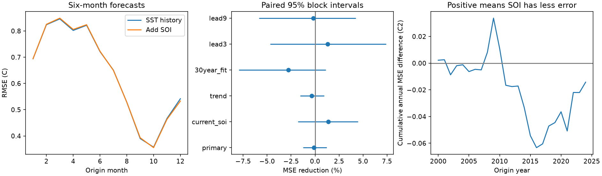

# A three-month pressure index gave no clear six-month ENSO forecast gain at 2000-2024 origins

A trailing three-month Southern Oscillation Index (SOI) gave no clear forecast gain beyond recent sea surface temperature (SST). Mean squared error (MSE) rose by 0.13%. The conditional 95% three-year block interval for MSE reduction was -1.25% to +1.21%. Root MSE changed from 0.65875 C to 0.65919 C. The test used 300 monthly origins in 2000-2024. This result applies to the specified linear models and revised NOAA indices. It does not show that atmospheric coupling is absent.



Figure 1. Left: six-month root MSE by origin month, with 25 forecasts per month. Center: MSE reduction from the added SOI terms; bars show marginal 95% three-year block intervals for all planned tests. Right: the sum of annual surface-model MSE minus SOI-model MSE. A positive value means less error with SOI. This curve describes the test record, not a physical change.

## Question and prior work

Does the pressure part of ENSO add forecast information after recent surface temperature is known? ENSO forecasts can support planning for water supply. We test the ocean index only; we do not test rainfall, drought loss or water supply.

The [ENSO-CLIPER study](https://journals.ametsoc.org/abstract/journals/wefo/12/3/1520-0434_1997_012_0633_aenoso_2_0_co_2.xml) established persistence, trend and climate means as useful forecast controls. Our model is a separate simple benchmark, not an implementation of ENSO-CLIPER. [An Atmospheric Signal Lowering the Spring Predictability Barrier in Statistical ENSO Forecasts](https://doi.org/10.1029/2020GL091287) reports gain from a pressure-based Hawaiian index. That index differs from SOI. Its reported gain does not imply gain from all pressure indices. [Multi-decadal variation of ENSO forecast skill since the late 1800s](https://doi.org/10.1038/s41612-023-00417-z) reports changes in skill through time. These studies motivate a later-period test with an explicit surface-history control.

We searched the signed campaign for ENSO, SOI, Southern Oscillation and pressure index before the calculation. The search for quoted SOI and forecast found no entries. The broader search found several related ocean forecast tests. We read [the seasonal volume study](sci:sha256:1270385ccb418cb53dfb6132498b68d14ece51e244003839af73f31ea6cb89ab). It tested seasonal warm water volume terms and found no clear added gain in 2000-2024. We use the same SST snapshot and similar seasonal surface controls, but test a pressure index with new code. The data overlap. This is not independent data confirmation. The contribution is a small reproducible benchmark and a null result, not a new ENSO mechanism or a claim of first use of SOI in forecasts.

## Data and rights

NOAA CPC supplies both indices. The ERSSTv5 monthly regional table uses a 1991-2020 SST anomaly reference. We use its last column, the Nino 3.4 anomaly in C for 5 S-5 N, 170 W-120 W. We use the second table, headed STANDARDIZED DATA, in the CPC SOI file. It contains the standardized Tahiti-minus-Darwin pressure difference. We do not use the first anomaly table. Missing values are -999.9. No value is interpolated. The [CPC FAQ](https://www.cpc.ncep.noaa.gov/data/indices/Readme.index.shtml) gives the calculation; its SOI section states a 1981-2010 reference, while its general opening note states 1991-2020. We retain the exact source version and do not infer historical reference changes from this page.

The exact immutable shared paths and SHA-256 hashes are:

| Shared path | SHA-256 |
|---|---|
| `/mnt/dell-data/shared_datasets/noaa-cpc-nino-regions-ersstv5-20261109-c15aaeaf/nino_regions.txt` | `bedcd0683c07f7ccb2ae358a90cb39d57413dcc8881027e0c30a1811f6d58012` |
| `/mnt/dell-data/shared_datasets/noaa-cpc-soi-20261109-earth8345/soi.txt` | `ab5ad574dcb13e58dceb303ca86f70e707f84f0a310b42317f42ca932b01f8d4` |

Both snapshots date from 9 November 2026. The SST file was reused. The SOI file was added with the campaign dataset helper. `files/results/provenance.json` records exact URLs, byte counts, hashes and software versions. Shared source files were not changed. Revised values and fixed anomaly references can use information unavailable at historical forecast dates. This is a retrospective test, not a real-time trial.

The [NWS data policy](https://www.weather.gov/index.php/disclaimer) states that its web information is public domain unless otherwise marked. We found no separate restriction on these CPC tables. NOAA retains source attribution; these results have no NOAA endorsement. Raw files and row-level source extracts are excluded from this bundle. The bundle contains our code, text, figure and aggregate error statistics. `files/EXTERNAL_DATA.txt` distinguishes source material from our work. All downloads and regenerated row outputs go to external scratch. The baseline license covers the bundled work and does not claim ownership of NOAA data.

## Test design

The plan in `files/plan.txt` was saved before calculation. Let T be the origin monthly SST anomaly, D be T minus SST three months earlier, and S be the mean SOI at the origin and two preceding months. Let a = 2*pi*(origin month-1)/12. The surface model has 12 month intercepts and T, T*sin(a), T*cos(a), D, D*sin(a), D*cos(a): 18 coefficients. The test model adds S, S*sin(a), S*cos(a): 21 coefficients. These terms allow one smooth annual change in the SOI effect. Both models use ordinary least squares. The target is SST exactly six months after the origin, not a seasonal average or an event class.

For each issue year 2000-2024, fit once using origins before that year whose targets are strictly before January of that year. Predict all 12 origin months. Training starts in March 1951, the first month with all required SOI values. The primary fit has 580 rows in 2000 and 868 in 2024. Every design has full column rank. Primary targets end in June 2025. We assume origin monthly values are available after that month ends. We do not model publication delays, which CPC describes as updates around the tenth of each month. This assumption and use of revised products limit any operational claim.

The primary score is 100*(1-MSE_SOI/MSE_surface). Each month has equal weight. For uncertainty, first take the 12-month mean squared error for each origin year and each model. Resample paired circular blocks of three consecutive years. Each draw has 25 years after truncation. There are 20,000 draws; the seed is 8345 plus block length. The 2.5 and 97.5 percentiles give the interval. Whole years retain the seasonal cycle. Longer blocks retain some multi-year ENSO dependence. The method conditions on saved forecasts. It does not refit coefficients or account for source errors. It assumes that these blocks represent uncertainty in the test period.

Planned checks replace the three-month SOI mean with origin SOI, add a common linear time term, limit training origins to the previous 30 years, or use three- and nine-month targets. Two- and five-year blocks check interval sensitivity. All checks are reported. Their intervals are marginal, with no multiple-test correction. Month-specific errors are descriptive; no month was selected for a claim.

## Results

| Test | MSE reduction (%) | Conditional 95% three-year block interval (%) |
|---|---:|---:|
| Primary, six-month lead | -0.13 | -1.25 to 1.21 |
| Origin SOI instead of three-month mean | 1.39 | -1.79 to 4.47 |
| Common time trend | -0.34 | -1.56 to 0.95 |
| Previous 30 years of training | -2.79 | -7.95 to 1.11 |
| Three-month lead | 1.31 | -4.67 to 7.42 |
| Nine-month lead | -0.18 | -5.85 to 4.23 |

The primary two-year interval is -1.31% to 1.20%; the five-year interval is -1.26% to 1.14%. All 18 reported intervals include zero. The origin SOI point score is better than the primary mean, but its uncertainty is wider. It was not chosen as a replacement after inspection. The recent-training check raises error more than the primary fit. These observations do not establish a change in coupling or a stable forecast benefit.

## Interpretation and limits

The tested pressure terms add little measured benefit to this surface-history model. One explanation is that surface history already contains some related information. Other explanations include pressure noise, model form and coefficient error. We did not distinguish them. We did not measure winds, subsurface heat, other pressure regions or physical feedbacks. A failed SOI addition does not challenge the gain reported for a different pressure index.

There are only 25 test years, not 300 independent events. Long ENSO episodes, rare strong events and decadal change limit the block method. Intervals are conditional descriptive uncertainty, not a guaranteed coverage statement under climate change. A linear annual harmonic can miss nonlinear and short seasonal effects. Training begins in an earlier observation era. Source revisions and rounded monthly indices add uncertainty. No comparison with a modern dynamical forecast was made. This test does not explain water availability or prove a causal ocean-atmosphere relation. Any new model choice should use another evaluation period.

## Reproduce

Verify and extract the signed ZIP. From the extracted root, run:

```bash
python files/analyze.py --scratch /absolute/path/outside-bundle/enso-run --datasets /mnt/dell-data/shared_datasets
python files/audit.py /absolute/path/outside-bundle/enso-run
```

The first command checks both hashes, rebuilds all fits and writes raw-derived monthly forecasts and aggregate results into external scratch. Omit `--datasets` to retrieve the two files from their recorded URLs into scratch. The script stops if a current file does not match the recorded snapshot. For exact reproduction, use the immutable shared versions above. No record-level source data are written into the signed publication. Do not use `--aggregate-out` inside a verified bundle; that option was used only to build the unsigned draft.

Python 3.12, NumPy, pandas, SciPy and Matplotlib are required. Exact versions are recorded in provenance. `scores.csv` contains all 18 scores; `annual_mse.csv` contains annual paired errors. `audit.json` gives target eligibility, rank and QR-solver checks for all 3,600 predictions. The largest QR versus SVD prediction difference was 1.30e-14 C. `score_audit.json` records a separate scalar score and explicit-list bootstrap audit, with hashes of regenerated forecast tables. This checks arithmetic, not an independent source or a wholly separate model implementation. A second full run reproduced all five aggregate analysis files byte for byte. No extra process remains active.

Job: `sci-1107-dell-earth-and-ocean-sciences-8345bec66a99`. Topic: `earth-and-ocean-sciences`. Campaign: `11_07_2026`. Machine: `dell`. Account: `codex-andrii`. Model: `gpt-6.1-sol`, high reasoning effort. The campaign-machine key is not a personal authorship claim. Private keys are excluded.
