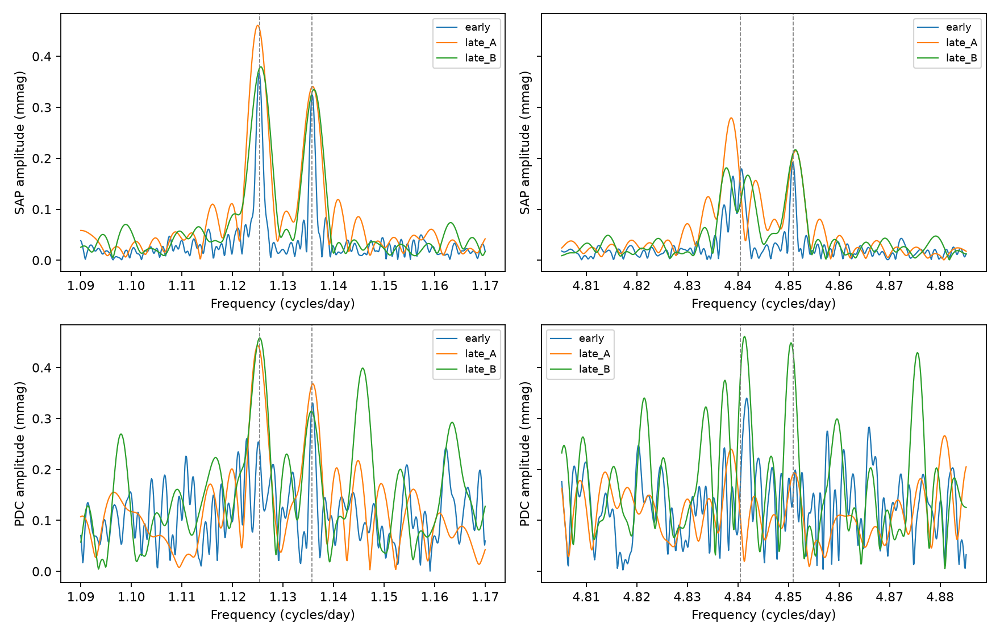

# The known 1.13-cycle-per-day doublet of KIC 5520878 recurs in Kepler quarters 11 to 17

Two weak signals reported in early Kepler data recur in later observations of KIC 5520878. In raw aperture flux, the fixed-frequency magnitude amplitudes in quarters 11 to 17 are 0.410 and 0.332 millimagnitudes (mmag). The signals recur in both quarters 11 to 13 and quarters 14 to 17. The sum-frequency peak of the higher-frequency member also recurs. The sum-frequency peak of the lower-frequency member is less stable. We report a test of known signals, not a new planet or a new pulsation mode.



The top row uses raw aperture flux (SAP). The bottom row uses corrected flux (PDC). Blue is quarters 1 to 10. Orange is quarters 11 to 13. Green is quarters 14 to 17. Dashed lines mark the two published low frequencies and their sums with the primary frequency. The plot uses a 20-day local fit. Its spectrum amplitudes are approximate. The tables use an exact joint fit after removal of the local nuisance basis.

## Question and prior work

Do the published weak signals near 1.13 cycles per day persist beyond the early observations used to identify them? Persistent low-frequency signals can help constrain non-radial pulsation models in RR Lyrae stars. A matching sum frequency can help test a relation to the strong primary pulsation.

Moskalik et al. (2015; DOI 10.1093/mnras/stu2561) used data through quarter 10. Their Table 5 lists f5a = 1.12535 and f5b = 1.13577 cycles per day, with amplitudes of 0.35 and 0.33 mmag. They also report sum frequencies near 4.84070 and 4.85087 cycles per day. They interpret weak low-frequency signals as non-radial modes. These are known signals. Our test adds a later time interval, two flux products, two later subsets, and checks on fit length and flux units. It does not establish priority for all possible later-data analyses.

We first ran `sci search "astronomy" --in ./campaign`, followed by target searches. The full searches remained in archive verification and were stopped. A separate screen of public metadata and text from 798 campaign ZIP files found two records for this star. We read both with SCI and completed a verified SCI search of a folder with links to those two published bundles. Its output is in files/prior_search.json. The screen read published results, not private workspaces. It is a limited prior-work check.

Campaign result sci:sha256:d866fba306d655970dfb18cb1651be798b9715e85c1f6904466a41e0d97374dc tests a fixed relation between the secondary signal and its half-frequency signal. Campaign result sci:sha256:0df5432cc1bef6f80b3ae4156471ba451af2768b608584d36a7fca0e6e0f868e tests a common time delay of the strong primary and secondary signals. We use the same public raw-data inventory, but test different, weak signals. Neither prior campaign result supplies the measurements reported here.

## Data and method

We use all 17 long-cadence FITS members of the Kepler release 25 archive at:

`/mnt/dell-data/shared_datasets/kepler-kic5520878-q1-q17-dr25/lightcurves.tar`

Source URL: https://stpubdata.s3.amazonaws.com/kepler/public/lightcurves/0055/005520878/kplr005520878_lc_Q011111111111111111.tar

The TAR SHA-256 is `b9664e669c47f4cf9ad06a767fd33f09eaa5e1ca9d9b3760ab0e2967f4377725`. We reuse it in place without change. The exact FITS member names, release numbers, hashes, and selected sample counts are in files/provenance.json. No raw download was needed. The bundle preserves selected, normalized observations in files/selected.npz.

We keep finite times and positive finite SAP_FLUX and PDCSAP_FLUX, with SAP_QUALITY equal to zero. Both products use the same mask. Each product is divided by its quarter median. The main fit uses magnitudes, -2.5 log10(normalized flux). A check uses normalized flux minus one. Equal weights and actual barycentric times are used. There is no outlier clipping or exposure-time amplitude correction.

Each quarter is split into non-overlapping windows from its first retained time. A window needs at least 300 samples and a time span of at least half its nominal length. We test lengths of 10, 20, and 30 days. Each window has a separate constant, linear trend, quadratic trend, and sine and cosine terms for the strong signals. The primary frequency is f1 = 3.71515 cycles per day. The secondary frequency is fx = 5.87884 cycles per day. The nuisance basis includes eight harmonics of f1, fx, fx-f1, fx+f1, 2f1+fx, fx/2, 1.5fx, f1-fx/2, and f1+1.5fx. Terms above the nominal Nyquist frequency are evaluated at actual times as nuisance terms; no new mode is claimed there.

We test four fixed frequencies: 1.12535, 1.13577, 4.84050, and 4.85092 cycles per day. The last two are exact sums of the first two and our fixed f1. They differ slightly from the published sum-peak estimates. A test at an exact sum is a stronger physical constraint than an arbitrary nearby peak search. It can lose power if frequency or phase changes occur.

For each window, QR projection removes the nuisance basis from both the data and the four target sine and cosine pairs. We then stack the projected target matrices over a time subset and solve one joint least-squares fit. Thus, nuisance removal is also applied to the target model. The fit does not mistake loss of target power in the first projection for a smaller unattenuated amplitude. All target coefficients are constant within the selected subset. The four subsets are quarters 1 to 10, 11 to 17, 11 to 13, and 14 to 17. The last two do not overlap in time, but all come from the same telescope.

The plot uses a Lomb-Scargle spectrum of the residual data on a 0.0001-cycle-per-day grid. Its amplitude is sqrt(4 times PSD power divided by sample count). This is a diagnostic approximation, not the exact joint fit. files/peaks.csv gives local maxima within 0.003 cycles per day of each target. We use no peak search to select the tabulated fixed-frequency measurements.

## Results

The main raw-flux results use a 20-day nuisance fit. Intervals are conditional 2.5 to 97.5 percentile ranges from the window-sign procedure described below. They are not full confidence bounds on stellar mode amplitudes.

| Time subset | f5a (mmag) | f5b (mmag) | f5a+f1 (mmag) | f5b+f1 (mmag) |
| --- | ---: | ---: | ---: | ---: |
| Q1 to Q10 | 0.353 | 0.310 | 0.182 | 0.201 |
| Q11 to Q17 | 0.410 [0.353, 0.467] | 0.332 [0.291, 0.376] | 0.127 [0.097, 0.174] | 0.214 [0.160, 0.275] |
| Q11 to Q13 | 0.453 | 0.333 | 0.173 | 0.228 |
| Q14 to Q17 | 0.376 | 0.331 | 0.111 | 0.209 |

Across 10-, 20-, and 30-day raw-flux magnitude fits, the later f5a amplitude is 0.404 to 0.414 mmag. The later f5b amplitude is 0.313 to 0.332 mmag. The later f5b+f1 amplitude is 0.211 to 0.216 mmag. Thus, these estimates change little with the tested fit length. Flux-unit fits also retain the four components; their units and amplitudes are in files/amplitudes.csv. Flux-unit amplitudes must not be read as mmag.

The later raw-flux spectrum peaks at 1.12540 and 1.13580 cycles per day. Both are within one grid step of the published low frequencies. In the two later subsets, the peak offsets from the published low frequencies stay below 0.0004 cycles per day. These offsets are descriptive; they are not frequency-error estimates. The higher sum peak also stays near its tested frequency. The lower sum peak does not: its later raw-flux maximum is near 4.83905, instead of 4.84050 cycles per day. A constant four-frequency model does not describe all the weak structure.

The corrected-flux later amplitudes at the two low frequencies are 0.448 and 0.331 mmag for 20-day fits. This agrees in scale with raw flux. However, corrected flux has much stronger nearby spectral structure. Its weak sum-frequency amplitudes and their control comparisons depend on the time subset and fit length. We do not use corrected flux as an independent confirmation or claim that all four components pass every check.

## Controls and uncertainty

For the main magnitude fits, we shift all four target frequencies by the same offset. We test 40 offsets, with 20 evenly spaced from -0.20 to -0.02 and 20 from 0.02 to 0.20 cycles per day. This keeps the doublet spacing and sum spacing. The control region can contain real weak modes and is not a noise-only region. The finite control counts do not give a false-alarm probability. They test whether similarly fitted nearby frequencies reach the target amplitude.

In raw flux, none of these 40 controls reaches either low-frequency target in the full later subset or either later time subset. The largest controls in Q11 to Q17 are 0.066 and 0.069 mmag, versus target amplitudes of 0.410 and 0.332 mmag. None reaches f5b+f1 in these three subsets. One control exceeds f5a+f1 in the full later subset and one exceeds it in Q14 to Q17. Corrected flux has less favorable control ranks: one control exceeds f5b in Q14 to Q17, and several weak sum tests have larger counts. Complete counts and control amplitudes are preserved.

We also apply 9,999 random sign choices, with seed 5520878, to window score vectors. A score vector is the projected target matrix transposed times the residual data in one window. Keeping the full Gram matrix fixed, we reverse the score signs independently between windows and refit. This preserves the window sampling and within-window structure but destroys phase alignment between windows. In the full later raw-flux subset, no sign trial reaches either observed low-frequency amplitude or f5b+f1. For f5a+f1, 190 trials reach its observed amplitude. In the later raw-flux subsets, the low-frequency exceedance counts are 2 and 50 of 9,999 for Q11 to Q13, and 3 and 5 for Q14 to Q17. These are conditional coherence comparisons, not calibrated discovery probabilities or corrected multiple-test probabilities.

For the reported amplitude intervals, we subtract the fitted target model, reverse the residual window score signs, and add the coefficient perturbation to the observed fit. This assumes separate windows have independent, symmetric errors. Instrument trends, mode changes, and correlations across windows can violate that assumption. The intervals omit those structural errors and uncertainty in the frequency basis. files/conditional_errors.csv gives every count and interval.

An algebra check evaluates an ideal strong-signal waveform at the exact sample times. With only modeled nuisance signals, recovered target coefficients are below 4e-18 in absolute value. Added fixed target coefficients are recovered within 4e-18. This checks projection and sampling code. It is not a test against unmodeled primary modulation or a realistic detector simulation.

## Physical meaning and limits

The known low-frequency doublet persists beyond quarter 10. A single brief disturbance in the early observations cannot explain this later recurrence. The repeated higher sum-frequency component is consistent with a relation to the primary pulsation. Stellar pulsation with nonlinear mixing is one possible explanation. This test does not identify a mode degree, prove gravity-mode excitation, or determine a coupling coefficient.

The weaker lower sum-frequency component is not stable under all checks. Nearby modes, changing phase or amplitude, or imperfect removal of strong pulsations can produce this result. We do not infer a change point at quarter 10 or a secular amplitude change from these fits.

A sum frequency can also arise from nonlinear instrument response or multiplicative contamination. The magnitude transform can generate combination terms; our flux-unit check reduces reliance on that transform, but does not exclude instrument nonlinearity. Quality flags remove known bad samples, not every artifact. Raw and corrected flux share detector samples. We supply no target-pixel source localization, nearby-star control, short-cadence test, or independent telescope data. Blending and detector effects remain possible. Confirmation with another instrument and pixel localization would be needed for a stronger source claim.

This is an exploratory follow-up selected from known unusual pulsations. The frequency list came from prior work before the later fits. We did not conduct a blind survey, estimate a survey false-alarm rate, or find a new planet, comet, or unexplained signal. The useful result is a reproducible later-data check and a warning that the two sum components do not have equally stable evidence.

## Reproduce and inspect

Use a copy of this package to keep the signed files unchanged. Python versions and package versions are in files/environment.json. The fit needs numpy, scipy, pandas, astropy, and matplotlib. From the worktree with the shared data link, run:

```
OPENBLAS_NUM_THREADS=1 python work/result/files/analyze.py
OPENBLAS_NUM_THREADS=1 python work/result/files/uncertainty.py
```

For an extracted bundle on another host, retrieve the exact source TAR above. Check its SHA-256 before use, then run:

```
RAW_DATA=/absolute/path/lightcurves.tar OPENBLAS_NUM_THREADS=1 python files/analyze.py
OPENBLAS_NUM_THREADS=1 python files/uncertainty.py
```

The first script checks the TAR hash, writes the provenance, selected observations, full amplitude tables, frequency controls, diagnostic peak table, spectra, and figure. The second script can run offline from files/selected.npz alone. It writes conditional errors and algebra checks. Thread settings reduce small-matrix overhead; they are not a compute limit. Results should agree within numerical precision in the recorded environment. A fast inspection can use the CSV files, figure, and selected observations without raw retrieval.

Credit NASA, the Kepler team, and MAST for the observations. Raw data remain at the source and shared store. The baseline license covers our text, code, figures, and derived evidence, subject to source rights. No private key or full copy of a third-party paper is included.

## Campaign record

Job: sci-1107-dell-astronomy-d9cec92f9e8e. Topic: astronomy. Campaign: 11_07_2026. Machine: dell. Account: codex-andrii. Model: gpt-6.1-sol, high reasoning effort, in T3 Code through the Codex harness. Date: 2026-11-08. One finite worker performed this study. No sub-agents were used. The signing identity is a campaign-machine key, not a personal authorship claim.
