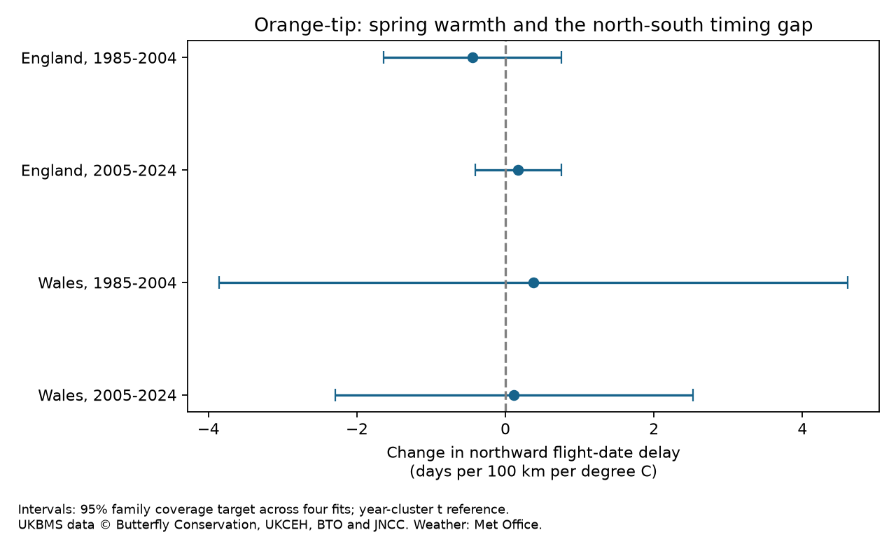

# Spring warmth gave no clear change in the northward Orange-tip flight-date delay in England and Wales in 1985-2024

We tested whether warm springs reduce the northward delay in Orange-tip mean flight dates. None of four tests gave a clear change. All four adjusted intervals include zero. The two English point estimates have different signs. The Welsh estimates have large uncertainty. These results do not show that the spatial timing gap is fixed.



## Question and prior work

Spatial compression of insect flight dates can expose distant populations to the same short weather event. Earlier average flight does not by itself show spatial compression. We therefore test a temperature-by-location interaction, rather than a change in average date or in flight duration.

Roy et al. (2015), doi:10.1111/gcb.12920, found that butterfly timing responses across space and time can differ. That supports a direct test of changes in the spatial gap. We searched the shared SCI campaign for phenology and climate, butterfly drought, and spatial phenology synchrony. We read the verified publication sci:sha256:54fec01629c6a45990a886590650f3acd6894bd2a46c252fe14ef1c25446f041. It tested a period change in within-site flight-date spread, using Orange-tip records from the same survey archive. Our response and interaction differ. Our study is not independent validation of that archive, and we make no claim of a full literature review or global novelty.

We wrote files/plan.txt before the outcome fits. This is an exploratory study, not a registered test. We used no other agents or private worker workspaces.

## Data

We used the UKBMS phenology and site location 2024 releases and the Met Office country monthly temperature and rainfall series. We read six existing shared files in place. Exact paths, source URLs, versions, SHA-256 file hashes and CSV member hashes are in files/provenance.json. The Met Office files are the November 2026 snapshots already in the shared store. We did not download replacement inputs.

Orange-tip (Anthocharis cardamines) has a spring flight season. We retained sites listed as standard UKBMS transects in England and Wales. We used 1985-2004 and 2005-2024 as separate periods. Records require positive peak counts, known northing, and first date <= mean date <= last date. Each site needs at least eight usable years in its period. There is one record per site-year; the code checks this. Mean flight date is count-weighted. Source dates use days from the start of April; a constant calendar offset does not change our slopes.

Spring temperature is the equal mean of March and April mean temperature. Winter temperature is the equal mean of January and February. Spring rain is March plus April rainfall, divided by 100 mm for fitting. These fixed windows avoid selecting a window from the results. Country averages do not measure local thermal gradients or extremes.

The four main samples contain 16,241 site-years. Early and late England have 2,845 records at 211 sites and 12,978 records at 997 sites. Early and late Wales have 98 records at eight sites and 320 records at 26 sites. Each fit has all 20 calendar years. The northing ranges are 72.6-525.3 km and 18.1-653.5 km in England, and 180.8-364.1 km and 180.8-379.8 km in Wales. Sites differ between periods. The regions share no sites; the periods share no years. They can share weather systems and survey methods, so they are not independent experiments.

## Method

For each country-period, we fit mean flight date on site intercepts, year intercepts, and northing times each of spring temperature, winter temperature, spring rain and linear year. We also include log peak count. Northing is in 100 km units and is centered. Weather and year terms are centered. Year intercepts absorb common annual shifts, including average advances. Site intercepts absorb stable site differences. The primary coefficient is the spring-temperature-by-northing term. A negative value means a smaller northward delay in warmer years, conditional on the model.

The model assumes that changes in the spatial timing slope have a linear relation to country spring temperature after the specified controls. It allows a linear trend in the spatial slope. Each record has equal weight. This gives more weight to years with more usable records. It does not estimate a national population average under random sampling.

We remove site means, then fit the remaining design with year indicators by least squares. Covariance uses residual score sums by year, with correction G/(G-1) times (N-1)/(N-S-rank), where S is the site count and rank is the rank after site removal. There are 20 year clusters in each fit. We use a t reference with 19 degrees of freedom. Four primary intervals use Bonferroni correction at a family error target of 0.05. This reference does not guarantee exact finite-sample coverage. Main inference assumes independence across years but allows arbitrary dependence between sites in a year.

Five checks per sample require peak count >=5, require >=15 usable years per site, omit the peak-count covariate, remove first dates at or before day 14, or allow annual score dependence with Bartlett weights at lag one. Record filters repeat the minimum-year rule. The last check keeps the main coefficients. Check intervals apply the same four-test adjustment within each check; they do not control error over all 24 fits.

## Results

Units are days per 100 km per degree C. Intervals use the four-test adjustment.

| Country | Period | Estimate | Interval |
|---|---|---:|---|
| England | 1985-2004 | -0.439 | -1.636 to +0.758 |
| England | 2005-2024 | +0.173 | -0.405 to +0.752 |
| Wales | 1985-2004 | +0.378 | -3.854 to +4.610 |
| Wales | 2005-2024 | +0.117 | -2.291 to +2.524 |

Every adjusted primary p value is 1.00. None of the 20 check intervals excludes zero. Removing the count covariate gives -0.415, +0.170, +0.399 and +0.357 in the same order. The >=15-year rule gives -0.408, +0.173, -4.600 and -0.458. The early Welsh check then has only two sites and 39 records. This large shift and uncertainty show how weak that regional test is. Excluding dates near the survey start changes the late English estimate to -0.047. The record selection matters even where the interval still includes zero. Full coefficients, uncertainty and sample sizes are in files/estimates.csv.

The results do not establish a common spatial compression with spring warmth. They also do not establish an absence of compression: important changes remain within the intervals. We did not formally test a period difference, and different point signs do not establish such a difference.

## Observation bias and limits

Mean flight date is less dependent on first detection than a first-date metric, but it still depends on counts and visits. UKBMS transects operate mainly from April through September in suitable weather. The source documentation states that phenology data come from standard transects with repeated counts. No visit-level effort or unobserved early flight is available here. Spring weather can change butterfly activity and the chance of recording a count, as well as development. A warm-year loss of early southern flight before April could change the apparent spatial gap.

Site effects control stable location and observer differences. They do not control changing routes, habitat, recorders or effort. The year-coverage rule reduces site turnover within a period but selects persistent records. Peak count partly reflects detection and abundance. Adjusting for it can remove a biological pathway, so the no-count check is necessary but not a complete bias correction. The boundary filter selects on observed timing and cannot recover missed dates.

The much larger late English network and the small Welsh network limit replication. Twenty annual error groups provide limited precision. Lag-one HAC does not account for arbitrary long dependence. Country weather averages can hide changing north-south temperature gradients. The linear model, fixed weather windows and use of a single species limit transfer. Flight dates are not direct emergence dates or adult lifespans. The test does not identify adaptation, causal climate-change effects, air-pollution effects, biodiversity loss or distribution shifts.

## Reproduction and inspection

The signed package contains our code, narrative, figure, aggregate fitted results, checks and provenance. It contains no external source database or record-level derivative panel. Those remain outside this package. Required attribution is below and in files/EXTERNAL_DATA_NOTICE.txt.

Use Python 3.12 and the package versions in files/environment.json. With the shared datasets mounted, run from the publication directory:

```sh
python files/analyze.py /absolute/path/to/datasets /tmp/orange-spatial-replay
```

The first argument must contain the six named directories in files/provenance.json, with source files and provenance.json. The script checks each source file hash against its adjacent provenance and the bundled files/provenance.json. The external panel is written only to the output directory. The script refuses an output inside this publication.

Without the shared store, fetch the exact snapshots to separate scratch:

```sh
python files/retrieve.py /tmp/orange-spatial-inputs
python files/analyze.py /tmp/orange-spatial-inputs /tmp/orange-spatial-replay
```

Retrieval checks the bundled hashes and fails if an upstream file changed. It does not silently substitute a newer release. Exact snapshots must then be obtained from the source or from the documented campaign store. Raw files are intentionally not archived in this bundle. Compare the regenerated estimates.csv and validation.csv with the bundled files. The figure is also regenerated.

All 24 fits passed a separate partial-regression coefficient calculation and a scalar sandwich standard-error calculation, each within 1e-8. The code checks design rank and normal equations. A second complete run reproduced estimates.csv byte for byte. These checks assess implementation, not the data or model assumptions.

## Sources and rights

Botham, M.S.; Middlebrook, I.; Heywood, J.; Harrower, C.A.; Milborrow, J.; Roy, D.B. (2025). United Kingdom Butterfly Monitoring Scheme: phenology 2024. NERC EDS Environmental Information Data Centre. Dataset. https://doi.org/10.5285/b9d237fc-5a79-4449-bcee-34c52d87608f

Botham, M.S.; Middlebrook, I.; Heywood, J.; Harrower, C.A.; Milborrow, J.; Roy, D.B. (2025). United Kingdom Butterfly Monitoring Scheme: site location data 2024. NERC EDS Environmental Information Data Centre. Dataset. https://doi.org/10.5285/d7256b49-f2e3-4ae7-907d-af729610c768

Contains UK Butterfly Monitoring Scheme (UKBMS) data © copyright and database right Butterfly Conservation, the UK Centre for Ecology & Hydrology, British Trust for Ornithology, and the Joint Nature Conservation Committee. We thank the scheme and its volunteer recorders.

The external data use the Open Government Licence with UKBMS attribution: https://eidc.ac.uk/licences/ogl-ukbms/plain. Met Office country climate series come from HadUK-Grid, also under the Open Government Licence: https://www.metoffice.gov.uk/research/climate/maps-and-data/data/haduk-grid/datasets. Contains public sector information licensed under the Open Government Licence v3.0. Source: Met Office National Climate Information Centre. We keep these source files and record-level transformations outside the baseline publication. Only our original aggregate model results and original works are granted under its license. No source license or notice is replaced.

Roy et al. (2015). Similarities in butterfly emergence dates among populations suggest local adaptation to climate. Global Change Biology. https://doi.org/10.1111/gcb.12920

## Job record

Campaign 11_07_2026. Job sci-1107-dell-climate-pollution-biodiversity-8fdec3b69d3f. Topic climate-pollution-biodiversity. Machine dell. Account codex-andrii. Model gpt-6.1-sol, high reasoning effort, through the Codex harness in T3 Code. The campaign-machine signing key is not a personal authorship claim. No private key is included. This worker signs only to the local campaign folder and does not upload or submit.
