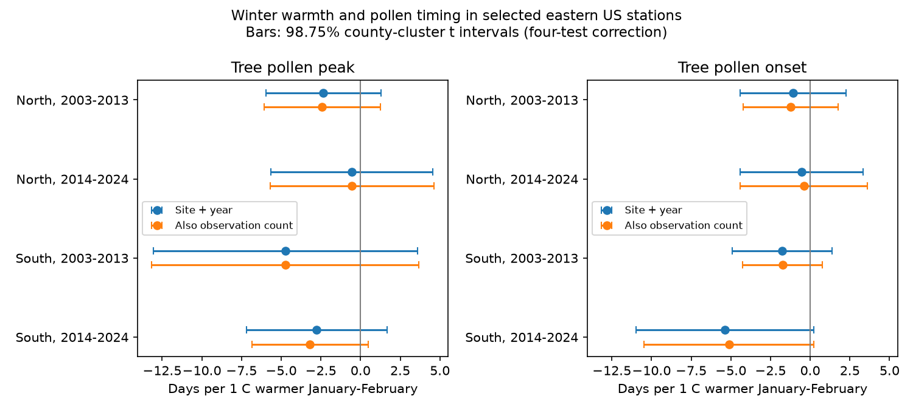

# January-February warmth slopes for tree pollen peak dates were uncertain in four eastern US samples in 2003-2024

We tested whether warmer winters were linked to earlier tree pollen peak dates. We used 656 station-years at 52 selected eastern US stations. All four fitted slopes were negative. All four corrected intervals included zero. Adjustment for observation count changed the slopes by less than 0.43 day per degree C. Thus these data do not establish a common link after local and annual controls. They also do not establish the absence of a link.



The figure compares models with site and year effects, with and without the log of observation count. Bars are 98.75% county-cluster t intervals. Four tests form one family for each outcome and model. Peak date is the primary outcome. Onset date is secondary.

## Question and prior evidence

Airborne pollen is a useful measure of ecological timing and a biological air contaminant. A prior North American study found earlier and longer pollen seasons and used climate models for attribution (Anderegg et al., 2021, doi:10.1073/pnas.2013284118). Our analysis asks a narrower question. Does local winter warmth have a clear link to peak timing after site and year effects, and does observation-count adjustment change that link?

Manangan et al. (2026, doi:10.3390/atmos17070635) describe the new CDC/NAB data release. Their methods define onset from three successive measured concentrations above a threshold and peak from the maximum measured concentration. They report variable sampling schedules and gaps. Thus uniform metric definitions do not ensure uniform observation effort.

The campaign search found a Swiss beech pollen study (SCI e092af7007f95d5408e7ab0e76676b2847b3b30f13359e15988e3ea8776548b3). It tests summer cues and annual pollen amount. We read it as related prior work. We reuse no code or data from it. This study uses another country, outcome and data system. It is not a direct replication. No other campaign pollen result found in the search used this CDC release. This is an exploratory study, not a registered test.

## Data and sample rules

We used CDC Socrata view rq2k-zaqh, retrieved on 2026-11-09. It has 2,793 rows, of which 1,429 are grouped-tree records. A separate API count query confirmed 2,793 rows. No API paging limit truncated this extract.

We joined county codes to the 2024 US Census county Gazetteer. Twenty-four tree rows had no county match and were excluded. We used county internal coordinates as location proxies. We selected latitude 30-50 N and longitude 100-65 W. This retained 979 tree rows before completeness filters.

North means latitude at least 40 N. South means latitude below 40 N. Periods are 2003-2013 and 2014-2024. We required at least 30 seasonal observations, valid onset and peak dates, valid weather, and at least five complete years per station within each period. These rules gave 656 rows at 52 distinct stations. State plus station label defines a station. No station-year was duplicated. No peak preceded its onset.

Temperature is the nearest 0.5-degree GHCN-CAMS cell at the county coordinate. We used the equal-weight mean of January and February monthly temperatures, in degrees C. The shared NOAA snapshot is version 3.01 and ends in October 2026. We used only 2003-2024. Data were provided by NOAA PSL, Boulder, Colorado, USA. The method reference is Fan and van den Dool (2008), doi:10.1029/2007JD008470.

The regions have separate stations. The periods have separate years, with some repeated stations. These are regional and temporal checks within one network. They are not independent observation systems.

## Method

Within each region and period, ordinary least squares fits peak day to January-February temperature, site indicators and year indicators. The adjusted model adds log seasonal observation count. Both models use exactly the same rows. The count is a proxy for effort; it is not a full correction for bias.

County-cluster covariance permits arbitrary error dependence within each county across years and nearby stations. We use a t reference with county count minus one degrees of freedom. The reported intervals use a Bonferroni correction for four region-period tests: each interval has 98.75% marginal coverage under the model assumptions. This gives a nominal 95% family coverage within each outcome and variant. It does not cover all exploratory variants together. Small cluster counts can reduce accuracy.

Year effects remove common annual changes, including broad warming. Thus the slope uses local departures from the common annual pattern. It is not the total response to climate change. Residual temperature standard deviations after site, year and count controls were 0.64-0.92 C.

Sensitivity tests use January-March temperature, at least 60 observations with the same five-year rule, separate site trends, two-way county/year covariance, and one-county omission. Two-way intervals use the smaller county/year degrees of freedom. Trend contrasts omit one site slope to avoid collinearity with year effects. All final model matrices have full column rank. A direct NumPy least-squares calculation agrees with all 48 model temperature coefficients to within 1e-7.

## Results

Adjusted peak-date slopes are in days per 1 C warmer January-February:

| Region | Years | Rows | Sites | Counties | Slope | Corrected interval |
|---|---|---:|---:|---:|---:|---|
| North | 2003-2013 | 127 | 17 | 17 | -2.41 | -6.06 to 1.24 |
| North | 2014-2024 | 106 | 13 | 13 | -0.54 | -5.71 to 4.62 |
| South | 2003-2013 | 237 | 26 | 23 | -4.74 | -13.16 to 3.69 |
| South | 2014-2024 | 186 | 23 | 21 | -3.19 | -6.85 to 0.47 |

Unadjusted slopes were -2.34, -0.55, -4.74 and -2.76, in the same order. Count adjustment preserved all four negative signs. The small changes do not show that observation bias is absent. Seasonal counts do not measure early-season gaps or equipment changes, and count can itself depend on season length.

All four count-adjusted onset intervals also included zero. Onset slopes ranged from -5.12 to -0.40 days per C.

For peak dates, all intervals included zero under the higher-count rule, site trends and two-way covariance. January-March slopes were -5.10, -0.74, -7.02 and -5.80. Its corrected intervals were below zero only in North 2003-2013 and South 2014-2024. This window sensitivity prevents a claim of a stable common response. It is not a reason to replace the primary window after seeing the results.

One-county omission preserved negative peak slopes in three samples. North 2014-2024 ranged from -2.24 to +0.58. The omission results are influence checks, not uncertainty intervals. All estimates, including null results, are in estimates.csv.

## Limits and scientific use

The result shows limited evidence for this specific within-site, within-year winter warmth measure. It does not contradict climate attribution from longer records and different models. The broad grouped-tree signal mixes species. Transport, local vegetation, rain, chilling, land use and monitor changes can alter the signal. County coordinates and coarse weather are imperfect station exposures. Missing counties and the five-year rule select the sample.

Fifty-seven of 656 peaks occurred before day 60. About 73% of southern onsets occurred before day 60. Thus even the January-February window overlaps or follows some outcomes. This is a seasonal association test, not a causal lag test. January-March has a greater timing problem. Daily exposures before taxon-specific events are a better next test.

Observation count is seasonal and can be affected by pollen timing. Adjusting it can remove real response or introduce bias. No visit dates were available here to estimate detection delay. Station and year effects do not correct all observation bias. Shared regional shocks can remain; the two-way check is also limited by only 11 years per period.

We did not test chemical air pollution, extreme weather, species range changes, biodiversity loss, or climate forcing attribution. The study contributes an inspectable benchmark for pollen timing in a new public dataset. It supports taxon-specific, observation-aware follow-up rather than a general causal claim.

## Reproduction and rights

The bundle contains original code, text, figures and aggregate statistical results. It contains no external record table, grid or derivative database. See files/EXTERNAL_DATA_NOTICE.txt for attribution and external terms. The CDC metadata labels its public release as US government public domain. We keep its records external because the underlying NAB observations have a separate provenance and data-sharing policy.

Use Python 3.12 with numpy, pandas, scipy, xarray, netCDF4, statsmodels and matplotlib. Tested package versions are in files/checks.json. Work outside the signed package:

```bash
python /path/to/unpacked/files/retrieve.py /absolute/scratch/raw
python /path/to/unpacked/files/analyze.py --datasets /absolute/scratch/raw --scratch /absolute/scratch/derived --out /absolute/scratch/results
```

On the campaign machine, replace the datasets argument with /mnt/dell-data/shared_datasets to use the immutable source snapshots. Exact source paths, sizes and SHA-256 hashes are in files/provenance.json. Retrieval URLs and expected hashes are in retrieve.py. Live CDC and NOAA files can change. The retrieval script stops on a hash mismatch. Use the recorded snapshots for exact reproduction. A changed live source is not an exact reproduction. Record-level output is written only to the requested scratch directory; keep it external.

Compare regenerated estimates.csv, county_omission_range.csv and audit.json with the bundled files. PNG bytes can differ by plotting library version. The package also supplies state-level sample counts, numerical checks and a selection log.

Campaign 11_07_2026. Job sci-1107-dell-climate-pollution-biodiversity-f87cd09eafc3. Topic climate-pollution-biodiversity. Machine dell. Account codex-myxtap. Model gpt-6.1-sol, high reasoning effort. The model performed analysis and wrote this report. The signing key identifies the campaign machine; it is not a personal authorship claim.
