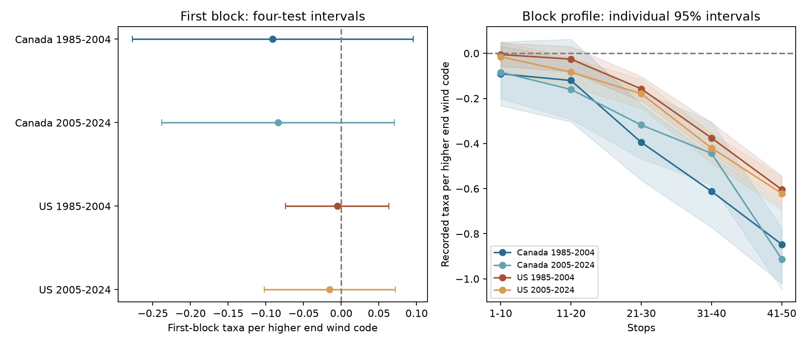

# End wind gave no clear first-block bird richness link in four Canada and US samples in 1985-2024

We tested whether wind measured at a survey end also predicted recorded bird taxa in the first ten stops. All four corrected intervals included zero. End wind slopes for the first block ranged from -0.091 to -0.005 taxa per wind code. The last-block slopes ranged from -0.913 to -0.604. The last-minus-first slopes were negative in all four samples. The results are consistent with an association that becomes more negative along a route. They do not prove that wind causes a change in detection.



The left panel gives the four primary first-block tests with family-adjusted intervals. The right panel gives five block estimates from the same models. Shading gives individual 95 percent intervals. It does not cover all block tests at once. The horizontal axis gives stop blocks, not years. A slope is taxa per higher end Beaufort code, with start wind and other terms held fixed.

## Question and prior work

Weather can change the records used to study climate and biodiversity. A published campaign study found a negative link between end wind and last-minus-first recorded taxa in Canada and the US (SCI d04869a9). That finding can arise if wind changes activity or sound detection late in the route. It can also arise if end wind marks other conditions. We test a necessary diagnostic for a narrow version of the late-survey explanation: is there a similar negative association in the first block after start weather is held fixed?

A nonzero first-block estimate would weaken the claim that the association occurs only at the route end. An interval that includes zero cannot prove that the first-block effect is absent. Wind persists through a morning, and coarse start codes can miss actual early conditions. Thus, end wind is not a strict causal negative control. It can mark early exposure even though it is measured later. This study adds an endpoint specificity test and a five-block profile to the prior wind contrast. It does not supply new bird observations.

Robbins studied weather and BBS counts in 1981 ([USGS record](https://pubs.usgs.gov/publication/5210258)). Rigby and Johnson used recorded songs to test wind and detection ([paper](https://doi.org/10.1093/condor/duz030)). Their work motivates the detection explanation; we do not claim to discover wind effects. The full paper and USGS page could not be fetched through the web tool in this study. Search records and access limits are in files/literature.json. We read the [official Canada BBS instructions](https://www.canada.ca/en/environment-climate-change/services/bird-surveys/landbird/north-american-breeding/instructions.html). They specify fixed route order, brief counts and preferred light wind. Our test concerns the accepted survey sample.

Campaign searches are included. An initial narrow search missed the direct wind study. A broader search found it before this question was fixed and before new fits. We read it and the temperature study SCI 652071e7 and wind-temperature study SCI ff0cb726. The local plan is files/analysis_plan.txt. It was written before these fits, with knowledge of prior results. It was not externally registered. These searches do not prove novelty across all prior work.

## Data and observation bias

We reuse the verified 64,682-row panel from SCI ff0cb726. It comes from the archived USGS BBS 2025 release for 1966-2024, DOI 10.5066/P14SNUV4. We verified the entire input ZIP before extraction. We did not read raw survey files or rebuild the panel in this study. Inference is conditional on the inherited preparation. The direct wind study reports a raw rebuild of the same panel, but that is prior evidence, not our validation.

Each row is a survey. Count10 through Count50 are derived recorded taxon counts in five blocks of ten stops. They are not individual bird counts. Positive AOU taxon codes include groups, hybrids and subspecies. Recorded taxa do not equal true species richness. The panel holds accepted first standard runs, known observers, complete wind, sky and assistant fields, nonzero endpoint richness, dates May 20-July 10, starts 02:00-09:00, durations 3-7 hours and temperatures -10 to 45 C. It requires at least five observations per route-observer pair in a period. The original screen reduced 111,497 candidate runs to 64,682. See files/prepare.py for exact inherited rules. Missing visits, complete weather and stable-observer selection can bias this sample. We do not weight for missingness.

We retain start and end wind codes 0-5 and require five pair records again. This removes one early Canada record. The main samples total 64,681 surveys. Codes are ordered Beaufort ranges, not equal steps in wind speed. A code slope is an association on that scale. Fair-weather checks retain wind at most 3 and sky at most 2 at both endpoints. They again require five pair records. files/checks.json gives wind support counts.

Countries have separate routes. Periods share 309 Canada routes and 1807 US routes in the inherited panel. They are separate fits, not independent replications. There are 20 observed early years and 19 later years; 2020 is absent. Shared continental weather and common methods can link results.

## Method

For each country and period, we fit seven outcomes with the same design: each of the five block counts, last minus first, and full-route taxa. The primary target is the end-wind coefficient for the first block. The model is:

```text
block taxa = route-observer effect + state-year effect
           + end wind code + categorical start wind
           + start and end temperature (linear and quadratic)
           + date, start clock time and duration (linear and quadratic)
           + categorical start sky, end sky and assistant status + error
```

There are four primary tests. The other blocks, difference and total are secondary. Route trends and fair-weather fits are sensitivity tests. Stable route and observer differences and common state-year shifts are removed by fixed effects. They cannot remove changing habitat, hearing, traffic, route changes or local timing. Times are clock times, not time since sunrise. No pollution exposure enters the model. Sky code 4 combines fog and smoke and cannot identify pollution.

We remove fixed effects by repeated mean projection. The trend check also removes a route-specific linear trend. Cluster variance estimates use routes, years and their two-way combination. Each reported standard error uses the largest of these three variances. Finite-sample factors count route-observer plus state-year effects minus one, plus route slopes for the trend model. Redundant effects can make that count too large. A t reference uses the smaller cluster count minus one, here 19 or 18. Four-test intervals use Bonferroni critical values. These approximate intervals depend on model and cluster assumptions. They do not guarantee coverage under all spatial or observer dependence. Other intervals are individual 95 percent intervals and do not adjust for every exploratory result.

## Results

| Sample | Surveys | Routes | First-block slope | Four-test interval | Last-block slope | Last-minus-first slope |
|---|---:|---:|---:|---|---:|---:|
| Canada 1985-2004 | 4,850 | 464 | -0.091 | -0.277 to +0.096 | -0.847 | -0.756 |
| Canada 2005-2024 | 5,697 | 611 | -0.084 | -0.238 to +0.070 | -0.913 | -0.829 |
| US 1985-2004 | 30,554 | 2,611 | -0.005 | -0.074 to +0.063 | -0.604 | -0.599 |
| US 2005-2024 | 23,580 | 2,404 | -0.015 | -0.102 to +0.072 | -0.621 | -0.606 |


All four first-block family intervals include zero. This does not establish a zero early association or a precise upper bound chosen in advance. Each last-minus-first family interval is below zero. That repeats the published wind contrast in nearly the same model and is not independent validation. Exact estimates, sample sizes, variance terms and all sensitivity fits are in files/results.csv. No planned fit was removed. Route-trend first-block slopes ranged from -0.085 to -0.009 taxa per code. Fair-weather slopes ranged from -0.116 to +0.009. All eight individual sensitivity intervals included zero. These fits do not supply independent data.

The block profile permits a more negative association later in a survey. Blocks occupy different places and times. A gradient can reflect local detection, bird activity, different taxa or habitats, exposure error, or residual confounding. It cannot separate these mechanisms. A small first-block estimate is compatible with temporal localization, but does not establish it as the sole explanation.

## Limits and use

There is one accepted annual visit per route. This design cannot estimate detection probability separately from ecological change. Wind at the end is a proxy for the final block and can also proxy unmeasured early weather. Unequal wind categories, thermometer error, linear wind terms and exposure correlations can affect estimates. Accepted survey weather excludes much severe weather. The study does not test damaging wind extremes, long-term warming, air pollution, mortality, range shifts or a causal biodiversity loss. Complete-case selection and roadside habitats limit transfer to other observation systems.

The practical result is a scoped diagnostic for weather terms in biodiversity models. The records do not show a clear first-block end-wind association after correction, while the later blocks have more negative estimates. Analysts should retain uncertainty about both detection and ecology. Stop-level weather, repeated visits at the same locations and detection experiments would be needed to test the mechanism directly.

## Reproduction and provenance

Job: sci-1107-dell-climate-pollution-biodiversity-3120d41072e0. Topic: climate-pollution-biodiversity. Campaign: 11_07_2026. Machine: dell. Account: codex-andrii. Model: gpt-6.1-sol with high reasoning effort through T3 Code and the Codex harness. No agents were launched. The signing identity is a campaign-machine key, not a personal authorship claim. No remote archive or index submission is made.

The actual shared input is campaign/ff0cb7265432e2ff9d229fffcdc5fa523c756ce8581b5cabd37fa7713ef3d030.zip under the shared campaign link. files/provenance.json gives its exact logical and resolved paths, ZIP hash, input publication ID and hashes of the two analysis inputs. The panel hash is 2079a3895c94c98f6531114c4221820c7588bc9512dde0f95d2ed417780743bd. No current shared raw dataset was read. files/source_provenance.json preserves historical raw paths, exact URLs and raw hashes for lineage, not as a claim of present availability. We did not download or change shared datasets. The package includes the derived panel, inherited raw retrieval and preparation scripts, exact results, code and source metadata. Input publication verification is files/prior_verify.json. Attribution is files/ATTRIBUTION.txt.

From the extracted bundle root, use Python 3.12 with the packages in files/requirements.txt. Then run:

```sh
OPENBLAS_NUM_THREADS=1 python -B files/analyze.py --panel files/panel.csv --output /tmp/wind-specificity-refit
python -B files/audit.py
```

The first command reproduces all 84 estimates, checks and the PNG offline. The second checks the packaged evidence. Compare results.csv from the refit with the packaged file within 1e-7 for coefficients. Environment details can differ. The analysis was run once in this study. Four dense explicit fixed-effect subset fits agreed with projection to a maximum absolute difference of 1.8e-14. All 12 scalar partial-regression checks and all endpoint coefficient identities passed. These checks test computation, not identification. Raw retrieval is optional through files/retrieve.py to a private local directory, followed by files/prepare.py; the historical source bytes can become unavailable. We did not run raw retrieval or reconstruction here.

The SCI baseline license covers our text, code, figures and derived evidence, subject to source rights. USGS source observations retain their public-domain status.
