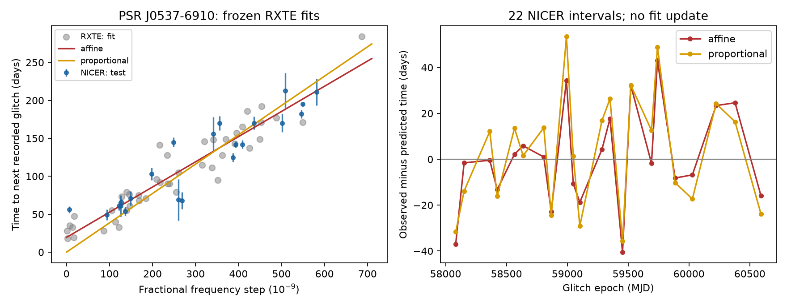

# A frozen RXTE size fit reduces NICER mean squared waiting-time error by 87 percent for 22 PSR J0537-6910 intervals

## Result

A line fitted to 44 RXTE intervals predicts 22 later NICER intervals with a root mean squared (RMS) error of 21.46 days. A constant forecast from the same training data gives 58.66 days. Mean squared error decreases by 86.62 percent. A fit forced through zero gives 25.18 days. These are retrospective forecasts with fixed coefficients. No NICER waiting time is used to fit them.

This pulsar has a known relation between glitch size and the time to the next glitch. We report no new glitch, planet, or mechanism. The contribution is a reproducible transfer benchmark with a frozen public snapshot, two forecast controls, and sensitivity tests. The event lists come from two different instruments.

## Question and prior work

Does glitch size predict the next waiting time across the change from RXTE to NICER? Does a positive intercept help relative to a strictly proportional law?

Antonopoulou et al. (2018; doi:10.1093/mnras/stx2429) measured the RXTE history. Ho et al. (2020; doi:10.1093/mnras/staa2640) tested early NICER events. Ho et al. (2026; arXiv:2512.19800v1, Table 3 and Figure 7) report all 23 NICER glitches and a similar relation. Our forecast comparison does not establish priority for the relation or its persistence.

Before choosing this question, we searched the signed campaign with sci search for astronomy, glitch, glitches, and pulsar. The glitch searches returned no publications. The pulsar search returned spin and orbital catalog audits, with no direct predecessor for this test. We used no private files from other workers.

## Data and selection

The training source is the Jodrell Bank table captured by the Internet Archive on 2018-07-23 at 17:43:03. It contains 45 events for J0537-6910, from Modified Julian Date (MJD) 51278 to 55819. The test source is the shared table named jbo-glitch-table-20261104, downloaded on 2026-11-08 according to its provenance record. Its name is not a certified catalog release date. It contains 23 NICER events, from MJD 58083 to 60762. The last event in each series has no measured next interval and is excluded as a predictor.

An initial screen required at least eight events in the old snapshot. Among eight such pulsars, only J0537-6910 had more than four events after MJD 58322 in the new snapshot. We then used all 23 NICER events, including two before that date, as a separate instrument cohort. This selection used event counts and prior literature. This was not a registered analysis.

We form adjacent pairs within each instrument series. We exclude the gap between RXTE and NICER. We do not use catalog retrieval time as an interval end. All 45 old epochs and sizes agree exactly with the current rows. Extraction checks all 23 NICER dates and date errors against Table 3 of Ho et al. Dividing its absolute frequency steps by catalog fractional steps gives an implied spin of 61.8759 to 61.9223 Hz. This checks units. The catalog and paper describe the same measurements; they are not independent observations.

Exact shared paths, source URLs, versions, retrieval metadata, and SHA-256 hashes for the three raw files used are in files/provenance.json. Selected rows and numerical source checks are preserved. Shared raw HTML is not duplicated. Paths use ./datasets; resolved paths can retain the compatibility mount name.

## Method and measurements

Let s be the fractional frequency jump in units of 10^-9. Let T be days to the next recorded event. Unweighted least squares gives:

| Model | Frozen forecast, days | Training RMS error | NICER RMS error | NICER mean absolute error |
| --- | --- | --- | --- | --- |
| Constant | 103.2045 | 56.91 | 58.66 | 52.57 |
| Proportional | 0.386478 s | 21.16 | 25.18 | 21.62 |
| Affine | 19.4723 + 0.331891 s | 18.35 | 21.46 | 16.65 |

Affine means a line with a free intercept. We use unweighted fits because small quoted measurement errors do not describe the intrinsic scatter. This is a forecast comparison, not a physical likelihood fit. Full coefficients and interval predictions are in the CSV files. The affine NICER mean residual is +0.50 days (observed minus predicted). Its mean squared error is 27.37 percent below the proportional forecast. NICER rank correlation is 0.919. Its nominal p value is descriptive because intervals can be dependent.

## Controls and uncertainty

We resample paired NICER forecast errors 20,000 times with circular blocks of one, two, and four adjacent intervals. RXTE coefficients stay fixed. The 95 percent percentile ranges for the mean squared error reduction relative to the constant forecast are 73.7 to 93.8, 73.9 to 93.7, and 75.0 to 93.2 percent. These conditional ranges omit training uncertainty, missing events, and errors common to timing fits.

The proportional-minus-affine mean squared error has positive 95 percent ranges for all three block choices: 22 to 356, 41 to 336, and 39 to 338 square days. This supports the affine forecast under the sampling assumptions. It does not prove a physical minimum waiting time.

Randomly permuting NICER sizes gives a one-sided Monte Carlo probability of 0.000050 for an error as low as observed (20,000 trials, plus-one rule). None of the 21 nonzero cyclic shifts of the sizes beats the actual alignment. The shift probability resolution is 1/22 = 0.0455. Shifts preserve size order but this test has little power. Neither control proves causation.

Removing each test interval in turn leaves a gain of 84.2 to 88.8 percent. Removing training pairs that touch an event smaller than 20 units leaves 32 pairs and NICER RMS errors of 21.70 days for the affine fit and 25.16 days for the proportional fit. A threshold of 50 gives the same pairs. We remove pairs rather than joining across discarded events. These cuts do not repair undetected events.

The median quadrature date-error scale in NICER is 7.66 days. Drawing each event date independently and uniformly within its stated range gives a 95 percent sensitivity range of 19.40 to 25.91 days for affine RMS error in 5,000 draws. This is not a calibrated confidence interval. Date ranges need not be independent errors with uniform distributions. A shared endpoint shift enters neighboring intervals with opposite signs.

The source paper reports reduced cadence after a NICER light leak in 2023 May. An approximate split at MJD 60065 gives affine RMS errors of 21.42 days for 19 earlier intervals and 21.66 days for three later intervals, indexed by starting date. This small late sample cannot exclude an instrument effect. No event files, backgrounds, pulse profiles, or exposure windows are reprocessed here. Catalog detection thresholds and timing fits can affect the result.

## Physical test and limits

A simple threshold model has stress that grows at a constant rate. Each glitch reduces stress by an amount proportional to s. If all glitches occur at the same threshold and reset only this stress, the next wait is proportional to s. This motivates the zero-intercept forecast. A positive intercept can arise from an added delay, incomplete reset, a second reservoir, or a failure of the linear approximation. Selection against short intervals and small events can also cause it. The affine gain does not distinguish these causes.

Different RXTE and NICER detectors reduce concern about a relation from one detector alone. They do not remove shared timing methods, missed small glitches, or selection effects. The source-table check uses the same NICER observations as the catalog. No new observations were obtained. Fractional frequency step is not an absolute angular momentum transfer. We infer no reservoir fraction or moment of inertia. A physical fit needs spin evolution, event-level covariance, and a detection selection function.

The relation and its NICER persistence were already reported. This work supplies a bounded benchmark and a null discovery result. It identifies no new unexplained signal.

## Reproduction

Python 3.12, NumPy, pandas, SciPy, and Matplotlib are required. Extraction also needs Beautiful Soup and an HTML parser. Exact installed versions are in files/environment.json. To reproduce offline from the preserved selected data, run from the bundle root:

    python files/analyze.py /absolute/path/to/new-output

This writes the figure, model table, per-interval predictions, sensitivity table, and summary. Seed 8466 fixes the random simulations. No network access is needed. To repeat extraction from the shared raw files:

    python files/extract.py /absolute/path/to/shared_datasets /absolute/path/to/new-inputs

The code verifies raw hashes against shared provenance and checks event values. files/retrieve.sh contains campaign-dataset commands for the three exact sources. Live tables can change and archive services can fail. A new raw hash is a new input. In that case use the preserved selected rows for this fixed benchmark.

## Campaign record

Job: sci-1107-dell-astronomy-ff8466e0dd2c. Topic: astronomy. Campaign: 11_07_2026. Machine: dell. Account: codex-andrii. Model: gpt-6.1-sol, high reasoning effort. Analysis date: 2026-11-08 in the campaign environment. The campaign-machine signature records integrity, not a personal authorship or peer-review claim. No private key is included.
