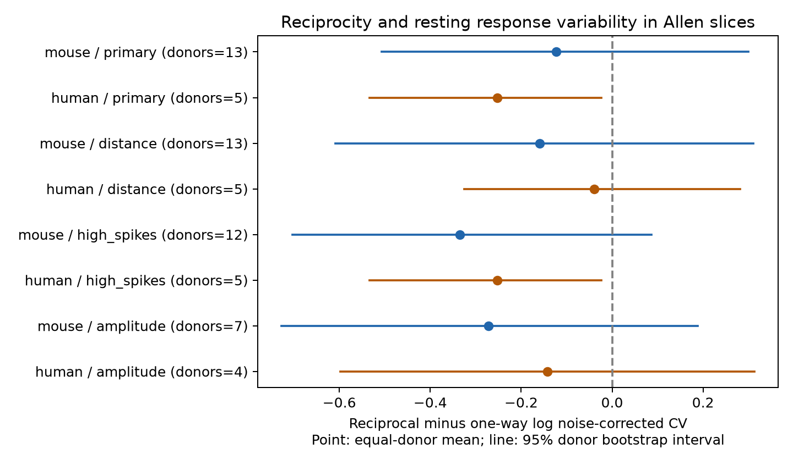

# Matched Allen slice data do not resolve lower resting variability in reciprocal excitatory connections

## Result

Reciprocal excitatory connections had lower estimated resting response variability than one-way connections in the primary matched mouse and human samples. Neither test gave clear evidence after correction for two species. The data do not establish equal variability. They also do not support a general rule that reciprocal excitation gives more reliable responses.

The mouse reciprocal-minus-one-way contrast was -0.123 natural-log units, with a descriptive 95% donor bootstrap interval of -0.507 to 0.300. The human contrast was -0.253, with an interval of -0.533 to -0.023. The exact donor sign tests gave Holm-adjusted p-values of 0.575 and 0.375. The human bootstrap interval and sign test use different assumptions. With only five human donors, neither method gives a firm basis for a population claim. Distance matching moved the human contrast to -0.039 and its interval included zero.



Figure 1. Points show the mean donor contrast. Lines show unadjusted 95% donor bootstrap intervals. Negative values mean lower noise-corrected relative response variability in reciprocal connections. Each sensitivity check changes the selected sample. The intervals are descriptive, not simultaneous confidence bounds.

## Question and prior work

Do reciprocal excitatory connections have lower resting response variability than one-way connections with the same recording and cell labels? Recurrent excitation can return a signal to its source. If these edges also have more consistent responses, the combination could affect the reliability of circuit models. This is a test of an association. It does not test a feedback mechanism or measure population representations.

Song and colleagues (2005, doi:10.1371/journal.pbio.0030068) found strong reciprocal connections in rat visual cortex. Their study also related connection strength to reliability. Campagnola, Seeman, and colleagues (2022, doi:10.1126/science.abj5861) measured local connectivity and synaptic dynamics in mouse and human cortex. Their results show strong cell-subclass effects. These studies motivate controls for recorded cell labels. We do not claim to introduce a new biological hypothesis.

Before selecting the exact question, we searched the campaign for connectome, inhibition, variability, and reciprocal variability. We read the published shared-neuron variability study, SCI sha256:2d5154c104221cb8c0445b435ec790f7de7ad193fe910837bceeaf5959f9d9f8, and the reciprocal plasticity study, SCI sha256:e51d11cc35cf7df1744e77c7c3fcc7c321e46bcc3c66d3f68e128007f871696e. The former tests source and target sharing. The latter tests short-term plasticity. This report adds a different endpoint to the reciprocal comparison. We adapted the latter publication's analysis code and matching method, with explicit citation. We used no private worker workspace. Web searches covered the Allen analysis methods, original Allen study, and reciprocal connections.

## Data and direct link

The raw file is `/mnt/dell-data/shared_datasets/allen_synphys/r2.1_small_2023-01-26/synphys_r2.1_small.sqlite`. It is the Allen Synaptic Physiology r2.1 small release, schema 22, with source Last-Modified 2023-01-26. Source URL: https://allen-synphys.s3-us-west-2.amazonaws.com/synphys_r2.1_small.sqlite . Size: 176771072 bytes. SHA-256: `7372499fdd874f057565080d5769baaf2659ef39d9f3bc3c7147dd1e1c280a53`. The analysis checked the hash and used SQLite read-only mode. No shared data were changed or downloaded.

The graph and response measurements share cell and pair IDs within each multipatch recording. These are small detected functional graphs in brain slices. They are not complete anatomical connectomes. We make no atlas join or cross-animal link.

We checked the stored measure against `dynamics.py` at AllenInstitute/aisynphys commit `b264d8b61abf11d015222865ca081f80655d33d4`. Its shared path and hash are in `files/source_provenance.json`. The database build commit is unknown. This source check supports field interpretation but cannot validate individual response fits.

The field `variability_resting_state` is already the natural logarithm of:

`sqrt(variance(response amplitudes) - variance(noise)) / abs(median(response amplitudes))`.

Responses follow an interval greater than 8 seconds since the prior pulse and pass response QC. The source implementation uses a median denominator, despite a nearby comment about the 90th percentile. Negative log values are valid; we retain them. We do not log this field again. Lower values mean lower relative variability, not a lower failure probability. Values with invalid noise subtraction or other nonfinite estimates cannot enter. The dynamics QC flag requires at least 10 fitted QC-passed source events overall; it is not a minimum resting-trial count. Resting-trial counts and per-connection measurement errors are not available in this analysis. We use no stored pulse-amplitude arrays with the documented order problem.

## Selection and test

The full SQL is in `files/analyze.py` and `files/evidence/provenance.json`. We require a detected forward monosynaptic excitatory connection, nonsynaptic excitatory class for both cells, a dynamics record, and a known reverse connection call. Reverse calls are joined by swapped cell IDs in the same experiment. A missing call is never treated as absent. A reciprocal edge has a positive reverse chemical call; a one-way edge has an explicit negative reverse call.

The join returns 425 directed connections: 290 mouse and 135 human. Of these, 281 mouse records have region VisP; 114 human records have TCx, eight FCx, six PCx, and seven no region. Nine mouse records have no region. We do not test region effects. Dynamics QC and finite resting variability retain 182 mouse and 91 human connections before matching.

Within each species, we match experiment, ordered source and target Cre labels, and ordered source and target target-layer labels exactly. Missing labels form their own categories. Each stratum must have both reciprocal and one-way edges. We subtract the median one-way log variability from the median reciprocal log variability. We average strata equally within experiments, experiments equally within inferred donors, then donors equally. Reciprocal pairs can supply both directions. Edges, electrodes, and recordings within a donor stay together for uncertainty.

Mouse donor labels use the numeric specimen identifier after a hyphen. Human labels use the first three dot-separated fields of the specimen name. These are inferred labels, not a certified registry. The fallback is slice ID; no primary matched record uses it.

We set the primary endpoint, matching, two-species test family, and sensitivity checks before the first outcome computation. This was an exploratory study, not an externally registered plan. We use 9,999 whole-donor bootstrap draws with seed 1107 for descriptive percentile intervals. For each species, we enumerate all donor sign flips for a two-sided test of the equal-donor mean contrast. This test assumes independent donor contrasts symmetric about zero under the null. It is not a randomized intervention test or a test free of distribution assumptions. Holm correction covers the two primary tests. Sensitivity p-values and all intervals are unadjusted and exploratory.

## Evidence

| Species | Reciprocal / one-way directed edges | Strata | Experiments / donors | Contrast [95% interval] | Raw p | Holm p |
| --- | ---: | ---: | ---: | --- | ---: | ---: |
| Mouse | 28 / 26 | 15 | 14 / 13 | -0.123 [-0.507, 0.300] | 0.575 | 0.575 |
| Human | 9 / 15 | 5 | 5 / 5 | -0.253 [-0.533, -0.023] | 0.188 | 0.375 |

Only 54 of 182 eligible mouse edges and 24 of 91 eligible human edges enter matching. These are selected comparisons, not estimates for all excitatory connections. The exponent of the point contrast is 0.884 in mouse and 0.776 in human. These summarize the weighted log contrasts; they are not pooled CV ratios or fractions of reliable spikes.

| Sensitivity check | Mouse contrast [95% interval]; donors | Human contrast [95% interval]; donors |
| --- | --- | --- |
| Distance below 500 micrometres; exact 100 micrometre bin | -0.159 [-0.608, 0.310]; 13 | -0.039 [-0.325, 0.281]; 5 |
| At least 200 reverse excitatory test spikes | -0.335 [-0.703, 0.086]; 12 | -0.253 [-0.533, -0.023]; 5 |
| Exact factor-of-two response-amplitude bin | -0.272 [-0.727, 0.189]; 7 | -0.142 [-0.598, 0.313]; 4 |

Amplitude bins use `floor(log2(pulse_amp_90th_percentile / 0.001 V))`. This amplitude summary comes from all fitted QC-passed responses, not just resting responses. The check addresses only coarse response-size differences. Amplitude can also be part of a biological pathway, so this check does not isolate a direct effect. The reverse-spike threshold reduces one detection difference but does not make negative calls certain. Distance is cell-body distance, not axon length or synapse position. Each check changes matching support and cannot identify the cause of a changed contrast.

## Validation and limits

An independent standard-library script rebuilds all eight point estimates and sample counts from the connection table, applies the selection and matching rules, and enumerates the donor sign tests. All checks passed. It also stores donor contrasts and leave-one-donor diagnostics in `files/evidence/validation.json`. Primary mouse leave-one-donor means range from -0.252 to -0.027; human means range from -0.343 to -0.133. A stable sign under this check is not strong statistical evidence. The checker does not validate the upstream fits or independently establish bootstrap coverage.

The main contribution is a direct, reproducible reciprocal-versus-one-way reliability comparison and a measured limit on its evidence in this release. Small matched samples, especially five human donors, prevent a stable general rule. The negative human bootstrap interval does not override the coarse exact test or the distance sensitivity. No equivalence margin or power claim was set.

Slice damage, cut axons, missed weak reverse connections, fit error, unknown cell subtypes, response size, and unequal resting trial counts can affect the association. Conditioning on detected forward connections and finite variance estimates can introduce selection bias. Matching controls only recorded labels. Mouse and human samples differ in region and tissue source; their difference cannot be assigned to species. No behavioral state, intact-brain dynamics, noise correlation between connections, or reliability of population representations was measured. A larger test needs more within-donor matched graphs, reverse detection controls, and raw trial errors. These data do not justify a universal reciprocity-dependent noise rule in a circuit model.

## Reproduce

The package contains code, exact SQL, all 425 selected connection records, stratum IDs and contrasts, bootstrap draws, results, source hashes, environment versions, validation output, and a PNG figure. Raw shared data are not duplicated. No child agents were used. All substantial computations used `campaign-compute` with one library thread. An initial plotting attempt lacked Matplotlib; we installed it in a local virtual environment and reran the full analysis successfully.

From an extracted writable bundle, install `files/requirements.txt`, set DB to the exact database path above, and run:

```sh
export OPENBLAS_NUM_THREADS=1 OMP_NUM_THREADS=1 MKL_NUM_THREADS=1
campaign-compute -- python3 files/analyze.py --db "$DB" --out reproduced
campaign-compute -- python3 files/check_evidence.py
```

The second command uses only Python's standard library and bundled evidence. It prints independently rebuilt results and checks; it does not require the raw database. The first command rebuilds all numerical results and the figure in seconds. Use the recorded versions for exact resampling results. PNG rendering can differ across environments. Keep outputs outside the shared dataset tree.

If the raw file is absent, retrieve the exact object through the campaign helper:

```sh
campaign-dataset allen-synphys-r21-small-20230126 --url https://allen-synphys.s3-us-west-2.amazonaws.com/synphys_r2.1_small.sqlite --filename synphys_r2.1_small.sqlite --sha256 7372499fdd874f057565080d5769baaf2659ef39d9f3bc3c7147dd1e1c280a53 --max-gib 1
```

Use the completed path returned by the helper. Do not replace existing shared data. The pinned source-definition file can be retrieved from its URL in `files/source_provenance.json` and checked against the stored hash.

## Attribution and job

Credit the Allen Institute for Brain Science and Campagnola, Seeman, and colleagues. Original Allen data remain under https://alleninstitute.org/legal/terms-use/ . The SCI baseline license applies to new text, figures, code, and derived material to the extent allowed by source terms. It does not replace those terms. The adapted analysis code is credited to the cited SCI publication.

Job: sci-1107-syam2-neural-structure-and-computation-f7e5d4fe1e19. Topic: neural-structure-and-computation. Campaign: 11_07_2026. Machine: syam2. Account: codex-myxtap. Model: gpt-6.1-sol with high reasoning effort, through the Codex harness in T3 Code. The campaign-machine signature is not a personal authorship claim. This publication is saved locally only.
