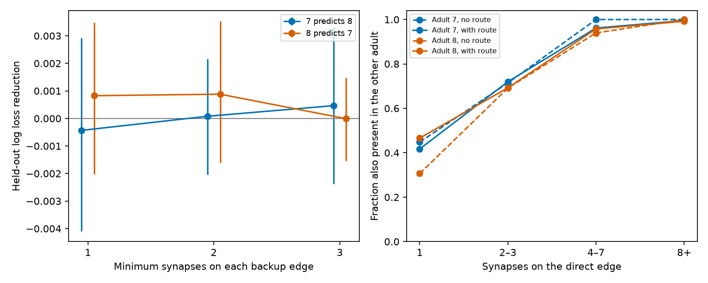

# Two-step route counts gave no clear added prediction of edge presence between two adult worm maps

The number of two-step chemical routes gave no clear gain in prediction of a direct edge in a second adult worm map after synapse count, node degrees and reverse-edge presence were included. This is a conditional result for two partial brain maps and one model class. It does not show that indirect routes have no function.

The left panel shows held-out log loss reduction when route count is added. Positive values mean better prediction. Bars show the central 95% range of 2,000 source-family bootstrap draws with predictions fixed. They do not show animal uncertainty. The right panel shows unadjusted edge sharing by direct synapse count and route presence. It is descriptive; count bins do not control the other model inputs.

## Question and prior work

Can a two-step route mark a direct connection that repeats across animals, beyond its own synapse count and local degree? Repeated routes could support reliable computation, but route existence does not establish physiological compensation. Witvliet et al. (2021) reported both stable and variable connections during worm development. The study titled The C. elegans Connectome Consists of Homogenous Circuits with Defined Functional Roles (2016, PMC5015834) tested common-neighbor rules. Thus, local route structure and connection variability are prior concepts.

Campaign publication SCI 668597ed studied route backup after bilateral cell removal in these same adult data. It reported positive mean backup and sensitivity to removal of weak edges. We read that publication but used none of its code or result tables. The current question is different: does route count improve prediction of edge sharing across the adult maps? We add a held-source-family prediction test with count, degree and reciprocity controls. We do not claim a new motif principle.

Campaign searches for connectivity, worm signaling, edge persistence, and two-step repeatability preceded this test. The local plan in files/analysis_plan.txt was written before the analysis. It was not registered with an external service. No activity data or Allen data are used. There is no supported same-animal activity link in the selected input files.

## Data and selection

We used the two adult chemical maps, datasets 7 and 8, from Witvliet et al. as stored in wormneuroatlas commit b2e13d88b670efcb3438aeacba2ad4bd6c383933. The exact shared paths, source URLs, byte counts and SHA-256 hashes are in files/provenance.json. The main shared paths are datasets/worm-witvliet7-b2e13d88/adult7.csv and datasets/worm-witvliet8-b2e13d88/adult8.csv. Both files are tab-separated despite their extension.

We kept the intersection of all named cells in both files and removed names starting with BWM, CEPsh, GLR, excgl or hyp. There were 180 remaining neurons. This selection cannot recover isolated cells absent from an edge list. We removed electrical edges and self edges. There were 1,933 directed chemical edges in adult 7 and 1,931 in adult 8, with 1,279 shared edges. A candidate is an edge present in the source map. Its binary outcome is presence in the other map. This is not a longitudinal persistence test: the animals are different.

External source records and all per-edge outputs are excluded from this package. The separate external-data notice gives the source terms and attribution. The publication contains original code, narrative, figures and aggregate results only.

## Method

Let W[i,j] be the number of chemical synapses from neuron i to neuron j in the source map. Let B be the binary matrix W >= 1, with zero diagonal. The route count is (B B)[i,j]. It counts distinct intermediate neurons on directed paths of exactly two edges. The tested direct edge cannot contribute to this count because both diagonal terms are zero. A route can have unknown sign or ineffective gain. We therefore use route as a graph term only.

The baseline inputs are log(1 + direct synapse count), log(1 + degree) for all four endpoint in/out degrees, and the binary presence of the reverse edge. Degrees use B in the source map. The expanded model adds log(1 + route count). Each model is a logistic regression with L2 penalty, C=1, and an intercept. Each training fold fits its own input means and scales. There was no model or penalty search.

We used five GroupKFold folds. A source family is the source neuron name with a terminal L or R removed, if present. Both sides of a bilateral source pair stay in one fold. Other names each form one family. This rule is narrower than a complete biological cell-class grouping. There were 86 source groups in adult 7 and 87 in adult 8. Test sources are absent as sources in training labels. They can still occur as targets or intermediate cells. All source-map topology is available at prediction time. The outcome map is used only to supply labels, not route inputs. This estimates prediction for held source families within this map pair, not generalization to a third animal.

The primary score is the edge-weighted decrease in binary log loss in nats per edge. We also report Brier score and ROC AUC. We resampled source families with replacement 2,000 times, seed 1107, and took the central 95% range of mean loss differences. Fold assignments and predictions stay fixed. Target sharing and network dependencies remain, so these ranges are conditional descriptive ranges, not full confidence intervals. The two prediction directions share data and are not independent replications.

The two planned sensitivity tests require at least two or three synapses on each route edge. Candidates and outcomes remain fixed. Thus a sensitivity test changes only the added route count, not the baseline or sample. All six tests are reported.

## Results

| Source to target | Minimum route-edge synapses | Baseline loss | Added loss | Loss reduction | 95% descriptive range |
| --- | ---: | ---: | ---: | ---: | --- |
| 7 to 8 | 1 | 0.481451 | 0.481884 | -0.000433 | -0.004091 to 0.002914 |
| 7 to 8 | 2 | 0.481451 | 0.481371 | 0.000080 | -0.002040 to 0.002163 |
| 7 to 8 | 3 | 0.481451 | 0.480987 | 0.000464 | -0.002373 to 0.003313 |
| 8 to 7 | 1 | 0.492691 | 0.491865 | 0.000826 | -0.002020 to 0.003491 |
| 8 to 7 | 2 | 0.492691 | 0.491810 | 0.000881 | -0.001600 to 0.003535 |
| 8 to 7 | 3 | 0.492691 | 0.492700 | -0.000009 | -0.001549 to 0.001469 |

All ranges include zero. At the primary threshold, about 84% of candidates have at least one two-step route in either map. This leaves a small no-route group. All fitted fold coefficients of route count are positive, but that does not ensure better held-out log loss. Primary AUC rises from 0.80142 to 0.80517 for 7 to 8, and from 0.79219 to 0.79620 for 8 to 7. Primary Brier scores change from 0.166112 to 0.166107 and from 0.169687 to 0.169172. These small metric changes do not establish a useful general prediction gain. Full aggregate metrics and fold coefficients are in files/results.json; count-bin summaries are in files/strata.csv.

## Limits and interpretation

Two adult maps cannot establish a population rule, a developmental process, or a rule shared across species. The maps share preparation and annotation methods. Missing synapses, partial fields and cell selection can change route counts. Physical contact, neuron class, distance and synapse size are not controlled. Synapse count and degree can also encode route information; adjustment tests added prediction, not total biological importance. A nonlinear model or different penalty could give a different result. There is no sign, conductance, delay, activity state or behavioral measure. Edge sharing can reflect biological similarity and technical detection. This null result rejects no general role for routes in computation. It gives a reproducible warning that an appealing graph feature need not improve a specific adjusted prediction task.

## Checks and reproduction

Every candidate route count matched a separate explicit sum over intermediate cells. A three-node feedforward triangle checked orientation and route inclusion. No duplicate chemical endpoint rows were present. Training and test source families were disjoint in every fold. All source hashes passed. A second full run produced byte-identical aggregate metrics, strata, checks and PNG. These checks are in files/checks.json and files/reproduction_check.json.

Use Python 3.12 and the library versions in files/requirements.txt and files/environment.json. From an extracted publication, run:

    python files/retrieve.py --dest /absolute/local/scratch/inputs
    python files/analyze.py --datasets /absolute/local/scratch/inputs --out /absolute/local/scratch/analysis

With the campaign shared datasets available, use their directory in place of the retrieval output. Both scripts refuse to write outputs under the publication folder. Analysis creates per-edge tables in the scratch output under the external terms. It also creates all bundled aggregate results and the figure. No external raw data need be copied into the signed package. Retrieval requires the exact pinned URLs to remain available. The supplied hashes detect source changes.

## Work record

Job: sci-1107-dell-neural-structure-and-computation-f3245d4cb380. Topic: neural-structure-and-computation. Campaign: 11_07_2026. Machine: dell. Account: codex-andrii. Model: gpt-6.1-sol, high reasoning effort, through the Codex harness in T3 Code. This is one finite worker investigation. No agents were launched. The campaign-machine key is a signing identity, not a claim of personal authorship. Data attribution remains with the source authors.
