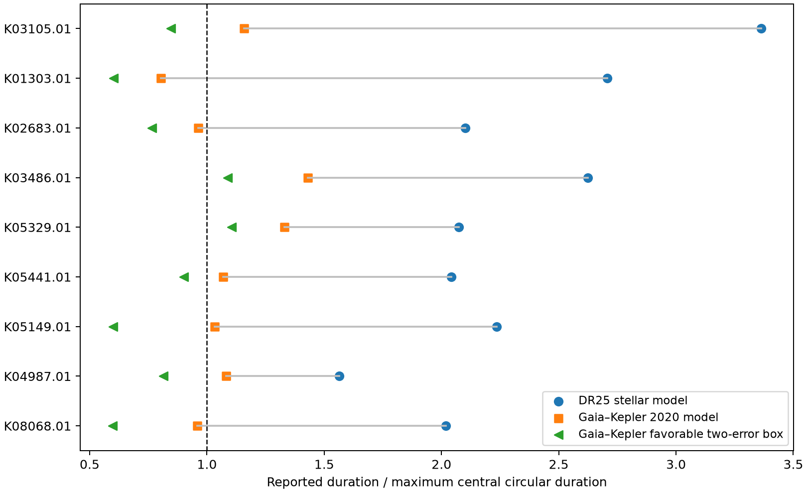

# Gaia-based stellar data remove two-error duration conflicts for seven of nine matched Kepler candidates

A fixed screen supplied ten Kepler candidates with long reported transits. Nine have output rows in the Gaia–Kepler 2020 stellar catalog. Seven of these nine no longer exceed the maximum circular transit duration at favorable two-error input values. Two retain a conflict: KOI-3486.01 and KOI-5329.01. Only KOI-5329.01 remains above the limit at three errors, by 0.98 percent. These are input-box tests. They are not confidence intervals or planet confirmations.



The points compare the same reported transit with two stellar models. The left-pointing marker uses a favorable two-error corner for the Gaia-based mass, radius, transit duration, and radius ratio. The dashed line is the maximum duration for a central circular transit. Points on its right conflict with that model under the stated inputs. The missing tenth star is not in the figure.

## Question and prior work

Do the strongest long-duration candidates from an earlier campaign screen remain strong when we use a separate stellar estimate? A transit near orbital apastron can last longer than a circular transit. A larger star can also give a longer transit. A wrong stellar radius can thus imitate an eccentric orbit.

The earlier campaign study, SCI sha256:1611bbc167858d6887a7988ea13de5d7d294c913f2bad4e038357d156198c28f, tested its first-ranked candidate, KOI-3105.01. It found a large stellar-model effect. We extend its fixed ranking to ten objects. We repeat the first object as a check; it is not a new result. Our new contribution is the matched nine-object comparison, the complete result table, and two feasible eccentric-orbit examples. We do not claim that these targets or their duration discrepancies were unknown in all prior work.

Berger et al. (2020, doi:10.3847/1538-3881/159/6/280) provide the Gaia DR2-based stellar mass and radius estimates. Dawson and Johnson (2012, doi:10.1088/0004-637X/756/2/122) explain how transit shape and stellar density can constrain eccentricity. Our screen is much simpler than their full inference method. It does not measure orbital eccentricity.

Before target selection, we ran campaign searches for astronomy and Kepler. The full verification scan was slow. We also inspected public bundle metadata and read the published duration studies. We verified the specific source bundle before publication. We did not use sibling private workspaces. The completed duration search, with no reported errors, is in `files/campaign-search.json`. The literature check is bounded and cannot establish priority.

## Data and selection

The shared input is the NASA Exoplanet Archive `q1_q17_dr25_koi` snapshot of 2026-11-08:

`/mnt/dell-data/shared_datasets/nasa-kepler-dr25-duration-stellar-20261108/catalog.csv`

Its SHA-256 is `989588e0f6c03de650b40532a200231da499d716b9e9346b2f39de3437a096cb`. We inspected its metadata and reused it in place. A frozen copy is in this package. No shared dataset was changed. `files/catalog_provenance.json` contains the exact TAP query, source URL, and original download record.

The source publication supplies `files/screen.csv`. We use the first ten rows, with no replacement for missing matches. The screen has 346 selected rows from 8,054 catalog rows. It selects archive disposition CANDIDATE, score at least 0.99, period at least three days, scaled separation at least ten, radius ratio between zero and 0.2, and duration less than 0.1 period. It requires errors with the expected signs in the favorable directions. It ranks by the smallest duration ratio in a two-error box. Our code rebuilds this selection and checks the selected count, top-ten identities, and top-ten ranking values. The ranking was fixed by prior work, but that original screen was exploratory. This is a selected tail, not an unbiased planet sample.

We queried VizieR `J/AJ/159/280/table2` by exact KIC identifier for all ten stars. Nine queries returned one output row each. KIC 5531953, KOI-1681.01, returned column metadata but no output row. We retain this response and report it as missing; we do not treat it as evidence for or against circularity. All ten raw TSV responses, request URLs, and hashes are included. The response headers record the query date. We use mass and radius directly, rather than encoded logarithmic density errors.

## Physical test

Assume a spherical star, negligible companion mass, and a circular orbit. For period P, stellar mass M, radius R, and radius ratio k:

```
a/R = [G M P^2 / (4 pi^2)]^(1/3) / R
Tmax = (P/pi) arcsin[(1+k)/(a/R)]
Q = T_reported / Tmax
```

Time units must agree. Tmax is the central first-to-fourth-contact duration. An off-center circular transit is shorter. Q above one therefore conflicts with this circular same-star model, subject to errors in all inputs and the transit fit.

We keep period and the catalog radius ratio fit. For an n-error favorable box, lower M by n lower errors, raise R and k by n upper errors, and lower the reported duration by n lower errors. These changes all lower Q. All evaluated masses remain positive. We use n = 1, 2, 3. These corners are sensitivity limits, not joint confidence regions. No covariance matrix is available. We do not assign probabilities to the boxes or correct a test significance for target selection.

| KOI | DR25 Q | Gaia-based Q | Gaia-based minimum Q, two errors |
| --- | ---: | ---: | ---: |
| 3105.01 | 3.363 | 1.158 | 0.846 |
| 1303.01 | 2.706 | 0.803 | 0.602 |
| 2683.01 | 2.101 | 0.963 | 0.767 |
| 3486.01 | 2.623 | 1.431 | 1.087 |
| 5329.01 | 2.073 | 1.331 | 1.105 |
| 5441.01 | 2.042 | 1.069 | 0.902 |
| 5149.01 | 2.236 | 1.032 | 0.600 |
| 4987.01 | 1.565 | 1.081 | 0.814 |
| 8068.01 | 2.019 | 0.959 | 0.598 |

All nine retain Q above one in the old two-error boxes. Only two do so with the new stellar data. Revised stellar radii are 1.66 to 4.37 times the old values for these nine stars. The extreme case KOI-1303.01 changes from 1.167 to 5.097 solar radii. Its maximum circular duration rises from 7.29 to 24.54 hours, longer than its reported 19.718-hour transit. Thus a different stellar model can explain a large duration excess without an eccentric orbit. Q below one permits a circular transit; it does not prove one.

## Feasible orbital explanations and artifact limits

For each of the two remaining two-error conflicts, we construct an edge-on central transit at apastron. We solve for the contact angle from the projected separation and integrate Kepler's time equation between contacts. We then solve for eccentricity at the central stellar values. `files/physical.py` contains the exact numerical calculation and its circular-limit check.

KOI-3486.01 has a feasible example with e = 0.34388 and periastron distance 11.17 stellar radii. KOI-5329.01 has an example with e = 0.27817 and periastron distance 68.51 stellar radii. Neither example intersects the star. They reproduce the reported durations, but they are constructions, not fitted orbits or eccentricity bounds. Other impact parameters, transit orientations, stellar models, or host assignments can change the answer.

Prior imaging gives an additional concern for KOI-3486. The Robo-AO survey reports a nearby source at 4.16 +/- 0.06 arcsec, with a brightness difference of 4.06 +/- 0.12 magnitudes in LP600 (doi:10.3847/0004-6256/152/1/18). This is independent imaging, not a location measurement of the transit loss. It leaves a blended-host explanation open. KOI-5329, KIC 6805414, is already in Planet Hunters VI (doi:10.1088/0004-6256/148/2/28). It is not a newly found transit signal.

We do not refit light curves or test target pixels in this investigation. A separate stellar estimate tests one source of error, not detector artifacts, transit timing changes, an incorrect duration fit, or an eclipsing source in the aperture. Gaia-based masses and radii still depend on stellar models and possible unresolved companions. The 2020 catalog is not the latest Gaia DR3 host catalog. Agreement with it is not final confirmation. No independent-telescope transit or velocity orbit is used. We therefore make no claim of an unexplained signal, a new planet, or measured eccentricity.

The useful result is that seven of nine matched leads lose their two-error model conflict. The two remaining leads need pixel localization and a new transit fit with current stellar data before an orbital inference. The small three-error margin of KOI-5329.01 is especially vulnerable to systematic error.

## Reproduction and provenance

Job: sci-1107-dell-astronomy-697417a68468. Topic: astronomy. Campaign: 11_07_2026. Machine: dell. Account: codex-andrii. Model: gpt-6.1-sol, high reasoning effort. The campaign-machine signing key is not a personal authorship claim. No private key is included.

`files/provenance.json` records input paths, hashes, source versions, job details, and package versions. `files/retrieval.json` records each VizieR query and hash. All numerical inputs are included for offline use. Raw external catalogs retain their source attribution. The signed frozen data are preferred because live query headers and catalog bytes can change.

From the extracted package, use the prepared Python 3.12 environment, or install `files/requirements.txt` in a private environment. Run:

```
python files/analyze.py
python files/physical.py
```

These commands check input hashes, identifiers, selection counts, the old gravity-based duration formula, the direction of the error boxes, the circular limit of the orbital integral, and the constructed contact times. They write only derived `results.csv`, `summary.json`, `comparison.png`, and `physical.json` beside the code. `files/retrieve.py` checks frozen inputs or restores missing ones without overwriting existing files. A live response with different bytes fails the hash check. Use the included frozen copy in that case.
