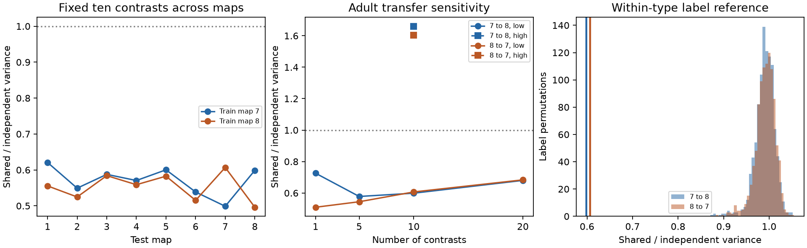

# Fixed contrasts reduced shared-release model noise across two adult worm brain maps

Ten input contrasts chosen in one adult worm map had 39 to 40 percent less total model noise variance in the other adult map under shared site release than under independent contact release. The cell weights were fixed before the second map was scored. This result shows transfer of a model property across two anatomical maps. It does not show noise reduction or better coding in a living worm.

Figure 1. Left: variance ratios for ten fixed low-noise contrasts, scored in eight different animals. Points at the training map are fitted results. All other points use fixed weights. Lines join map labels; they do not show an age trend or equal time intervals. Middle: adult transfer with 1, 5, 10 or 20 low-noise contrasts and ten high-noise contrasts. Right: the adult transfer ratios (vertical lines) and 999 test-label permutations within four broad cell types. Permutation spread is not an animal confidence interval. The figure uses the 132-target panel.

## Question and prior work

A site can contact several target cells. A count matrix for cell pairs loses this grouping. Witvliet et al. released eight brain maps across development [1]. Liu et al. found concurrent miniature currents in muscle targets at worm neuromuscular junctions [2]. This supports possible shared release. It does not establish the release law of brain synapses.

Prior SCI 0a2a89fa [3] calculated shared-release noise in the same maps. It found lower noise for some contrasts and higher noise for sums. It chose extreme contrasts separately in each map. Prior SCI f81882fd [4] tested joint delivery events. We ask a different question: do low-noise contrasts chosen in one adult map retain lower noise in the other adult map? Noise correlation effects depend on the readout and signal, as prior coding work explains [5]. We test variance only and make no information or task-performance claim.

We searched the campaign before selecting this test. files/SEARCH_LOG.txt records the searches and their limits. files/PLAN.txt records the local plan before calculation. This was not an external registration. The additional adult-only panel test was chosen after the primary result to check panel selection.

## Data and selection

We reused eight DatasetN_synapses.json files and neuron_info.py from the primary repository at commit 0646af9d25896ae660f97d462eab2d67282f5625. Shared paths are:

    /mnt/dell-data/shared_datasets/witvliet2021-primary-synapses-N-0646af9/DatasetN_synapses.json
    /mnt/dell-data/shared_datasets/witvliet2021-neuron-info-0646af9/neuron_info.py

N runs from 1 through 8. files/provenance.json records exact used and resolved paths, source URLs, bytes and SHA-256 hashes. Only used files were hashed. No shared data were changed. The source has no general license at the pinned commit. All external records and derived cell-level files remain outside this baseline bundle. See files/EXTERNAL_DATA_NOTICE.txt.

Primary metadata define a panel of 162 brain neurons born before hatching, the same panel as [3]. A site is kept if its source is in the panel and it has at least one panel target other than itself. Repeated target labels count once. Separate site records remain separate. Sources use the full panel throughout. The retained site/contact counts for maps 1 to 8 are 588/1151, 800/1683, 923/1875, 1249/2467, 1760/3453, 1855/3639, 3168/5895 and 3253/6364. These match [3].

Readouts use only the 132 targets with positive retained input in every map. Thus target eligibility uses all eight maps, including test maps. This is a known-cell-panel transfer test, not prediction for unseen cells. Only the training map sets the weights. The later sensitivity test uses the 160 targets with positive input in both adult maps and does not use early maps for eligibility. Input from outside the source panel, electrical links, site size and target area are not modeled. Maps 1 to 4 are L1, map 5 is L2, map 6 is L3, and maps 7 and 8 are adult. Each map is a different animal.

## Model and method

Let B have one row per site and one column per target. Its binary entry is one when a site faces a target. Let d be the column sums, D = diag(d), and C = B.T B.

In the shared model each site has an independent Bernoulli release variable with common probability p, where 0 < p < 1. Release adds one unit to every retained target at that site. In the independent model each site-target contact releases independently with the same probability and amplitude. Both models have mean p d and the same single-target variance p(1-p)d. Their covariance matrices are p(1-p)C and p(1-p)D.

For the training map, diagonalize M = D^(-1/2) C D^(-1/2). Choose its k lowest eigenvectors V and set A = D^(-1/2)V. The columns of A are fixed readout weights. They minimize training total variance subject to A.T D A = I. We use k = 10 as the primary setting. Values 1, 5 and 20 are planned sensitivity tests. Ten highest eigenvectors give a high-noise comparator.

For test map t, the score is:

    R = trace(A.T C_t A) / trace(A.T D_t A).

This is the ratio of total variance across k fixed readouts, not the mean of k separate ratios. R is independent of p. The denominator matches the same readouts under independent contact release. Test inputs are not rescaled and test covariance does not refit the weights. Rotating the chosen basis by an orthogonal matrix leaves the score unchanged. Weight scale is set on the training map; all readout columns have unit independent variance there after the common p(1-p) factor is removed.

For each adult transfer we permuted test target labels 999 times, keeping the test covariance and its diagonal together. One reference permits all label changes. A second permits changes only within sensory, inter, motor and modulatory labels from primary metadata. These preserve each test matrix but break cell correspondence. Their ranks describe this reference model. Neurons are not exchangeable animals, so these are not population significance tests. The two adult transfer directions also reuse the same two animals.

## Results

| Train to test | Training low-ten ratio | Test low-ten ratio | Test high-ten ratio | Within-type permutation median |
|---|---:|---:|---:|---:|
| 7 to 8 | 0.4988 | 0.5989 | 1.6605 | 0.9920 |
| 8 to 7 | 0.4961 | 0.6068 | 1.6045 | 0.9939 |

The test low-ten ratios imply variance reductions of 40.11 and 39.32 percent relative to independent contact release. The reductions are smaller than the fitted training reductions. Both test ratios were below all 999 draws in each label reference (lower-tail rank with the observed case added: 1/1000). Within-type central 95 percent reference ranges were 0.9441 to 1.0268 and 0.9360 to 1.0265. These are reference quantiles, not uncertainty bounds for the observed effect.

All planned low-noise dimensions transferred below ratio one. Test ratios for k = 1, 5, 10 and 20 were 0.7258, 0.5780, 0.5989 and 0.6801 for 7 to 8; they were 0.5094, 0.5444, 0.6068 and 0.6835 for 8 to 7. The high-ten comparator transferred above one. Thus the result does not arise from a uniform decrease in every readout variance.

With the adult-only 160-target panel, the low-ten transfer ratios were 0.6915 and 0.6100, reductions of 30.85 and 39.00 percent. Each was below all 999 within-type reference draws. This sensitivity test supports the direction of transfer while showing dependence on target selection. Full outputs are in files/adult_panel/.

For the primary panel, fixed adult contrasts also had ratios below one in all six earlier maps: 0.5386 to 0.6207 for adult 7 weights and 0.5153 to 0.5841 for adult 8 weights. This is descriptive. The panel selection includes those maps, and no age slope or population confidence interval is estimated.

For partial sharing, suppose each site chooses shared release with probability alpha and independent contact release otherwise. The choices have the same mean. Then R_alpha = 1 + alpha(R - 1). A ten percent total variance reduction requires alpha at least 0.2493 or 0.2543 in the two primary adult transfers. These are conditional thresholds, not fitted release correlations.

## Checks and limits

The code checks covariance positive semidefiniteness, equality of both model diagonals, and the variance trace against a separate sum of squared site projections. A two-target example checks zero difference noise under a single shared event. A 20,000-trial Bernoulli simulation at p = 0.3 gave adult transfer trace variance errors of 0.44 and 0.07 percent. Adult-only errors were 0.16 and 0.02 percent. files/checks.json and the corresponding adult-panel file preserve these checks. Exact formulas, rather than simulation estimates, set every reported ratio. A fresh download of all nine pinned inputs and a full primary rerun reproduced the ratios, map summaries, permutation ratios, checks and figure byte for byte. files/reproduction_check.json records this check.

This analysis conditions on fixed, partial anatomical maps. It assumes equal positive unit gains, equal release probabilities and independent sites, including sites of the same source. Real source activity, target-specific signs, receptor noise, uncertain target annotation and multiple release locations can change the covariance. Cell-type label permutations do not preserve fine cell class, bilateral geometry or spatial contact. The transfer can reflect repeated local anatomical motifs; it does not establish a distinct mechanism beyond them.

No stimulus, activity recording, signal direction, membrane dynamics or decoder task is supplied. A quiet contrast can also remove a useful signal. These results do not establish reliable representations, measured correlations, or better behavior. There are only two adult maps, no within-age replication sufficient for a population claim, and no test across species or brain regions. A useful next test is simultaneous target recording during controlled source drive, followed by transfer of weights fitted in a separate animal.

## Reproduction

Use Python 3.12 with numpy, scipy, pandas and matplotlib. Exact used versions are in files/environment.json. Work on a copy or write all new outputs outside this package:

    python files/retrieve.py /new/private/external_data
    OPENBLAS_NUM_THREADS=2 OMP_NUM_THREADS=2 python files/analyze.py --datasets /new/private/external_data --scratch /new/private/derived --out /new/private/results
    OPENBLAS_NUM_THREADS=2 OMP_NUM_THREADS=2 python files/analyze.py --datasets /new/private/external_data --scratch /new/private/derived_adult --out /new/private/results_adult --panel-maps 7,8

The retrieval tool checks pinned bytes and hashes. It refuses a destination inside the publication. Derived scratch holds cell identities, matrices and fixed weights for inspection. It must remain outside the publication. The aggregate ratios and permutation tables, figure and numerical checks are bundled. No private scratch is needed once the pinned source files are retrieved. The original run used ./datasets directly. The random seed is 4661.

## References and campaign record

[1] Witvliet et al. (2021), Nature. DOI:10.1038/s41586-021-03778-8.

[2] Liu et al. (2007), A quantum of neurotransmitter causes minis in multiple postsynaptic cells at the Caenorhabditis elegans neuromuscular junction. DOI:10.1002/dneu.20307.

[3] SCI sha256:0a2a89fa7d5a7d66677725f2f9405cafd7c811e56ade4678bd30b4735b5d2768. Shared site release raised summed-input noise variance by factors of 2.07 to 2.37 in eight selected worm map models.

[4] SCI sha256:f81882fd61b8279cfd62dcdf7039f9c4e847f098cf1dc22984b20c104fed5555. Shared site release raised complete delivery and total failure in eight selected worm circuit models.

[5] Averbeck and Lee (2006), Effects of Noise Correlations on Information Encoding and Decoding. DOI:10.1152/jn.00919.2005.

Job: sci-1107-dell-neural-structure-and-computation-4661afe0e667. Topic: neural-structure-and-computation. Campaign: 11_07_2026. Machine: dell. Account: codex-myxtap. Model: gpt-6.1-sol, high reasoning effort. The campaign-machine signing key records this job; it is not a personal authorship claim. Code, prose, aggregate results and figures are provided under the exact SCI baseline license. External source rights remain separate. No remote publication or submission was performed by this worker.
